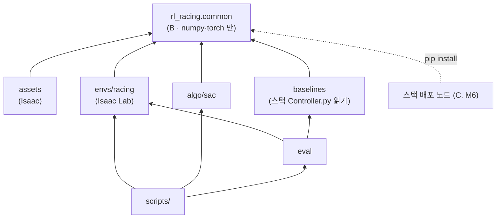
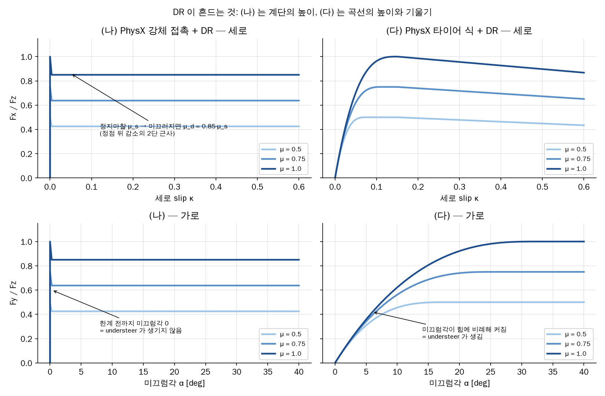
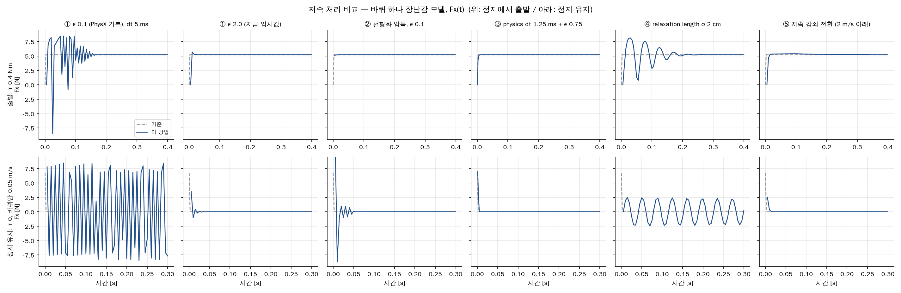
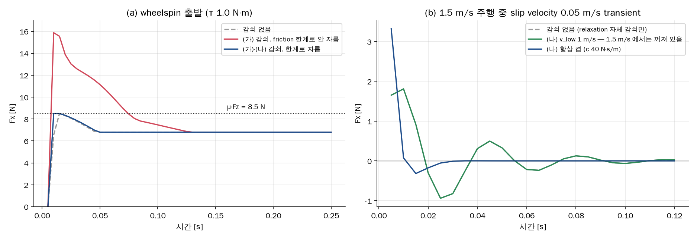

# rl-racing 구조

> [!abstract] 한 줄
> 코드를 **A(학습 전용) · B(sim·실차 공유)** 로 나누고, B 를 `rl_racing/common/` 한 곳에 둔다.
> 의존은 **한 방향** — 모든 것이 `common` 을 import 하고, `common` 은 아무것도 import 하지 않는다.

> [!info] 위치
> [[공유 인터페이스 (sim ↔ real)]] §0 의 A/B/C 분리를 디렉터리로 옮긴 것. 결정 #19(별도 repo) 의 구현.

---

## 0. 원칙 4개

| # | 원칙 | 이유 |
|---|---|---|
| 1 | **의존은 한 방향.** `common` ← `assets`·`envs`·`algo`·`baselines`·`eval`·`scripts` | B 가 학습 코드에 끌려가면 실차에 Isaac 이 따라간다 |
| 2 | **`common` 은 ROS·Isaac import 금지.** numpy·torch 만. Python **3.10 문법까지** | 실차(NUC/Mac)에서 같은 코드가 돈다. 차량 컴퓨터의 Python 버전은 **모른다** — 3.10 은 "어느 쪽이든 돌게" 잡은 안전한 하한 |
| 3 | **스펙은 코드 한 곳.** 차량 상수·obs 순서/정규화·action 규약·npz 스키마 | 두 곳에 있으면 언젠가 어긋나고, 그게 reality gap 이다 |
| 4 | **볼트는 노트만.** 코드는 전부 여기 | 사용자 요청 (#19) |

---

## 1. 디렉터리

```
rl-racing/
├─ pyproject.toml             패키지 rl_racing. 의존 numpy, torch
│                             extras: [dev] pytest·ruff  /  Isaac 은 컨테이너가 제공 (pip 의존에 안 넣음)
├─ README.md
│
├─ rl_racing/
│  ├─ common/                 ★ B — sim·실차 공유.  ROS·Isaac 금지.  py3.10
│  │  ├─ vehicle.py           차량 상수 단일 출처  (L=0.33, δ_max, κ_max, v_max …)
│  │  ├─ track_data.py        reference path 스키마 — 필드·버전·검증, npz 저장/로드
│  │  ├─ frenet.py            FrenetTrack · FrenetTracker        ← tools/frenet_gpu.py
│  │  ├─ base_policy.py       순수 PP (조향만)                    신규
│  │  ├─ action.py            tanh 출력 → (κ, a_x) → δ, governor  신규
│  │  └─ observation.py       actor obs 스펙 + 조립 + spec_hash   신규
│  │
│  ├─ assets/                 A — 차량·트랙 생성 (Isaac 필요)
│  │  ├─ urdf_gen.py                                              ← tools/gen_racecar_urdf.py
│  │  ├─ racecar_cfg.py                                           ← tools/racecar_cfg.py
│  │  └─ track_gen.py                                             ← tools/gen_track.py
│  │
│  ├─ envs/racing/            A — Isaac Lab DirectRLEnv            신규
│  │  ├─ env.py · env_cfg.py
│  │  ├─ reward.py            프로젝트 스택 §10-4
│  │  ├─ critic_obs.py        privileged — μ, v_cap, 실제 벽 거리 …
│  │  ├─ randomization.py     μ, v_cap …
│  │  └─ path_variation.py    d_ref(s) 생성 — 오프셋·경로 교체 (#22)
│  │
│  ├─ algo/                   A — SAC                              신규 (§7 결정 2)
│  │  └─ sac.py               비대칭 critic, head 별 초기화
│  │
│  ├─ baselines/              A — 비교군
│  │  ├─ stack_controller.py  스택 Controller.py 스텁 주입 + 리셋   ← tools/test_controller_adapter.py 의 어댑터 부분
│  │  └─ speed_profile.py     실험 ② 전용 forward/backward pass    인터페이스 §7
│  │
│  └─ eval/                   A — μ 스윕 실행, 지표(랩타임·RMS e_d), 그림
│
├─ scripts/                   진입점만. 로직은 rl_racing/ 안에
│  ├─ train.py · eval_sweep.py · gen_track.py · build_racecar_usd.sh
│  ├─ export_policy.py        M6
│  └─ tools/                  inspect_usd · usd_to_glb · export_usd_portable
│                             measure_gpu_budget · validate_drive (← test_racecar_drive)
│
├─ tests/
│  ├─ test_frenet.py                                              ← tools/test_frenet_gpu.py
│  ├─ test_stack_controller.py   회귀: reset 후 결정성              ← test_controller_adapter.py 의 검사 부분
│  ├─ test_base_policy.py · test_action.py · test_observation.py
│  └─ isaac/                  @pytest.mark.isaac — 컨테이너에서만
│
├─ docker/                    Dockerfile (← ML 서버 노트 §4 본문을 파일로), run.sh,
│                             setup_isaaclab.sh · fix_isaaclab_deps.sh · check_isaac_env.sh · verify_isaaclab.py
├─ maps/<name>/global_waypoints.json      입력만 복사, 출처 스택 커밋 기록 (§7 결정 4)
└─ build/                     .gitignore — *.usd, *.npz, 체크포인트, 로그
```

---

## 2. 의존 그래프



`common` 에서 나가는 화살표는 **없다.** 테스트로 강제한다 (`common` 안에서 `isaaclab`·`pxr`·`rclpy` import 시 실패).

---

## 3. B(`common`) 공개 API — 시그니처 수준

> 코드가 아니라 **약속**이다. 구현 전에 이 표가 합의돼야 한다.

| 모듈 | 공개 이름 | 비고 |
|---|---|---|
| `vehicle` | `VEHICLE` (frozen dataclass) | `wheelbase=0.33` 단일값. URDF 생성기도 여기서 읽는다 → 0.33 vs 0.3302 이중값 해소 |
| `track_data` | `RefPath` (배열 묶음) · `load_npz` · `save_npz` · `validate` | **스키마 버전 필드**. 균일 격자 검사가 여기로 이동 |
| `frenet` | `FrenetTrack.from_npz(path)` · **`FrenetTrack.from_arrays(...)`** · `FrenetTracker` | ★ 실차에는 npz 가 없다 — 스택이 발행하는 global raceline 배열로 만든다. 그래서 `from_arrays` 가 1급이다 |
| `base_policy` | `pure_pp(frenet_out, preview, v, cfg) -> kappa_pp` | (B,) 배치. 조향만 |
| `action` | `compose(tanh_out, kappa_pp) -> (delta, a_x)` · `governor(a_x, v, v_lim, k_g)` | residual 합성은 **여기**에서 한다 → 알고리즘은 residual 을 모른다 |
| `observation` | `ACTOR_OBS_SPEC` · `build_actor_obs(...) -> (B, D)` · `spec_hash()` | 이름·순서·차원·스케일을 **선언**으로. critic obs 는 A 쪽(`envs/critic_obs.py`) |

`d_ref(s)` 는 `common` 이 **만들지 않는다.** sim 에서는 `envs/path_variation.py` 가, 실차에서는 스택 local waypoint 의 `d_m` 이 준다.
`common` 은 s 격자 위의 배열로 받기만 한다.

---

## 4. sim2real 가드 — `spec_hash`

export 할 때 policy 파일 메타데이터에 **`spec_hash`**(obs 스펙 + action 규약 + 차량 상수의 해시)를 넣는다.
실차 노드는 기동 시 자기 쪽 `rl_racing.common.spec_hash()` 와 비교하고 **다르면 실행을 거부**한다.

> "B 가 두 벌이 되는" 사고를 **주행 전에** 잡는다. 순서 하나, 스케일 하나 어긋나도 policy 는
> 조용히 다른 함수를 계산한다 — 로그로는 거의 못 찾는다.

---

## 5. 실차 컴퓨터 — NUC 또는 Mac (2026-09-29 정정)

이전 노트의 **Jetson Orin Nano / TensorRT 는 틀렸다.** 정정 결과:

- **TensorRT 불필요.** policy(2×256 MLP)는 CPU 추론으로 충분하다
- **B 는 torch 로 쓰고 실차도 torch CPU 로 같은 코드를 돈다** — 구현이 물리적으로 한 벌
- 배포 형태(torch 직접 vs ONNX Runtime)는 **M6 에 결정.** 지금은 B 를 순수 함수로, 가능한 한 ONNX export 가 되는 형태로 써 두면 둘 다 열려 있다
- ⏳ 확인 필요: 차량 컴퓨터의 **OS · ROS 2 배포판 · Python 버전** — **현재 모른다** (2026-10-06 사용자 확인).
  작업 PC(CLI 를 돌린 기계, ROS 2 Jazzy · Ubuntu 24.04 · Python 3.12)와는 **다른 구성**이다. 작업 PC 기준으로 추정하지 않는다.
  **Mac 이면 ROS 2 를 어떻게 돌리는지**(네이티브 / Docker·VM)가 배포 형태를 바꾼다

---

## 6. 이전 계획

| 단계 | 대상 | 검증 위치 |
|---|---|---|
| **1차** | 골격(pyproject·README·.gitignore) · `common/{vehicle, track_data, frenet}` · `tests/test_frenet` · `baselines/stack_controller` + 회귀 테스트 · `docker/` · `maps/` | **Isaac 없이** — 이 세션에서 pytest 로 |
| **2차** | `assets/*` · `scripts/gen_track.py` · `scripts/build_racecar_usd.sh` · `scripts/tools/*` | Isaac 컨테이너 (사용자 실행) |
| **3차** | `common/{base_policy, action, observation}` · `envs/racing` · `algo/sac` · `eval` | 신규 작성 — 각각 구조 합의 후 |

이전이 끝나면 볼트의 `tools/`, `run.sh`, `urdf/`, `f1tenth_URDF/` 를 지우고 노트의 `tools/…` 경로(17곳)를 `rl-racing/…` 로 바꾼다.

> [!warning] 이전은 "복사 + 이름 변경"만 한다
> 1·2차에서 로직을 고치지 않는다. 고칠 것이 보이면 **따로 적고** 이전을 끝낸 뒤 별도 커밋으로.
> 그래야 "옮기다 깨졌나, 고치다 깨졌나"가 갈린다. 1차의 frenet 테스트 수치가 이전 전과 **똑같아야** 한다.

---

## 7. 결정 — ✅ 전부 권고대로 확정 (2026-09-29)

| # | 질문 | 권고 | 근거 |
|---|---|---|---|
| 1 | **Tier 1(f1tenth_gym)을 구조에 넣을까** | ✅ **넣지 않는다** | 아래 |
| 2 | SAC 를 직접 쓸까, skrl 을 쓸까 | ✅ **직접** (CleanRL 계열 단일 파일) | 아래 |
| 3 | 볼트의 코드 삭제 + 노트 경로 갱신 | ✅ 예 (전체 이전 완료 후) | 원칙 4 |
| 4 | 맵은 `global_waypoints.json` 만 복사 | ✅ 예 | `gen_track` 이 쓰는 입력은 이것뿐. pgm/png 는 불필요 |

### 결정 1 — Tier 1 을 빼자는 근거 (이전 권고를 뒤집는다)

[[ML 서버 · Isaac Sim 환경]] §9 에서 나는 **"Tier 1 을 버리지 말 것"** 을 권했다. 근거는 *"Isaac Lab 환경을 만드는
수 주 동안 아무 학습도 못 한다"* 였다. 지금은 사정이 다르다:

- 수 주의 대부분이던 **자산 작업이 끝났다** — URDF→USD 검증, 트랙 USD, 주행·마찰 포화 실측, Frenet projector, 비교군 어댑터. 남은 건 DirectRLEnv 포장
- **연구 질문(μ 스윕)은 Isaac 에서만 의미가 있다** — f1tenth_gym 은 선형 타이어라 포화가 없고(§8-5-1), 포화는 PhysX 에서 실측했다(§8-5-2)
- f1tenth_gym 의 action 은 **(조향, 속도)** 라 우리 **(κ, a_x)** 와 의미가 다르다 → 어댑터 + 두 벌의 동역학 → 그 차이가 또 하나의 gap

필요해지면 `envs/` 아래에 추가할 수 있게 `common` 은 시뮬레이터를 모른다 — 그걸로 충분하다.

### 결정 2 — SAC 를 직접 쓰자는 근거

알고리즘 쪽 요구는 두 개다: **비대칭 critic**(critic 만 privileged obs), **head 별 초기화**(조향 0 / 가속 bias 양수, #21).
residual 합성은 `common/action.py` 에서 하므로 알고리즘은 residual 을 모른다.

- 직접: 두 요구를 **확실히** 넣을 수 있고, 로드맵의 CleanRL `sac_continuous_action.py` 읽기 계획과 맞물린다 — 읽은 코드를 고쳐 쓰게 된다
- skrl: 설치·검증은 끝났고 시간을 아낀다. 단 **SAC 에서 비대칭 critic 입력을 지원하는지 확인하지 못했다** ⏳

학습 목적(내부를 이해)과 디버깅 가시성 때문에 직접을 권하지만, **skrl 이 둘을 지원한다면 합리적인 대안**이다.

---

## 8. 진행 방식 (2026-09-29 확정)

- **브랜치**: `main` 은 빈 init 커밋만 두고, 작업은 **`dev`** 에서 한다. 단계가 검증되고 **사용자가 확인한 뒤** `main` 으로 합친다
- **1차 이전은 Claude Code CLI 로 수행**한다 (이 원격 세션이 아니라). 커밋 C1 골격 → C2 복사 → C3 구조 변경 → C4 비교군
- **이전 중 발견한 흠은 고치지 않고 보고만** 한다. 이전 완료 후 사용자에게 다시 묻는다.

### 8-1. 1차 이전 결과 (2026-10-06, CLI 보고)

| | 해시 | 내용 |
|---|---|---|
| init | `01770fa` | main — 빈 커밋 (**원격에 있음**) |
| C1 | `9f72c17` | 골격 + common 경계 테스트 |
| C2 | `1182484` | 복사 — frenet·리포트·맵 + 판정 테스트 |
| C3 | `42e60c1` | vehicle·track_data 분리, FrenetTrack 은 RefPath 를 받는다 |
| C4 | `ec3e737` | 비교군 어댑터 + 리셋 회귀 테스트 |

✅ **main 병합 완료 (2026-10-06)** — `22be25a` (`--no-ff`, C1~C4 를 묶은 병합 커밋). 병합 결과에서 pytest 70 passed.
`dev` 도 `22be25a` 로 맞췄다.

> [!warning] 사용자 셸 환경 — 흠 12 실재 확인
> 첫 실행에서 시스템 pytest(`/usr/lib/python3/dist-packages`)가 잡혀 torch 가 없었고,
> ROS 2 **Jazzy** 의 `launch_testing` pytest 플러그인이 `pytest_pycollect_makemodule` 에서 테스트 모듈을 따로 import 하며 끼어들었다.
> 해결: venv 활성화 + `PYTEST_DISABLE_PLUGIN_AUTOLOAD=1 python -m pytest -q`.
> 이 기계는 **작업 PC** 다 (ROS 2 Jazzy · Ubuntu 24.04 · Python 3.12). 차량 컴퓨터와는 다른 구성이고, 차량 컴퓨터 설정은 아직 모른다.

| 검증 | 결과 |
|---|---|
| 0단계 기준선 | 노트 수치와 일치 (npz 24,302 B, 3a 3.25e-05, adapter 2.911 m/s 등) |
| frenet 리포트 (C2·C3) | 처리량 제외 **바이트 동일** |
| npz 비트 비교 (C3) | 두 맵 16 키 전부 `array_equal` + dtype 일치. 추가 키 `schema_version` 뿐 |
| adapter 리포트 (C4) | raw diff **비어 있음** |
| pytest | 70 passed (스택 있음) / 61 passed + 9 skipped (없음). 커밋별 worktree 재검증 |
| 돌연변이 3개 | `heading_error_integral` 제거는 **정적 검사(4번)만** 잡는다 — KI=0 이라 동작 테스트로는 안 보인다. 완전성 테스트의 필요성이 실측으로 확인됨 |

지시 이탈 3개 (전부 수용): frenet docstring 사용 예 3줄, `local_window` 의 입력 접근자, ruff per-file-ignores.

### 8-2. 흠 목록 — 12개 (⏳ 사용자 결정 대기)

| # | 흠 | 성격 |
|---|---|---|
| 1 | frenet docstring "전역 argmin 은 쓸 수 없다" — 낡은 문장 | 문서 |
| 2 | `preview_horizon` 0.5 m 과장 | 값 |
| 3 | 외적 = 0 이면 `d = 0` — **크기까지 0** (u 가 clamp 된 경우 실제 거리 ≠ 0 이어도). 합성 정사각 트랙에서 0.5 m 이탈점이 `d = 0`, `at_edge = False`. 실제 두 맵 0 건 | **B 정확성** |
| 4 | preview 설정이 트랙 데이터(npz)에 있음 | 설계 → 3차 |
| 5 | wheelbase 0.33 vs 0.3302 | 설계 → 2차 |
| 6 | 끝점 중복 없는 입력에서 lap/ds 오류 → `from_arrays` 가 `validate()` 에서 ValueError (ds 0.24% 오차 > 문턱 0.1%). **실차 입구가 닫혀 있다** (조용히 틀리지는 않음) | **B 정확성** |
| 7 | npz float32 스칼라 때문에 sim·실차의 ds·lap 이 3e-8 다르다 | 설계 → spec_hash (3차) |
| 8 | `cur_state_speed` 가 `__init__` 에도 리셋 목록에도 없다 | 비교군 |
| 9 | `FrenetTracker` 의 미사용 변수 `N` | 정리 |
| 10 | yaml 파싱에서 파일을 닫지 않음 | 정리 |
| 11 | `save_npz` 의 `schema_version` 정책 미정 | 설계 (작음) |
| 12 | ROS 를 source 한 셸에서 pytest 가 죽는다 | 환경 → 실차(NUC, ROS) 대비 |

**결정 (2026-10-06)**: `dev` push 완료 → **1차를 main 에 병합한 뒤** 흠을 고친다 (CLI).
지금 고칠 것 **1·2·3·6·8·9·10·11·12**, 미룰 것 **4(3차)·5(2차)·7(3차 spec_hash)**.

> [!warning] 흠 3 의 수정 방법 — `torch.where(cross >= 0, 1, −1)` 은 **틀린 수정**이다
> 크기는 살리지만 부호를 무조건 왼쪽으로 정해서, 좌회전 코너 바깥(오른쪽)에서 부호가 뒤집힌다.
> 외적이 0 이 되는 것은 최근접점이 **꼭짓점에 clamp 됐을 때**뿐이다 (`0<u<1` 이면 cross=0 ⇔ 경로 위).
> 그때는 꼭짓점 양쪽 선분 법선의 합(**이등분 법선**)과 `rel` 의 내적으로 좌우를 정한다.
> 또 이전 설명에서 "크기는 맞고 부호만 0" 이라 한 것도 틀렸다 — `√d² × sign(0)` 이라 크기까지 0 이다.

> [!note] 흠 6 의 불변식
> N 개 점의 폐루프 → 선분 N 개, `lap = N·ds`. 끝점 중복이 있든 없든 **같은 RefPath** 가 나와야 한다.
> 끝점 중복 경로(두 맵)는 지금과 **비트 단위로 같아야** 한다.


### 8-3. 흠 수정 결과 (2026-10-06, CLI) — dev 에 6개 커밋, 95 passed

| 커밋 | 고친 문제 (쉬운 말로) |
|---|---|
| `c4189db` | **횡오차가 0 으로 잘못 나오던 문제** — 차가 경로 꼭짓점에서 들어오는 선분의 연장선 위에 있으면 0.5 m 벗어나도 `d = 0`. 이등분 법선으로 좌우를 판정하게 고침 |
| `a1789e7` | **끝점 중복이 없는 경로 데이터를 거부하던 문제** — 랩 길이 나눗셈이 `N−1` 이라 간격이 0.24% 틀려 검사에서 떨어졌다. `N` 으로 통일. 닫히지 않은 곡선은 명확히 거부 |
| `a1ed7c2` | **preview 거리 0.5 m 과장**(20.0 → 19.5 m), 실측과 안 맞던 설명문, 안 쓰는 변수 정리 |
| `07507de` | **옛 버전 파일을 다시 저장하면 버전 번호가 0 으로 남던 문제** — 저장은 항상 현재 버전 |
| `006b43b` | **스택 컨트롤러 리셋에서 `cur_state_speed` 가 안 지워지던 문제**, yaml 파일을 안 닫던 문제 |
| `01f13d4` | **ROS 2 셸에서 pytest 가 죽는 문제** 문서화 — 가상환경 + `PYTEST_DISABLE_PLUGIN_AUTOLOAD=1` + `python -m pytest` **세 가지 모두** 필요 (하나라도 빠지면 torch 또는 yaml 에러) |

검증: 실제 두 맵의 트랙 데이터는 매 커밋 원본과 비트 단위 동일 / frenet 리포트는 지평선 줄과 처리 시간만 변경 /
스택 컨트롤러 리포트는 한 글자도 안 바뀜. 미룬 것 그대로: preview 설정 위치(3단계), wheelbase 0.33 vs 0.3302(2단계), float32 저장 오차와 spec_hash(3단계).

**diff 검토에서 찾은 작은 것 2개** (병합을 막을 정도는 아님):
1. `frenet.py` 지평선 주석 *"n·stride·ds 는 ds 하나만큼 과장"* — 실제로는 **preview 한 칸(stride·ds = 0.5 m)** 만큼이다. 값은 맞고 주석만 틀림
2. 끝점 판정이 "거리 < 1e-6 m 면 중복" 이고, 닫는 선분 검사는 "ds 의 3배 초과면 에러" **상한만** 있다.
   마지막 점이 첫 점과 **거의** 겹치는데 1e-6 m 보다 조금 먼 입력(예: 다른 프로그램을 거치며 반올림된 좌표)은
   중복으로 안 잡히고 **길이 ≈ 0 인 선분**이 하나 생긴 채 통과한다. 하한 검사(예: 0.5·ds 미만이면 에러)를 권장.
   스택의 waypoint 메시지는 float64 라 지금 데이터에서는 안 생긴다

**→ 2026-10-06 수정 완료 (dev, `f85dd3d`·`cc81fe1`, 97 passed).** 주석 정정, 그리고 끝점 거리를 네 구간으로 판정:
같은 점(간격의 0.1% 미만, 좌표 반올림 수준) / 애매하게 가까움(간격 절반 미만 → 에러) / 정상 닫는 선분(간격의 0.5~3배) / 닫히지 않은 곡선(3배 초과 → 에러).
실제 두 맵은 비트 단위 그대로, 두 리포트도 처리 시간 줄 외 변화 없음.
남은 사소한 것: 설명문이 "세 구간" 이라 적고 네 개를 나열한다 / 점이 1개뿐인 입력이면 평균 간격 계산에서 0 으로 나눈다 (폐곡선은 점 3개 이상이 필요하니 시작에서 거부하면 된다).

**→ 사용자가 main 에 병합 (`d6111a8`).** 이후 병합용 스크립트를 dev 에 추가 (`9971a25`, 아직 main 에는 없음):
`scripts/merge_dev_to_main.sh -m "병합 메시지"` 한 줄이 원격 가져오기 → `--no-ff` 병합 → pytest·ruff → (확인 후) main push → dev 를 main 에 맞추기 를 한다.
충돌·테스트 실패·취소 중 하나라도 생기면 로컬 main 을 병합 전으로 되돌리고 아무것도 push 하지 않는다 (임시 저장소에서 7가지 경우 확인).


### 8-4. ML 서버 작업공간 (2026-10-06 확정)

지금 `~/rl-racing` 은 9월에 만든 **git 이 아닌 작업 폴더**이고, 새 GitHub 저장소와 이름이 겹친다. 아래로 바꾼다.

```
~/rl-racing/              ← git clone (dev)                  → 컨테이너 /workspace
   build/                 ← 산출물 (.gitignore): USD, npz, glb, 로그, 체크포인트
~/rl-racing-old/          ← 지금 폴더를 이름만 바꿔 보관      → 컨테이너 /old (읽기 전용)
                             2차 이전의 비교 기준. 검증이 끝나면 삭제
~/.cache/isaac/…          ← 그대로
이미지 isaac-rl:<user>     ← Isaac Sim + (3단계에서) Isaac Lab v2.3.2
```

| 결정 | 내용 | 이유 |
|---|---|---|
| 컨테이너 `/workspace` = git 저장소 | 서버의 코드는 언제나 `dev` 브랜치의 코드 | 볼트 사본을 거쳐 손으로 복사하다 버전이 어긋나는 일을 없앤다 |
| 옛 폴더는 읽기 전용으로 붙인다 | `/old` | 비교 기준을 새 코드가 실수로 덮어쓰지 못하게 |
| **Isaac Lab 을 이미지에 넣는다** | v2.3.2 고정 + 의존성 정리까지 Dockerfile 에서 | 우리가 고치는 코드가 아니므로 재빌드 부담이 없다. 컨테이너를 켜면 바로 쓸 수 있고, 의존성 문제는 빌드 실패로 크게 드러난다. 9월에 `--rm` 컨테이너에서 설치가 어떻게 유지됐는지는 사용자도 기억하지 못한다 |
| **CLI 는 작업 PC 에서만** | CLI 가 코드를 쓰고 `dev` 에 push → 사용자가 서버에서 pull 후 컨테이너에서 실행 → 로그를 붙여 넣는다 | 서버에 Claude Code CLI 설치가 어렵다 |
| 서버는 **pull 만** 한다 | 서버에서 커밋하지 않는다. 인증은 **읽기 전용 deploy key** | 저장소가 private 이고, 서버 홈 폴더(`drwxr-xr-x`)를 다른 사용자도 읽을 수 있다. 개인 토큰을 평문으로 두지 않는다 |

**순서 — 환경과 코드를 동시에 바꾸지 않는다** (이전 원칙 「옮기기와 고치기를 섞지 않는다」를 환경에도 적용):
1. 폴더 이름 변경 · clone · `run.sh` 연결 경로 수정. **이미지는 지금 것 그대로**
2. 2차 이전 (Isaac 이 필요한 스크립트) → 지금 이미지에서 옛 산출물과 대조
3. Dockerfile 수정(노트 버전: `OMNI_KIT_ALLOW_ROOT`, `libxt6`, `torchaudio`) + Isaac Lab 포함 → 재빌드 → 다시 검증

**서버 상태 확인 결과 (2026-10-06):**

| 항목 | 결과 | 뜻 |
|---|---|---|
| `run.sh`·`tools/*` 해시 | 볼트와 **전부 같다** (`test_controller_adapter.py` 만 서버에 없음 — 1차, 작업 PC 용) | 2차 이전의 출발점 = 볼트의 `tools/` |
| Isaac Lab | `v2.3.2`, 수정한 파일 없음 | 공식 태그 그대로 |
| 이미지 | `isaac-rl:hyeonggyun` 하나뿐 (`docker commit` 해 둔 것 없음) | |
| 새 컨테이너의 패키지 | torch 2.7.0+cu128, torchaudio 2.7.0, **isaaclab·skrl 없음**, **libxt6 없음** | 이미지는 서버의 Dockerfile 로 빌드됐다. **Isaac Lab 설치는 컨테이너가 꺼질 때 매번 사라졌다** |
| `vault/` | git remote 없음 (22 MB 사본) | 이전 후 삭제 |
| `unicorn_ws/` | `build install log src` — 빌드된 ROS 워크스페이스 (241 MB) | ⏳ 용도 확인 |

> [!warning] ⭐ 9월의 실행 환경은 이미 재현할 수 없다
> Isaac Lab 과 그 의존성은 컨테이너 안에서 `setup_isaaclab.sh` 로 설치됐고, 컨테이너가 지워질 때 함께 사라졌다.
> 그 스크립트는 버전을 고정하지 않은 패키지(warp-lang, trimesh 등)를 설치하므로 **지금 다시 돌리면 9월과 다른 버전이 깔린다.**
> → 「이미지는 그대로 두고 9월 산출물과 대조」 라는 위 순서의 전제가 성립하지 않는다. 아래로 수정 제안.

**수정 제안한 순서** (⏳ 사용자 확인 대기):
1. 작업공간 정리 — 이름 변경 · 9월 산출물을 읽기 전용 사본(`~/rl-racing-ref`)으로 보관 · deploy key · clone
2. **새 이미지 먼저** — Isaac Lab 포함 + 설치된 패키지 버전 목록(`pip freeze`)을 저장소에 기록해 다음부터는 같은 환경을 재현.
   검증: **옛 스크립트를 새 이미지에서** 돌려 9월 산출물과 대조 → 차이가 있으면 그건 순수하게 환경 탓
3. 2차 이전 — **옛 스크립트와 새 코드를 같은 새 이미지에서** 돌려 결과가 같아야 한다 → 차이가 있으면 그건 순수하게 이전 탓

한 번에 하나만 바뀐다는 원칙은 그대로이고, 비교의 고정점이 「9월 이미지」에서 「옛 스크립트」로 바뀐 것이다.

**→ 2026-10-06 사용자 동의. `unicorn_ws/` 는 안 쓴다 (옛 폴더째 나중에 삭제).**

**2단계(새 이미지) 확정 사항:**

| 항목 | 결정 |
|---|---|
| Dockerfile | **앞부분은 서버의 지금 파일을 한 글자도 바꾸지 않는다** — 빌드 캐시 재사용 + Isaac Sim 부분이 9월 이미지와 동일. 뒤에 `OMNI_KIT_ALLOW_ROOT`·`libxt6`·`VIRTUAL_ENV`·Isaac Lab v2.3.2(`/opt/IsaacLab`) 추가 |
| Isaac Lab 설치 | 9월에 검증된 `setup_isaaclab.sh`·`fix_isaaclab_deps.sh` 를 재사용. 바꾸는 것은 **실패 시 빌드 중단**, **GPU 기동 테스트 제외**(빌드 후 검증으로) 두 가지뿐 |
| 재현성 | 첫 빌드 후 `pip freeze` → 작업 PC 로 옮겨 `docker/constraints.txt` 로 커밋 → 다음 빌드부터 그 버전만 설치 |
| 이미지 이름 | **`rl-racing:isaac`** (버전 숫자 없음). 옛 `isaac-rl:hyeonggyun` 은 검증이 끝날 때까지 보존 |
| 검증 | ① 기동 ② 옛 스크립트로 만든 산출물 vs `~/rl-racing-ref` (URDF·npz·GLB 는 바이트, USD 는 내용) ③ μ 네 값의 가속도 vs §8-5-2 표, **차이 1% 이내**·마찰 포화(a/μg=1.00) 유지 |
| 범위 밖 | 코드 이전(3단계), 버전 변경, μ=1.0 토크 절반 수수께끼, 옛 이미지 삭제 |

**9월 산출물(`~/rl-racing-ref`, 31개 파일)의 출처 — 2026-10-06 확인:**

| 파일 | 만드는 옛 스크립트 | 비교 |
|---|---|---|
| `assets/racecar_physics.urdf` | `build_racecar_usd.sh` (안에서 `gen_racecar_urdf.py`) | 바이트. ⭐ **작업 PC(Isaac 없음)에서 다시 만들어도 같았다** (`d36853e7…`) |
| `assets/racecar.usd`, `configuration/*.usd` 4개, `config.yaml`, `.asset_hash` | `build_racecar_usd.sh` (안에서 Isaac Lab `convert_urdf.py`) | 바이트 → 다르면 내용 |
| `assets/racecar_{both,collision}.glb` | `build_racecar_usd.sh` (안에서 `usd_to_glb.py`) | 바이트 → 다르면 내용 |
| `assets/racecar_flat.{usda,usdc}` | `export_usd_portable.py` | 바이트 → 다르면 내용 |
| `assets/track.glb` | `usd_to_glb.py` 에 트랙 USD — **어느 맵·어느 옵션이었는지 기록 없음** | 후보 6개 중 해시가 맞는 것을 찾는다 |
| `maps/<맵>/track_<맵>.{npz,usd}` | `gen_track.py` (출력 기본값 = 맵 폴더) | npz 바이트. ⭐ **작업 PC 에서 usd-core + numpy 2.4 로 다시 만들어도 같았다**. usd 는 USD 라이브러리 버전이 다르면 바이트가 달라진다(같은 라이브러리로는 매번 같음) → 내용 비교 |
| `maps/` 의 나머지 14개 | 스택에서 복사한 입력 (`global_waypoints.json` 은 저장소 것과 해시 동일) | 옛 스크립트가 건드리지 않았는지만 확인 |

**새 이미지 빌드 결과 (2026-10-06, 서버):**

| 항목 | 결과 | 뜻 |
|---|---|---|
| Dockerfile 앞부분 검사 | 처음엔 멈춤 → 고친 뒤 통과 | 서버 파일 끝의 `CMD ["bash"]` (뒤에 줄바꿈 없음) 를 프롬프트에 옮겨 적다 빠뜨렸다. 검사 장치가 의도대로 잡았다 (`25b83ef`) |
| build cache | `CACHED` 6단계 | 앞부분(apt · venv · pip · Isaac Sim · torch · WORKDIR)이 전부 재사용됐다 → **Isaac Sim 부분은 9월 이미지와 바이트 단위로 같다** |
| Isaac Lab | `37ddf62` = 공식 `v2.3.2` 태그 커밋 (git ls-remote 로 확인) | |
| 빌드 중 확인 | ✅ 통과 | |
| 패키지 차이 (옛 이미지 대비) | 제거 0. 추가는 Isaac Lab 과 그 의존성. 버전 변경 6개: click · psutil · typing-extensions · starlette (설치 스크립트가 의도한 것), torchaudio `2.7.0 → 2.7.0+cu128` (cu128 판으로 재설치), **numpy `1.26.0 → 2.4.6`** | ⬇️ |

> [!warning] ⭐ numpy 가 2.x 로 올라갔다 — Isaac Lab v2.3.2 는 `numpy<2` 를 요구한다
> `fix_isaaclab_deps.sh` 는 `numpy<2` 를 설치한 **바로 다음 줄에** `onnx>=1.18.0` 을 따로 설치한다. 그 연쇄:
> ```
> onnx 1.23.2      → ml_dtypes>=0.5.4 를 요구 (상한 없음)
> ml_dtypes 0.6.0  → numpy>=2.0.0 을 요구        (2026-08-13 배포)
> → pip 가 numpy 를 2.4.6 으로 올린다. 패키지를 하나씩 설치하므로 앞의 numpy<2 가 막아 주지 못한다
> ```
> **9월에도 같았을 가능성이 높다** (2026-10-07 재빌드로 확인 — 중간에 한 번 반대로 정정했다가 되돌림).
> `TERM` 을 고쳐 공식 `isaaclab.sh --install` 이 실제로 돌게 해도(96초, 종료코드 0) **isaaclab 본체 설치가 실패**하고
> 대체 경로로 넘어간다. 원인은 isaaclab `setup.py` 의 `flatdict==4.0.1` — 소스로만 배포돼 빌드가 필요한데,
> 최신 setuptools 에는 `pkg_resources` 가 없어 빌드가 죽는다 (작업 PC 에서 재현: `No module named 'pkg_resources'`).
> isaaclab 설치는 의존성을 한꺼번에 풀기 때문에 flatdict 하나 때문에 isaaclab 전체가 안 깔리고, `numpy<2` 를 지켜 줄 것이 없다.
> `--install` 은 이 실패를 `find -exec` 안에서 해서 종료코드 0 을 낸다.
> 9월에도 사람이 터미널에서 `--install` 을 돌렸고 같은 실패 → 대체 경로였을 것이다 (설치 스크립트에 대체 경로와 flatdict 우회가 있는 것이 그 흔적).
> 재빌드 결과: `numpy==2.4.6`, `ml_dtypes==0.6.0`, `onnx==1.23.2`, `flatdict==4.1.0`(대체 경로가 깐 wheel 판)

> [!warning] 9월의 flatdict 우회(`PIP_CONSTRAINT` 로 `setuptools<82`)는 지금 pip 에서는 효과가 없다
> 작업 PC 실측 — flatdict 4.0.1 빌드:
> | pip | 방법 | 결과 |
> |---|---|---|
> | 26.2 | `PIP_CONSTRAINT=setuptools<82` | ❌ 같은 `pkg_resources` 오류 (새 pip 은 일반 constraint 를 빌드 환경에 적용하지 않는다) |
> | 26.2 | `PIP_BUILD_CONSTRAINT=setuptools<82` | ✅ 빌드됨 |
> | 24.0 | `PIP_CONSTRAINT=setuptools<82` | ✅ 빌드됨 |
> → 공식 설치를 성공시키려면(= Isaac Lab 이 의도한 `numpy<2` 환경) `--install` 단계에 `PIP_BUILD_CONSTRAINT` 를 걸면 된다.
> 9월과 다른 환경이 되므로 **지금 검증을 끝낸 뒤 변수 하나만 바꾸는 별도 단계**로 한다.
>
> 결정 (⏳): 검증은 **이대로** 한다 (9월과 같은 조건). `numpy<2` 로 맞출지는 버전 고정 목록을 만들 때
> **변수 하나만 바꾸는 별도 단계**로 판단한다 — 그때는 `onnx`/`ml_dtypes` 상한도 같이 걸어야 한다.
> 이것이 「버전을 기록하지 않으면 환경이 조용히 바뀐다」의 실례다.

> [!danger] ⭐ `isaaclab.sh` 는 터미널 설정(`TERM`) 없이 실행하면 아무것도 안 하고 즉시 죽는다 (2026-10-07)
> `isaaclab.sh` v2.3.2 의 13행 `set -e`, 16행 `tabs 4`. `tabs` 는 터미널 종류를 모르면 실패하고(`'ansi+tabs': unknown terminal type.`, 종료코드 1),
> `set -e` 때문에 스크립트가 거기서 끝난다. 작업 PC 에서 `env -u TERM tabs 4` 로 같은 메시지·종료코드를 재현했다.
> - `docker run -it` 는 `TERM=xterm` 을 넣어 주지만, 스크립트에서 쓰는 `-i` 만으로는 안 넣는다. `docker build` 의 `RUN` 에도 없다
> - 그래서 **빌드 중 `isaaclab.sh --install` 이 0.0초 만에 죽었다** (빌드 로그에서 「3. --install」과 「4. import 확인」의 시각이 같은 12.63초).
>   설치 스크립트는 종료코드를 일부러 보지 않는 구조라(9월 주석: 부분 실패가 묻히므로 import 로 확인) 조용히 대체 경로로 넘어갔다
> - `verify_env.sh` 의 기동 확인 두 개도 같은 이유로 실패했다
> - 9월에 문제가 없었던 이유: 사람이 `./run.sh bash` 로 터미널을 열고(`-it`) 그 안에서 실행했다
>
> 고칠 곳: 빌드의 Isaac Lab 설치 `RUN` 과 `docker/run.sh` 양쪽에 `TERM=xterm`. 빌드 쪽을 고치면 설치 경로가 바뀌므로 **재빌드 후 패키지 차이를 다시 본다.**

> [!danger] ⭐ Isaac Lab 의 `SimulationContext` 를 만든 스크립트는 `simulation_app.close()` 에서 영원히 멈춘다 (2026-10-07 진단)
> py-spy 로 멈춘 프로세스를 직접 봤다 (docker 기본 설정은 프로세스 들여다보기를 막으므로 `--cap-add=SYS_PTRACE` 로 따로 띄움):
> ```
> close (simulation_app.py:814)                                  ← Isaac Sim 종료가 타임라인을 STOP 시킨다
>   <lambda> (isaaclab/sim/simulation_context.py:252)            ← Isaac Lab 이 등록해 둔 STOP 콜백
>     _app_control_on_stop_handle_fn (simulation_context.py:1028)
>       while not timeline.is_playing(): self.render()           ← 다시 play 될 때까지 무한히 렌더
> ```
> Isaac Lab 의 의도: 사람이 GUI 로 보다가 정지 버튼을 누르면 앱을 끄지 않고 화면을 계속 그린다. 스크립트가 스스로 끝날 때는
> **`close()` 전에 `SimulationContext.clear_instance()` 로 이 콜백을 풀어야 한다** (Isaac Lab 의 테스트·환경 `close()` 가 그렇게 한다).
> - **환경 문제가 아니다.** 9월 스크립트에도 같은 결함이 있었다. 사람이 터미널에서 결과를 보고 Ctrl-C 했을 것이다
> - 해당 스크립트: `verify_isaaclab.py`, `test_racecar_drive.py`, `measure_gpu_budget.py` (`SimulationContext` 를 만들고 정리 없이 `close()`).
>   `gen_track.py` · `usd_to_glb.py` · `export_usd_portable.py` · `inspect_usd.py` · Isaac Lab `convert_urdf.py` 는 만들지 않으므로 해당 없음
> - Isaac Lab 튜토리얼 `create_empty.py` 는 `while simulation_app.is_running(): sim.step()` — **원래 끝나지 않는 대화형 예제**라 자동 검증에 쓰면 안 된다
> - 앞으로 우리 코드(학습 스크립트 등)는 `env.close()` / `SimulationContext.clear_instance()` 를 `simulation_app.close()` 앞에 둔다

> [!success] ⭐ 새 이미지 `rl-racing:isaac` 검증 결과 (2026-10-07, `GPUS=1 docker/verify_env.sh`)
> | 항목 | 결과 |
> |---|---|
> | 기동 | ✅ Isaac Sim · Isaac Lab import 11개, 물리 step |
> | 산출물 32개 (입력 15 + 옛 스크립트 재생성 17) | **29개 바이트 단위로 같음** — 차량 URDF · `racecar.usd` · `configuration/*.usd` 4개 · `.asset_hash` · GLB 3개 · 트랙 npz 2 · 트랙 USD 2. 입력 15개 그대로 |
> | `config.yaml` | 생성 시각 주석만 다름 |
> | `racecar_flat.usda` · `.usdc` | 다름 → **9월 기준 파일이 낡은 것** (아래) |
> | `track.glb` 출처 | 기록이 없었는데 찾음: `usd_to_glb.py` 에 `ifac_roboracer` 트랙 USD, `--only both` |
> | 물리 (μ 1.0 · 0.5 · 0.25 · 0.12) | **가속도 4개 모두 9월과 소수 셋째 자리까지 같음 (0.00%)**. 정지 안정 · 조향 부호 · 구동 방향 ✅ |
>
> [!warning] 2026-10-08 정정 — 아래 「시점 문제」 설명은 **전제가 틀렸다**
> 「같은 입력 + 같은 USD 라이브러리면 Flatten 결과가 같다」를 전제로 했는데, 그렇지 않다.
> **USD 의 Flatten 은 instanceable prim 의 프로토타입 번호(`Flattened_Prototype_N`)를 실행할 때마다 다르게 붙인다**
> (작업 PC 에서 같은 파일을 같은 환경에서 12번 Flatten → md5 12개 모두 다름). 3단계 A 서버 검증에서도 같은 `racecar.usd` 로
> 오늘 만든 flat 두 개가 서로 달랐다. 그러니 9월 flat 과의 차이도 번호 때문일 수 있다 — 9월 flat 이 실제로 낡았는지는
> 「합성된 장면」 비교(아래 §8-5)로 다시 판정한다. 비교 도구도 그 방식으로 고쳤다 (`compare_assets.py`, dev `6b48cd4`).
>
> **→ 판정 완료 (2026-10-08, 「합성된 장면」 비교):** 9월 flat 과 오늘 flat 의 차이는 **바퀴 joint 4개의 `physxJoint:maxJointVelocity` 뿐**이다 —
> 9월 `11278.67 °/s` = **196.85 rad/s**, 오늘 `34377.46 °/s` = **600 rad/s**. 9월 16일 02:35 커밋
> 「휠 joint 속도 한계를 600 rad/s 로 분리」 바로 그 변경이다. 즉 **9월 flat 은 실제로 낡은 파일이 맞았다** — 결론은 처음과 같지만,
> 처음 근거(「Flatten 은 결정적」)는 틀렸고 이번 직접 비교가 진짜 근거다. 나머지 장면 내용은 전부 같다.
> 따라서 `verify_env.sh` 는 9월 기준과 비교할 때 앞으로도 `racecar_flat.*` 2개를 「실제로 다름」으로 보고한다 — 알려진 차이다.
> (물리 수치가 9월과 같은 것도 앞뒤가 맞는다: 거동 시험의 휠 목표 속도 60 rad/s 는 두 한계 모두보다 작아 한계가 작동하지 않는다.)

> **(정정 전 기록) `racecar_flat.*` 이 다른 이유 — 환경이 아니라 9월 기준 파일의 시점 문제:**
> 9월 15일 08:28 `export_usd_portable.py` 추가 → 그때의 `racecar.usd` 로 flat 생성 →
> 16일 02:35 차량 생성기 수정(휠 속도 한계 600 rad/s 분리) → 02:39 `build_racecar_usd.sh` 재실행으로 `racecar.usd` 재생성.
> 그런데 `build_racecar_usd.sh` 는 `racecar.usd` · `configuration/` · `racecar*.glb` 만 지우고 만든다 — **flat 은 15일 것이 그대로 남았다.**
> 논리로도 확정된다: 이번 `racecar.usd` 와 `configuration/*.usd` 는 9월 것과 바이트가 같고 Isaac Sim(USD 라이브러리)도 9월 이미지 그대로이므로,
> 이번 flat = 「9월 최종 `racecar.usd` 를 평탄화한 것」이다. 9월 flat 이 그것과 다르다면 9월 flat 은 다른(이전) `racecar.usd` 에서 나온 것이다.
>
> **결론: 환경 검증 통과.** 같은 입력에서 나온 것은 전부 같고, 물리 거동도 같다. 즉 새 이미지 + 저장소 구조로 옮겨도
> 9월 결과가 그대로 재현된다. 다음 단계(코드 이전)의 비교 기준은 9월 파일이 아니라 **새 이미지에서 옛 스크립트로 다시 만든 결과**
> (`~/rl-racing-old/assets`, `maps/`)를 쓴다 — flat 도 거기서는 최신이다.
>
> **→ 2026-10-07 사용자가 main 에 병합 (`1ebee0a`, 커밋 19개).** 남은 것: 버전 고정 목록(constraints) ·
> (선택) 공식 설치로 전환해 numpy<2 · 3단계 코드 이전 · 작은 개선(검증 진행 표시와 컨테이너 정리, 설치 스크립트가 import 실패 이유를 버리는 문제, pip-diff 의 Isaac Lab 줄 반복 표시)

> [!warning] 볼트의 `urdf/racecar_physics.urdf` 는 낡은 파일이다
> 서버 것과 다르다 — 휠 effort 1.257 / velocity 196.85 (지금 생성기는 0.629 / 600). 이전이 끝나면 지우기로 한 목록(§6)에 이미 있다.


### 8-5. 3단계 — Isaac 스크립트 이전 (2026-10-07 설계 확정)

2단계는 main `1ebee0a`, lock 작업은 `715d384` 로 병합됨. 남은 볼트 `tools/` 9개를 저장소로 옮긴다.

| 옛 파일 | 새 위치 |
|---|---|
| `gen_racecar_urdf.py` | `rl_racing/assets/urdf_gen.py` |
| `racecar_cfg.py` | `rl_racing/assets/racecar_cfg.py` |
| `gen_track.py` | `rl_racing/assets/track_gen.py` + `scripts/gen_track.py` |
| `build_racecar_usd.sh` | `scripts/build_racecar_usd.sh` |
| `inspect_usd.py` · `usd_to_glb.py` · `export_usd_portable.py` · `measure_gpu_budget.py` | `scripts/tools/` |
| `test_racecar_drive.py` | `scripts/tools/validate_drive.py` |

**A 옮기기** (결과가 옛 스크립트와 같아야 함 — 경로·import·출력 위치·lint 예외만 바꾼다) → **B 고치기** (항목별로, 예상한 차이만 나는지 확인):
① `track_gen` 의 npz 를 `common/track_data.RefPath` 로 (npz 에 `schema_version` 키 추가) ② `validate_drive`·`measure_gpu_budget` 의 종료 멈춤 수정
③ `build_racecar_usd.sh` 가 flat 도 다시 만들기 ④ wheelbase 통일

| 설계 결정 | 내용 |
|---|---|
| 컨테이너에서 `rl_racing` import | `run.sh` 가 `PYTHONPATH` 에 저장소 루트 (이미지 변경 없음 — 이미지에 설치하면 lock 대조에 걸린다) |
| 출력 위치 | `build/assets/` (차량), `build/tracks/<맵>/` (트랙). 입력 `maps/` 와 분리 |
| 진입점 | 로직은 `rl_racing/`, 실행은 `scripts/`. 점검 도구는 `scripts/tools/` 의 독립 스크립트 |
| 비교 기준 | `~/rl-racing-old` 의 **최신** 산출물 (현재 이미지에서 옛 스크립트로 만든 것) |
| 경로 문자열 문제 | USD·`config.yaml` 안에 출력 폴더의 절대경로가 적힌다. 검증할 때는 새 코드의 출력 폴더를 옛 것과 **같은 컨테이너 경로**(`/workspace/assets`)에 붙여 생성 → 바이트 비교가 그대로 가능 |

**A 결과 (2026-10-08, 서버 `verify_migration.sh`, dev `7fc9950`):**
- 17쌍 중 **14쌍 바이트 동일** (URDF · `racecar.usd` · `configuration/*.usd` 4 · `.asset_hash` · GLB 3 · 트랙 npz 2 · 트랙 USD 2),
  `config.yaml` 은 생성 시각만 다름, 물리 4값 0.00%
- `racecar_flat.usda/.usdc` 만 다름 → 원인은 이전이 아니라 **Flatten 의 프로토타입 번호가 실행마다 달라지는 것**.
  diff 가 「같은 번호의 프로토타입 내용이 뒤바뀜 (바퀴 원기둥 ↔ 상자)」 모양이었다
- **최종: 옛 스크립트 ↔ 새 코드의 flat 2개도 「합성된 장면 606줄 모두 같음」 → 17쌍 전부 같음 (A 완료)**
- 비교 방식 수정: USD 는 인스턴스를 통과해 장면의 모든 prim 의 경로·타입·스키마·속성값·관계를 적은
  「합성된 장면 목록」 으로 비교 (바이트 같음 → 같음 / 목록 같음 → 부가정보만 다름 / 목록 다름 → 실제로 다름).
  비교할 때 다시 Flatten 해서 생기던 「설명문의 경로」 차이도 없어진다
- 작업 PC 쪽: 9개 원본 md5 일치, URDF md5 `d36853e7…` 옛·새 동일, 트랙 npz·usd 두 맵 모두 바이트 동일
- 덧붙여 B 에 넣을 것: `usd_to_glb.py` 가 GLB 안에 `"generator": "tools/usd_to_glb.py"` 를 적는다 (GLB 바이트가 바뀌는 변경)

**B1 결과 (2026-10-12, 서버 `verify_migration.sh`, dev `afb39c0`) — 예측과 정확히 일치:**
17쌍 = 바이트 같음 9 + 부가정보만 다름 8 (`config.yaml` 생성 시각 1 · GLB 생성 도구 문자열 3 · flat 합성 장면 동일 2 ·
npz `schema_version` 키 추가 2), 실제로 다름 0, 물리 4값 0.00%, `validate_drive.py` 가 `exit_guard` 없이 스스로 종료.
고친 것: npz 를 `RefPath` 로 (벽 계산과 N·ds·lap 교차 검사) · 종료 멈춤 · flat 자동 재생성 · GLB 생성 도구 경로 · 고정 경로 기본값.

**B2 (wheelbase) 예측 — 생성기를 임시로 고쳐 돌려 본 결과 URDF 는 정확히 5줄만 바뀌어야 한다:**
| 줄 | 지금 | B2 후 | 이유 |
|---|---|---|---|
| 생성기 주석 | `tools/gen_racecar_urdf.py` | `rl_racing/assets/urdf_gen.py` | 경로 정리 |
| `base_link` 질량중심 x | 0.166888 | 0.166787 | 앞 부품이 0.2 mm 뒤로 오고 목표 CoG(= lr)가 0.1 mm 줄어 섀시 CoG 를 다시 역산 |
| `base_link` 관성 iyy · izz | 0.02605204 · 0.03182004 | 0.02606443 · 0.03183243 | 앞 부품이 CoG 에 가까워져 그 몫이 줄고, 합성 Izz 0.04712 를 맞추려 섀시 몫이 는다 (ixx 그대로) |
| 앞 조향 너클 joint 2개의 x | 0.3302 | 0.33 | wheelbase |
합성값(질량 3.47, Izz 0.04712, CoG 높이 0.074)은 그대로 맞고, 합성 CoG x = lr = 0.171346. 앞뒤 무게 배분(lf:lr)은 그대로다.
그 밖에 USD 는 질량중심·관성·앞 너클/바퀴 위치만, GLB 는 차량 2개의 앞쪽 x 최대값 0.3810 → 0.3808 만 달라져야 한다.

**B2 결과 (2026-10-12, 서버 `verify_migration.sh`, dev `3472b17`) — 예측대로, 단 예측 목록의 빈틈 2개:**
- URDF: 예측한 5줄 그대로 (작업 PC 에서도 확인). 새 md5 `697d83a3…`. 생성기 합성값 검증: 질량 3.47 · Izz 0.04712 · CoG x = lr = 0.171346 · CoG z 0.074 모두 오차 0
- USD: 바이트 그대로 5개 (`racecar.usd` 껍데기 · `configuration/racecar_robot.usd` · `racecar_sensor.usd` · 트랙 USD 2).
  `racecar_base.usd` 는 앞 너클·앞바퀴 4개의 위치 x(0.3302 → 0.33)만, `racecar_physics.usd`·flat 은 그 위치와 함께
  base_link 질량중심·관성, 앞 너클 joint 위치(`localPos0`), 그리고 **`physics:JointEquivalentInertia`** 가 바뀌었다
- ① 예측에 없던 `JointEquivalentInertia`: URDF 변환기가 관절마다 계산해 적어 두는 「그 관절이 움직이는 쪽의 등가 관성」(드라이브 게인 계산용)으로,
  바뀐 질량·위치에서 다시 계산된 값이다. 조향 관절 0.0192976 → 0.0192780 (−0.10%), 바퀴 관절은 8번째 자리만 다르다 — 원인이 같은 파생값
- ② GLB 바운딩 박스는 **그대로**였다 (예측: 앞쪽 최대 x 0.3810 → 0.3808). 차체 상자(중심 x 0.165, 길이 0.5)의 앞끝이 x = 0.415 로
  앞바퀴 앞끝(0.3808)보다 앞이라, 앞쪽 끝은 차체가 정한다. 예측을 9월 15일 초기 GLB 기록에서 가져온 실수. 정점·인덱스 개수 같음, 정점 좌표만 다름
- 물리: μ=1.0 4.882 → **4.880 (−0.04%)**, μ=0.5·0.25·0.12 는 소수 셋째 자리까지 같음. μ=1.0 은 마찰이 아니라 토크가 가속을 정하는
  구간이라 질량 분포 변화가 미세하게 보이고, 마찰 포화 구간은 μg 로 정해져 그대로다. **이후 물리 기준값: 4.880 / 4.415 / 2.441 / 1.173**
- 브랜치: main 의 B1 병합 커밋(`2c595b5`) 뒤에 dev 를 당기는 단계가 빠졌다 (내용은 같음). 다음 병합 때 스크립트가 "main 에만 있는 커밋 1개" 로 표시하고 정상 처리한다

**wheelbase (B-④) — 비율 유지하며 둘 다 줄인다 (사용자 결정):**
`s = 0.33 / 0.3302 = 0.9993943065` → `lf = 0.15875·s = 0.158653846`, `lr = 0.17145·s = 0.171346154`, 합 0.330000000.
앞뒤 무게 배분(lf : lr)은 그대로다. 출처 값(스택 `dynamics.yaml`)과 다른 이유를 코드 주석에 남긴다.

**B2 병합 (2026-10-12):** main = dev = `8bff233`. 3단계(이전) 끝.

### 8-6. 주행 시뮬레이션 프레임워크 (2026-10-13 설계 확정)

> [!abstract] 사용자 요청
> 순수 PP · 학습된 policy · 스택 controller 등 **원하는 제어기를 골라** Isaac Sim 에서 주행시키고 **영상과 데이터로** 출력한다.
> base_policy·action 구현보다 먼저 만든다.

**판단 — 찬성, 조건 셋.** §1 의 `eval/`(μ 스윕·지표·그림)이 바로 이것이고, 차량·트랙·구동·리셋·Frenet 을 묶은 핵심부는 학습 env 에도 그대로 필요하다.
1. **학습 env 와 같은 핵심부**를 쓴다 — 평가용 루프를 따로 만들면 "학습한 시스템" 과 "평가한 시스템" 이 갈린다 (코드 두 벌 문제)
2. **제어기는 기존 코드를 감싸기만** 한다 — PP 를 프레임워크용으로 따로 짜면 PP 가 두 벌이 된다. 그래서 pure_pp 는 base_policy 이후
3. **Isaac 렌더·녹화는 한 번도 돌려 본 적이 없다** (`validate_drive.py` docstring 의 `--video` 는 인자 정의가 없다) → 0단계로 먼저 확인

```
scripts/drive.py  --controller stack --map <map> --mu 1.0,0.5,0.25 --laps 3 --video top
  |
  v
eval/runner ---- obs ---->  Controller.act(obs)  ---- Command(steer, accel | speed) ----+
  ^                                                                                     |
  | obs + priv                                                                          v
envs/racing  RacingEnv (Isaac Lab DirectRLEnv): car, track, actuation, reset, Frenet, done
  |
  v
eval/recorder --> build/runs/<time>_<controller>_<map>/
                    meta.json  steps.npz  laps.csv  video.mp4  topdown.mp4
```

| 파일 | 역할 |
|---|---|
| `rl_racing/envs/racing/env_cfg.py` · `env.py` | RacingEnv — 장면(지면·트랙·차), 리셋, 종료 판정, 상태 수집. 나중에 reward·obs 만 얹으면 학습 env |
| `rl_racing/envs/racing/actuation.py` | 명령 → 조인트 (조향 매핑, 가속 모드, 속도 모드) |
| `rl_racing/eval/controllers.py` | 제어기 약속 + 등록표: `const` · `stack` · `pure_pp` · `policy` |
| `rl_racing/eval/runner.py` · `recorder.py` · `topdown.py` | 주행 루프 · 기록 · 로그로 2D 영상 (Isaac 불필요) |
| `scripts/drive.py` | 진입점 |

**결정 (2026-10-13, 권고대로 확정):**

| # | 결정 |
|---|---|
| 1 | 핵심부 = Isaac Lab DirectRLEnv. 학습 env 와 같은 코드 |
| 2 | 제어기 입력은 **측정값만** (위치·yaw, 차체 속도, yaw rate, 가속도, 실제 조향각, 바퀴 속도, Frenet, $d_{\text{ref}}$ 표). μ · 접촉 힘 · 실제 벽 거리 · v_cap 은 **기록만**. 출력은 조향 δ + (가속 a_x **또는** 목표 속도) + 로그용 info. 첫 버전 측정값은 참값 (noise·지연은 자리만) |
| 3 | 구동 모델 두 모드 — **가속**: 토크 개루프 (VESC 전류 제어에 해당, 실측 등가질량 보정) / **속도**: 바퀴 속도 P 루프 (VESC 속도 제어에 해당. 기존 velocity 모드 τ = 0.02·(ω목표 − ω) 가 사실상 이것). 둘 다 effort 모드 위에서 토크를 직접 계산 |
| 4 | 트랙·지면 한 벌을 모든 env 가 공유, 차끼리 비충돌 → 여러 대가 한 트랙에 겹쳐 달리는 영상. **env 별 μ** = 바퀴 재질 μ × 지면 1.0 ('곱' 결합). 안 되면 한 프로세스 안에서 μ 를 차례로 |
| 5 | 실행 1회 = 제어기 1개. 제어기 비교 영상은 로그를 겹쳐 그린 2D 로 |
| 6 | 벽 접촉은 세고 계속 주행 (접촉 센서 기준). DNF = 3초 정지 · 전복 · 시간 초과. 평가 모드는 자동 리셋 끔 (DirectRLEnv 기본은 자동 리셋) |
| 7 | **스택 controller 는 코드를 복사**해 저장소에 둔다 (사용자 결정) — `Controller.py` · `controller.yaml` · 맵별 `speed_scaling.yaml` (+ LICENSE), 출처 커밋·sha256 기록, 원본 그대로, ruff 제외. §7 결정 4("maps 는 global_waypoints.json 만") 의 예외. sector_tuner 의 ×0.8 은 코드를 읽고 어댑터에서 재현 → [[공유 인터페이스 (sim ↔ real)]] §5 |
| 8 | 순서: 0 렌더 확인 → 1 핵심부 → 2 스택 → 3 base_policy·action → pure_pp → (SAC 후) policy |

| 제어기 | 무엇 | 명령 | 단계 |
|---|---|---|---|
| `const` | 고정 조향 + 고정 가속 또는 속도 (시험용) | 둘 다 | 1 |
| `stack` | 스택 Controller.py (복사본 + 어댑터) | 속도 | 2 |
| `pure_pp` | base_policy + compose(residual 0) + 속도 출처 | 속도 | 3 |
| `policy` | 실차와 같은 경로: obs 조립 → 추론 → compose → governor | 가속 | SAC 후 |

**한 번의 주행:** 직선 구간에서 정지 출발 (gen_track 의 스폰 후보 계산 재사용), 랩 기준선도 그 지점, 1랩은 출발 가속 포함·2·3랩은 flying lap.
물리 200 Hz · 제어 50 Hz (스택 어댑터 `loop_rate=50` 과 같음, 실차 주기를 재면 바꾼다).

**출력:** `meta.json` (git 커밋·수정 여부, 제어기·설정, 맵, μ, seed, dt, 이미지·lock 정보, 실행 명령) ·
`steps.npz` (매 제어 step 의 상태·명령·Frenet·슬립비·벽 여유·접촉 + 제어기 info + 특권값) ·
`laps.csv` (env × 랩: 랩타임, RMS·최대 $e_d$, 최대 |d|, 벽 접촉 수, 최대 슬립비, 완주) · `video.mp4` (Isaac: 위에서 전체 / 차 따라가기) ·
`topdown.mp4` (로그로 그린 2D: 경계·raceline·속도 색 궤적 + s 축 속도·$e_d$·조향). 새 의존성 없음 (imageio-ffmpeg·matplotlib 이 이미지에 있다).
렌더를 켜면 GPU +2~4 GiB → 브로커 할당 확인. 결과는 서버 `build/runs/` (git 밖), scp 로 가져온다.

> [!warning] 코드를 읽다가 찾은 것 — 1단계에서 실측으로 정한다
> - **armature 등가질량**: 바퀴 armature 1.0e-3 은 실물 관성 9.03e-5 의 11배 (수치 안정용, "M2 튜닝 대상"). 회전부를 차체 질량으로 환산하면
>   4·J/r² = **1.69 kg** — 차체 3.47 kg 의 49%. [[프로젝트 스택]] §8-5-2 의 권고식 τ = m·a_x·r/4 그대로 바꾸면 마찰 한계 전에도
>   **명령의 약 67%** 만 나온다 (그 절의 기대치 "a ~ 9.6 m/s²" 는 이미 3.47 + 1.69 = 5.16 kg 로 나눈 값과 같다)
> - **정정**: 9월의 "μ=1.0 최대 가속 4.88 m/s²" 는 validate_drive 가 구동 effort 를 4배로 키운 **속도 서보** 조건의 값이다. 가속 한계로 쓰면 안 된다.
>   그 값이 기대치의 절반인 이유는 [[프로젝트 스택]] §8-5-2 에 미해결로 남아 있다
> - **조향 기하**: 지금은 두 앞바퀴를 같은 각도로 꺾는다. 최대 조향에서 Ackermann 이면 안쪽 27.7° · 바깥 21.1° 가 필요한데 조인트 한계는 24°.
>   작은 δ 에서는 ±0.2° 차이라 무시할 만하지만 저속 헤어핀에서 κ = tanδ/L 이 어긋날 수 있다
> - **벽 관통**: 10 m/s × 물리 dt 0.005 s = 한 step 5 cm = 벽 두께
> - **트랙 바닥 리본과 지면이 둘 다 z = 0** → 렌더에서 깜빡일 수 있다 (0단계 사진으로 확인)

**1단계 시험** (영상과 함께 나와 그대로 데모가 된다): ① 가속 계단 — 명령 대비 실측으로 변환 이득 ② 고정 δ 원 주행 — 실측 곡률 vs tanδ/L 로 조향 기하 결정
③ env 별 μ — 마찰 포화 가속이 물리 기준값(4.880 / 4.415 / 2.441 / 1.173)과 같은가 ④ 벽 직진 충돌 10 m/s — 관통하지 않는가
⑤ 같은 설정 두 번 — 로그가 같은가 (다르면 그 차이가 비교의 noise floor)

**0단계 (2026-10-13 프롬프트):** `scripts/tools/render_check.py` 하나. 카메라 2개(`top` 월드 고정 · `chase` 차의 base_link 자식) → 첫 프레임·워밍업 후 PNG,
3초 직진 주행 mp4 2개, 시간(기동·물리 step·캡처 프레임)과 메모리(단계별 장치 사용량, 자기 프로세스는 컨테이너 PID 차이로 측정불가일 가능성),
30초 hold 동안 `gpu status -d`. 자동 판정: 사진이 비어 있지 않은가 · mp4 프레임 수 · 차가 움직였는가. Isaac Lab API 는 v2.3.2 소스에서 확인하고 `파일:행` 을 주석에.

**0단계 결과 (2026-10-14): 렌더 불가 — 드라이버 595 와 Isaac Sim 5.1 의 알려진 비호환.** `render_check.py`(dev, 601줄)와 Isaac Lab 공식 튜토리얼
`run_usd_camera.py` 가 같은 곳(`librtx.scenedb.plugin.so`, RTX 렌더 엔진 생성)에서 죽었다. 근거·해결책은 [[ML 서버 · Isaac Sim 환경]] §7.
headless 물리(학습)는 영향 없음. `render_check.py` 는 드라이버가 바뀌면 그대로 다시 돌려 확인하는 용도로 남긴다.
✅ **렌더 분리 확정 (2026-10-14, 사용자 결정):** 영상을 Isaac 렌더에서 떼어 **기록한 자세로 다시 그린다** — 2D 영상 + 3D 다시보기(GLB + 로그, 브라우저).
서버 관리자에게 R580 드라이버를 요청하는 것은 병행 (바뀌면 Isaac 영상을 그때 추가, 구조는 그대로).

**1단계를 셋으로 나눈다:**

| | 내용 | 실행 위치 |
|---|---|---|
| 1-가 핵심부 | RacingEnv + 구동 모델 + `const` 제어기 + 주행 루프 + **기록 형식** + `drive.py` + 물리 시험 `check_env.py` | 서버 (headless, 카메라 금지) |
| 1-나 2D 영상 | 기록 → mp4 (트랙·raceline·속도 색 궤적 + s 축 그래프) | 어디서든 (matplotlib) |
| 1-다 3D 다시보기 | 링크별 로컬 좌표 GLB + 기록 → 브라우저에서 재생 | 사용자 PC |

**1-가 에서 정한 모델링 (2026-10-14):**
- **가속 모드**: τ = m_eff·a_x·r/4, m_eff = 전체 질량 + 4·(바퀴 관성 + armature)/r² 를 **시뮬레이터에 올라간 실제 값**에서 읽는다 (상수 재기록 금지)
- **속도 모드**: 모터 하나 + 디퍼렌셜이므로 **바퀴 4개 평균 각속도로 토크 하나** → 4등분. K = 0.08 N·m/(rad/s) (기존 velocity 서보 바퀴당 0.02 × 4).
  바퀴마다 따로 속도를 맞추는 기존 velocity 서보는 디퍼렌셜을 잠근 차처럼 코너에서 바퀴를 끌기 때문에 쓰지 않는다
- 조향은 평행 조향 그대로, 후진 금지 (전방 속도 ≤ 0 에서 감속 명령이면 토크 0)
- 기록에 링크 7개(차체·너클 2·바퀴 4)의 world 자세를 넣는다 → 3D 다시보기를 나중에 붙여도 다시 돌릴 필요가 없다
- 물리 시험은 지면만 있는 장면(`flat`)과 트랙 장면 두 번: ① 가속 계단 a = 1·2·4 → 실측/명령 1 ± 3%
  ② 고정 조향 원 (속도 1 m/s, δ 네 값) → 실측 곡률/tanδ·L⁻¹ 보고 (Ackermann 결정용)
  ③ env 별 μ → μ ≤ 0.5 는 a/μg = 1 ± 3% (마찰 포화). μ = 1.0 은 **보고만** — 가속 중 하중이 뒤로 옮겨(ΔN = m·a·h/L ≈ 6.5 N)
  앞바퀴만 미끄러진다. 준정적 계산 약 **8.3 m/s²** (앞 μN + 뒤 비미끄러짐). ~~토크 한계 9.6 과 1 ± 3%~~ 는 하중 이동을 빠뜨린 틀린 기준이었다 (2026-10-14 정정)
  ④ 벽 직진 충돌 5·10 m/s → 관통하면 FAIL ⑤ 같은 주행 두 번 → 차이가 noise floor

**1-가 첫 실행 (2026-10-14): 두 장면 모두 env 생성에서 멈춤** — `float(actuators["drive"].effort_limit)`: Isaac Lab 2.3 의 actuator 속성은
(env 수 × 관절 수) 텐서다. 코드 리뷰로 함께 찾은 것: 리셋 직후 측정값 요청 시 죽음 (자세 캐시가 비어 있음) ·
**슬립비 전방축이 바퀴와 함께 돈다** (바퀴 링크 x 축 사용) · **트랙 필터 접촉 센서가 이 PhysX 에서 안 된다**
(`GPU contact filter for collider '/World/track' is not supported`) → 벽 접촉이 항상 0 · 벽 충돌 시험이 뒤 차축 d 로 판정
(정면 충돌에서 앞이 뚫려도 못 잡음) · 접촉 횟수를 getter 안에서 셈 · 정착 없이 가속 시험 · seed 없음 · 예외 시 정리 안 됨.
→ 접촉은 **차 외곽 12점(차체 모서리 4 + 바퀴 바깥 모서리 8)의 Frenet 여유**를 주 신호로, 필터 없는 차체(base_link) 수평 접촉력을 보조로.
바퀴 바깥(±0.132 m)이 차체(±0.10 m)보다 넓어 옆면은 바퀴가 먼저 닿는다.
- implicit actuator 는 `velocity_limit` 을 쓰지 않는다는 경고 → 조향 속도 한계(3.2 rad/s)는 USD 값에만 의존. PhysX 에 실제 들어간 관절 한계를 출력해 확인한다
- 9월 `validate_drive` 의 "effort ×4" 는 실행 중 파이썬 속성 대입이라 PhysX 로 안 갔을 가능성이 높다 (implicit actuator 는 시작할 때 한계를 써 넣는다) — [[프로젝트 스택]] §8-5-2 의 의심 1번
- ⏳ 사용자 확인 필요: **실차 구동계** — 센터가 샤프트로 잠겨 있는지(앞뒤 차축 같은 속도), 센터 디퍼렌셜이 있는지. 지금 모델은 네 바퀴에 같은 토크(전부 개방)

**1-가 2차 실행 (2026-10-14):**
- ✅ PhysX 에 실제로 들어간 관절 한계: 바퀴 0.629 N·m · 600 rad/s, 조향 5.0 N·m · **3.2 rad/s** — 조향 속도 한계는 USD 값으로 걸려 있다 (implicit actuator 경고는 실제 문제 아님)
- ✅ ④ 벽 충돌 PASS: 최대 침투 0.0 mm (5 m/s) / **9.2 mm (10 m/s)** — 벽 두께 5 cm 안, 관통 없음. 기하 판정·차체 접촉 센서 둘 다 감지
- ❌ ① 장치 불일치: `root_physx_view.get_masses()` 는 **CPU 텐서**인데 GPU 의 m_eff 로 나눔 (check_env.py:114-115). 예외가 메시지만 찍고 나머지 시험을 건너뜀
- ❌ ⑤ 에서 멈춤: **한 프로세스에서 두 번째 RacingEnv 를 만들면 생성 중에 멈춘다** (④ 의 env.close() 뒤). "close() 하면 여러 env 를 순서대로 만들어도 된다" 는 docstring 은 확인 안 된 가정이었다
  → 규칙: **한 프로세스에 env 하나.** 시험은 장면마다 env 하나를 만들어 두고 리셋·설정 변경(μ, 스폰, 명령 종류)으로 이어서 돈다 — 학습의 μ 무작위화에도 같은 기능이 필요하다

**1-가 3차 실행 (2026-10-14) — 기능은 통과, 물리에 이상 세 가지:**
- ✅ ④ 벽 충돌 (침투 0.0 / 9.2 mm), ✅ ⑤ 결정성 **완전 일치** (리셋 전후·env 0 vs 1 모두 Δ = 0 → 비교의 noise floor 0), ✅ 차끼리 비충돌, ✅ 저속 m_eff (a = 1 → 0.972)
- ❌ **약 1 m/s 를 넘으면 가속이 무너진다.** ① a = 1·2·4 → 1 s 뒤 속도 0.97 / 1.24 / 1.61 m/s, ③ μ = 1.0 최대 토크 → 0.5 s 뒤 1.6 m/s, **바퀴 슬립 0**.
  토크 중 가속이 된 몫 97% / 62% / 40% / 33%. 같은 차·같은 최대 토크로 `validate_drive` 는 0.5 s 에 2.44 m/s 까지 갔다 → 차가 아니라 **env 쪽 무언가**가 속도에 따라 토크를 먹는다
- ❌ **μ = 0.12 에서 a = 1.59 > μg = 1.18** — 걸린 마찰이 설정한 μ 가 아니다. 수치가 "μ 와 약 0.2 의 평균" 과 잘 맞는다
  (0.12 → 0.16 → 한계 1.57, 0.25 → 0.225 → 2.21, 0.5 → 0.35 → 3.43; 실측 1.59 / 2.11 / 3.37) — 재질 결합 방식 가설, 확인 필요.
  9월 `validate_drive` 방식(모든 재질을 μ 로)에서는 a/μg = 0.995~0.997 로 정확했다 → env 별 μ 방식이 의심
- ⚠️ ② 고정 조향 원: 실측 곡률이 tanδ/L 보다 2.2 / 5.7 / 12.6 / 16.0% 작다 (δ = 0.1 ~ 0.4189). Ackermann 결정 전에 **조향 관절이 명령 각에 실제로 도달하는지**부터
  (조향 서보 stiffness 8 N·m/rad 로 낮다 — 0.06 rad 만 덜 꺾여도 대부분 설명된다)
→ 추측하지 않고 진단: 바퀴 접지력(접촉 센서)·PhysX 실제 파라미터를 읽어 **토크가 어디서 새는지**(관절 vs 차체), **실제 마찰계수 Fx/Fz**, 같은 토크 법칙으로 `validate_drive` 재현, 조향 명령 vs 실제

**1-가 4차 진단 (2026-10-15, `diag_drive.py`) — 가속 붕괴의 원인 확정:**
- 원인: `racecar_cfg.py:75` `max_angular_velocity=1000.0`. Isaac Lab 에서 이 값의 단위는 **deg/s** 다 (v2.3.2 `sim/schemas/schemas_cfg.py:92-93`,
  `schemas.py:322-323` 이 변환 없이 `physxRigidBody:maxAngularVelocity` 에 쓴다). 1000 deg/s = 17.45 rad/s = 바퀴로 **0.887 m/s**
- 작동 방식(수치로 확인): 바퀴 각속도가 17.45 rad/s 를 넘으면 매 물리 step 마다 "바퀴 링크 관성 9.03e-5 × 초과분" 만큼 깎인다 →
  바퀴당 J/dt = 0.018 N·m·s/rad, 차 전체 **28 N·s/m 의 점성 브레이크**. 최대 토크(49.5 N)로도 최고 속도 2.66 m/s

  | 바퀴당 토크 [N·m] | 0.1 | 0.2 | 0.4 | 0.629 |
  |---|---|---|---|---|
  | 종단 속도 예측 [m/s] | 1.1678 | 1.4491 | 2.0115 | 2.6555 |
  | 실험 A 실측 | 1.1683 | 1.4495 | 2.0120 | 2.6559 |

  조정 상수 없이 0.04% 이내. 과도 응답 시정수(0.184 s)도 맞고, 3차 ① 의 1 s 속도(0.972·1.238·1.614)도 이 브레이크의 종단 속도(1.071·1.255·1.624)로 설명된다
- 영향: 0.9 m/s 를 넘는 모든 결과. 실험 C 가 9월 값(4.880·2.440)을 그대로 재현 → **9월 validate_drive 도 같은 브레이크 아래**였다.
  9월 기준 μ=1.0 의 4.880 은 마찰이 아니라 브레이크가 정한 값 (μ≤0.25 는 미끄러지는 구간이라 유효)
- 마찰은 맞다: 실험 B 의 가속도(미끄러지는 구간 평균) a/g = 0.2482 (μ 0.25), 0.1192 (μ 0.12). 3차 ③ 의 μ=0.12 → 1.59 는 재현 안 됨 —
  ③ 은 리셋 직후(스폰 높이 5 mm 에서 떨어지는 중) 정착 없이 쟀다
- **진단의 힘 열은 측정이 아니었다**: `wheel_contact_force_b` 가 읽는 `net_forces_w` 는 Isaac Lab 정의상 **수직항력의 합**
  (`sensors/contact_sensor/contact_sensor_data.py:74-81`) → 평지에서 Fx = 0 은 당연. A 의 τ_손실·F_저항, B 의 μ_eff 는 무효. Fz(바퀴 하중)는 유효.
  마찰력은 브레이크를 없앤 뒤 바퀴 운동방정식 Fx·r = τ − J_eff·dω/dt 로 구한다 (관절 마찰·감쇠 0 — 0-1 출력)
- 조향(실험 D)은 아직 판단 불가: 1 m/s 에서도 바퀴(19.7 rad/s)가 문턱 위라, 더 빨리 도는 바깥 바퀴가 더 제동돼 회전을 방해한다.
  조향 관절이 명령보다 0.01~0.02 rad 덜 꺾이는 것(서보 stiffness 8 의 정상상태 오차)은 별개 → 브레이크 제거 후 D 를 다시 재고 Ackermann 을 정한다
- 다음: CLI 5차 — 값 교체(deg/s 로 바퀴 관절 한계 이상) + 단위 가드 테스트(수정 전 실패 확인) + 진단 힘 열 정정 + check_env ③ 정착·① 구간 연장

**1-가 5차 (2026-10-15) — 브레이크 제거 확인, 구동·마찰은 정확, 남은 것은 조향:**
- 수정: `max_angular_velocity = degrees(WHEEL_VEL_RAD_S) × 1.5 ≈ 51,566 deg/s` (racecar_cfg.py, 71e0fd0), 단위 가드 테스트는 수정 전 실패 확인.
  접촉 센서는 `_wheel_normal_force`(수직항력)로 이름·의미 정정, 진단의 Fx 는 바퀴 운동방정식으로
- 구동 (실험 A): 가속도가 4τ/(r·m_eff) 와 0.04% 이내 (1.525·3.052·6.101 vs 1.526·3.052·6.104), 숨은 저항 F_저항 = 0.00~0.03 N. τ=0.629 는 앞바퀴가 미끄러져 8.28
- 마찰: ③ PASS — μ 0.5·0.25·0.12 에서 a/μg = 0.993·0.996·0.997, μ=1.0 은 하중 이동 예측(8.333)의 0.993. 실험 B 의 μ_eff 0.2472·0.1194(바퀴별 0.244~0.250).
  B 의 μ=0.5 줄은 수만 단위로 폭주 — Fz 가 거의 0 인 순간으로 나눈 통계 문제. 바퀴가 잠깐 뜨는지(물리)인지는 다음 진단에서 Fz 최솟값으로 확인
- 실험 C: μ=1.0 이 4.880 → 8.278 (= ③ 값) → 9월 기준 4.880 은 브레이크였다는 판단이 맞았다
- ① 의 "차끼리 부딪힘 ❌" 은 오판: 2 s·8 m 로 늘리자 직진 방향 오차(끝 yaw 0.0112 rad)가 쌓인 것. 옆 변위 ≈ ½·yaw·거리 = 4.5 cm(실측 5.0 cm), 1.2 mm·7.2 mm 도 같은 식으로 맞음.
  충돌 판정은 원래 검증한 1 s 구간에서 하고 2 s 편차는 보고만으로
- **조향 (실험 D·②)**: 명령 대비 곡률 0.919·0.983·1.023·0.852 (δ 0.1·0.2·0.3·0.4189). 원인 둘:
  ① 평행 조향 — 두 앞바퀴가 같은 각이라 서로 다른 회전 중심을 원한다(안쪽 바퀴가 원하는 반지름 = L/tanδ + t/2, 바깥 = L/tanδ − t/2).
  실측 반지름이 작은 δ 에서는 바깥 바퀴 쪽(하중이 실린 쪽), 최대 δ 에서는 안쪽 바퀴 쪽(0.870 vs 0.893)에 붙는다 → 타이어 힘 균형으로 정해짐
  ② 서보 강성 8 N·m/rad 의 정상상태 오차 0.005~0.014 rad (δ=0.1 에서 14% 덜 꺾임)
- 결정 (2026-10-15, 사용자):
  - **Ackermann 적용** — 최대 δ 에서 안쪽 0.4836 rad·바깥 0.3688 rad → 경첩 관절 한계를 올리고 USD 재생성. 명령 δ 한계 0.4189 는 그대로
  - **서보는 이번에 그대로** — 사용자 지적: 강성만 올리면 실차의 서보 지연이 사라진다. 실제로 지금 응답 지연(감쇠/강성 = 0.5/8 ≈ 62 ms)은
    강성을 50 으로 올리면 10 ms 로 줄어든다. 다만 지금 값은 측정이 아니라 우연히 생긴 값이고(3.2 rad/s·0.4189 도 F1TENTH gym 기본값과 같다),
    정상상태 오차는 시간이 아니라 타이어 힘에 따라 변한다 → 나중에 **서보 시간 응답(순수 지연·속도 한계·1차 지연)을 actuation 에 명시적으로**
    모델링하고 실차 조향 계단 시험(IMU yaw rate)으로 값을 정해 무작위화, PhysX 강성은 "타이어 힘에 밀리는 정도"만 서보 토크 사양으로
  - **실차 구동계 = 센터 잠김** (앞뒤 축 평균 속도가 같다). 지금 모델(네 바퀴 같은 토크)과 다름 → PhysX fixed tendon
    (길이 = ½(q_FL+q_FR) − ½(q_RL+q_RR) 고정)으로 묶는 방안. Isaac Lab v2.3.2 가 USD tendon 을 읽는다
    (`assets/articulation/articulation.py:1815-1850`, 설정 함수 1155-1314). 6차는 조사만, 구현은 그다음

**1-가 6차 (2026-10-16) — Ackermann 코드 확인, 센터 잠김은 tendon 이 어려움:**
- 코드(ac00ae5·66f1442): `steer_to_hinges(δ, δ_max, L, t)` 가 Ackermann 각을 낸다 — 회전 중심 L/tanδ_L + t/2 = L/tanδ_R − t/2 = L/tanδ
  (6차 프롬프트에 부호를 반대로 적었는데 CLI 가 맞는 식으로 썼다). 경첩 관절 한계 ±0.5077 rad(안쪽 최대 0.4836 의 1.05 배). 서버 실행 전
- 재현 테스트의 "수정 전 실패" 는 TypeError(인자 추가)였다 — 기하 단언 자체도 평행 조향이면 회전 중심이 t/2 = 0.113 m 어긋나 실패하므로 실질적으로는 유효
- tendon 조사 결과에 대한 판단:
  - CLI 가 걱정한 `schemas.py:638` 의 드라이브 설정 건너뜀은 우리와 무관 — racecar_cfg 에 `joint_drive_props` 가 없고, 액추에이터 강성·한계는
    텐서 API 로 쓴다(`articulation.py:1763-1774`, effort 한계는 `set_dof_max_forces` :838)
  - **더 큰 문제: fixed tendon 은 관절 트리를 따라야 한다** — 루트 축은 나머지 모든 축의 공통 조상 관절이어야 하고, 축끼리는 링크 하나를 사이에
    두고 이어져야 한다(Omniverse 물리 문서). 뒷바퀴 둘은 base_link(들어오는 관절이 없는 뿌리 링크) 밑의 형제라 공통 조상 관절이 없다 → 네 바퀴를
    하나의 tendon 으로 묶기 어렵다
  - 대안: (a) actuation 에서 앞뒤 축 사이에 스프링·감쇠 결합 토크를 200 Hz 로 계산(명시 적분이라 강하게 못 건다, 안정 한계 계산 필요),
    (b) PhysX 속도 드라이브로 각 바퀴가 반대쪽 축 평균 속도를 따라가게(감쇠가 암시적이라 강하게 걸 수 있으나 드라이브 힘이 effort 한계에 잘림).
    어느 쪽이든 센터가 잠기면 한 축에 토크가 몰릴 수 있어 바퀴당 effort 한계 0.629 를 올려야 한다(모터 총 토크 한계는 소프트웨어로). 6차 결과를 본 뒤 결정

**1-가 6차 서버 결과 (2026-10-16) — Ackermann 기하는 맞다, 남은 오차는 서보가 덜 꺾는 것:**
- 실측 곡률 = 실제 바퀴 각이 뜻하는 곡률(두 바퀴 평균) 의 1.003·0.992·0.985·0.977 (δ 0.1·0.2·0.3·0.4189) → 기하 불일치는 사라졌다
- 명령 대비 곡률은 0.826·0.905·0.921·0.926 — 경첩이 Ackermann 목표보다 0.012~0.024 rad 덜 꺾인다(δ=0.1 에서 16~19%). 바깥 바퀴(하중 큼)가 더 덜 꺾임.
  추정 원인: 접지면 비틀림 마찰 ≈ μ·N·(바퀴폭/2) = 0.16 N·m ÷ 서보 강성 8 = 0.020 rad — 크기가 맞는다
- 나머지: 실험 A·C·③ 은 5차와 같음(구동·마찰 정확), ① 충돌 판정 PASS(1 s 시점)·2 s 편차는 ½·yaw·거리 예측과 일치.
  실험 B 마찰계수 중앙값 1.000·0.495·0.248·0.120 으로 깨끗해졌고, μ=0.5 에서만 Fz=0 샘플 19개 — 최대 토크에서 바퀴가 잠깐 뜬다(낮은 우선순위로 관찰)
- 결정 (2026-10-16, 사용자): **서보는 경첩을 강하게 하고 응답 지연을 명시적으로 건다, 지연 시간은 직접 설정할 수 있게** (cfg·drive.py 인자).
  구성: δ 명령 → 순수 지연 → (속도 한계 3.2 rad/s 로 포화되는 1차 지연 τ) → Ackermann → 강한 PhysX 경첩. 지금 설정의 시간 응답은 diag 계단 실험으로 재서 비교.
  **센터 잠김은 8차, 소프트웨어 결합** (앞뒤 축 평균 속도 차이에 따른 결합 토크, 200 Hz, 안정 한계 계산 포함)

**차량·sim 파라미터 YAML 통합 (2026-10-16 결정, 9차 — 센터 잠김 다음):**
- 계기: 사용자 제안. 지금 파라미터가 `common/vehicle.py`·`urdf_gen.py PARAMS`·`racecar_cfg.py`·`env_cfg.py` 네 곳에 흩어져 있고,
  같은 값이 두 번 적힌 곳이 있다(조향 한계 0.4189·조향 속도 3.2·서보 토크 5.0·바퀴 반지름 0.0508 이 racecar_cfg 와 PARAMS/VEHICLE 양쪽,
  바퀴 토크 0.629 는 PARAMS 로 계산되는 값을 손으로 다시 적음) — 원칙 3 위반
- 결정: **`config/car.yaml` 하나, 섹션 셋** — `real`(실차의 물리적 사실, sim·real 공유) / `sim`(시뮬레이터 모델링 값) / `randomization`(학습용 범위).
  **PyYAML 을 의존성으로 추가**(컨테이너·실차 ROS 에는 이미 있음, 작업 PC venv 에만 설치). 순서는 7차(서보) → 8차(센터 잠김) → **9차(통합)**
- 규칙(9차 프롬프트에 넣을 것):
  1. `real` 값은 value·unit·status·source — status 는 measured / datasheet / stack / cad / estimate / unmeasured → "아직 안 잰 실차 값" 목록을 자동으로
  2. 파생값(lf·lr, 최대 곡률, Ackermann 경첩 한계, 바퀴 토크 한계)은 YAML 에 넣지 않고 코드가 계산 — 독립 입력값만
  3. 스택 YAML 을 복사하지 않는다 — 출처만 적고, `UNICORN_STACK` 이 있으면 스택 파일과 대조하는 테스트
  4. 실행마다 실제로 쓴 값 전체를 `meta.json` 에 — 콘솔도 차체 치수를 거기서 읽게
  5. 실행 시 덮어쓰기는 한 방식(`--set real.steering.delay=0.03`) — 7차의 `--steer-*` 인자도 여기로
  6. 숫자는 바꾸지 않는 정리 — URDF md5 그대로, PhysX 에 들어간 값 그대로, check_env 결과 그대로인지로 확인
- 8차(센터 잠김)에서 새로 생기는 결합 강도 같은 값은 한 곳(env_cfg)에 출처 주석과 함께 모아 두게 해서 9차 이동을 쉽게

**1-가 7차 (코드 2026-10-16, 서버 결과 2026-10-19) — 서보를 명시적으로: 조향 정상상태 오차가 사라짐:**
- 코드 (de68450·95ace8e·4397293·2a70f07·45067fc, 테스트 180 passed): `actuation.SteerServo` — δ 명령 → 순수 지연(링버퍼, 물리 step 5 ms 해상도)
  → 속도 한계 r 로 포화되는 1차 지연 τ (`δ_f += clamp((1−e^(−dt/τ))(δ_d − δ_f), ±r·dt)`, 정확 이산화) → Ackermann → 강한 경첩
  (강성 120, 감쇠 0.7156 = 임계감쇠 2√(k·I), I ≈ 1.067e-3). 기본값 `steer_delay_s=0`·`steer_tau_s=0.06`·`steer_rate_max=3.2`.
  `env.set_steer_servo()`, drive.py `--steer-delay/--steer-tau/--steer-rate`, 콘솔 meta 표시. 경첩 관절 속도 한계(4.39 rad/s)를 δ 속도 한계와 분리
- 서버: USD 경첩 한계 ±29.09°·관절 속도 251.52 deg/s, PhysX 에서 읽은 강성 120·감쇠 0.7156 — 설계값 그대로
- **곡률 (실험 D)**: 명령 대비 0.989·0.998·0.996·0.994 (δ 0.1·0.2·0.3·0.4189). 6차 0.826~0.926 → ② 오차 1.07·0.19·0.29·0.65% (기준 ±3%)
- **조향 계단 응답 (실험 E, δ 0→0.3)** — (i) 6차 설정(약한 경첩, 서보 없음) vs (ii) 7차 기본값. 아래 "예측"은 서보 식 + Ackermann 만으로 계산(경첩은 완벽히 따른다고 가정)

  | | 왼쪽(안쪽) 63% / 90% [s] | 오른쪽 63% / 90% [s] | 최종 오차 [rad] |
  |---|---|---|---|
  | (i) 6차 설정 | 0.075 / 0.190 | 0.075 / 0.260 | −0.0134 / −0.0214 |
  | (ii) 7차, 측정 | 0.075 / 0.155 | 0.065 / 0.145 | −0.0014 / −0.0024 |
  | (ii) 예측, τ=0.06 | 0.070 / 0.150 | 0.060 / 0.140 | 0 |
  | 예측, τ=0.075 (+측정된 경첩 지연 5 ms) | 0.085 / 0.185 | 0.075 / 0.170 | 0 |

  → (ii) 는 서보 식대로 움직이고, 강한 경첩은 서보 출력보다 **한 물리 step(5 ms)** 늦을 뿐이다
- **diag 의 "τ 를 0.075 로" 제안은 따르지 않는다** (Claude 권고, 사용자 확인 대기):
  ① 계산이 틀렸다 — "(i) 의 63% 도달 시간 = τ" 로 놓았지만 63% 시간에는 τ 말고도 속도 한계·경첩 지연·Ackermann(안쪽 바퀴가 늦게 63% 에 닿음)이 들어간다.
  τ=0.06 에서 이미 63% 시간이 (i) 과 같고, 0.075 로 올리면 안쪽 바퀴가 0.085 s 로 (i) 보다 느려진다.
  ② (i) 은 측정이 아니다 — 6차의 약한 경첩(강성 8)이 우연히 만든 응답이라 맞출 이유가 없다. 90% 시간 차이도 (i) 쪽의 느린 꼬리(타이어 비틀림에 밀린 정상상태 오차) 때문.
  → **τ=0.06 유지, "아직 안 잰 값"** (9차 car.yaml 에서 status: unmeasured). 지연 0 도 "안 쟀음" 의 뜻일 뿐 — 실차에는 제어 루프와 서보 PWM 주기(50 Hz 면 최대 20 ms)만큼은 반드시 있다
- 실차 측정 방법(나중): ① 차를 들어 올리고 조향 계단 명령을 주면서 휴대폰 슬로모션(240 fps ≈ 4 ms)으로 바퀴를 찍는다 → 지연·속도 한계·τ 를 차량 동역학 없이 직접.
  ② 바닥에서 저속 계단 → IMU yaw rate 로 타이어 하중이 걸렸을 때 느려지는 정도
- 나머지: 실험 A·B·C·③ 은 6차와 같은 값(조향 변경이 구동에 영향 없음). ① 2 s 옆 편차 1.89 cm (5차 5.0 cm, ½·yaw·거리 예측 1.41 cm).
  B 의 μ=0.5 에서 Fz=0 샘플 21개(6차 19) — 같은 현상(최대 토크에서 바퀴가 잠깐 뜸), 낮은 우선순위 유지
- 8차에 같이 고칠 것: 실험 E 의 τ 제안 문구를 "서보 식 예측 vs 경첩 측정" 비교로 교체(실차 값을 넣은 뒤에도 sim 경첩이 서보 식을 따르는지 보는 검사가 된다)

**8차 결정 (2026-10-19, 사용자): 아래 제안 세 가지 그대로 — τ=0.06 유지 · 잠김 기본 켬 · 바퀴당 PhysX 한계 2.516.
"이 값들을 9차에서 yaml 로 고칠 수 있게 설계"** → 8차 프롬프트에 넣은 9차 대비 구조:
- 정의는 `RacingEnvCfg` 필드 한 곳, 파생값(k·c·모터 총 토크 기본값·안전망 기본값)은 숫자로 두지 않고 기본값 `None` = 코드 계산
- 적용 시점 세 가지로 분류해 주석·표에: **runtime**(setter 로 실행 중 env 별 변경 → 9차 randomization 대상) / **spawn**(env 생성 때 한 번) / **usd**(재생성 필요).
  이번 값은 바퀴당 안전망만 spawn, 나머지 runtime
- `env_cfg.CAR_YAML_KEYS` = {cfg 필드: (car.yaml 키, 적용 시점)} — 9차 로더가 쓸 대응표 (키 이름은 잠정, 9차 확정)

  | cfg 필드 | car.yaml 키 (잠정) | 적용 | 기본값 |
  |---|---|---|---|
  | steer_delay_s | real.steering.delay_s | runtime | 0 (안 쟀음) |
  | steer_tau_s | real.steering.tau_s | runtime | 0.06 (안 쟀음) |
  | steer_rate_max | real.steering.rate_max | runtime | 3.2 (스택 dynamics.yaml) |
  | center_locked | real.drivetrain.center_locked | runtime | True |
  | motor_torque_max_nm | real.drivetrain.motor_torque_max_nm | runtime | None → 2.516 (m·a_max·r·1.5) |
  | coupling_spring_frac | sim.drivetrain.coupling_spring_frac | runtime | 0.1 |
  | coupling_damper_frac | sim.drivetrain.coupling_damper_frac | runtime | 0.5 |
  | wheel_effort_safety_nm | sim.drivetrain.wheel_effort_safety_nm | spawn | None → 모터 총 토크 |
- setter 가 검증 — 결합이 안정 판정을 못 넘거나 모터 한계가 안전망보다 크면 ValueError (YAML 수정 실수가 조용히 넘어가지 않게)
- `env.actuation_params()` = 지금 실제로 쓰는 env 별 값 → meta.json `actuation` (9차 규칙 4 의 "실제로 쓴 값" 자리), 콘솔이 읽음
- drive.py 인자는 늘리지 않음 (9차 `--set`). STEER_STIFFNESS 같은 나머지 spawn 값은 9차에서 같은 방식으로
- Isaac Lab 확인 (v2.3.2): `ImplicitActuatorCfg.effort_limit` 는 `effort_limit_sim` 으로 복사돼 PhysX 한계가 되고(`actuators/actuator_pd.py:60-67`),
  `velocity_limit` 는 지워진다(:81-91 — racecar_cfg 의 velocity_limit 두 개는 죽은 값, 7차 경첩 readback 이 USD 의 4.39 였던 이유).
  implicit 액추에이터는 effort target 을 자르지 않고 PhysX 로 넘기므로(`articulation.py:1886-1897`) **런타임에 액추에이터 속성을 바꿔도 PhysX 한계는 그대로** —
  validate_drive 의 `--effort-scale` 이 효과가 없던 이유. 그래서 안전망은 spawn 값, 실제 제약(모터 총 토크)은 소프트웨어 runtime 값
- 결합 안정 판정의 "한 step 늦음" 경우 (CLI 질문, 2026-10-19): 결합 토크를 지난 step 의 속도로 계산하는 경우. 상태 [twist, dt·Δω, 지난 twist, 지난 dt·Δω] 의
  4×4 행렬 [[1,1,−a,−b],[0,1,−a,−b],[1,0,0,0],[0,1,0,0]]. **우리 코드는 실제로 제때** (`direct_rl_env.py:370-384` 매 물리 step 뒤 `scene.update`,
  `articulation_data.py:763-769` 가 바퀴 속도를 새로 읽음) — 늦은 경우는 솔버 차이에 대한 여유로만 검사 → [[질문 로그]] 2026-10-19
- 기록: 실험 E 의 잘못된 τ 제안은 7차 프롬프트에서 Claude 가 "(ii) 가 (i) 과 같은 응답이 되는 τ 를 제안하라" 고 시킨 데서 나왔다 — (i) 을 맞출 기준으로 삼은 것 자체가 잘못

**학습 중심 협업 규칙 (2026-10-19, 사용자 결정):** 설계는 설명(추천 없이) → 사용자 결정 → 검토 → 작은 단위 구현, 구현은 한 단계 = 목적 하나·약 30줄·커밋 하나·단계마다 확인 (볼트 `CLAUDE.md` §0). **8차는 이 규칙 전에 CLI 작업이 끝났으므로 그대로 두고, 9차부터 적용.** rl-racing `CLAUDE.md` 맨 앞에 같은 규칙을 넣어 dev 에 push (`709a1cd`, 8차 마지막 커밋 `77d7489` 위).
8차 CLI 커밋 (서버 실행 전): `023b27a` CenterCoupling·모터 총 토크 · `7c8746f` 바퀴 effort 출처·죽은 velocity_limit · `169fde6` env 연결·set_drivetrain·CAR_YAML_KEYS · `79b9de2` meta.json actuation · `473994c` check_env ③ 잠김 예측·validate_drive · `77d7489` diag 0-4·A·C 잠김/열림·E 오프라인·F (13 파일 +1036/−138)

**8차 CLI 보고 검토 (2026-10-19, Claude — 코드 직접 읽음, 서버 실행 전):**
- 구현은 합의대로다: `CenterCoupling.step` 이 비틀림을 먼저 갱신하고 토크를 계산(안정 계산이 가정한 순서), 결합은 앞 −τ_c/2·뒤 +τ_c/2(합 보존),
  잠기지 않은 env 는 T/4 균등, 바퀴당 안전망 clip 후 기록 = 적용값, reset 은 그 env 만. `coupling_spectral_radius` 의 docstring 도 "실제 코드는 제때" 로 맞다
- ⚠️ **CLI 보고와 주석 2곳의 타이밍 설명이 틀렸다** — "`_apply_action()` 이 읽는 joint_vel 은 한 물리 step 전 값 = 한 step 늦음" (env.py:364-369, 보고문).
  `_apply_action` 은 substep 맨 앞에서 **직전 `sim.step` 이 끝난 상태 = 이번 step 이 시작하는 상태**를 읽고, 그 토크가 이번 step 동안 작용한다 → 이게 "제때" 모델 그대로다.
  "한 step 늦음" 은 토크가 그보다 한 step 더 전 상태로 계산되는 경우. 동작에는 영향 없음(두 경우 다 검사) — 주석만 서로 모순
- ⚠️ diag_drive.py:688-690 의 "실험 E 에서 측정이 5 ms 늦은 이유 = substep 순서" 도 틀린 설명. 측정은 같은 `env.step` 안에서 그 step 의 목표를 받은 직후에 읽는다.
  실제 이유는 **경첩 PD 의 램프 추종 지연 = 감쇠/강성 = 0.7156/120 ≈ 6.0 ms** (PhysX PD 의 감쇠가 목표 속도 0 기준으로 걸려서, 움직이는 목표를 c/k 만큼 늦게 따라간다). 기대값 ≈5 ms 자체는 맞다
- 주의 1: env 생성 시 PhysX 한계 readback 을 기대값과 상대 1e-6 으로 비교해 다르면 에러 — URDF→USD 변환기가 값을 반올림하면 서버에서 env 생성이 막힐 수 있다 (float32 왕복 오차만이면 통과)
- 주의 2: `validate_drive.py` 는 이제 `--effort-scale` 이 실제로 걸리고, 기본 바퀴 한계도 안전망 2.516 이라 **9월 수치(4.880 등)는 더 이상 재현되지 않는다** (옛 검증 도구라 영향은 작음)
- Claude 실수: 8차 프롬프트에 URDF md5 를 6차 값(2c94e45c…)으로 적었다. 7차에서 URDF 가 바뀌어 현재 값은 `979706d5…` — CLI 는 현재 값을 그대로 유지했다
- ✅ **주석 정정 완료 (2026-10-19, 사용자 결정 "지금 고치자")** — 새 협업 규칙대로 세 단계, 단계마다 확인 후 push. 고칠 곳을 다시 찾다가 `actuation.py` 모듈 설명에도 같은 오류가 있어 세 곳이 됐다: `a9a5b50` actuation.py 모듈 설명 · `76a057a` env.py `_apply_action` 주석 · `4541eb4` diag_drive.py 실험 E 주석(지연 이유 = 경첩 PD 의 c/k ≈ 6 ms). 셋 다 설명 문자열을 뺀 AST 가 고치기 전과 같음(동작 불변), ruff 통과

**1-가 8차 서버 결과 (2026-10-19) — 결합은 설계대로, 잠김 최대 가속은 예측보다 4.5% 낮음:**
- readback: 바퀴 effort 2.516 · 경첩 4.3899 rad/s — env 생성 시 엄격 비교 통과(변환기 반올림 걱정은 기우). 결합 k 4.361 · c 0.10903 (J 1.0903e-3)
  - 출력의 "안정성 최댓값 0.9975 / 0.9980" 은 훑은 범위 끝 s = 0.01(관성이 100 배 큰 경우 — 느리지만 안정)의 값. 위험 지표는 s = 1 의 0.707 / 0.811
- **토크 0.4 이하에서 잠김 = 열림** (ΣFx 5.295 · 10.59 · 21.18 N, F_저항 ≈ 0) — 필요 없을 때 결합은 아무것도 안 한다 ✅
- **μ=1·최대 토크: 열림 8.28 (그대로) → 잠김 9.16** (A 9.10, C 9.165, ③ 9.163). 예측 "9.4~9.6" **빗나감** — 토크 한계 9.598 의 0.955, μg 의 0.934.
  잠김에서도 네 바퀴 평균이 차체보다 16% 빨리 돈다(미끄러짐 = 마찰 한계에 걸림). 타이어 힘 합 ΣFx ≈ 31.6 N = μ·ΣFz(34.04) 의 0.93.
  예측의 가정("필요 접지력이 μmg 의 98% 라 네 바퀴가 다 붙어 있을 수 있다")은 여유가 너무 얇았다 — 왜 μmg 의 93% 에서 멈추는지는 아직 모름.
  실험 B(잠김, 최대 토크) 바퀴별 μ_eff: 앞왼 1.034 · 앞오 0.9995 · **뒤왼 nan(슬립비가 0.2 를 넘은 구간 없음)** · 뒤오 1.0009 → 바퀴마다 상태가 다르다는 단서
- B 의 μ ≤ 0.5 는 그대로(0.4945 · 0.2484 · 0.1195). μ=0.5 에서 Fz=0 샘플 34개(7차 21) — 바퀴가 잠깐 뜨는 현상, 잠김에서 늘었다
- **조향:** D 의 명령 대비 곡률 0.988 · 0.989 · 0.983 · 0.992 (7차 열림 0.989 · 0.998 · 0.996 · 0.994), ② 오차 1.29 · 1.06 · 1.72 · 0.80% — ±3% 안.
  δ=0.3 에서 잠김이 1.3% 덜 돈다 = 실험 F 의 열림/잠김 곡률 비 1.014 와 일치 → 센터 잠김의 실제 물리(앞축이 끌려가며 버팀), 두 실험이 서로 맞는다
- **실험 E:** 측정 − 오프라인 예측 = +5 ms (10% 지점 왼쪽만 0) — 경첩 PD 지연 c/k ≈ 6 ms 설명과 맞음
- **실험 F (원 선회 δ=0.3):** 잠김 ω̄_앞/ω̄_뒤 = **1.0000** ✅, τ_c 0.209 N·m, 비틀림 0.048 rad, 안전망 clip 0. 열림 1.0341 — 앞이 빠른 방향은 맞지만 순수 구름 예측 1.0472 보다 1.2% 작다(원인 모름, 보고만).
  속도 0.9415(열림) vs 0.9518(잠김): 속도 제어가 네 바퀴 평균 각속도를 맞추므로 열림에서는 앞바퀴가 빠른 만큼 차체(뒤 차축)가 느려진다
- check_env: ① PASS (1.000 · 2.000 · 3.999, 2 s 편차 1.85 cm / 예측 1.73), ③ μ ≤ 0.5 PASS (0.993 · 0.996 · 0.997), μ=1 은 9.163 / 잠김 예측 9.598 = 0.955 (보고만). 전체 ✅
- 작은 것: B 에서 한 바퀴에 유효 샘플이 없으면 numpy 경고 + nan (진단 출력 정리 대상). ③ 의 "9월 기준" 열은 μ=1·0.5 가 브레이크에 오염된 값(4.880 · 4.415)이라 오해 소지
- 결정 대기 (2026-10-19): μmg 의 93% 에서 멈추는 원인을 지금 볼지 — 진단 파일(diag.npz)의 바퀴별 토크·슬립·하중을 읽는 일회성 확인 명령 준비됨
- **원인 확인 1 (2026-10-19, 사용자 결정 "지금 확인", diag.npz 실험 A 토크 0.629 의 뒷부분 0.75 s 평균):**

  | | 바퀴 | 토크 | 슬립비 | Fz | Fx | Fx/Fz |
  |---|---|---|---|---|---|---|
  | 잠김 | 앞왼 | 0.491 | 0.002 | 5.97 | 5.84 | 0.978 |
  | | 앞오 | 0.491 | 0.311 | 4.43 | 4.42 | 0.998 |
  | | 뒤왼 | 0.767 | 0.000 | 13.77 | 11.28 | **0.819** |
  | | 뒤오 | 0.767 | 0.313 | 9.87 | 9.88 | 1.001 |
  | 열림 | 앞왼·앞오 | 0.629 | 0.73 · 1.22 | 6.28 · 4.69 | 6.28 · 4.69 | 1.000 |
  | | 뒤왼·뒤오 | 0.629 | 0 · 0 | 13.79 · 9.28 | 8.88 · 8.88 | 0.644 · 0.957 |

  - 가설 "결합이 출렁인다" **기각** — 결합 토크 0.276 N·m (표준편차 0.016), 앞뒤 평균 속도 차 −0.004 rad/s, 바퀴 힘 표준편차 0.4 N 이하
  - 가설 "바퀴마다 상태가 다르다" **확인** — 축 안은 open diff 라 좌우 토크가 같다. 가벼운 오른쪽 바퀴가 먼저 미끄러지면(마찰 한계) 무거운 왼쪽 바퀴도
    같은 토크밖에 못 받아 자기 한계를 다 못 쓴다. 남는 접지력 합 = 앞왼 0.13 + 뒤왼 2.49 ≈ 2.62 N = 34.04 − 31.42 — **부족분이 정확히 설명된다**
  - **더 근본적인 발견: 대칭인 차인데 왼쪽 바퀴에 하중이 58% 실린다** (잠김 0.580, 열림 0.590, 앞축·뒤축 모두 약 0.58).
    URDF 는 좌우 대칭이다(섀시 무게중심 y = 0, 부품 ±hy — urdf_gen.py 확인). 하중이 대칭이었다면 open diff 제약도 걸리지 않아 9.6 예측이 맞았을 것
  - 크기 단서: 네 바퀴가 모두 **원기둥의 오른쪽 모서리로만 땅에 닿는다**고 하면 왼쪽 몫 = (hy + 바퀴폭/2)/(2·hy) = 0.5845 — 측정과 거의 같다.
    무게중심이 왼쪽으로 1.8 cm 치우친 것과도 같은 크기라 아직 둘을 못 가른다
  - 영향(사실이면): 좌·우 선회가 비대칭이 된다(실험 D·② 는 왼쪽 선회만 쟀다). 학습된 policy 가 이 비대칭을 배울 수 있다
  - 다음 확인(하나씩): 같은 파일에서 env 0~3(토크 0.1~0.629)의 좌우 하중 비 — 낮은 토크에서도 0.58 이면 가속 때문이 아니라 정지 상태부터의 기하 문제
- **원인 확인 2 (2026-10-19) — 왼쪽 하중 몫, 토크별:**

  | 토크 | 잠김: 첫 기록 / 0.25 s / 뒷부분 | 열림: 첫 기록 / 0.25 s / 뒷부분 |
  |---|---|---|
  | 0.1 | 0.562 / 0.561 / 0.561 | 0.561 / 0.560 / 0.561 |
  | 0.2 | 0.561 / 0.561 / 0.563 | 0.561 / 0.561 / 0.563 |
  | 0.4 | 0.559 / 0.557 / **0.528** | 0.559 / 0.556 / **0.546** |
  | 0.629 | 0.558 / 0.562 / **0.580** | 0.558 / 0.579 / **0.590** |

  - **정지 직후부터 0.56** (첫 기록 = 0.5 초 정지 직후, 토크·모드와 무관하게 같은 값) → 가속 때문이 아니다. 좌우로 1.35 cm 치우친 것과 같은 크기
    (바퀴 모서리 접촉 예측 0.5845 보다 작음)
  - 빨라지거나(토크 0.4, 약 9 m/s 까지 → 0.53) 미끄러지면(0.629 → 0.58~0.59) 값이 변한다. 무게중심이 치우친 것이라면 직진 중에 값이 변하지
    않아야 한다(이만큼 바꾸려면 옆 가속도 약 0.9 m/s² 가 필요한데 직진 편차는 cm 단위) → **바퀴-지면 접촉 쪽을 가리키는 단서**, 단 아직 단정 못 함
  - 하중 값 자체는 진짜다 — 미끄러지는 바퀴의 마찰력이 그 바퀴 하중 × μ 와 맞는다(앞오 0.998, 뒤오 1.001)
  - 다음 확인(하나씩): 2 초 정지 후 PhysX 가 쓰는 몸체별 질량·무게중심을 읽어 차 전체 무게중심의 좌우 위치를 본다 — 0 이면 무게중심 가설 탈락
- **원인 확인 3 (2026-10-19, 일회성 `build/diag/com_check.py`) — 무게중심 가설 탈락, 바퀴 접촉 위치로 좁혀짐:**
  - PhysX 가 쓰는 값: base_link 3.09 kg 무게중심 (x 0.16679, **y 0**, z 0.07685), 너클·바퀴는 자기 중심. 차 전체 무게중심 (0.17135, **0.00000**, 0.074),
    총질량 3.47. 2 초 정지 후 **roll·pitch 0**
  - 정지 하중: 앞왼 10.018 · 앞오 7.653 · 뒤왼 9.057 · 뒤오 7.306 N → 왼쪽 몫 **0.5605** (무게중심만으로 예측 0.5000). 앞뒤 몫은 무게중심과 정확히 맞음(앞 17.67 · 뒤 16.36)
  - **해석 (정역학):** 정지해 있으니 무게중심에 대한 roll 모멘트 합이 0 이어야 한다. 하중이 바퀴 중심면(±hy)에 걸린다면 모멘트가
    0.1128 × (19.08 − 14.96) = 0.464 N·m 로 0 이 아니다 → 실제로 힘이 걸리는 위치가 **바퀴 중심면보다 평균 1.36 cm 오른쪽**이어야 성립한다(바퀴 폭의 절반 1.9 cm 안).
    옆 방향 마찰력 쌍은 같은 높이라 서로 상쇄돼 roll 모멘트를 만들지 못한다
  - **기전(가장 그럴듯한 설명):** 원기둥 바퀴는 폭 방향으로 "선" 접촉이고, 바퀴 네 개 + 선 접촉이면 하중 분배를 평형 조건만으로 정할 수 없다(정역학적 부정정).
    강체 접촉 솔버는 가능한 답 중 하나를 고르는데, 여기서는 모든 바퀴에서 오른쪽 모서리 쪽으로 치우친 답을 골랐다. 실제 타이어·서스펜션은 스프링이라 답이 하나로 정해진다(대칭 차 → 대칭 하중)
  - 대각선 비틀림도 있다: 앞왼+뒤오 17.32 vs 앞오+뒤왼 16.71 — 바퀴 네 개 강체 지지의 또 다른 부정정 자유도
  - ⏳ **설계 결정 필요 — 바퀴 접촉을 어떻게 고칠지** (협업 규칙 1단계로 설명, 2026-10-19): 접촉점을 바퀴 중심면에 두는 모양(구·얇은 원기둥) /
    PhysX compliant contact(타이어 세로 강성, `RigidBodyMaterialCfg.compliant_contact_stiffness·damping`, Isaac Lab physics_materials_cfg.py:67-79) / 서스펜션 관절
- **결정 (2026-10-19, 사용자): B — compliant contact, 9차 이전에.** 이유: "실차에서 하중에 따른 각 타이어의 처짐(bump)을 직접 잴 수 있으니까".
  사용자 질문: 이것을 타이어 세로 압축 + 서스펜션(댐퍼 스프링) 압축을 하나로 본 단순화로 볼 수 있나?
- **검토 (협업 규칙 3단계, Claude):**
  - 맞는 부분 — 타이어 스프링 k_t 와 서스펜션 스프링(바퀴 기준) k_s 는 직렬이라 등가 강성 k_eq = k_t·k_s/(k_t + k_s) (차량동역학의 ride rate).
    **정적·느린 하중 분배**(어느 바퀴가 얼마를 지나)는 바퀴마다 k_eq 하나로 정확히 나온다. 부정정(선 접촉·대각선 비틀림) 둘 다 풀린다
  - 안 맞는 부분 ① 처짐이 나타나는 곳: sim 에서는 모든 처짐이 "바퀴가 땅에 파고든 깊이" 다. 서스펜션 처짐(수 mm~1 cm)까지 넣으면 바퀴 반지름 5.08 cm 에 비해 커서
    굴림 반지름(바퀴 회전 ↔ 차 속도)이 틀어질 수 있다 — 실차는 차체가 내려가지 바퀴가 작아지지 않는다. PhysX 가 접촉점을 어디에 두는지에 따라 크기가 달라 sim 에서 재야 함
    ② 동역학: 실차는 차체·바퀴가 따로 움직이는 2자유도(quarter-car)라 진동이 둘(차체 출렁임, 바퀴 튐) — 합치면 바퀴 튐이 사라진다. 평평한 트랙에서는 영향 작음
    ③ 댐퍼 위치: 실차 댐퍼는 서스펜션 스프링과 병렬·타이어와 직렬. 접촉 감쇠 하나로는 차체 출렁임 감쇠비만 맞출 수 있다. 하중-처짐 측정으로는 스프링만 나오고 감쇠는 따로
    ④ 안티롤바(좌우를 묶는 스프링)와 앞뒤 roll 강성 배분은 바퀴별 독립 스프링으로 표현 못 함 — 앞뒤 k 를 달리 줘서 근사만 가능
    ⑤ 차 전체가 강체로 기울어 바퀴도 같이 기운다(실차는 서스펜션 형상에 따라 다름)
  - 수정안(사용자 결정 대기): 접촉 강성에는 **타이어 세로 강성 k_t 만** 넣고 서스펜션은 이번에 넣지 않는다 (처짐이 바퀴 침투로 나타나는 것과 기하가 일관). 서스펜션이 필요해지면 C 로
  - 구현 전 확인할 것: (가) PhysX 강성이 접촉점 하나당인지 — 원기둥 접촉점 수에 따라 바퀴 하나의 실효 강성이 달라질 수 있어 sim 하중-침하 시험으로 보정 필요
    (나) `_apply_mu`(env.py:485-490)가 실행 중 재질을 다시 쓸 때 compliant 값이 유지되는지 — Isaac Lab 은 compliant 값을 USD 재질 속성으로 쓴다(physics_materials.py, PhysxMaterialAPI)
    (다) 어느 재질에 거나(지면 vs 바퀴 — 지금 바퀴엔 결합된 재질이 없음)와 두 재질이 만날 때 합치는 규칙 (라) 실측 전 임시값 (마) 기존 검증 전부 재실행
- **결정 (2026-10-19, 사용자): 접촉 강성 = 타이어 세로 강성 k_t 만.** 이유: 실차 서스펜션을 단단하게 설정해 위아래로 거의 안 움직인다.
  검토: 직렬 등가 k_eq = k_t·k_s/(k_t+k_s) 는 k_s ≫ k_t 이면 k_t 에 수렴 (k_s = 10·k_t 이면 k_eq = 0.91·k_t) → 타당. 서스펜션이 정말 그만큼 단단한지는 측정 때 같이 보면 된다
- **재질(material) 정리 — PhysX 헤더 `PxMaterial.h`(NVIDIA-Omniverse/PhysX main, 공개 최신판 — Isaac Sim 5.1 의 PhysX 와 판이 다를 수 있어 sim 확인 필요):**
  - 재질 = 충돌 모양(shape)마다 붙는 접촉 성질: 정마찰·동마찰·반발계수·감쇠·합치는 방식(combine mode)
  - **compliant contact 는 반발계수 칸을 음수로 쓰는 것**이다: "If a negative value is provided it is interpreted as stiffness term for an implicit spring simulated at
    the contact site, with the spring positional error defined by the contact separation value". 감쇠(damping)는 따로 있고 compliant 일 때만 쓰인다
  - 두 재질이 만나면: 마찰·반발은 두 재질의 합치는 방식 중 큰 것(AVERAGE < MIN < MULTIPLY < MAX)을 쓴다. 단 **compliant 와 강체가 만나면 합치는 방식과 무관하게 compliant 쪽 값**을 쓴다 (감쇠도 같음)
  - `eCOMPLIANT_ACCELERATION_SPRING` 플래그를 켜면 강성이 질량과 무관한 가속도 스프링이 된다 — 실측 N/m 를 넣으려면 끈 상태(기본)
  - Isaac Lab 은 `RigidBodyMaterialCfg.compliant_contact_stiffness·damping` 을 USD 재질 속성(PhysxMaterialAPI)으로 쓴다(physics_materials.py). 실행 중 env 별 재질은
    PhysX tensor API `get/set_material_properties` 의 [정마찰, 동마찰, 반발계수] 세 칸 — **감쇠 칸은 없다**
  - 지금 상태: 지면 재질 = 정·동 1.0, 반발 0, 마찰 합치기 multiply (USD). 차 쪽 모양(차체 상자·바퀴 4)에는 USD 재질이 없고, `_apply_mu` 가 tensor API 로 마찰만 바꾼다(반발 칸은 읽은 값 그대로 되돌려 씀)
  - ⏳ 결정 대기 (협업 규칙 1단계로 설명): compliant 를 지면 재질에 걸지 / 바퀴 재질에 걸지
- **결정 (2026-10-19, 사용자): compliant 는 지면 재질에.** 이유: 실차 타이어 네 개가 같은 제품이고 강성이 달라질 일이 없다.
  **추가 요청: 이 파라미터도 9차 car.yaml 에서 고칠 수 있게** (실차와 대조해 튜닝하기 쉽게)
- 검토 (Claude): 타당 — 한 곳·간단, `_apply_mu` 와 안 겹침, 벽 충돌은 강체 유지, 맵에서도 바퀴는 지면에 닿음.
  놓친 가정 하나: 무작위화가 필요한 이유는 "타이어끼리 다름" 만이 아니라 **실측값의 오차·마모·sim 접촉 모델과의 차이** 다. 지면은 모든 env 가 공유하므로
  한 실행 안에서 env 마다 강성을 다르게 줄 수 없다 (실행을 나눠 바꾸는 건 가능, 나중에 env 별이 필요하면 바퀴 재질로 옮기는 중간 크기 공사).
  9차 분류: 지면 재질은 env 를 만들 때 한 번 정해짐 → 적용 시점 **spawn** (바꾸려면 새 프로세스 — 실차 대조 튜닝에는 충분)
- **합의 (2026-10-19, 사용자 "진행하자") → 작업 단계 (협업 규칙 4단계, 단계마다 확인):**
  - A1 정지 하중·실효 강성 확인 (일회성 `build/diag/compliant_static.py`, 지면 GroundPlaneCfg 를 스크립트 안에서만 바꿔치기, k = 0·2000·4000)
  - A2 굴림 반지름 확인 (일정 속도 직진, 바퀴 회전 × 반지름 vs 차 속도)
  - B1 env_cfg 필드 2개 + CAR_YAML_KEYS(spawn), 기본 0 = 강체(동작 불변) — YAML 값 형태는 A1 결과로 결정 · B2 env.py 지면 재질에 연결(동작 불변)
  · B3 기록(diag 0-3, meta.json) · B4 재현 테스트: check_env "정지 좌우 하중 0.50 ± 0.01" (강체에서 실패 확인) · B5 기본값을 임시값으로(물리 변경)
  - C 서버 전체 재검증 (diag A~F, check_env flat·map)
- **A1 결과 (2026-10-19) — 좌우 대칭은 해결, 두 가지가 더 확인 필요:**

  | k [N/m] | 왼쪽 몫 | 침하 앞왼·앞오·뒤왼·뒤오 [mm] | 실효 강성 ÷ 입력 k |
  |---|---|---|---|
  | 0 (강체) | 0.5612 | ≈ 0 (기준선) | — |
  | 2000 | **0.5019** | 2.302 · 2.223 · 2.304 · 2.225 | 1.93 · 1.98 · 1.78 · 1.83 |
  | 4000 | **0.5019** | 1.142 · 1.102 · 1.143 · 1.103 | 1.95 · 2.00 · 1.79 · 1.85 |

  - ✅ 좌우 대칭 0.56 → 0.502 (남은 0.2% 는 실차 부품 배치 차이보다 작다). 앞뒤 몫 0.5193 = 무게중심 예측 0.5192. USD 재질에 값이 실제로 써졌다
  - ✅ 선형: k 를 두 배 하면 침하가 정확히 절반 (비 2.016~2.017)
  - 실효 강성 ≈ 입력의 약 **2 배** → 원기둥 바퀴 하나에 접촉 스프링이 두 개(양쪽 모서리?)일 가능성. 그런데 앞 ≈ 1.95, 뒤 ≈ 1.8 로 같지 않고 왼쪽이 오른쪽보다 2~3% 무르다.
    침하는 앞뒤가 같은데(차가 숙이지 않음) 하중은 앞이 8% 많다 — 스프링이 같다면 앞이 더 가라앉아야 한다. 아직 설명 못 함
  - ⚠️ 차체 세로 속도가 3 초 뒤에도 +0.0175 m/s (두 k 에서 같은 값, 강체는 −0.001). 출렁임 모드는 감쇠비 0.6~0.85 로 추정돼 3 초면 멈춰야 한다 → **계속 떨리고 있을** 가능성.
    떨림이 있으면 위 표가 한 순간의 값이라 흔들린다
  - 다음: A1b (일회성 `build/diag/compliant_vib.py`) — 2 초 정지 후 1 초 기록해 평균·표준편차, 떨림 주파수
- **A1b 결과 (2026-10-19) — 떨림은 없다. 세로 속도는 "보고값만" 어긋나 있다:**

  | k [N/m] | 하중 표준편차 | 침하 표준편차 | 왼쪽 몫 (표준편차) | 보고 세로속도 평균 · 표준편차 [m/s] | 평균 둘레 부호 바뀜 |
  |---|---|---|---|---|---|
  | 0 (강체) | 0.03 ~ 0.05 N | ≈ 0 | 0.5607 (0.0002) | −0.00134 · 0.00005 | 19 회/s (≈ 10 Hz) |
  | 4000 | ≤ 0.001 N | ≤ 0.003 mm | 0.5019 (0.0000) | **+0.01742** · 0.00002 | 1 회/s (진동 아님) |

  - ✅ 사용자 판단("큰 의미 없는 진동") 대로 — 더 정확히는 compliant 쪽은 **진동 자체가 없다**. 오히려 강체 쪽이 하중이 0.03~0.05 N 씩 10 Hz 로 들썩인다
    (미정 지지 문제의 해를 solver 가 매 step 조금씩 다르게 고르는 것으로 보임, 크기는 무시할 수준)
  - ✅ 실효 강성 ÷ 입력 = 1.939 · 1.994 · 1.789 · 1.849 (1 초 평균, A1 의 한 순간 값과 같다) → **앞 ≈ 1.97, 뒤 ≈ 1.82 는 측정 잡음이 아니라 실제 차이**. 원인은 여전히 미해결
  - ⚠️ 세로 속도 +0.0174 m/s 가 일정한데 높이는 그대로(침하 표준편차 0.003 mm) — 정말 그 속도면 1 초에 17 mm 올라가야 한다.
    → 실제 움직임이 아니라 **PhysX 가 보고하는 속도값에 붙은 일정한 오차** (위치를 옮기는 데 쓰인 속도와 solver 가 끝나고 내보내는 속도가 다름, 강체도 −0.0013 으로 같은 종류).
    세로 속도는 관측에 안 들어가지만, **같은 종류의 오차가 수평 vx(관측 "vx", 속도 모드의 기준)에 생기는지** 확인 필요 → A2 에 포함
  - YAML 값 형태(B1 결정 사항): 실측 k_t 를 PhysX 값으로 바꾸는 계수가 하나로 안 떨어진다(앞 1.97 / 뒤 1.82, 차이 8%). 정지 하중 분배에는 영향 없음(k 2000·4000 모두 0.5019) — B1 에서 1단계로 설명
  - 다음: A2 (일회성 `build/diag/compliant_roll.py`) — 속도 모드 2 m/s 직진, k = 0 · 4000. 실제 이동 속도(위치 변화) vs 보고 vx vs 바퀴 ω·r, 실효 굴림 반지름
- **A2 결과 (2026-10-19) — 평균은 예측대로, 바퀴별로는 접촉점 높이가 제각각:**

  | k [N/m] | 실제 속도 (위치 변화) | 보고 vx (관측) | 차이 | 보고 세로속도 |
  |---|---|---|---|---|
  | 0 | 1.99996 | 2.00016 | +0.010% | −0.00146 |
  | 4000 | **1.95798** | 1.95960 | +0.083% (1.6 mm/s) | +0.01601 |

  | k=4000 | FL | FR | RL | RR |
  |---|---|---|---|---|
  | r − 실효 반지름 [mm] | 1.043 | 1.074 | **−0.013** | **2.084** |
  | 침하 [mm] | 1.170 | 1.174 | 1.097 | 1.100 |
  | 비율 (÷ 침하) | 0.89 | 0.91 | 0.00 | 1.89 |
  | 무토크 구름에서 계산되는 slip (r = 50.8 고정) | +2.1% | +2.2% | 0.0% | **+4.3%** |

  - ✅ 예측 1.96 → 실제 1.958. 속도 제어기는 바퀴 평균 ω × 50.8 mm 를 2.0 에 맞추므로, 실효 반지름이 ~1.06 mm 줄어든 만큼 실제 속도가 2.1% 낮다
  - ✅ 관측 vx 오차 +0.083% (1.6 mm/s) — 세로 속도 같은 큰 보고 오차는 수평에는 거의 없다. 강체는 네 바퀴 모두 50.8 mm (±0.016)
  - ✅ 앞축 평균 = 뒤축 평균 (센터 잠김 결합이 맞춘 값, 39.363 vs 39.3625 rad/s) → 이번 경우 결합이 앞뒤를 억지로 맞추며 싸우지 않음
  - ⚠️ **새 문제: 바퀴마다 마찰이 걸리는 점의 높이가 다르다.** 토크가 거의 0 (총 0.0006 N·m) 인 자유 구름인데 RL 은 바퀴 바닥(r), RR 은 지면보다 1 mm 위(r − 1.9δ), 앞은 지면 근처(r − 0.9δ).
    물리가 정하는 값이 아니라 solver 가 접촉점을 어디에 두느냐의 문제로 보인다. 원인 미상 — A1 의 앞뒤 실효 강성 차이(1.97 / 1.82)와 같은 계열일 수 있음
  - 영향: slip 값에 바퀴별 고정 오프셋 0 ~ +4.3% (지금 slip 은 check_env ③ 표시 열·recorder 랩 요약 max_slip·diag 기록에만 쓰임, 보상·관측에는 없음.
    나중에 asymmetric critic 의 특권 입력 후보). 오프셋이 침하에 비례한다면 k 를 낮출수록 커진다 (가설, 미확인)
  - ⏳ 결정 대기 (협업 규칙 1단계로 설명): 그대로 받아들이고 B1 으로 / 확인 하나 더(k 변화·재실행) / 바퀴 충돌 모양 재검토
  - 사용자 질문 (결정 전): 타이어에 compliant 를 걸면 면 접촉에 가까워지나? → **아니다**, 바퀴–지면 접촉은 같다(compliant–강체 결합은 compliant 값, 접촉점은 충돌 모양이 정함). 달라지는 건 env 별 강성 가능성·벽 접촉뿐. 실제 접지면과의 큰 차이는 가로 방향(slip 곡선 없음, Coulomb) — [[질문 로그]] 2026-10-19
  - **사용자 (2026-10-19): "slip 곡선을 고려해야 될 것 같다"** → PhysX Vehicles SDK·F1TENTH gym 의 타이어 계산 설명([[질문 로그]] 2026-10-19, 그림 `attachments/tire/tire_models.png`).
    ⏳ 결정 대기 (협업 규칙 1단계): 타이어 힘을 어디서 만들지 — 직접 만든 식(articulation 유지, PhysX 마찰 끄고 외력) / PhysX Vehicles / 별도 차량 모델(F1TENTH 식).
    이 결정이 A2 결정(굴림 반지름)과 compliant B1~B5 의 필요 여부를 바꾸므로 그 둘은 보류
- **결정 (2026-10-19, 사용자): 2번 PhysX Vehicles SDK** — 이유 "검증된 방법". 조건: **우리 프로젝트에 제대로 쓸 수 있는지 먼저 검증**
- 검토 (Claude, 협업 규칙 3단계):
  - 타당: slip·결합 slip(Michigan = brush)·저속 sticky·서스펜션·차동이 이미 구현돼 있다. 4륜 차동에 **센터 잠김이 있다** (`PxVehicleFourWheelDriveDifferentialParams`
    centerBias = centerTarget = 1.0 → "locked", 8차 결정과 맞음). 바퀴 반지름이 파라미터라 A2 굴림 반지름 문제가 사라진다
  - "검증됨" 의 범위: 게임·실시간 CPU 차량 시뮬로 검증된 것이지 (a) Isaac Lab GPU 병렬 RL, (b) 실제 RC 타이어와의 일치로 검증된 것은 아님 — 계수는 어차피 우리가 실측으로 맞춰야 함.
    가로 방향은 정점 뒤 감소가 없다(brush 포화, μ-slip 그래프는 세로 slip 에만 걸림)
  - **가장 큰 위험 = Isaac Lab 호환성**: Isaac Lab GitHub issue #3735 (Isaac Sim 5.0) — PhysX vehicle 을 Isaac Lab 에서 띄우면 "physics scene 에 vehicle context API 없음",
    "GPU 직접 접근으로 설정된 scene 에 GPU 비호환 constraint 를 넣을 수 없음" 오류 (검색 요약 기준, 공식 답변 못 찾음). PhysX vehicle 은 서스펜션 한계·sticky 를
    PxConstraint 로 건다(`PxVehiclePhysXConstraintComponents.h`) — 오류와 맞는 구조. vehicle 갱신 코드는 CPU(`physxvehicle/src`) → GPU 물리면 step 마다 CPU↔GPU 동기화,
    CPU 장치로 돌리면 수천 env 가 느림. 예전 Isaac Gym 포럼에도 "vehicle SDK 는 불가, URDF 바퀴로" 라는 답
  - 구조 교체: articulation(바퀴 = 링크) → 강체 + vehicle 구성요소(바퀴는 링크가 아님). 조향 서보 모델(7차)·센터 결합(8차)·관측(바퀴 ω)·기록·diag A~F 를 다시 맞춰야 함.
    env 별 제어 입력을 USD 속성으로 쓰는 방식이면 env 수에 비례하는 비용 — 확인 필요
  - 실패 시 대안(최종 결정은 사용자): SDK 없이 **같은 식**(`computeTireForceMichiganModel` + slip + μ-slip 그래프 + 저속 처리, 약 100 줄)을 torch 로 옮겨
    지금 articulation 에 외력으로 — "검증된 식" 은 유지, GPU 호환 문제는 피함 (= 1번 + PhysX 식)
- 검증 계획 (제안, 확인 대기): **V0** 설치·설정 확인(읽기만, `build/diag/vehicle_probe.py`) → **V1** 차량 1 대 cpu·cuda 에서 뜨는가·움직이는가
  → **V2** env 64·1024 복제·step 시간·env 별 제어 → **V3** 물리 확인(μ 1·0.5 직선 가속, 일정 반경 선회, 출발·정지). V1 에서 cuda 실패면 여기서 멈추고 다시 결정
- 범위 설명(실측에 맞출 특성 고르기)·실차 bag 에서 계수 추출 가능성 → 결정 대기 ([[질문 로그]] 2026-10-19)
- 사용자 질문: PhysX Vehicles 는 어디 쓰이나, Isaac 차량 RL 은 어떻게 하나 → PhysX Vehicles 는 게임 엔진(Unity·UE4)·CARLA 등 실시간 단일 차량용,
  Isaac 차량 RL 의 주류는 articulation + PhysX 강체 접촉 + DR (Wheeled Lab 코드 확인 — 타이어 모델 없이 drifting zero-shot 주장). PhysX Vehicles 를 Isaac Lab GPU RL 에 쓴 사례 못 찾음 ([[질문 로그]] 2026-10-19).
  ⏳ 이 정보로 결정(2번) 유지 여부 재확인 대기 — V0 는 어느 쪽이든 정보가 됨
- **사용자 (2026-10-19): "(나)와 (다) 중 하나가 괜찮을 것 같다"** → 2번(PhysX Vehicles)은 후보에서 빠짐, V0 불필요. 두 안 상세 설명 (협업 규칙 1단계, 추천 없음):

  

  | | (나) 지금 구조 + DR 강화 (Wheeled Lab 방식) | (다) PhysX 타이어 식을 torch 로 → articulation 에 외력 |
  |---|---|---|
  | sim 의 힘-slip | Coulomb: 붙어 있거나(slip 0) 미끄러지거나. μ_d < μ_s 로 "정점 뒤 감소"의 2단 근사만 가능 | Michigan(brush) + μ-slip 3점 그래프 — 선형 구간·정점·감소 |
  | understeer | 한계 전까지 미끄럼각 0 → 없음 (조향 이득 무작위로 흉내, 횡가속도 비례는 못 냄) | 미끄럼각이 힘에 비례 → 생김 |
  | DR 이 흔드는 것 | 계단의 높이(μ_s, μ_d) | 곡선의 높이(μ)와 기울기(C_κ, C_α) |
  | bag 의 쓰임 | DR 범위를 정하고 검증 (C_α 같은 파라미터가 sim 에 없음) | 파라미터 직접 피팅 → DR 의 중심값 |
  | 바뀌는 코드 | `_apply_mu` μ_s·μ_d 분리, DR 항목 추가 | 새 `tire.py`(순수 함수 + 단위 테스트), env 에서 Fz 읽기·외력 적용, 바퀴 PhysX 마찰 0 |
  | 저속 안정성 | PhysX solver 가 처리 (문제 없음) | **직접 처리 필요** — 명시 계산이면 v ≲ 1 m/s 에서 바퀴 회전이 발산(C_κ ≈ 170 N 가정) |
  | Fz | PhysX 가 내부에서 | 접촉 센서 법선력 — 직전 step 값(한 step 늦음) |
  | compliant B1~B5 | 필요 (바퀴별 한계 = μ·Fz) | 필요 (힘 ∝ Fz) |
  | A2 굴림 반지름 | 남음 (A2 결정 다시) | 사라짐 (반지름은 식의 파라미터 r_e) |
  | 선례 | Wheeled Lab (Isaac Lab, zero-shot drifting) | 이번 검색에선 Isaac 에서 같은 조합 확인 못 함 (식은 PhysX Vehicles·CARLA·Unity 가 사용) |

  Isaac Lab v2.3.2 `Articulation.set_external_force_and_torque(forces, torques, positions, body_ids, env_ids, is_global)` 확인 — deprecated 예고, 후속은 `permanent_wrench_composer`.
  ⏳ 결정 대기: (나) / (다) + 이유
- **결정 (2026-10-19, 사용자): (다) — PhysX 타이어 식을 torch 로 옮겨 articulation 에 외력.** bag 은 나중에 — 그 전까지 임시값.
  (이유는 앞선 발언 "slip 곡선을 고려해야 될 것 같다" 로 이해 — 확인 대기)
- 검토 (Claude, 3단계) — 설계 보충:
  - 접촉 센서 net force 는 벽 접촉도 포함 → Fz 는 **지면 법선 성분만** 쓴다. 바퀴 재질 μ = 0 이면 바퀴가 벽을 긁을 때 마찰도 0 (차체-벽은 그대로)
  - 파라미터를 **env 별 텐서**로 두면 DR 이 자연스럽다. YAML 은 **하중 1 N 당 값**(bag 피팅이 F/Fz 로 나오고 F1TENTH C_S 와 같은 단위) → 코드가 정지 하중을 곱해 PhysX 단위로 (제안, 확인 대기)
  - 저속 안정 조건(바퀴 회전, 명시 계산): `|v| + ε > dt·C_κ·r²/J` 면 진동 없이 줄어듦 → C_κ = 170 N 이면 2.0 m/s. 임시 ε 를 이렇게 크게 잡으면
    3 m/s 에서도 slip 이 40% 작게 계산되는 왜곡 → **저속 처리 방식은 통합(T5) 전에 1단계로 따로 결정**
  - 임시값으로 학습한 결과는 잠정 — bag 피팅 뒤 다시 확인
- 임시값 (bag·실측 전, 근거는 대화 기록):

  | 파라미터 | 임시값 | 근거 | 나중에 |
  |---|---|---|---|
  | r_e 실효 굴림 반지름 | 0.0508 m | 무부하 반지름 그대로 | bag 순항 구간 v/ω |
  | 정지 하중 Fz_rest | 앞 8.8 · 뒤 8.2 N/바퀴 | A1 compliant 정지 하중 (총 3.47 kg) | 저울 |
  | C_κ / Fz (세로 강성 ÷ 하중) | 20 | 실제 타이어 경험칙 대략 10~30 의 중간, RC 미확인 → brush 포화 slip 3/20 = 0.15 | 직선 가속 bag |
  | C_α / Fz [1/rad] | 앞 4.718 · 뒤 5.4562 | race stack `CAR/dynamics.yaml` 값(= F1TENTH 기본, 1/10 차) | 원선회 bag |
  | latStiffX | 2.0 | PhysX·CARLA 기본 (정지 하중 2 배에서 가로 강성이 평평해짐) | — |
  | μ-slip 3점 | (0, 1.0) · (0.15, 1.0) · (1.0, 0.8) | 정점을 brush 포화 slip 에 맞춤, 정점 뒤 20% 감소는 예시 | 직선 가속 bag (헛돎) |
  | camber 강성 · 하중 필터 | 0 · 거르지 않음(0~3 배 그대로) | 서스펜션 하드 / 필터는 게임용 부드러움 | — |
  | ε 세로 · 가로 | 2.0 · 0.5 m/s | 위 안정 조건 (가로는 ΣC_α/m 로 0.25 m/s 이상) | **저속 처리 결정 때 교체** |
  | 지면 compliant k · c | 4000 N/m · 50 N·s/m | A1·A1b·A2 에서 쓴 값 (침하 1.1 mm, 진동 없음) | 실차 타이어 눌림 측정 |
- 작업 단계 (제안, 단계마다 CLI 프롬프트 하나·확인):
  B1~B5 compliant (합의된 그대로) → T1 `tire.py` 파라미터·slip + 테스트 → T2 μ-slip·Michigan 힘 + 테스트 → T3 env_cfg 타이어 필드·CAR_YAML_KEYS(임시값)
  → (저속 처리 결정) → T4 Fz·속도 분해·slip 계산만(동작 불변) → T5 바퀴 PhysX 마찰 0 + 타이어 외력 적용 → T6 저속 처리 → T7 기록(타이어 힘·slip)
  → 서버 검증 (slip 쓸기·μ 1/0.5 직선 가속·정지 출발·정상 원선회, diag A~F·check_env)
- ✅ **사용자 확인 (2026-10-19): 임시값 동의, compliant 는 PhysX 값 그대로** (YAML 키 `sim.ground.compliant_stiffness`·`_damping`, 적용 시점 spawn,
  실측 타이어 세로 강성으로 바꾸지 않는다 — 실효 강성 ≈ 입력의 1.8~2.0 배라는 점은 주석으로만 남김)
- 구현 시작: **B1** 지면 compliant 필드 + CAR_YAML_KEYS (env_cfg.py·tests/test_env_cfg.py, 동작 불변) — CLI 프롬프트 전달
  - ✅ B1 `17a5e34` (dev push 됨, CLI 보고는 20ea40e — push 전에 다시 쓰인 것으로 보임) — 필드 2개·음수 거부·CAR_YAML_KEYS(sim.ground.*, spawn), 196 passed·12 skipped. diff 확인함
  - ✅ B2 `163b2e3` (push 전) — `_setup_scene` 지면 RigidBodyMaterialCfg 에 연결 + 정적 테스트, 197 passed. 0.0 = Isaac Lab 기본값과 같은 USD → 동작 불변
  - ✅ B2 dev push 확인, diff 확인함 (커밋 본문의 "B1(20ea40e)" 는 실제 17a5e34 — 기록만)
  - ✅ B3 `83c017e` (push 전) — diag 0-3 이 재질 USD 의 `physxMaterial:compliantContactStiffness/Damping` 출력, meta.json "contact" 키(`env.contact_params()`), 198 passed
  - B4 재현 테스트: check_env flat 장면에 ⑥ 정지 좌우 하중 — 1.5 s 정착 후 0.5 s 평균 (FL+RL)/합, 네 env 모두 0.50 ± 0.01 이면 PASS.
    flat 장면에 wheel_contact_sensors=True (하중 읽기, 물리 동작은 안 바뀜 — 접촉 보고만 켬). 지금(강체)은 ≈0.56 으로 FAIL 이 나와야 한다 — CLI 프롬프트 전달
  - ✅ B3 `83c017e`·B4 `b3dd4a4` dev push, diff 확인함
  - ✅ **B4 서버 결과 (2026-10-20) — 재현 성공:** ⑥ 네 env 모두 왼쪽 몫 **0.5611** (FL 9.974 · FR 7.705 · RL 9.131 · RR 7.241 N), 앞 몫 0.5192 → FAIL.
    ① PASS(비율 1.000) · ② 상대차 0.80~1.72% · ③ μ=1 9.163(예측 9.598의 0.955), μ≤0.5 PASS — **8차와 같은 값** → 접촉 센서를 켜도 물리는 안 바뀜
    - 바퀴별 하중은 com_check(FL 10.018 · FR 7.653 · RL 9.057 · RR 7.306)와 조금 다른데 왼쪽 몫은 같다(0.561) — 미정 분배가 이력에 따라 바뀌는 것과 맞음
    - **앞 몫은 무게중심 예측 0.5192 와 정확히 같다** → 미정인 건 좌우뿐. 원기둥의 선 접촉이 바퀴 폭(좌우) 방향이라 작용점이 좌우로만 움직일 수 있고,
      앞뒤 위치는 바퀴 바닥으로 고정되기 때문으로 해석
  - B5: 기본값 0 → **4000 N/m · 50 N·s/m** (물리 바뀜, 모든 실행에 적용) + 낡은 주석 정리 — CLI 프롬프트 전달.
    예측: ⑥ PASS 왼쪽 몫 ≈ 0.502 / ① 비율 ≈ 1.007 (A2 의 접촉점 높이 효과, ±3% 안) / ③ μ=1 ≈ 9.6 / μ≤0.5 PASS / map ④⑤ PASS
  - ✅ **B5 `234f55d` 서버 결과 (2026-10-20) — compliant 단계(B1~B5) 완료:**

    | 시험 | B4 (강체) | B5 (4000/50) | 예측 |
    |---|---|---|---|
    | ⑥ 왼쪽 몫 | 0.5611 ❌ | **0.5019 ✅** (FL 8.883·FR 8.791·RL 8.203·RR 8.163 = A1b 와 같음) | ≈0.502 |
    | ① 가속 비율 | 1.000 | 1.002·1.002·1.001 | ≈1.007 — 예측보다 작음, 원인 미확인(판정 무관) |
    | ③ μ=1 | 9.163 (예측의 0.955), 최대 slip 0.29 | **9.665 (1.007), 최대 slip 0.006** | ≈9.6 |
    | ③ μ=0.5·0.25·0.12 | 0.993·0.996·0.997 | 1.000·0.999·0.999 | PASS |
    | ② 상대차 (δ 0.1·0.2·0.3·0.42) | 1.29·1.06·1.72·0.80% | 2.36·2.14·0.08·0.16% | 보고만(5% 경고) |
    | ④ 벽 · ⑤ 결정성 | — | PASS (침투 0·0.0164 m) · Δ 0 | PASS |

    - **8차의 수수께끼가 풀림**: 센터 잠김 μ=1 이 9.16(μmg 의 93%)에 그친 건 좌우 하중 쏠림 때문 — 가벼운 오른쪽 바퀴가 먼저 헛돌았다(slip 0.29).
      좌우가 맞으니 헛돌지 않고(0.006) 토크 한계 예측 9.598 을 넘는다(+0.7% 는 A2 의 접촉점이 바퀴 중심에 더 가까운 효과로 추정)
    - ② 작은 조향각에서 상대차가 1% 늘고 큰 각에서 줄었다 — 5% 안, 원인 미확인(A2 의 바퀴별 굴림 반지름 차이가 후보). 타이어 모델 뒤 다시 본다
- ✅ **T1** `489c932` (push 전) — `tire.long_slip`·`lat_slip`, 손계산 테스트 9개 + 경계 테스트에 tire.py 추가, 209 passed·12 skipped
- T2 는 약 80줄이라 둘로 나눔 (단계 = 약 30줄): **T2a** μ-slip 3점 그래프 `friction_vs_slip` → **T2b** Michigan 힘 `michigan_force`.
  T2b 기준값은 PhysX C++ 식을 1:1 로 옮긴 numpy 참조로 미리 계산 (임시값: 정지 하중 8.8 N, longStiff 176 N, latStiffY 47.4496 N/rad, latStiffX 2):
  κ 0.02 → Fx 3.071526 (선형 3.52 의 0.87) · κ 0.5 → 8.075294 (= μ·g(0.5)·Fz) · α 0.05 → Fy −1.918432 · κ=α=0.05 → (6.056713, −1.728931) ·
  μ 0.5, κ 0.05 → 4.237037 · Fz 0 → 0 · Fz 40(상한 3 배 = 26.4) κ 0.02 → 3.365873 · κ −0.1, α −0.05 → (−8.311177, +1.720870)
- ✅ T1 dev push 확인, diff 확인함 (docstring 의 PhysX 함수 이름이 원문 철자 `computeLongitudionalSlip` 과 다름 — T2b 에서 맞춤)
- ✅ **T2a** `e129445` (push 전) — `friction_vs_slip`, 225 passed·12 skipped
- **T2b** `michigan_force` — 추가 기준값: rear wheel(rest 8.2 N, longStiff 164 N, latStiffY 51.132389) κ 0.02·α 0.05 → (2.744623, −1.946312) ·
  α 0.3 → Fy −7.608353 · normal load 1e-9 N·κ 50 → Fx 8e-10 (float32 에서 K³ overflow 방지: f1(K) = poly(min(K, 3)) — poly 가 [0,3] 에서 단조 증가, poly(3) = 1)
- ✅ T2a dev push 확인, diff 확인함
- ✅ **T2b** `6b13284` (push 전) — `smoothing_f1`·`michigan_force`, 기준값 A~L·rear·per-wheel broadcast 가 numpy 참조와 1e-6 이내, 244 passed·12 skipped
- **T3** env_cfg 타이어 필드 9개 + CAR_YAML_KEYS (전부 spawn, 지금은 읽는 곳 없음 → 동작 불변):
  `real.tire.*` = rolling_radius_m(=WHEEL_RADIUS) · long_stiffness_per_load 20 · cornering_stiffness_per_load_front 4.718 · _rear 5.4562 · lat_stiff_x 2.0 ·
  friction_vs_slip ((0,1),(0.15,1),(1,0.8)) / `sim.tire.*` = load_cap_ratio 3.0 · slip_eps_long 2.0 · slip_eps_lat 0.5.
  PhysX 단위 변환은 T4 의 env: rest_load(질량·무게중심으로 axle 별) → longStiff = per_load·rest_load, latStiffY = per_load·rest_load / f1(3/latStiffX)
- 다음: T3 뒤 **저속 처리 1단계** (ε 크게 / 선형화 암묵 계산 / 타이어 substep / relaxation length / 저속 감쇠 전환)
- **저속 처리 1단계 설명 (2026-10-20, 추천 없음)** — 장난감 모델(바퀴 하나 + 차체 질량 1/4, dt 5 ms, 임시 계수)로 다섯 가지를 직접 비교:

  

  - 원인: slip velocity s = ω·r − v 의 모드가 `λ = C_κ·(r²/J + 1/m)/(|v|+ε) = 598/(|v|+ε)` [1/s] 로 줄어든다(C_κ 170 N, r²/J + 1/m = 3.52 1/kg).
    명시 계산 안정 dt·λ < 2 → |v|+ε > 1.5 m/s, 진동 없음 dt·λ < 1 → > 3.0 m/s. (앞서 바퀴만 보고 낸 2.0 m/s 는 차체 질량을 빼먹은 값 — 정정.
    임시값 ε 2.0 은 안정 쪽이지만 정지 근처에서 감쇠하는 진동이 남는다)
  - 우리 차가 작고 바퀴가 가벼워(J/r² = 0.42 kg) 이 모드가 빠르다 — 이게 문제의 뿌리
  - ① ε 크게: 코드 0. 대가는 속도 의존 stiffness 왜곡 `|v|/(|v|+ε)` — ε 2.0 이면 1 m/s 에서 0.33, 3 m/s 에서 0.6. ε_lat 0.5 면 cornering stiffness 가 1 m/s 에서 67%
    → 저속 코너에서 가짜 understeer (Δκ 가 배울 대상이 sim 인공물). ε 0.1(PhysX 기본)은 출발에서 Fx 가 ±8.5 N 로 뛰고 정지 유지에서 끝없이 떨린다(100 Hz, ±0.06 m/s)
  - ② 선형화 암묵: 작은 ε 그대로, 출발 깨끗. 대가: dF/ds 와 "바퀴가 맡는 차체 질량" 근사가 필요(4 바퀴·center coupling 이 엮여 정확하지 않음),
    saturation 을 넘나들 때 선형화가 틀려 한 번 크게 튐(정지 유지 첫 step −8.5 N, 50 ms 안에 정착)
  - ③ physics dt ↓ (1.25 ms): 깨끗하지만 그래도 ε 0.75 필요(1 m/s 에서 0.57), 학습 계산 4 배, center coupling k = frac·J/dt² 다시 조정, diag·check_env 전부 다시
  - ④ relaxation length (transient slip, brush model 의 bristle 이 굴러가며 휘는 것을 식으로): 속도로 나누지 않음, 물리적 근거. 대가: 바퀴마다 상태 2 개(reset 관리),
    σ 미지(≈ contact patch 길이, 1~2 cm?), **정지 근처에서 감쇠가 없어 진동이 남음**(그림: 0.3 s 뒤에도 ±2.3 N) → 저속 감쇠항 추가가 보통
  - ⑤ 저속 감쇠 전환: 단순·정지 안정. 대가: ε 0.1 의 slip 식이 안정한 건 ≈1.5 m/s 이상이라 전환 문턱이 ≈2 m/s — 운용 속도(0~5 m/s)의 큰 부분이 비물리적 감쇠 힘.
    PhysX sticky 는 비슷한 발상이지만 구동하지 않는(주차) 바퀴에만 건다
  - 조합 가능 (예: ②+작은 ε, ④+저속 감쇠, ①+③). 장난감 모델은 바퀴 하나 — 실제 4 바퀴·PhysX 관절 solver 에서는 T4/T5 diag 로 다시 확인
  - ⏳ 결정 대기: 방식(조합) + 이유 / 정확해야 하는 최저 속도 범위 / ④ 면 σ·감쇠, ③ 이면 계산량 4 배 감수 여부
- ✅ T2b dev push 확인, diff 확인함 · ✅ **T3** `7563b49` (push 전) — 타이어 필드 9개 + CAR_YAML_KEYS(spawn), 245 passed
- **결정 (2026-10-20, 사용자): ④ relaxation length + 저속 감쇠항** (이유 한 줄 확인 대기)
- 검토 (Claude, 3단계) — 장난감 모델로 확인:
  - 타당: slip 을 |v| 로 나누지 않아 ε 왜곡이 없다(bag 에서 맞춘 C 를 그대로 쓸 수 있음), brush model 의 transient 그대로라 물리 근거가 있다,
    정지에서 타이어가 스프링처럼 차를 붙잡는다, 감쇠항이 정지 근처 진동을 없앤다(장난감: 0.3 s 뒤 |F| 2.3 N → 6e-11 N)
  - **갱신 순서가 필수**: 이번 step 에 읽은 속도로 u 를 먼저 갱신하고 그 u 로 force 를 계산 — 반대로(force 를 옛 u 로, u 를 옛 속도로) 하면 ±8.5 N 로 영원히 떨린다
  - **고속에서 −|v|·u/σ 항이 stiff**: dt·|v|/σ — σ 2 cm·5 m/s 에서 1.25(진동하며 줄어듦), σ 1 cm 면 2.5 → **Euler 갱신은 발산**.
    수정안: 그 항을 exp 정확해로 갱신 `u ← u·e^(−a·dt) + s·(1 − e^(−a·dt))/a`, a = |v|/σ → 장난감에서 σ 1 cm·5 m/s 도 안정
  - 감쇠항 형태는 두 가지 — (가) slip velocity 감쇠 `F += c(|v|)·s` (Pacejka 의 저속 감쇠와 같은 발상) /
    (나) bristle 휨 속도 감쇠 `F += c(|v|)·u̇`. 장난감에서는 비슷(출발 최대 7.44 vs 7.37 N, 기준 5.23). 이론상 (가)는 저속 정상 주행에서 c·s 만큼 force 가 더해지고, (나)는 정상 상태에서 0
    `c(|v|) = c0·½(1 + cos(π|v|/v_low))` (|v| < v_low), 명시 계산 안정 조건 dt·c0·(r²/J + 1/m) < 1 → c0 < 57 N·s/m. 장난감: c0 40 이 50 보다 덜 출렁임
  - wheelspin 기억: 정지에서 바퀴가 헛돌면 u 가 끝없이 커져, 접지가 돌아와도 한동안 slip 이 큰 것처럼 남는다 → |u/σ| 상한(예: 1.0 = μ-slip 그래프 끝점) 제안
  - T3 의 slip_eps 두 필드는 force 계산에 안 쓰게 된다 → 순간 slip 진단(T1 함수)용으로만 남기는 것을 제안
  - 임시값 제안: σ_x = σ_y = 2 cm (contact patch 길이 추정 — sim 침하 1.1 mm 에서 21 mm), c0 40 N·s/m, v_low 1 m/s, 상한 1.0
- 수정된 작업 단계 (제안): R1 tire.py relaxation 갱신(exp 정확해, 상한) → R2 tire.py 저속 감쇠 계수 → R3 env_cfg 필드(σ, c0, v_low, 상한)
  → T4a env: Fz·바퀴 속도 분해·순간 slip 기록(동작 불변) → T4b env: relaxation 상태(바퀴별 2 개, reset)·κ'·α' 기록(동작 불변)
  → T5 바퀴 PhysX 마찰 0 + 타이어 외력(동작 바뀜) → T7 기록 → 서버 검증. (원래 T6 저속 처리는 R1~R3·T4b 로 흡수)
- ✅ **사용자 확인 (2026-10-20): 요약·임시값 동의.** ④ 를 고른 이유: "물리적 근거가 있어서". 저속 코너는 보통 **2~3 m/s**
- 감쇠항 형태 상세 (1단계, 추천 없음) — 장난감 모델 (`attachments/tire/toy/damp2.py`):

  

  - relaxation 모델 = 질량-스프링: ω_n longitudinal 173 rad/s(27.5 Hz), lateral 49 rad/s(7.8 Hz). 자체 감쇠는 |v|/σ 항뿐 → ζ = |v|/(2σ·ω_n):
    longitudinal 0·0.5·1·2·3 m/s 에서 0·0.07·0.14·0.29·0.43 / lateral 0·0.26·0.51·1.02·1.53 → **2~3 m/s 코너는 lateral ζ ≥ 1, 인공 감쇠가 필요 없는 범위**
  - (가) slip velocity 감쇠 `F += c(|v|)·s` · (나) bristle 휨 속도 감쇠 `F += c(|v|)·du/dt` — 정지 근처(v ≈ 0)에서는 du/dt = s 라 **같은 식**
  - 차이 ①: 저속 정상 주행 치우침 — 같은 3 N 에 필요한 slip velocity 가 (가)는 0.2·0.5 m/s 에서 5%·7% 작다(더 stiff), (나)는 정상 상태에서 0
  - 차이 ②: (나)는 정상 상태에서 0 이라 **모든 속도에서 켜 둘 수 있다** (tread·carcass 고무의 hysteresis 로 해석 가능) — 1.5 m/s transient 진동이
    30 ms 뒤 0.5 N → 0.0014 N, 대신 시작 force 가 즉시 반응해 최대 |F| 1.8 → 3.3 N (relaxation 지연이 줄어듦). 계수 c 의 실제 값은 모름
  - **공통 필수 (검토 결과)**: 감쇠 force 를 friction 한계로 자르지 않으면 wheelspin 출발에서 force 가 15.9 N(μ·Fz 8.5 N 의 1.9 배), 0.3 s 속도가 14~17% 빨라진다 →
    합력 |(Fx, Fy)| ≤ μ_eff·load 로 자른다 (자르면 두 형태 모두 8.5 N, 속도 차이 +0.6%)
  - ⏳ 결정 대기: (가) v_low 아래만 / (나) v_low 아래만 / (나) 항상 + 이유, v_low 값(제안 1 m/s — 코너 2~3 m/s 에 안 걸림)
- ✅ T3 dev push 확인, diff 확인함 (eps 주석은 이제 낡음 — 안정 조건 3.0 m/s 정정·force 에 안 씀 → R3 에서 고침)
- **결정 (2026-10-20, 사용자): (나) bristle 휨 속도 감쇠를 모든 속도에서 켬** (이유 한 줄 확인 대기)
- 검토 (Claude, 3단계):
  - 타당: 정상 상태에서 0 이라 어느 속도에서도 force 를 치우치지 않는다 · v_low·fade 함수가 필요 없어 파라미터가 하나 준다 ·
    1~2 m/s longitudinal 진동(ζ 0.14~0.29)이 사라진다 · tread·carcass hysteresis 로 해석된다
  - 감쇠가 더하는 ζ ≈ c·k/(2ω_n) — longitudinal 0.41, lateral 0.47 (c 40) → 정지에서도 0.41, 2 m/s longitudinal 은 0.29 + 0.41 ≈ 0.70
  - 안정 조건은 모든 속도에서 dt·c·k < 1 — longitudinal c < 57, lateral c < 174 N·s/m → c 40 이면 둘 다 만족. k 는 J·질량으로 env 가 계산하므로 init 에서 검사(T4b)
  - 대가: transient 에서 force 가 slip 변화에 즉시 반응해 relaxation 지연이 줄어든다(1.5 m/s 예: 최대 |F| 1.8 → 3.3 N). c 의 실제 값은 측정이 어렵다 →
    DR 범위로 다룰 후보. 정상 상태 구간에서 C·μ 를 맞추는 bag 피팅에는 영향 없음
  - 구현 세부: du/dt 는 상한 적용 **후** 실제 변화량/dt (wheelspin 으로 상한에 닿으면 0 → 감쇠 force 도 0) · 합력 |F| ≤ μ_eff·load 상한은 그대로 필수
- 합의 요약 (확인 대기): 타이어 force = Michigan(κ' = u_x/σ_x, tanα' = u_y/σ_y) + c·du/dt (longitudinal·lateral 각각, 모든 속도), 합력은 μ_eff·load 로 자른다.
  u 는 매 step 그 step 에 읽은 속도로 먼저 갱신(exp 정확해, |u/σ| ≤ 1), du/dt 는 상한 적용 후 실제 변화량. 임시값 σ_x = σ_y = 2 cm, c = 40 N·s/m. v_low 없음
- 작업 단계: **R1** tire.relaxation_update → R2 tire 감쇠 + 합력 상한 → R3 env_cfg 필드(σ, c, 상한) + eps 주석 정정 → T4a → T4b → T5 → T7 → 서버 검증
- 사용자 (2026-10-20): R1 프롬프트 전달. (나) 항상 켬의 이유도 "물리적 근거" → 물리적 근거를 따져 봄 ([[질문 로그]] 2026-10-20):
  구조(carcass spring‖damper + contact slip, σ = C/c_c)는 근거 있음 / **결합은 근사** — 엄밀한 직렬 모델은 du/dt 를 (1 + |v|·c/C) 로 나눈다,
  c 40 이면 3 m/s 에서 1.71 배 차이 / **c 40 은 수치용 크기** — 고무 손실계수 0.81 에 해당(보통 0.1~0.4 → c 5~20). R1 은 어느 쪽이든 그대로 쓴다
  (직렬이면 s 와 |v| 를 1 + |v|·c/C 로 나눠 넘기면 같은 정확해). ⏳ 결정 대기: 병렬 c 40 유지 / 병렬 c 10~20 / 직렬 형태
  - 직렬로 하면 생기는 차이 ([[질문 로그]] 그림 `series_vs_parallel.png`): 정지·출발·정상 상태는 같고 주행 중 transient 만 다름. 3 m/s lateral k 40 에서
    병렬은 step 직후 force 가 정상 상태의 2.89 배(비물리적), 직렬은 0.74 에서 τ 26 ms 로 쌓임. k 10 이면 병렬 0.72·6.7 ms / 직렬 0.42·11.5 ms 로 가깝다
- ✅ **R1** `697934f` (push 전) — `tire.relaxation_update` (exp 정확해 + 상한 + du/dt), 256 passed·12 skipped
- **결정 (2026-10-20, 사용자): 직렬 형태 + c 는 물리 범위로** (이유: 물리적 일관성 — 앞선 "물리적 근거" 와 같은 맥락으로 기록)
- 검토 (Claude, 3단계):
  - 타당: 직렬은 carcass(spring‖damper)–contact 모델 그대로라 일관되고, 물리 범위 c 는 step 직후 비물리적 overshoot 가 없다
  - c 값 비교 (장난감·해석해, σ 2 cm):

    | c [N·s/m] | ζ long · lat | 고무 손실계수 η | 정지 정착 | 3 m/s 직렬 long 시작·τ | lat 시작·τ |
    |---|---|---|---|---|---|
    | 10 | 0.10 · 0.12 | 0.20 | 195 ms | 0.15 · 7.8 ms | 0.42 · 11.5 ms |
    | **15 (제안)** | 0.15 · 0.18 | 0.31 | 125 ms | 0.21 · 8.4 ms | 0.52 · 13.9 ms |
    | 20 | 0.20 · 0.24 | 0.41 | 90 ms | 0.26 · 9.0 ms | 0.59 · 16.3 ms |

    15 = 타이어 고무 η 범위(대략 0.1~0.4)의 가운데. c 하나를 longitudinal·lateral 에 같이 쓴다(실제는 다를 수 있음 — 측정되면 나눔)
  - 근사 두 개: β = |v|·c/C 의 C 는 선형 stiffness(비선형 구간에서 실제 기울기는 더 작음 → β 를 작게 잡음), lateral C 는 그 순간 load 의 cornering stiffness
  - 정지 정착이 c 40 의 35 ms 보다 길어짐(125 ms) — 정지·출발 순간의 작은 진동(27.5 Hz)이 바퀴 ω 관측에 노이즈처럼 보일 수 있다. episode 시작은 어차피 정착 시간을 둠
  - 부호: longitudinal force 는 deflection 과 같은 방향(+c·du/dt), lateral 은 T1 약속상 반대 방향(michigan fy 가 −)이라 감쇠도 −c·du/dt
- 합의 요약 (확인 대기): 타이어 force = Michigan(κ' = u_x/σ_x, tanα' = u_y/σ_y) + carcass damping(longitudinal +c·du_x/dt, lateral −c·du_y/dt), 합력 |F| ≤ μ_eff·load.
  u 는 직렬 모델 — R1 에 s/(1+β), |v|/(1+β) 를 넘겨 갱신(β = |v|·c/C, 방향별), 매 step 그 step 에 읽은 속도로 먼저. 임시값 σ_x = σ_y = 2 cm, **c = 15 N·s/m**, |u/σ| ≤ 1
- 작업 단계: **R2a** tire 감쇠 force + 합력 상한 → R2b tire cornering stiffness·β 도우미 → R3 env_cfg 필드(σ_x·σ_y·c·상한) + eps 주석 정정 → T4a → T4b → T5 → T7 → 서버 검증
- ✅ R1 dev push 확인, diff 확인함 · ✅ **R2a** `61c7051` (push 전) — `damped_tire_force` (Michigan + carcass damping + 합력 상한), 265 passed·12 skipped
  (사용자가 R2a 를 진행 → 합의 요약·c 15 확인으로 기록)
- **R2b** `cornering_stiffness`(그 순간 load 의 C_α, michigan_force 안의 식과 같음) · `series_factor`(β = |v|·c/C, C = 0 이면 0)
- T4b 메모: 바퀴가 떠 있으면(normal load 0) contact 가 없으니 carcass deflection u 를 0 으로 되돌릴지 — T4b 프롬프트 전에 확인
- ✅ R2a dev push 확인, diff 확인함 (부호·상한 적용 후 du·mag 0 처리 모두 프롬프트대로) · ✅ **R2b** `f914848` (push 전) — 277 passed·12 skipped (+12).
  CLI 가 series_factor 테스트 하나를 atol 1e-9 로 썼다가 float32 정밀도로 실패 → 지시대로 1e-6 으로 고침 (그 테스트는 float32 입력 — env 텐서도 float32 라 문제 아님, push 후 diff 에서 확인)
- **R3** env_cfg 필드 4개 (전부 spawn): `tire_relaxation_length_long_m` 0.02 · `tire_relaxation_length_lat_m` 0.02 (`real.tire.*`) ·
  `tire_carcass_damping` 15.0 (`real.tire.carcass_damping`) · `tire_deflection_cap` 1.0 (`sim.tire.deflection_cap`). 검사: σ > 0 (R1 이 σ 로 나눔), c ≥ 0 (0 = 감쇠 끔), cap > 0.
  T3 의 낡은 eps 주석 정정 — slip_eps 는 이제 순간 slip 기록·진단용(T4a)만, 근거 식은 질량 몫 포함 dt·C_κ·(r²/J + 1/m) → 진동 없음 3.0 m/s · 안정 1.5 m/s. 값(2.0·0.5)은 그대로
- ✅ R2b dev push 확인, diff 확인함 · ✅ **R3** `98e33d9` (push 전) — 278 passed·12 skipped (+1). `__post_init__` 음수·0 검사는 isaaclab 없어 줄만 확인 → push 후 diff 로 확인
- **Isaac Sim 6.2 + Isaac Lab v3.0.0 이주 결정 (2026-10-21, 사용자)**: 9차·시뮬레이션 환경 구성이 끝난 뒤, SAC·reward 구현 직전. 드라이버 595.84 유지(R580 요청 안 함)
  - 검토: 그때까지 Isaac 렌더·UI 없음(WebRTC 도 이주 뒤) · 9차에서 sim 과 bag 을 비교해 맞춘 값은 PhysX 가 바뀌면 다시 확인(bag 에서 직접 피팅한 값은 그대로) ·
    Isaac Lab 접점을 env.py 에 모아 두는 구조 유지(tire·actuation·geometry 는 torch 만) · T5 외력 API 는 `permanent_wrench_composer` 가 2.3.2·3.0 둘 다 있음
    (`set_external_force_and_torque` 는 둘 다 deprecated) · 6.2 + 595.84 는 미확인(공식 595.58.03) → 이주 첫 단계 render_check · 합격 기준 = 지금 기준값 재현
- **T4a** 를 둘로: T4a-1 geometry.wheel_lateral_axis_world (z_up × fwd, slip angle 과 lateral force 공통 축, 순수 함수) → T4a-2 env 기록(v_long·v_lat·순간 κ·α, 동작 불변)
- ✅ **T4a-1** `4b48fe1` (push 전, R3 `98e33d9` 도 아직 push 전) — 285 passed·12 skipped (+7). 이주 합의 요약은 이의 없어 확정으로 기록
- **T4a-2** get_privileged 에 `wheel_v_long`·`wheel_v_lat`·`tire_kappa`·`tire_alpha` (cfg 의 r_e·eps 사용, wheel_slip 그대로). ast 테스트로 연결만 확인, 서버에서 값 확인
  - 서버 판정: 분자 검산 κ·(|v|+ε_long) = wheel_slip·max(|v|,0.1) (같은 분자, float32 오차 안) = PASS 기준
  - 예측(관찰): 좌회전 원 δ 0.3·1 m/s — α 는 음수 쪽(바깥으로 밀림)이고 아주 작다(지금은 PhysX rigid friction 이라 lateral sliding 이 거의 없음),
    센터 잠김 때문에 앞 κ < 0(끌림)·뒤 κ > 0(밂) / 직진 가속 2 m/s² — κ > 0 네 바퀴, |α|·|v_lat| ≈ 0
- ✅ **T4a-2** `418936c` dev push 확인, diff 확인함 — 286 passed·12 skipped. **서버 PASS** (분자 검산 1.5e-8 · 7.5e-9)
  - 원(δ 0.3, 1 m/s) v_long FL·FR·RL·RR 0.871·1.0567·0.8229·1.0174 — 바깥/안쪽 비 FR/FL 1.2132(기하 1.2133)·RR/RL 1.2364(1.2364),
    회전 반지름 = L/tanδ 1.067 m 그대로(7·8차의 조향 부족이 사라짐). 축 평균 ωr 앞 0.9756 = 뒤 0.9753 (센터 잠김 동작), 축 평균 지면 속도 앞/뒤 1.0475(실험 F 의 4.7%)
  - **예측 틀림 1 — 앞 κ < 0 아님**: slip velocity(ωr − v) 앞 0.009·0.014, 뒤 0.101·0.010 m/s — 둘 다 양수. 회전 중 축끼리 싸우는 손실을 구동이 메우므로 전체가 양수 쪽,
    센터 잠김은 "뒤 축이 더 많이" 로 나타난다(뒤 축 평균 0.055 = 앞뒤 경로 차 4.75% 가 강제하는 값, 기하로 정해짐)
  - 관찰: 뒤 축 초과 회전이 **안쪽 RL 에 거의 다 몰림**(고전 slip ratio 12%, RR 0.9%) — 축 안 open diff 는 같은 토크라 덜 붙잡는 바퀴로 몰린다.
    나누는 비율은 PhysX 마찰 모델 몫이라 T5 뒤 다시 본다
  - **예측 틀림 2 — α 부호**: 원에서 α +4~7e-4 rad(0.03°), 직진 가속 −2e-4. PhysX 강체 마찰은 slip 없이 lateral force 를 내는 구속이라 이 크기의 부호는
    force 방향과 무관 — "좌회전이면 α < 0" 은 slip 기반 force(T5 이후)에서 볼 판정으로 옮긴다
  - 진단 κ 는 저속에서 작게 나온다: κ = s/(|v|+2) → 1 m/s 에서 실제 slip ratio 의 약 1/3. 저속에서는 slip velocity s [m/s] 로 읽을 것
- **T4b 전 결정 (1단계, 대기)**: 바퀴가 뜰 때(Fz 0) carcass deflection u — (1) 그대로 갱신 (2) u = 0 (3) carcass 시정수 τ = c·σ/C(rest) 로 감쇠(long 1.7 ms·lat 7.2 ms).
  장난감(`attachments/tire/make_airborne_fig.py`): wheelspin 착지는 셋 다 바로 상한 근처(damping force 가 채움), 코너링 착지는 (1) 즉시 정상 Fy·(2)(3) 약 17 ms 에 쌓임,
  한 step 접촉 끊김은 (2) 만 17 ms 다시 쌓음·(3) 절반 남김. 함께 정할 것: "떠 있음" 판정 기준(Fz 문턱)
- **결정 (2026-10-21, 사용자): (1) 공중에서도 그대로 갱신** — 이유: on-road 주행이라 바퀴가 뜰 일이 거의 없다 · "17 ms 면 계산시간이 크다"
  - 검토: 첫 이유는 타당 + (1) 은 Fz 문턱이 필요 없어 접촉 센서 값 흔들림에도 영향 없음. **둘째 이유는 오해** — 17 ms 는 시뮬레이션 안의 물리 시간
    (착지 뒤 force 가 쌓이는 시간 σ(1+β)/|v|)이지 계산 시간이 아니다. (2)·(3) 의 계산 비용은 substep 당 torch.where 한 줄로 무시할 수준
  - 놓친 점: RL 탐색은 실제 주행보다 극단적(벽 충돌, μ DR 높을 때 전복 직전) → 학습 중에는 뜨는 일이 실차보다 잦을 수 있다. (1) 의 결과는 착지 force 가
    물리보다 ~17 ms 빨리 돌아오는 것뿐(불안정 아님) → T7 에서 episode 당 Fz = 0 step 수를 기록해 잦으면 다시 본다
  - 합의 요약(확인 대기): Fz = 0 이어도 특별 처리 없음 — u 는 R1 로 계속 갱신(lateral 은 C_α(0) = 0 → β = 0), force 는 R2a 상한으로 0.
    Fz 문턱 없음. episode reset 때만 u = 0. T7 에서 공중 step 수 기록
- **T4b 단계**: T4b-1 tire.py `axle_rest_loads`·`stiffness_from_per_load`(순수) → T4b-2 env 초기화(sim 의 질량·COM 으로 rest load, 바퀴별 stiffness,
  안정 확인 dt·c·(r²/J + 1/m) = 0.264 < 1, 서버에서 ⑥ 실측 앞 8.84·뒤 8.18 N 과 대조) → T4b-3 바퀴 운동량 계산 도우미로 정리(값 불변, T4a-2 와 같은 숫자)
  → T4b-4 u 상태·reset·substep 갱신(계산·기록만 — 차를 미는 force 는 아직 PhysX)·κ'·tanα' 기록. 결정 대기: 타이어 모델 켜고 끄는 cfg 스위치를 둘지
- ✅ **결정 (2026-10-21, 사용자 동의): 타이어 모델 on/off 스위치 (가)** — 아래 합의 요약 그대로. 검토·제안: `tire_model: bool` spawn, T5 서버 검증 전 False → 검증 뒤 기본값 True
  (별도 커밋). off = 지금 PhysX 마찰, on = 바퀴 PhysX 마찰 0 + 타이어 외력 + 접촉 센서 강제. μ DR 이 가는 곳이 모드마다 다름(_apply_mu).
  u 계산·기록은 두 모드 모두(off 에서는 차에 안 쓰고 "타이어 모델이었다면" 을 기록만). check_env `--tire-model` 로 ③(②) 기대값만 모드별, ①④⑤⑥ 공통
- ⚠️ lateral 임시값 4.718/rad(F1TENTH 선형 모델)은 brush 에서 saturation 32.5° — T5 전에 유지/조정 따로 결정 ([[질문 로그]] 「stiffness」)
- ✅ **T4b-1** `c305a05` (push 전) — 297 passed·12 skipped (+11)
- **T4b-2** env 초기화: sim 의 바디 질량·COM(`body_com_pos_w`, base 좌표로)으로 x_com·wheelbase 를 재서 rest load, 바퀴별 (N,4) stiffness,
  안정 확인 dt·c·(r²/J + M/4 의 역수) < 1 (0.264 예상, 넘으면 ValueError), `tire_params()` → meta.json "tire". 서버 예상: 앞 8.837·뒤 8.183 N (⑥ 0.5192),
  C_κ 앞 176.7·뒤 163.7, C_α(rest) 앞 41.69·뒤 44.65
- ✅ **T4b-2** `8f9dbd8` dev push 확인, diff 확인 — 298 passed. **서버 PASS**: rest load 앞 8.8375·뒤 8.1828 N (x_com 0.1713 / L 0.3300 → 앞 비율 0.5191, ⑥ 0.5192),
  C_κ 176.75·163.657, C_α(rest) 41.6953·44.6473, 안정 0.2640. 작은 메모: 안정 조건 주석의 "R1 이 이 조건 아래서 안정" 은 정확히는 damping force 가
  다음 step 에 가해지는 명시 루프의 조건(R1 은 exp 정확해라 조건 없이 안정) — T4b-4 때 같이 고침. ast 테스트가 g 를 인라인하게 강제한 것은 테스트가 형태까지 묶은 탓
- **T4b-3** 바퀴 속도 분해를 `_wheel_ground_velocity()` 로 정리(ω·v_long·v_lat·fwd·lat 축) — get_privileged 가 쓰고 T4b-4 의 substep 갱신도 쓴다.
  서버 판정: T4a-2 와 같은 두 주행을 다시 돌려 priv 값이 비트 단위로 같음(⑤ 결정성)
- T4b-3 `015db1f` dev push 확인, diff 는 순수 이동(식 변화 없음) — 299 passed. **서버: 직진 가속은 비트 단위로 같음, 원 주행은 크게 다름**
  (최대 차 v_long 1.48 m/s · wheel_slip 38). ⚠️ 내 판정 기준이 틀린 전제였다 — ⑤ 결정성은 **한 프로세스 안**(리셋 전후·env0 대 env1)만 확인했고
  프로세스끼리(실행 두 번) 같은지는 확인한 적이 없다. get_privileged 는 읽기만 하므로 리팩토링이 물리를 바꿀 수 없음 → 원 주행을 같은 코드로 한 번 더 돌려
  (t4b3_circle2) 실행끼리 재현되는지, 처음 달라지는 시각과 meas(물리) 도 다른지로 가른다
  - ✅ **T4b-3 PASS**: `t4a_circle` 폴더가 나중에 다른 설정(속도 3.0, μ 0.2)으로 덮어써져 있었다(meta args) — 비교 대상이 달랐던 것.
    같은 코드 두 번(t4b3_circle vs circle2) 전부 같음 → **프로세스끼리도 결정론적**(원 주행 포함, 이번에 처음 확인). 직진은 이전 코드와 비트 단위로 같음
  - 교훈: 비교 실행은 매번 새 `--out` 이름, 비교 전에 meta args 먼저 확인
- **T4b-4 전 결정 대기**: u 갱신의 lateral β 에 바퀴별 Fz 가 필요 → 바퀴 접촉 센서(지금 기본 꺼짐, 진단 전용)를 (A) 기본 켬 / (B) off 모드는 rest load 로 대신.
  계획: T4b-4a 센서 기본값(A 일 때, 서버: 두 주행이 t4b3 와 비트 단위로 같은지 = 센서가 물리를 안 바꿈) → T4b-4b u 상태·reset·substep 갱신·κ'·tanα' 기록
- ✅ **결정 (2026-10-21, 사용자): (A) 바퀴 접촉 센서 기본 켬**. 검토: 합의(u 두 모드 계산)와 맞음. Fz 는 world z 성분이라 평평한 지면·맵 전제
  (벽 접촉은 수평이라 z 에 안 섞임). 학습 env 수가 크면 비용을 한 번 재 본다(9차 이후)
- **T4b-4a** env_cfg `wheel_contact_sensors` 기본 True + "진단 전용·기본 꺼짐" 주석들 정정. 서버: 두 주행을 다시 돌려 t4b3 와 공통 키가 비트 단위로 같음,
  새 키 wheel_normal_force 의 네 바퀴 합 ≈ M·g = 34.04 N
- ✅ **T4b-4a** `080ca4b` — 300 passed. **서버 PASS**: 두 주행 모두 기존 키 전부 같음(센서가 물리 불변), 새 키 wheel_normal_force 합 34.039·34.032 N.
  ("args 같음: False" 는 내 스크립트가 --out 경로까지 비교한 탓 — 물리 판정과 무관)
  - Fz 로 무게중심 높이 역산이 두 시험에서 맞는다: 원(좌회전 a_y ≈ 0.80) 좌우 이동 0.898 N/쪽 → h = ΔF·t/(m·a_y) = 0.073 m,
    직진 2 m/s² 앞→뒤 1.59 N → h = ΔF·L/(m·a) = 0.076 m. Fz 신호가 물리적으로 일관됨
- **T4b-4b 를 둘로**: T4b-4b-1 tire.py `series_relaxation_step`(β 계산 + R1 호출을 한 순수 함수로 — PC 에서 테스트) → T4b-4b-2 env 연결
  (u 상태·reset·_apply_action 첫 줄에서 substep 갱신·κ'·tanα' 기록)
- ✅ **T4b-4b-1** `eb17fc3` (push 전) — 306 passed·12 skipped (+6)
- 설명 방식 변경 (2026-10-21, 사용자: "설명을 하나도 모르겠고 가독성이 떨어진다") — 큰 그림 `attachments/tire/pipeline.png`(5 ms 마다 ①~⑤) 를 기준으로,
  단계마다 "그림의 몇 번 박스 / 무엇을 하는지 한 줄 / 무엇을 확인하는지 한 줄" 만. 수식·코드 세부는 CLI 프롬프트 안에만
- **T4b-4b-2** (③ 박스를 시뮬레이터에 연결): u 상태 (N,4)×2·reset 때 0·_apply_action 첫 줄에서 갱신·κ' = u_x/σ_x, tanα' = u_y/σ_y 기록.
  서버: 기존 키 불변(u 는 아직 force 에 안 씀), κ' ≈ 실제 slip ratio, tanα' ≈ v_lat/|v|, |κ'|·|tanα'| ≤ 1
- ✅ **T4b-4b-2** `6575ff9` (push 전, eb17fc3 도 push 전) — 307 passed·12 skipped (+1). 서버 확인 대기. 다음 T5 전 결정: lateral 임시값 · 외력 적용 방법·위치 · check_env on/off 기대값
  - **서버 PASS**: 기존 키 불변(두 주행). κ' 대 실제 slip ratio — 직진 FL·FR·RL·RR 0.01044/0.01062 · 0.01044/0.01042 · 0.01184/0.01177 · 0.01092/0.01088 (2% 안),
    원 0.01051/0.01038 · 0.01414/0.01367 · 0.12271/0.12253 · 0.01035/0.00940 (RR 만 10%). tanα' 대 v_lat/|v| 부호 같고 크기 비슷(1e-4 수준, 뒤 20% 차).
    최대 |κ'| 0.36·|tanα'| 0.006 ≤ 1. RR·lateral 차이 가설: 비교 기준(순간값)은 20 ms 마다 한 번 찍은 값이라 substep 사이 빠른 흔들림이 섞이고,
    u 는 매 substep 을 적분한 값 — 확인하려면 substep 기록이 필요(지금은 안 함)
- **T5 전 결정 1/3 — 외력을 어디에 (1단계, 대기)**: (가) 바퀴 body 의 접지점(p_w − r·e_z)에 force — 모멘트는 Isaac Lab 이 위치로 계산,
  (나) 차체 body 의 접지점 위치에 force + 바퀴에 spin 토크 −r·f_x 를 외부 torque 로 따로. 피할 것: 바퀴 중심에 force 만(구동 토크를 막는 −r·f_x 가 없어
  바퀴가 계속 빨라지고, load transfer 의 높이가 h → h − r 로 줄어 31% 만 남음). API 는 2.3.2·3.0 모두 있는 `instantaneous_wrench_composer`
  (매 substep 뒤 자동 초기화, positions·is_global 받음). 경첩 축이 바퀴 중심을 지나는 수직선(킹핀 경사·scrub 0)이라 두 방법 모두 조향 토크는 0
- ✅ **결정 (2026-10-21, 사용자): (가) 바퀴 body 의 접지점에 force** — 이유: 회전 토크를 따로 주는 대신 실제와 같은 경로
  - 검토: 모멘트가 위치에서 자동으로 맞고 이중 계산 위험이 없다. 놓친 점 — ① 위치 기준(link 원점 대 COM)을 Isaac Lab 소스로 확인할 것(바퀴는 둘이 같음)
    ② 지금 `_apply_mu` 는 차량의 **모든** shape 에 μ 를 쓴다 → on 모드에서는 바퀴 shape 만 0, 차체 shape 는 μ 유지(shape↔body 대응을 찾아야 함)
    ③ rolling resistance 는 두 모드 모두 없다(PhysX 도 없음) — coasting bag 으로 9차에 다룰 항목 ④ 접지점 = 중심 − r·e_z 는 compliant 침하(≈1 mm)를 무시(모멘트 2%)
  - 합의 요약(확인 대기): on 모드에서 매 substep u 갱신 직후 damped_tire_force 로 (f_x, f_y) → F = f_x·e_fwd + f_y·e_lat 를 바퀴 body 의 p_w − r·e_z 에
    instantaneous_wrench_composer(is_global, positions)로 가한다. 바퀴 shape 의 PhysX 마찰만 0, μ 는 타이어 식으로. off 모드는 force 없이 u 기록만
  - T5 단계(안): T5-1 cfg `tire_model` 스위치 + 검사 → T5-2 on 모드 바퀴 shape 마찰 0 → T5-3 force 계산·적용·기록 → T5-4 check_env `--tire-model`·모드별 기대값
  - ✅ 합의 요약 사용자 동의 (2026-10-21)
- **T5 전 결정 2/3 — lateral stiffness 임시값 (1단계, 대기)** 그림 `attachments/tire/lat_stiffness_options.png`
  - (a) F1TENTH 그대로 앞 4.72·뒤 5.46 /rad → saturation 32.5° · (b) F1TENTH 선형 모델이 μ 에 닿는 각(앞 12.1°·뒤 10.5°)에서 saturation → 앞 13.94·뒤 16.18 ·
    (c) saturation 7°, 앞뒤 비율은 F1TENTH → 앞 24.43·뒤 28.26
  - K_us 1.64 / 0.57 / 0.32 °/g · 0.5 g 에서 앞 α 6.1 / 2.1 / 1.2° · 3 m/s lateral τ 13.9 / 9.1 / 8.1 ms · C_α/C_κ(ν, 작은 slip 의 force 방향 비) 0.24 / 0.70 / 1.22
- ✅ **결정 (2026-10-21, 사용자): (b)** — 이유: F1TENTH 근거를 유지하면서 brush 에 맞는다. bag 이 오면 그때 제대로 맞춘다
  - 검토: longitudinal 을 정할 때(saturation 을 의미 있는 점에 맞춤)와 같은 논리. 앞뒤 비율이 유지돼 understeer 부호도 같다(K_us 0.57 °/g).
    놓친 점: F1TENTH 의 선형식은 μ 가 기울기에 곱해져서(F_y = μ·C_S·F_z·α) 한계 각 1/C_S 가 μ 와 무관하지만, Michigan 은 기울기가 μ 와 무관하고
    saturation 각이 μ 에 비례해 줄어든다 → 두 모델이 맞는 것은 μ = 1 에서만(μ 0.5 면 우리 쪽 6.1°). 우리 쪽이 일반적인 타이어 이론
  - 합의 요약(확인 대기): `tire_cornering_stiffness_per_load_front` = 3/tan(1/4.718) = 13.941408, `_rear` = 3/tan(1/5.4562) = 16.184911 [/rad].
    다른 타이어 값은 그대로. 9차 bag 피팅으로 교체. 서버의 C_α(rest) 출력은 앞 123.21·뒤 132.44 N/rad 가 된다
  - ✅ 합의 요약 사용자 동의 (2026-10-21) → T5-0 프롬프트
- **T5 전 결정 3/3 — check_env 의 on 모드 판정 (1단계, 대기)**
  - 두 모드 공통: ① 가속 계단 1±3% · ④ 벽 · ⑤ 결정성 · ⑥ 좌우 하중. 모드별: ③ μ ≤ 0.5 (off: a = μg / on: 정점 지나 wheelspin → κ' 상한 1 →
    a = y₂·μ·g = 0.8μg, 측정 구간 초반 정점 통과분만큼 조금 큼), ③ μ = 1 잠김(보고만), ② 원(보고만, on 에서 K_us 0.0099 rad 로 1 m/s 0.3%·3 m/s 2.7% 작아짐)
  - 선택지: (가) 모델 예측(y₂·μ·g, cfg 에서 읽음)으로 PASS/FAIL (나) on 모드는 보고만 (다) 새 시험 — 토크를 천천히 올리며 (κ', F_x/F_z) 를
    기록해 Michigan 곡선과 비교
- ✅ **결정 (2026-10-21, 사용자): (다) slip 곡선 직접 비교** — 이유: 모델 자체가 다르니 토크를 점점 올리며 잰 데이터를 계산값과 비교
  - 검토: 곡선 전체(기울기·정점)를 보고 force 전달 경로(식 → composer → PhysX → 가속도)를 끝까지 확인. 놓친 점 —
    ① "측정 force" 를 우리가 계산한 값으로 쓰면 순환 비교 → 독립 측정은 차 전체 가속도 M·a_x(평평한 직선, 외력은 타이어뿐)
    또는 바퀴 운동방정식 (τ − J·dω/dt)/r ② 토크 제어로는 정점 뒤 구간이 불안정(force 가 줄어 바퀴가 바로 상한까지 감) → 정상 상태 비교는
    정점 전 구간만, 정점 뒤는 damping 항 포함 동적 비교 또는 보고 ③ longitudinal 만 다룸 — lateral 은 속도를 올리는 원 주행으로 따로(보고)
  - 합의 요약(확인 대기): off 모드는 지금 ③ 그대로. on 모드에 새 시험 ⑦ — flat 직진, μ 1.0·0.5, 토크 0 → 최대를 천천히(예: 4 s),
    매 step F_meas = M·a_x 대 F_model = Σ(Michigan(κ'_i, F_z,i) + c·du_i/dt, 상한) → 정점 전 구간 |차|/(μ·M·g) ≤ 5% 면 PASS, 정점·정점 뒤는 보고.
    ①④⑤⑥ 공통, ②·③ μ=1 보고. lateral 은 나중에 속도 올리는 원 주행(보고)
  - 합의 요약은 사용자가 이어서 T5-0 을 진행 → 확인으로 기록 (μ 1.0·0.5, 4 s, 5% 는 제안값 그대로)
- ✅ **T5-0** `81ed07c` (push 전) — 308 passed·12 skipped (+1). 서버 확인은 T5-1 과 묶음(초기화 출력 C_α(rest) 앞 123.21·뒤 132.44)
- **T5-1** env_cfg `tire_model: bool = False` + CAR_YAML_KEYS (sim.tire.model, spawn) + 검사(tire_model 이면 wheel_contact_sensors 필수) + env 초기화 출력에 모드 표시

**8차 구조 제안 — 센터 잠김 소프트웨어 결합 (2026-10-19, 위 결정으로 확정):**
- 모델: 모터 토크는 지금처럼 네 바퀴에 똑같이 + **앞뒤 축 사이에 가상의 축(driveshaft)** — 앞축 평균 각 − 뒤축 평균 각(비틀림 Δθ)에 스프링 k,
  평균 각속도 차이 Δω 에 감쇠 c. 결합 토크 τ_c = k·Δθ + c·Δω 를 앞 두 바퀴에서 τ_c/2 씩 빼고 뒤 두 바퀴에 τ_c/2 씩 더한다
  → 네 바퀴 토크 합 = 모터 토크 그대로(결합은 내부 토크), 축 안의 좌우 차이는 건드리지 않음(축 안 open diff 유지).
  Δθ 는 관절 위치(PhysX 가 감을 수 있음)가 아니라 Δω 를 매 물리 step 적분한 소프트웨어 상태, env reset 때 0
- **안정 한계 계산**: 토크를 step 시작 상태로 계산해 한 step 동안 고정하는 명시 적분. 상대 운동의 관성은 바퀴 관절 관성 J = 1.0903e-3
  (바퀴 9.03e-5 + armature 1e-3)이 최소 — 바퀴가 미끄러지거나 떠 있을 때. 땅을 잡고 있으면 관성이 커져 더 안정하다.
  a = h²k/J, b = h·c/J (h = 0.005 s) 로 두면 semi-implicit Euler 의 안정 조건은 0 < b < 2, a + 2b < 4
  - a = b = 1 (한 step 에 차이를 정확히 없앰): k = 43.6, c = 0.218 — 여유가 없다
  - a = b = 0.5: 바퀴가 떠 있을 때 step 마다 0.71 배로 줄지만, 속도 값이 한 step 늦게 들어가면 불안정(1.19 배)
  - **제안 a = 0.1, b = 0.5 → k = 4.36 N·m/rad, c = 0.109 N·m·s/rad**: 바퀴가 떠 있을 때 step 마다 0.71 배(45 ms 에 5% 이하),
    한 step 늦어도 안정(0.81 배). 모터 토크가 한 축으로 다 갈 때(1.258 N·m)의 비틀림 0.29 rad = 바퀴 둘레로 1.5 cm — 속도는 같다
  - k·c 는 PhysX 에서 읽은 J 와 dt 로 코드가 계산(파생값), env_cfg 에는 `center_lock: bool = True`(끄면 지금 모델)와 a·b 만 출처 주석과 함께
- 토크 한계: **모터 총 토크 한계 2.516 N·m (= 지금 0.629 × 4) 는 소프트웨어로 그대로** → 직진 결과 불변. **바퀴당 PhysX 한계는 0.629 → 2.516**
  (센터가 잠기면 한 축으로 모터 토크가 다 갈 수 있고, 선회 때는 그 위에 결합 토크가 얹힌다). `effort_limit` 를 읽는 곳 전부(가속·속도·토크 모드,
  check_env, diag, validate_drive)의 의미가 바뀌므로 전부 찾아 정리. 기록하는 바퀴 토크는 결합 포함 실제 적용값(진단 Fx = (τ − J·dω/dt)/r 가 이 값을 쓴다)
- 기록: 결합 토크·축 평균 속도 차이를 priv 필드로 → 콘솔에 자동으로 나옴
- **결과 예측 (구현 전에 적어 둠)**:
  - 실험 A 의 τ ≤ 0.4, ③ μ ≤ 0.5, 실험 B: 그대로 (직진에서 네 바퀴 같은 속도, 또는 넷 다 미끄러짐)
  - **μ=1·τ=0.629 (실험 A·C, ③ 의 μ=1): 8.28 → 약 9.6** — 지금은 하중이 빠진 앞바퀴가 헛돌아서 묶이는데, 잠기면 앞바퀴가 헛돌 수 없어 남는 토크가 뒤로 간다.
    9.6 = 실험 A 기울기 15.25 × 0.629 (토크 한계). 필요한 접지력이 μmg 의 98% 라 9.4~9.6 이면 맞는 것.
    check_env ③ 의 μ=1 예측식(앞바퀴 미끄러짐 + 하중 이동)은 잠김일 때 식으로 바꿔야 한다
  - 새 실험 F (원 선회 δ=0.3, 1 m/s, 결합 끔/켬): 끄면 앞축 평균 속도가 뒤보다 약 4.7% 빠르다(앞축이 더 큰 원을 돈다, 1/cosδ). 켜면 0 이 되고
    결합 토크가 계속 걸린다(앞바퀴는 끌리고 뒷바퀴는 민다 — 센터 잠긴 실차가 급선회에서 버티는 현상). D·② 곡률이 조금 바뀌면 버그가 아니라 이 물리
- 테스트: 재현 테스트 먼저("잠김이면 앞뒤 축 평균 속도가 같다" — 지금 코드에서 실패). Isaac 없는 단위 테스트로 결합 계산만 — 장난감 모델에서
  안정(한 step 늦은 경우 포함)·토크 합 보존·좌우 차이 불변·reset

**1-다 3D 다시보기 — 브라우저 뷰어를 먼저 만듦 (2026-10-15):**
- 계기: 3차 실행 장면을 영상으로 볼 수 있느냐는 질문. **`check_env.py` 는 기록을 남기지 않는다** (Recorder 를 쓰지 않음) → 그 장면은 다시 볼 수 없다.
  같은 조건을 `drive.py` 로 다시 돌려야 기록(`build/runs/<시각>_<제어기>_<맵>/`)이 생긴다
- 뷰어: rl-racing 주행 다시보기 (비공개 artifact — **2026-10-15 사용자 요청으로 삭제, 아래 콘솔로 대체**). `steps.npz` · `meta.json` · `summary.json` 을 골라 열면 재생,
  내장되지 않은 맵은 `track_<맵>.npz` 도 같이. 파일은 브라우저 안에서만 읽고 올리지 않는다. 내장 트랙: mapping_3 · roboracer
- 처음 계획(링크별 GLB)과 다른 점: GLB 대신 **기록의 링크 7개 자세(`link_pose_w`)에 차체 상자·바퀴 원기둥을 붙여** 그린다 (치수는 `urdf_gen.py` PARAMS).
  `link_pose_w` 가 없으면 `pos_xy`·`yaw`·조향으로 근사
- 표시만 바꾸는 것 둘: ① flat 은 모든 env 가 같은 원점에서 출발해 겹치므로 **그림에서만** 옆으로 0.6 m 씩 띄운다 (끌 수 있음, 계기판 위치는 원래 값)
  ② 12점 벽 여유(차 외곽 12점에서 벽까지 거리의 최솟값)가 0.01 m 이하인 step 은 차체를 빨갛게 — env.py 의 접촉 판정 기준과 같은 값
- 확인한 것: 실제 `Recorder` 로 쓴 npz(무압축·압축, int64·bool·0차원 문자열 포함)를 읽은 값이 numpy 와 일치. headless Chromium 에서 불러오기·재생·카메라 3종·
  밝은/어두운 테마·폰 폭·오류 메시지 확인. **기록 형식(`recorder.py` docstring 의 스키마)이 바뀌면 뷰어도 같이 고쳐야 한다**
- 1-나(2D mp4)는 여전히 필요 — 보고서·발표에 넣을 영상 파일은 이 뷰어로 만들 수 없다 (artifact 는 파일을 내려받게 할 수 없음)
- ⚠️ 고침 (2026-10-15): drive.py 의 meta.json 에는 `--t-end` 기본값 inf 가 표준 JSON 이 아닌 `Infinity` 로 들어 있어서 브라우저가 못 읽었다
  (`vars(args)` 를 그대로 덤프). 아티팩트는 읽기 전에 `null` 로 바꾸게 고쳤고, 콘솔은 서버가 `"inf"` 문자열로 바꿔 보낸다

**콘솔 — 다시보기를 저장소로 옮김 (2026-10-15, 사용자 결정):** `rl_racing/console/`, 브랜치 `console` (4ff5798, dev 병합은 사용자)
- 결정: **보기만** (주행 실행은 지금처럼 터미널) · 구현은 Claude 가 별도 브랜치로 · 라벨은 **코드 이름 그대로 영어** ·
  화면은 도구처럼 — 아티팩트가 "AI 티" 난다는 지적: 둥근 카드·작은 대문자 제목·청록 강조색·알약 표시·안내 문장·웹폰트를 전부 없앴다
- 구조: 서버는 **표준 라이브러리만** (호스트 python3, 컨테이너 밖) → `build/runs` 목록·파일, `build/tracks/<맵>/track_<맵>.npz` 를 그대로 내준다.
  npz 는 브라우저가 읽는다. PC 에서는 `ssh -L 8765:127.0.0.1:8765` 로 접속
- 공용 서버라 127.0.0.1 에도 다른 사용자가 붙을 수 있다 → 데이터 경로는 토큰 쿠키(`~/.cache/rl-racing-console/token`), Host 헤더 검사, 파일 이름 고정
- 화면: 기록 목록 | 3D | env·값 표 | 시간축 그래프(기록된 배열 아무거나, 바퀴는 앞 실선·뒤 점선). 값 표·그래프는 기록 필드를 일반적으로 다뤄서
  env.py 에 필드가 생기면(예: 4차의 `wheel_contact_force_b`) 콘솔을 고치지 않아도 나온다
- 확인: `tests/test_console.py` 23개 + headless Chromium 으로 기능 점검. **실제 서버 기록으로는 아직 안 열어 봤다**
- 아티팩트 뷰어는 사용자 요청으로 삭제 (2026-10-15). dev 병합은 사용자가 직접 (`git merge --ff-only origin/console`)

---

## 🔗 연결

- [[공유 인터페이스 (sim ↔ real)]] — B 의 규약 (이 구조가 담는 내용)
- [[프로젝트 스택]] §13 #19 (별도 repo), #21~#24
- [[트랙 생성 · Frenet 변환]] · [[ML 서버 · Isaac Sim 환경]] — 옮겨 올 코드의 기록
