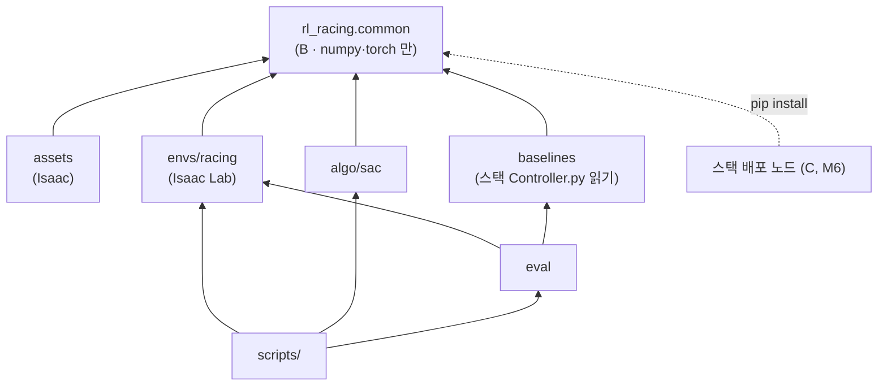

# rl-racing 구조

> [!abstract] 한 줄
> 코드를 **A(학습 전용) · B(sim·실차 공유)** 로 나누고, B 를 `rl_racing/common/` 한 곳에 둔다.
> 의존은 **한 방향** — 모든 것이 `common` 을 import 하고, `common` 은 아무것도 import 하지 않는다.

> [!info] 위치
> [[공유 인터페이스 (sim ↔ real)]] §0 의 A/B/C 분리를 디렉터리로 옮긴 것. 결정 #19(별도 repo) 의 구현.

---

## 0. 원칙 4개

| # | 원칙 | 이유 |
|---|---|---|
| 1 | **의존은 한 방향.** `common` ← `assets`·`envs`·`algo`·`baselines`·`eval`·`scripts` | B 가 학습 코드에 끌려가면 실차에 Isaac 이 따라간다 |
| 2 | **`common` 은 ROS·Isaac import 금지.** numpy·torch 만. Python **3.10 문법까지** | 실차(NUC/Mac)에서 같은 코드가 돈다. 차량 컴퓨터의 Python 버전은 **모른다** — 3.10 은 "어느 쪽이든 돌게" 잡은 안전한 하한 |
| 3 | **스펙은 코드 한 곳.** 차량 상수·obs 순서/정규화·action 규약·npz 스키마 | 두 곳에 있으면 언젠가 어긋나고, 그게 reality gap 이다 |
| 4 | **볼트는 노트만.** 코드는 전부 여기 | 사용자 요청 (#19) |

---

## 1. 디렉터리

```
rl-racing/
├─ pyproject.toml             패키지 rl_racing. 의존 numpy, torch
│                             extras: [dev] pytest·ruff  /  Isaac 은 컨테이너가 제공 (pip 의존에 안 넣음)
├─ README.md
│
├─ rl_racing/
│  ├─ common/                 ★ B — sim·실차 공유.  ROS·Isaac 금지.  py3.10
│  │  ├─ vehicle.py           차량 상수 단일 출처  (L=0.33, δ_max, κ_max, v_max …)
│  │  ├─ track_data.py        reference path 스키마 — 필드·버전·검증, npz 저장/로드
│  │  ├─ frenet.py            FrenetTrack · FrenetTracker        ← tools/frenet_gpu.py
│  │  ├─ base_policy.py       순수 PP (조향만)                    신규
│  │  ├─ action.py            tanh 출력 → (κ, a_x) → δ, governor  신규
│  │  └─ observation.py       actor obs 스펙 + 조립 + spec_hash   신규
│  │
│  ├─ assets/                 A — 차량·트랙 생성 (Isaac 필요)
│  │  ├─ urdf_gen.py                                              ← tools/gen_racecar_urdf.py
│  │  ├─ racecar_cfg.py                                           ← tools/racecar_cfg.py
│  │  └─ track_gen.py                                             ← tools/gen_track.py
│  │
│  ├─ envs/racing/            A — Isaac Lab DirectRLEnv            신규
│  │  ├─ env.py · env_cfg.py
│  │  ├─ reward.py            프로젝트 스택 §10-4
│  │  ├─ critic_obs.py        privileged — μ, v_cap, 실제 벽 거리 …
│  │  ├─ randomization.py     μ, v_cap …
│  │  └─ path_variation.py    d_ref(s) 생성 — 오프셋·경로 교체 (#22)
│  │
│  ├─ algo/                   A — SAC                              신규 (§7 결정 2)
│  │  └─ sac.py               비대칭 critic, head 별 초기화
│  │
│  ├─ baselines/              A — 비교군
│  │  ├─ stack_controller.py  스택 Controller.py 스텁 주입 + 리셋   ← tools/test_controller_adapter.py 의 어댑터 부분
│  │  └─ speed_profile.py     실험 ② 전용 forward/backward pass    인터페이스 §7
│  │
│  └─ eval/                   A — μ 스윕 실행, 지표(랩타임·RMS e_d), 그림
│
├─ scripts/                   진입점만. 로직은 rl_racing/ 안에
│  ├─ train.py · eval_sweep.py · gen_track.py · build_racecar_usd.sh
│  ├─ export_policy.py        M6
│  └─ tools/                  inspect_usd · usd_to_glb · export_usd_portable
│                             measure_gpu_budget · validate_drive (← test_racecar_drive)
│
├─ tests/
│  ├─ test_frenet.py                                              ← tools/test_frenet_gpu.py
│  ├─ test_stack_controller.py   회귀: reset 후 결정성              ← test_controller_adapter.py 의 검사 부분
│  ├─ test_base_policy.py · test_action.py · test_observation.py
│  └─ isaac/                  @pytest.mark.isaac — 컨테이너에서만
│
├─ docker/                    Dockerfile (← ML 서버 노트 §4 본문을 파일로), run.sh,
│                             setup_isaaclab.sh · fix_isaaclab_deps.sh · check_isaac_env.sh · verify_isaaclab.py
├─ maps/<name>/global_waypoints.json      입력만 복사, 출처 스택 커밋 기록 (§7 결정 4)
└─ build/                     .gitignore — *.usd, *.npz, 체크포인트, 로그
```

---

## 2. 의존 그래프



`common` 에서 나가는 화살표는 **없다.** 테스트로 강제한다 (`common` 안에서 `isaaclab`·`pxr`·`rclpy` import 시 실패).

---

## 3. B(`common`) 공개 API — 시그니처 수준

> 코드가 아니라 **약속**이다. 구현 전에 이 표가 합의돼야 한다.

| 모듈 | 공개 이름 | 비고 |
|---|---|---|
| `vehicle` | `VEHICLE` (frozen dataclass) | `wheelbase=0.33` 단일값. URDF 생성기도 여기서 읽는다 → 0.33 vs 0.3302 이중값 해소 |
| `track_data` | `RefPath` (배열 묶음) · `load_npz` · `save_npz` · `validate` | **스키마 버전 필드**. 균일 격자 검사가 여기로 이동 |
| `frenet` | `FrenetTrack.from_npz(path)` · **`FrenetTrack.from_arrays(...)`** · `FrenetTracker` | ★ 실차에는 npz 가 없다 — 스택이 발행하는 global raceline 배열로 만든다. 그래서 `from_arrays` 가 1급이다 |
| `base_policy` | `pure_pp(frenet_out, preview, v, cfg) -> kappa_pp` | (B,) 배치. 조향만 |
| `action` | `compose(tanh_out, kappa_pp) -> (delta, a_x)` · `governor(a_x, v, v_lim, k_g)` | residual 합성은 **여기**에서 한다 → 알고리즘은 residual 을 모른다 |
| `observation` | `ACTOR_OBS_SPEC` · `build_actor_obs(...) -> (B, D)` · `spec_hash()` | 이름·순서·차원·스케일을 **선언**으로. critic obs 는 A 쪽(`envs/critic_obs.py`) |

`d_ref(s)` 는 `common` 이 **만들지 않는다.** sim 에서는 `envs/path_variation.py` 가, 실차에서는 스택 local waypoint 의 `d_m` 이 준다.
`common` 은 s 격자 위의 배열로 받기만 한다.

---

## 4. sim2real 가드 — `spec_hash`

export 할 때 policy 파일 메타데이터에 **`spec_hash`**(obs 스펙 + action 규약 + 차량 상수의 해시)를 넣는다.
실차 노드는 기동 시 자기 쪽 `rl_racing.common.spec_hash()` 와 비교하고 **다르면 실행을 거부**한다.

> "B 가 두 벌이 되는" 사고를 **주행 전에** 잡는다. 순서 하나, 스케일 하나 어긋나도 policy 는
> 조용히 다른 함수를 계산한다 — 로그로는 거의 못 찾는다.

---

## 5. 실차 컴퓨터 — NUC 또는 Mac (2026-09-29 정정)

이전 노트의 **Jetson Orin Nano / TensorRT 는 틀렸다.** 정정 결과:

- **TensorRT 불필요.** policy(2×256 MLP)는 CPU 추론으로 충분하다
- **B 는 torch 로 쓰고 실차도 torch CPU 로 같은 코드를 돈다** — 구현이 물리적으로 한 벌
- 배포 형태(torch 직접 vs ONNX Runtime)는 **M6 에 결정.** 지금은 B 를 순수 함수로, 가능한 한 ONNX export 가 되는 형태로 써 두면 둘 다 열려 있다
- ⏳ 확인 필요: 차량 컴퓨터의 **OS · ROS 2 배포판 · Python 버전** — **현재 모른다** (2026-10-06 사용자 확인).
  작업 PC(CLI 를 돌린 기계, ROS 2 Jazzy · Ubuntu 24.04 · Python 3.12)와는 **다른 구성**이다. 작업 PC 기준으로 추정하지 않는다.
  **Mac 이면 ROS 2 를 어떻게 돌리는지**(네이티브 / Docker·VM)가 배포 형태를 바꾼다

---

## 6. 이전 계획

| 단계 | 대상 | 검증 위치 |
|---|---|---|
| **1차** | 골격(pyproject·README·.gitignore) · `common/{vehicle, track_data, frenet}` · `tests/test_frenet` · `baselines/stack_controller` + 회귀 테스트 · `docker/` · `maps/` | **Isaac 없이** — 이 세션에서 pytest 로 |
| **2차** | `assets/*` · `scripts/gen_track.py` · `scripts/build_racecar_usd.sh` · `scripts/tools/*` | Isaac 컨테이너 (사용자 실행) |
| **3차** | `common/{base_policy, action, observation}` · `envs/racing` · `algo/sac` · `eval` | 신규 작성 — 각각 구조 합의 후 |

이전이 끝나면 볼트의 `tools/`, `run.sh`, `urdf/`, `f1tenth_URDF/` 를 지우고 노트의 `tools/…` 경로(17곳)를 `rl-racing/…` 로 바꾼다.

> [!warning] 이전은 "복사 + 이름 변경"만 한다
> 1·2차에서 로직을 고치지 않는다. 고칠 것이 보이면 **따로 적고** 이전을 끝낸 뒤 별도 커밋으로.
> 그래야 "옮기다 깨졌나, 고치다 깨졌나"가 갈린다. 1차의 frenet 테스트 수치가 이전 전과 **똑같아야** 한다.

---

## 7. 결정 — ✅ 전부 권고대로 확정 (2026-09-29)

| # | 질문 | 권고 | 근거 |
|---|---|---|---|
| 1 | **Tier 1(f1tenth_gym)을 구조에 넣을까** | ✅ **넣지 않는다** | 아래 |
| 2 | SAC 를 직접 쓸까, skrl 을 쓸까 | ✅ **직접** (CleanRL 계열 단일 파일) | 아래 |
| 3 | 볼트의 코드 삭제 + 노트 경로 갱신 | ✅ 예 (전체 이전 완료 후) | 원칙 4 |
| 4 | 맵은 `global_waypoints.json` 만 복사 | ✅ 예 | `gen_track` 이 쓰는 입력은 이것뿐. pgm/png 는 불필요 |

### 결정 1 — Tier 1 을 빼자는 근거 (이전 권고를 뒤집는다)

[[ML 서버 · Isaac Sim 환경]] §9 에서 나는 **"Tier 1 을 버리지 말 것"** 을 권했다. 근거는 *"Isaac Lab 환경을 만드는
수 주 동안 아무 학습도 못 한다"* 였다. 지금은 사정이 다르다:

- 수 주의 대부분이던 **자산 작업이 끝났다** — URDF→USD 검증, 트랙 USD, 주행·마찰 포화 실측, Frenet projector, 비교군 어댑터. 남은 건 DirectRLEnv 포장
- **연구 질문(μ 스윕)은 Isaac 에서만 의미가 있다** — f1tenth_gym 은 선형 타이어라 포화가 없고(§8-5-1), 포화는 PhysX 에서 실측했다(§8-5-2)
- f1tenth_gym 의 action 은 **(조향, 속도)** 라 우리 **(κ, a_x)** 와 의미가 다르다 → 어댑터 + 두 벌의 동역학 → 그 차이가 또 하나의 gap

필요해지면 `envs/` 아래에 추가할 수 있게 `common` 은 시뮬레이터를 모른다 — 그걸로 충분하다.

### 결정 2 — SAC 를 직접 쓰자는 근거

알고리즘 쪽 요구는 두 개다: **비대칭 critic**(critic 만 privileged obs), **head 별 초기화**(조향 0 / 가속 bias 양수, #21).
residual 합성은 `common/action.py` 에서 하므로 알고리즘은 residual 을 모른다.

- 직접: 두 요구를 **확실히** 넣을 수 있고, 로드맵의 CleanRL `sac_continuous_action.py` 읽기 계획과 맞물린다 — 읽은 코드를 고쳐 쓰게 된다
- skrl: 설치·검증은 끝났고 시간을 아낀다. 단 **SAC 에서 비대칭 critic 입력을 지원하는지 확인하지 못했다** ⏳

학습 목적(내부를 이해)과 디버깅 가시성 때문에 직접을 권하지만, **skrl 이 둘을 지원한다면 합리적인 대안**이다.

---

## 8. 진행 방식 (2026-09-29 확정)

- **브랜치**: `main` 은 빈 init 커밋만 두고, 작업은 **`dev`** 에서 한다. 단계가 검증되고 **사용자가 확인한 뒤** `main` 으로 합친다
- **1차 이전은 Claude Code CLI 로 수행**한다 (이 원격 세션이 아니라). 커밋 C1 골격 → C2 복사 → C3 구조 변경 → C4 비교군
- **이전 중 발견한 흠은 고치지 않고 보고만** 한다. 이전 완료 후 사용자에게 다시 묻는다.

### 8-1. 1차 이전 결과 (2026-10-06, CLI 보고)

| | 해시 | 내용 |
|---|---|---|
| init | `01770fa` | main — 빈 커밋 (**원격에 있음**) |
| C1 | `9f72c17` | 골격 + common 경계 테스트 |
| C2 | `1182484` | 복사 — frenet·리포트·맵 + 판정 테스트 |
| C3 | `42e60c1` | vehicle·track_data 분리, FrenetTrack 은 RefPath 를 받는다 |
| C4 | `ec3e737` | 비교군 어댑터 + 리셋 회귀 테스트 |

✅ **main 병합 완료 (2026-10-06)** — `22be25a` (`--no-ff`, C1~C4 를 묶은 병합 커밋). 병합 결과에서 pytest 70 passed.
`dev` 도 `22be25a` 로 맞췄다.

> [!warning] 사용자 셸 환경 — 흠 12 실재 확인
> 첫 실행에서 시스템 pytest(`/usr/lib/python3/dist-packages`)가 잡혀 torch 가 없었고,
> ROS 2 **Jazzy** 의 `launch_testing` pytest 플러그인이 `pytest_pycollect_makemodule` 에서 테스트 모듈을 따로 import 하며 끼어들었다.
> 해결: venv 활성화 + `PYTEST_DISABLE_PLUGIN_AUTOLOAD=1 python -m pytest -q`.
> 이 기계는 **작업 PC** 다 (ROS 2 Jazzy · Ubuntu 24.04 · Python 3.12). 차량 컴퓨터와는 다른 구성이고, 차량 컴퓨터 설정은 아직 모른다.

| 검증 | 결과 |
|---|---|
| 0단계 기준선 | 노트 수치와 일치 (npz 24,302 B, 3a 3.25e-05, adapter 2.911 m/s 등) |
| frenet 리포트 (C2·C3) | 처리량 제외 **바이트 동일** |
| npz 비트 비교 (C3) | 두 맵 16 키 전부 `array_equal` + dtype 일치. 추가 키 `schema_version` 뿐 |
| adapter 리포트 (C4) | raw diff **비어 있음** |
| pytest | 70 passed (스택 있음) / 61 passed + 9 skipped (없음). 커밋별 worktree 재검증 |
| 돌연변이 3개 | `heading_error_integral` 제거는 **정적 검사(4번)만** 잡는다 — KI=0 이라 동작 테스트로는 안 보인다. 완전성 테스트의 필요성이 실측으로 확인됨 |

지시 이탈 3개 (전부 수용): frenet docstring 사용 예 3줄, `local_window` 의 입력 접근자, ruff per-file-ignores.

### 8-2. 흠 목록 — 12개 (⏳ 사용자 결정 대기)

| # | 흠 | 성격 |
|---|---|---|
| 1 | frenet docstring "전역 argmin 은 쓸 수 없다" — 낡은 문장 | 문서 |
| 2 | `preview_horizon` 0.5 m 과장 | 값 |
| 3 | 외적 = 0 이면 `d = 0` — **크기까지 0** (u 가 clamp 된 경우 실제 거리 ≠ 0 이어도). 합성 정사각 트랙에서 0.5 m 이탈점이 `d = 0`, `at_edge = False`. 실제 두 맵 0 건 | **B 정확성** |
| 4 | preview 설정이 트랙 데이터(npz)에 있음 | 설계 → 3차 |
| 5 | wheelbase 0.33 vs 0.3302 | 설계 → 2차 |
| 6 | 끝점 중복 없는 입력에서 lap/ds 오류 → `from_arrays` 가 `validate()` 에서 ValueError (ds 0.24% 오차 > 문턱 0.1%). **실차 입구가 닫혀 있다** (조용히 틀리지는 않음) | **B 정확성** |
| 7 | npz float32 스칼라 때문에 sim·실차의 ds·lap 이 3e-8 다르다 | 설계 → spec_hash (3차) |
| 8 | `cur_state_speed` 가 `__init__` 에도 리셋 목록에도 없다 | 비교군 |
| 9 | `FrenetTracker` 의 미사용 변수 `N` | 정리 |
| 10 | yaml 파싱에서 파일을 닫지 않음 | 정리 |
| 11 | `save_npz` 의 `schema_version` 정책 미정 | 설계 (작음) |
| 12 | ROS 를 source 한 셸에서 pytest 가 죽는다 | 환경 → 실차(NUC, ROS) 대비 |

**결정 (2026-10-06)**: `dev` push 완료 → **1차를 main 에 병합한 뒤** 흠을 고친다 (CLI).
지금 고칠 것 **1·2·3·6·8·9·10·11·12**, 미룰 것 **4(3차)·5(2차)·7(3차 spec_hash)**.

> [!warning] 흠 3 의 수정 방법 — `torch.where(cross >= 0, 1, −1)` 은 **틀린 수정**이다
> 크기는 살리지만 부호를 무조건 왼쪽으로 정해서, 좌회전 코너 바깥(오른쪽)에서 부호가 뒤집힌다.
> 외적이 0 이 되는 것은 최근접점이 **꼭짓점에 clamp 됐을 때**뿐이다 (`0<u<1` 이면 cross=0 ⇔ 경로 위).
> 그때는 꼭짓점 양쪽 선분 법선의 합(**이등분 법선**)과 `rel` 의 내적으로 좌우를 정한다.
> 또 이전 설명에서 "크기는 맞고 부호만 0" 이라 한 것도 틀렸다 — `√d² × sign(0)` 이라 크기까지 0 이다.

> [!note] 흠 6 의 불변식
> N 개 점의 폐루프 → 선분 N 개, `lap = N·ds`. 끝점 중복이 있든 없든 **같은 RefPath** 가 나와야 한다.
> 끝점 중복 경로(두 맵)는 지금과 **비트 단위로 같아야** 한다.


### 8-3. 흠 수정 결과 (2026-10-06, CLI) — dev 에 6개 커밋, 95 passed

| 커밋 | 고친 문제 (쉬운 말로) |
|---|---|
| `c4189db` | **횡오차가 0 으로 잘못 나오던 문제** — 차가 경로 꼭짓점에서 들어오는 선분의 연장선 위에 있으면 0.5 m 벗어나도 `d = 0`. 이등분 법선으로 좌우를 판정하게 고침 |
| `a1789e7` | **끝점 중복이 없는 경로 데이터를 거부하던 문제** — 랩 길이 나눗셈이 `N−1` 이라 간격이 0.24% 틀려 검사에서 떨어졌다. `N` 으로 통일. 닫히지 않은 곡선은 명확히 거부 |
| `a1ed7c2` | **preview 거리 0.5 m 과장**(20.0 → 19.5 m), 실측과 안 맞던 설명문, 안 쓰는 변수 정리 |
| `07507de` | **옛 버전 파일을 다시 저장하면 버전 번호가 0 으로 남던 문제** — 저장은 항상 현재 버전 |
| `006b43b` | **스택 컨트롤러 리셋에서 `cur_state_speed` 가 안 지워지던 문제**, yaml 파일을 안 닫던 문제 |
| `01f13d4` | **ROS 2 셸에서 pytest 가 죽는 문제** 문서화 — 가상환경 + `PYTEST_DISABLE_PLUGIN_AUTOLOAD=1` + `python -m pytest` **세 가지 모두** 필요 (하나라도 빠지면 torch 또는 yaml 에러) |

검증: 실제 두 맵의 트랙 데이터는 매 커밋 원본과 비트 단위 동일 / frenet 리포트는 지평선 줄과 처리 시간만 변경 /
스택 컨트롤러 리포트는 한 글자도 안 바뀜. 미룬 것 그대로: preview 설정 위치(3단계), wheelbase 0.33 vs 0.3302(2단계), float32 저장 오차와 spec_hash(3단계).

**diff 검토에서 찾은 작은 것 2개** (병합을 막을 정도는 아님):
1. `frenet.py` 지평선 주석 *"n·stride·ds 는 ds 하나만큼 과장"* — 실제로는 **preview 한 칸(stride·ds = 0.5 m)** 만큼이다. 값은 맞고 주석만 틀림
2. 끝점 판정이 "거리 < 1e-6 m 면 중복" 이고, 닫는 선분 검사는 "ds 의 3배 초과면 에러" **상한만** 있다.
   마지막 점이 첫 점과 **거의** 겹치는데 1e-6 m 보다 조금 먼 입력(예: 다른 프로그램을 거치며 반올림된 좌표)은
   중복으로 안 잡히고 **길이 ≈ 0 인 선분**이 하나 생긴 채 통과한다. 하한 검사(예: 0.5·ds 미만이면 에러)를 권장.
   스택의 waypoint 메시지는 float64 라 지금 데이터에서는 안 생긴다

**→ 2026-10-06 수정 완료 (dev, `f85dd3d`·`cc81fe1`, 97 passed).** 주석 정정, 그리고 끝점 거리를 네 구간으로 판정:
같은 점(간격의 0.1% 미만, 좌표 반올림 수준) / 애매하게 가까움(간격 절반 미만 → 에러) / 정상 닫는 선분(간격의 0.5~3배) / 닫히지 않은 곡선(3배 초과 → 에러).
실제 두 맵은 비트 단위 그대로, 두 리포트도 처리 시간 줄 외 변화 없음.
남은 사소한 것: 설명문이 "세 구간" 이라 적고 네 개를 나열한다 / 점이 1개뿐인 입력이면 평균 간격 계산에서 0 으로 나눈다 (폐곡선은 점 3개 이상이 필요하니 시작에서 거부하면 된다).

**→ 사용자가 main 에 병합 (`d6111a8`).** 이후 병합용 스크립트를 dev 에 추가 (`9971a25`, 아직 main 에는 없음):
`scripts/merge_dev_to_main.sh -m "병합 메시지"` 한 줄이 원격 가져오기 → `--no-ff` 병합 → pytest·ruff → (확인 후) main push → dev 를 main 에 맞추기 를 한다.
충돌·테스트 실패·취소 중 하나라도 생기면 로컬 main 을 병합 전으로 되돌리고 아무것도 push 하지 않는다 (임시 저장소에서 7가지 경우 확인).


### 8-4. ML 서버 작업공간 (2026-10-06 확정)

지금 `~/rl-racing` 은 9월에 만든 **git 이 아닌 작업 폴더**이고, 새 GitHub 저장소와 이름이 겹친다. 아래로 바꾼다.

```
~/rl-racing/              ← git clone (dev)                  → 컨테이너 /workspace
   build/                 ← 산출물 (.gitignore): USD, npz, glb, 로그, 체크포인트
~/rl-racing-old/          ← 지금 폴더를 이름만 바꿔 보관      → 컨테이너 /old (읽기 전용)
                             2차 이전의 비교 기준. 검증이 끝나면 삭제
~/.cache/isaac/…          ← 그대로
이미지 isaac-rl:<user>     ← Isaac Sim + (3단계에서) Isaac Lab v2.3.2
```

| 결정 | 내용 | 이유 |
|---|---|---|
| 컨테이너 `/workspace` = git 저장소 | 서버의 코드는 언제나 `dev` 브랜치의 코드 | 볼트 사본을 거쳐 손으로 복사하다 버전이 어긋나는 일을 없앤다 |
| 옛 폴더는 읽기 전용으로 붙인다 | `/old` | 비교 기준을 새 코드가 실수로 덮어쓰지 못하게 |
| **Isaac Lab 을 이미지에 넣는다** | v2.3.2 고정 + 의존성 정리까지 Dockerfile 에서 | 우리가 고치는 코드가 아니므로 재빌드 부담이 없다. 컨테이너를 켜면 바로 쓸 수 있고, 의존성 문제는 빌드 실패로 크게 드러난다. 9월에 `--rm` 컨테이너에서 설치가 어떻게 유지됐는지는 사용자도 기억하지 못한다 |
| **CLI 는 작업 PC 에서만** | CLI 가 코드를 쓰고 `dev` 에 push → 사용자가 서버에서 pull 후 컨테이너에서 실행 → 로그를 붙여 넣는다 | 서버에 Claude Code CLI 설치가 어렵다 |
| 서버는 **pull 만** 한다 | 서버에서 커밋하지 않는다. 인증은 **읽기 전용 deploy key** | 저장소가 private 이고, 서버 홈 폴더(`drwxr-xr-x`)를 다른 사용자도 읽을 수 있다. 개인 토큰을 평문으로 두지 않는다 |

**순서 — 환경과 코드를 동시에 바꾸지 않는다** (이전 원칙 「옮기기와 고치기를 섞지 않는다」를 환경에도 적용):
1. 폴더 이름 변경 · clone · `run.sh` 연결 경로 수정. **이미지는 지금 것 그대로**
2. 2차 이전 (Isaac 이 필요한 스크립트) → 지금 이미지에서 옛 산출물과 대조
3. Dockerfile 수정(노트 버전: `OMNI_KIT_ALLOW_ROOT`, `libxt6`, `torchaudio`) + Isaac Lab 포함 → 재빌드 → 다시 검증

**서버 상태 확인 결과 (2026-10-06):**

| 항목 | 결과 | 뜻 |
|---|---|---|
| `run.sh`·`tools/*` 해시 | 볼트와 **전부 같다** (`test_controller_adapter.py` 만 서버에 없음 — 1차, 작업 PC 용) | 2차 이전의 출발점 = 볼트의 `tools/` |
| Isaac Lab | `v2.3.2`, 수정한 파일 없음 | 공식 태그 그대로 |
| 이미지 | `isaac-rl:hyeonggyun` 하나뿐 (`docker commit` 해 둔 것 없음) | |
| 새 컨테이너의 패키지 | torch 2.7.0+cu128, torchaudio 2.7.0, **isaaclab·skrl 없음**, **libxt6 없음** | 이미지는 서버의 Dockerfile 로 빌드됐다. **Isaac Lab 설치는 컨테이너가 꺼질 때 매번 사라졌다** |
| `vault/` | git remote 없음 (22 MB 사본) | 이전 후 삭제 |
| `unicorn_ws/` | `build install log src` — 빌드된 ROS 워크스페이스 (241 MB) | ⏳ 용도 확인 |

> [!warning] ⭐ 9월의 실행 환경은 이미 재현할 수 없다
> Isaac Lab 과 그 의존성은 컨테이너 안에서 `setup_isaaclab.sh` 로 설치됐고, 컨테이너가 지워질 때 함께 사라졌다.
> 그 스크립트는 버전을 고정하지 않은 패키지(warp-lang, trimesh 등)를 설치하므로 **지금 다시 돌리면 9월과 다른 버전이 깔린다.**
> → 「이미지는 그대로 두고 9월 산출물과 대조」 라는 위 순서의 전제가 성립하지 않는다. 아래로 수정 제안.

**수정 제안한 순서** (⏳ 사용자 확인 대기):
1. 작업공간 정리 — 이름 변경 · 9월 산출물을 읽기 전용 사본(`~/rl-racing-ref`)으로 보관 · deploy key · clone
2. **새 이미지 먼저** — Isaac Lab 포함 + 설치된 패키지 버전 목록(`pip freeze`)을 저장소에 기록해 다음부터는 같은 환경을 재현.
   검증: **옛 스크립트를 새 이미지에서** 돌려 9월 산출물과 대조 → 차이가 있으면 그건 순수하게 환경 탓
3. 2차 이전 — **옛 스크립트와 새 코드를 같은 새 이미지에서** 돌려 결과가 같아야 한다 → 차이가 있으면 그건 순수하게 이전 탓

한 번에 하나만 바뀐다는 원칙은 그대로이고, 비교의 고정점이 「9월 이미지」에서 「옛 스크립트」로 바뀐 것이다.

**→ 2026-10-06 사용자 동의. `unicorn_ws/` 는 안 쓴다 (옛 폴더째 나중에 삭제).**

**2단계(새 이미지) 확정 사항:**

| 항목 | 결정 |
|---|---|
| Dockerfile | **앞부분은 서버의 지금 파일을 한 글자도 바꾸지 않는다** — 빌드 캐시 재사용 + Isaac Sim 부분이 9월 이미지와 동일. 뒤에 `OMNI_KIT_ALLOW_ROOT`·`libxt6`·`VIRTUAL_ENV`·Isaac Lab v2.3.2(`/opt/IsaacLab`) 추가 |
| Isaac Lab 설치 | 9월에 검증된 `setup_isaaclab.sh`·`fix_isaaclab_deps.sh` 를 재사용. 바꾸는 것은 **실패 시 빌드 중단**, **GPU 기동 테스트 제외**(빌드 후 검증으로) 두 가지뿐 |
| 재현성 | 첫 빌드 후 `pip freeze` → 작업 PC 로 옮겨 `docker/constraints.txt` 로 커밋 → 다음 빌드부터 그 버전만 설치 |
| 이미지 이름 | **`rl-racing:isaac`** (버전 숫자 없음). 옛 `isaac-rl:hyeonggyun` 은 검증이 끝날 때까지 보존 |
| 검증 | ① 기동 ② 옛 스크립트로 만든 산출물 vs `~/rl-racing-ref` (URDF·npz·GLB 는 바이트, USD 는 내용) ③ μ 네 값의 가속도 vs §8-5-2 표, **차이 1% 이내**·마찰 포화(a/μg=1.00) 유지 |
| 범위 밖 | 코드 이전(3단계), 버전 변경, μ=1.0 토크 절반 수수께끼, 옛 이미지 삭제 |

**9월 산출물(`~/rl-racing-ref`, 31개 파일)의 출처 — 2026-10-06 확인:**

| 파일 | 만드는 옛 스크립트 | 비교 |
|---|---|---|
| `assets/racecar_physics.urdf` | `build_racecar_usd.sh` (안에서 `gen_racecar_urdf.py`) | 바이트. ⭐ **작업 PC(Isaac 없음)에서 다시 만들어도 같았다** (`d36853e7…`) |
| `assets/racecar.usd`, `configuration/*.usd` 4개, `config.yaml`, `.asset_hash` | `build_racecar_usd.sh` (안에서 Isaac Lab `convert_urdf.py`) | 바이트 → 다르면 내용 |
| `assets/racecar_{both,collision}.glb` | `build_racecar_usd.sh` (안에서 `usd_to_glb.py`) | 바이트 → 다르면 내용 |
| `assets/racecar_flat.{usda,usdc}` | `export_usd_portable.py` | 바이트 → 다르면 내용 |
| `assets/track.glb` | `usd_to_glb.py` 에 트랙 USD — **어느 맵·어느 옵션이었는지 기록 없음** | 후보 6개 중 해시가 맞는 것을 찾는다 |
| `maps/<맵>/track_<맵>.{npz,usd}` | `gen_track.py` (출력 기본값 = 맵 폴더) | npz 바이트. ⭐ **작업 PC 에서 usd-core + numpy 2.4 로 다시 만들어도 같았다**. usd 는 USD 라이브러리 버전이 다르면 바이트가 달라진다(같은 라이브러리로는 매번 같음) → 내용 비교 |
| `maps/` 의 나머지 14개 | 스택에서 복사한 입력 (`global_waypoints.json` 은 저장소 것과 해시 동일) | 옛 스크립트가 건드리지 않았는지만 확인 |

**새 이미지 빌드 결과 (2026-10-06, 서버):**

| 항목 | 결과 | 뜻 |
|---|---|---|
| Dockerfile 앞부분 검사 | 처음엔 멈춤 → 고친 뒤 통과 | 서버 파일 끝의 `CMD ["bash"]` (뒤에 줄바꿈 없음) 를 프롬프트에 옮겨 적다 빠뜨렸다. 검사 장치가 의도대로 잡았다 (`25b83ef`) |
| build cache | `CACHED` 6단계 | 앞부분(apt · venv · pip · Isaac Sim · torch · WORKDIR)이 전부 재사용됐다 → **Isaac Sim 부분은 9월 이미지와 바이트 단위로 같다** |
| Isaac Lab | `37ddf62` = 공식 `v2.3.2` 태그 커밋 (git ls-remote 로 확인) | |
| 빌드 중 확인 | ✅ 통과 | |
| 패키지 차이 (옛 이미지 대비) | 제거 0. 추가는 Isaac Lab 과 그 의존성. 버전 변경 6개: click · psutil · typing-extensions · starlette (설치 스크립트가 의도한 것), torchaudio `2.7.0 → 2.7.0+cu128` (cu128 판으로 재설치), **numpy `1.26.0 → 2.4.6`** | ⬇️ |

> [!warning] ⭐ numpy 가 2.x 로 올라갔다 — Isaac Lab v2.3.2 는 `numpy<2` 를 요구한다
> `fix_isaaclab_deps.sh` 는 `numpy<2` 를 설치한 **바로 다음 줄에** `onnx>=1.18.0` 을 따로 설치한다. 그 연쇄:
> ```
> onnx 1.23.2      → ml_dtypes>=0.5.4 를 요구 (상한 없음)
> ml_dtypes 0.6.0  → numpy>=2.0.0 을 요구        (2026-08-13 배포)
> → pip 가 numpy 를 2.4.6 으로 올린다. 패키지를 하나씩 설치하므로 앞의 numpy<2 가 막아 주지 못한다
> ```
> **9월에도 같았을 가능성이 높다** (2026-10-07 재빌드로 확인 — 중간에 한 번 반대로 정정했다가 되돌림).
> `TERM` 을 고쳐 공식 `isaaclab.sh --install` 이 실제로 돌게 해도(96초, 종료코드 0) **isaaclab 본체 설치가 실패**하고
> 대체 경로로 넘어간다. 원인은 isaaclab `setup.py` 의 `flatdict==4.0.1` — 소스로만 배포돼 빌드가 필요한데,
> 최신 setuptools 에는 `pkg_resources` 가 없어 빌드가 죽는다 (작업 PC 에서 재현: `No module named 'pkg_resources'`).
> isaaclab 설치는 의존성을 한꺼번에 풀기 때문에 flatdict 하나 때문에 isaaclab 전체가 안 깔리고, `numpy<2` 를 지켜 줄 것이 없다.
> `--install` 은 이 실패를 `find -exec` 안에서 해서 종료코드 0 을 낸다.
> 9월에도 사람이 터미널에서 `--install` 을 돌렸고 같은 실패 → 대체 경로였을 것이다 (설치 스크립트에 대체 경로와 flatdict 우회가 있는 것이 그 흔적).
> 재빌드 결과: `numpy==2.4.6`, `ml_dtypes==0.6.0`, `onnx==1.23.2`, `flatdict==4.1.0`(대체 경로가 깐 wheel 판)

> [!warning] 9월의 flatdict 우회(`PIP_CONSTRAINT` 로 `setuptools<82`)는 지금 pip 에서는 효과가 없다
> 작업 PC 실측 — flatdict 4.0.1 빌드:
> | pip | 방법 | 결과 |
> |---|---|---|
> | 26.2 | `PIP_CONSTRAINT=setuptools<82` | ❌ 같은 `pkg_resources` 오류 (새 pip 은 일반 constraint 를 빌드 환경에 적용하지 않는다) |
> | 26.2 | `PIP_BUILD_CONSTRAINT=setuptools<82` | ✅ 빌드됨 |
> | 24.0 | `PIP_CONSTRAINT=setuptools<82` | ✅ 빌드됨 |
> → 공식 설치를 성공시키려면(= Isaac Lab 이 의도한 `numpy<2` 환경) `--install` 단계에 `PIP_BUILD_CONSTRAINT` 를 걸면 된다.
> 9월과 다른 환경이 되므로 **지금 검증을 끝낸 뒤 변수 하나만 바꾸는 별도 단계**로 한다.
>
> 결정 (⏳): 검증은 **이대로** 한다 (9월과 같은 조건). `numpy<2` 로 맞출지는 버전 고정 목록을 만들 때
> **변수 하나만 바꾸는 별도 단계**로 판단한다 — 그때는 `onnx`/`ml_dtypes` 상한도 같이 걸어야 한다.
> 이것이 「버전을 기록하지 않으면 환경이 조용히 바뀐다」의 실례다.

> [!danger] ⭐ `isaaclab.sh` 는 터미널 설정(`TERM`) 없이 실행하면 아무것도 안 하고 즉시 죽는다 (2026-10-07)
> `isaaclab.sh` v2.3.2 의 13행 `set -e`, 16행 `tabs 4`. `tabs` 는 터미널 종류를 모르면 실패하고(`'ansi+tabs': unknown terminal type.`, 종료코드 1),
> `set -e` 때문에 스크립트가 거기서 끝난다. 작업 PC 에서 `env -u TERM tabs 4` 로 같은 메시지·종료코드를 재현했다.
> - `docker run -it` 는 `TERM=xterm` 을 넣어 주지만, 스크립트에서 쓰는 `-i` 만으로는 안 넣는다. `docker build` 의 `RUN` 에도 없다
> - 그래서 **빌드 중 `isaaclab.sh --install` 이 0.0초 만에 죽었다** (빌드 로그에서 「3. --install」과 「4. import 확인」의 시각이 같은 12.63초).
>   설치 스크립트는 종료코드를 일부러 보지 않는 구조라(9월 주석: 부분 실패가 묻히므로 import 로 확인) 조용히 대체 경로로 넘어갔다
> - `verify_env.sh` 의 기동 확인 두 개도 같은 이유로 실패했다
> - 9월에 문제가 없었던 이유: 사람이 `./run.sh bash` 로 터미널을 열고(`-it`) 그 안에서 실행했다
>
> 고칠 곳: 빌드의 Isaac Lab 설치 `RUN` 과 `docker/run.sh` 양쪽에 `TERM=xterm`. 빌드 쪽을 고치면 설치 경로가 바뀌므로 **재빌드 후 패키지 차이를 다시 본다.**

> [!danger] ⭐ Isaac Lab 의 `SimulationContext` 를 만든 스크립트는 `simulation_app.close()` 에서 영원히 멈춘다 (2026-10-07 진단)
> py-spy 로 멈춘 프로세스를 직접 봤다 (docker 기본 설정은 프로세스 들여다보기를 막으므로 `--cap-add=SYS_PTRACE` 로 따로 띄움):
> ```
> close (simulation_app.py:814)                                  ← Isaac Sim 종료가 타임라인을 STOP 시킨다
>   <lambda> (isaaclab/sim/simulation_context.py:252)            ← Isaac Lab 이 등록해 둔 STOP 콜백
>     _app_control_on_stop_handle_fn (simulation_context.py:1028)
>       while not timeline.is_playing(): self.render()           ← 다시 play 될 때까지 무한히 렌더
> ```
> Isaac Lab 의 의도: 사람이 GUI 로 보다가 정지 버튼을 누르면 앱을 끄지 않고 화면을 계속 그린다. 스크립트가 스스로 끝날 때는
> **`close()` 전에 `SimulationContext.clear_instance()` 로 이 콜백을 풀어야 한다** (Isaac Lab 의 테스트·환경 `close()` 가 그렇게 한다).
> - **환경 문제가 아니다.** 9월 스크립트에도 같은 결함이 있었다. 사람이 터미널에서 결과를 보고 Ctrl-C 했을 것이다
> - 해당 스크립트: `verify_isaaclab.py`, `test_racecar_drive.py`, `measure_gpu_budget.py` (`SimulationContext` 를 만들고 정리 없이 `close()`).
>   `gen_track.py` · `usd_to_glb.py` · `export_usd_portable.py` · `inspect_usd.py` · Isaac Lab `convert_urdf.py` 는 만들지 않으므로 해당 없음
> - Isaac Lab 튜토리얼 `create_empty.py` 는 `while simulation_app.is_running(): sim.step()` — **원래 끝나지 않는 대화형 예제**라 자동 검증에 쓰면 안 된다
> - 앞으로 우리 코드(학습 스크립트 등)는 `env.close()` / `SimulationContext.clear_instance()` 를 `simulation_app.close()` 앞에 둔다

> [!success] ⭐ 새 이미지 `rl-racing:isaac` 검증 결과 (2026-10-07, `GPUS=1 docker/verify_env.sh`)
> | 항목 | 결과 |
> |---|---|
> | 기동 | ✅ Isaac Sim · Isaac Lab import 11개, 물리 step |
> | 산출물 32개 (입력 15 + 옛 스크립트 재생성 17) | **29개 바이트 단위로 같음** — 차량 URDF · `racecar.usd` · `configuration/*.usd` 4개 · `.asset_hash` · GLB 3개 · 트랙 npz 2 · 트랙 USD 2. 입력 15개 그대로 |
> | `config.yaml` | 생성 시각 주석만 다름 |
> | `racecar_flat.usda` · `.usdc` | 다름 → **9월 기준 파일이 낡은 것** (아래) |
> | `track.glb` 출처 | 기록이 없었는데 찾음: `usd_to_glb.py` 에 `ifac_roboracer` 트랙 USD, `--only both` |
> | 물리 (μ 1.0 · 0.5 · 0.25 · 0.12) | **가속도 4개 모두 9월과 소수 셋째 자리까지 같음 (0.00%)**. 정지 안정 · 조향 부호 · 구동 방향 ✅ |
>
> [!warning] 2026-10-08 정정 — 아래 「시점 문제」 설명은 **전제가 틀렸다**
> 「같은 입력 + 같은 USD 라이브러리면 Flatten 결과가 같다」를 전제로 했는데, 그렇지 않다.
> **USD 의 Flatten 은 instanceable prim 의 프로토타입 번호(`Flattened_Prototype_N`)를 실행할 때마다 다르게 붙인다**
> (작업 PC 에서 같은 파일을 같은 환경에서 12번 Flatten → md5 12개 모두 다름). 3단계 A 서버 검증에서도 같은 `racecar.usd` 로
> 오늘 만든 flat 두 개가 서로 달랐다. 그러니 9월 flat 과의 차이도 번호 때문일 수 있다 — 9월 flat 이 실제로 낡았는지는
> 「합성된 장면」 비교(아래 §8-5)로 다시 판정한다. 비교 도구도 그 방식으로 고쳤다 (`compare_assets.py`, dev `6b48cd4`).
>
> **→ 판정 완료 (2026-10-08, 「합성된 장면」 비교):** 9월 flat 과 오늘 flat 의 차이는 **바퀴 joint 4개의 `physxJoint:maxJointVelocity` 뿐**이다 —
> 9월 `11278.67 °/s` = **196.85 rad/s**, 오늘 `34377.46 °/s` = **600 rad/s**. 9월 16일 02:35 커밋
> 「휠 joint 속도 한계를 600 rad/s 로 분리」 바로 그 변경이다. 즉 **9월 flat 은 실제로 낡은 파일이 맞았다** — 결론은 처음과 같지만,
> 처음 근거(「Flatten 은 결정적」)는 틀렸고 이번 직접 비교가 진짜 근거다. 나머지 장면 내용은 전부 같다.
> 따라서 `verify_env.sh` 는 9월 기준과 비교할 때 앞으로도 `racecar_flat.*` 2개를 「실제로 다름」으로 보고한다 — 알려진 차이다.
> (물리 수치가 9월과 같은 것도 앞뒤가 맞는다: 거동 시험의 휠 목표 속도 60 rad/s 는 두 한계 모두보다 작아 한계가 작동하지 않는다.)

> **(정정 전 기록) `racecar_flat.*` 이 다른 이유 — 환경이 아니라 9월 기준 파일의 시점 문제:**
> 9월 15일 08:28 `export_usd_portable.py` 추가 → 그때의 `racecar.usd` 로 flat 생성 →
> 16일 02:35 차량 생성기 수정(휠 속도 한계 600 rad/s 분리) → 02:39 `build_racecar_usd.sh` 재실행으로 `racecar.usd` 재생성.
> 그런데 `build_racecar_usd.sh` 는 `racecar.usd` · `configuration/` · `racecar*.glb` 만 지우고 만든다 — **flat 은 15일 것이 그대로 남았다.**
> 논리로도 확정된다: 이번 `racecar.usd` 와 `configuration/*.usd` 는 9월 것과 바이트가 같고 Isaac Sim(USD 라이브러리)도 9월 이미지 그대로이므로,
> 이번 flat = 「9월 최종 `racecar.usd` 를 평탄화한 것」이다. 9월 flat 이 그것과 다르다면 9월 flat 은 다른(이전) `racecar.usd` 에서 나온 것이다.
>
> **결론: 환경 검증 통과.** 같은 입력에서 나온 것은 전부 같고, 물리 거동도 같다. 즉 새 이미지 + 저장소 구조로 옮겨도
> 9월 결과가 그대로 재현된다. 다음 단계(코드 이전)의 비교 기준은 9월 파일이 아니라 **새 이미지에서 옛 스크립트로 다시 만든 결과**
> (`~/rl-racing-old/assets`, `maps/`)를 쓴다 — flat 도 거기서는 최신이다.
>
> **→ 2026-10-07 사용자가 main 에 병합 (`1ebee0a`, 커밋 19개).** 남은 것: 버전 고정 목록(constraints) ·
> (선택) 공식 설치로 전환해 numpy<2 · 3단계 코드 이전 · 작은 개선(검증 진행 표시와 컨테이너 정리, 설치 스크립트가 import 실패 이유를 버리는 문제, pip-diff 의 Isaac Lab 줄 반복 표시)

> [!warning] 볼트의 `urdf/racecar_physics.urdf` 는 낡은 파일이다
> 서버 것과 다르다 — 휠 effort 1.257 / velocity 196.85 (지금 생성기는 0.629 / 600). 이전이 끝나면 지우기로 한 목록(§6)에 이미 있다.


### 8-5. 3단계 — Isaac 스크립트 이전 (2026-10-07 설계 확정)

2단계는 main `1ebee0a`, lock 작업은 `715d384` 로 병합됨. 남은 볼트 `tools/` 9개를 저장소로 옮긴다.

| 옛 파일 | 새 위치 |
|---|---|
| `gen_racecar_urdf.py` | `rl_racing/assets/urdf_gen.py` |
| `racecar_cfg.py` | `rl_racing/assets/racecar_cfg.py` |
| `gen_track.py` | `rl_racing/assets/track_gen.py` + `scripts/gen_track.py` |
| `build_racecar_usd.sh` | `scripts/build_racecar_usd.sh` |
| `inspect_usd.py` · `usd_to_glb.py` · `export_usd_portable.py` · `measure_gpu_budget.py` | `scripts/tools/` |
| `test_racecar_drive.py` | `scripts/tools/validate_drive.py` |

**A 옮기기** (결과가 옛 스크립트와 같아야 함 — 경로·import·출력 위치·lint 예외만 바꾼다) → **B 고치기** (항목별로, 예상한 차이만 나는지 확인):
① `track_gen` 의 npz 를 `common/track_data.RefPath` 로 (npz 에 `schema_version` 키 추가) ② `validate_drive`·`measure_gpu_budget` 의 종료 멈춤 수정
③ `build_racecar_usd.sh` 가 flat 도 다시 만들기 ④ wheelbase 통일

| 설계 결정 | 내용 |
|---|---|
| 컨테이너에서 `rl_racing` import | `run.sh` 가 `PYTHONPATH` 에 저장소 루트 (이미지 변경 없음 — 이미지에 설치하면 lock 대조에 걸린다) |
| 출력 위치 | `build/assets/` (차량), `build/tracks/<맵>/` (트랙). 입력 `maps/` 와 분리 |
| 진입점 | 로직은 `rl_racing/`, 실행은 `scripts/`. 점검 도구는 `scripts/tools/` 의 독립 스크립트 |
| 비교 기준 | `~/rl-racing-old` 의 **최신** 산출물 (현재 이미지에서 옛 스크립트로 만든 것) |
| 경로 문자열 문제 | USD·`config.yaml` 안에 출력 폴더의 절대경로가 적힌다. 검증할 때는 새 코드의 출력 폴더를 옛 것과 **같은 컨테이너 경로**(`/workspace/assets`)에 붙여 생성 → 바이트 비교가 그대로 가능 |

**A 결과 (2026-10-08, 서버 `verify_migration.sh`, dev `7fc9950`):**
- 17쌍 중 **14쌍 바이트 동일** (URDF · `racecar.usd` · `configuration/*.usd` 4 · `.asset_hash` · GLB 3 · 트랙 npz 2 · 트랙 USD 2),
  `config.yaml` 은 생성 시각만 다름, 물리 4값 0.00%
- `racecar_flat.usda/.usdc` 만 다름 → 원인은 이전이 아니라 **Flatten 의 프로토타입 번호가 실행마다 달라지는 것**.
  diff 가 「같은 번호의 프로토타입 내용이 뒤바뀜 (바퀴 원기둥 ↔ 상자)」 모양이었다
- **최종: 옛 스크립트 ↔ 새 코드의 flat 2개도 「합성된 장면 606줄 모두 같음」 → 17쌍 전부 같음 (A 완료)**
- 비교 방식 수정: USD 는 인스턴스를 통과해 장면의 모든 prim 의 경로·타입·스키마·속성값·관계를 적은
  「합성된 장면 목록」 으로 비교 (바이트 같음 → 같음 / 목록 같음 → 부가정보만 다름 / 목록 다름 → 실제로 다름).
  비교할 때 다시 Flatten 해서 생기던 「설명문의 경로」 차이도 없어진다
- 작업 PC 쪽: 9개 원본 md5 일치, URDF md5 `d36853e7…` 옛·새 동일, 트랙 npz·usd 두 맵 모두 바이트 동일
- 덧붙여 B 에 넣을 것: `usd_to_glb.py` 가 GLB 안에 `"generator": "tools/usd_to_glb.py"` 를 적는다 (GLB 바이트가 바뀌는 변경)

**B1 결과 (2026-10-12, 서버 `verify_migration.sh`, dev `afb39c0`) — 예측과 정확히 일치:**
17쌍 = 바이트 같음 9 + 부가정보만 다름 8 (`config.yaml` 생성 시각 1 · GLB 생성 도구 문자열 3 · flat 합성 장면 동일 2 ·
npz `schema_version` 키 추가 2), 실제로 다름 0, 물리 4값 0.00%, `validate_drive.py` 가 `exit_guard` 없이 스스로 종료.
고친 것: npz 를 `RefPath` 로 (벽 계산과 N·ds·lap 교차 검사) · 종료 멈춤 · flat 자동 재생성 · GLB 생성 도구 경로 · 고정 경로 기본값.

**B2 (wheelbase) 예측 — 생성기를 임시로 고쳐 돌려 본 결과 URDF 는 정확히 5줄만 바뀌어야 한다:**
| 줄 | 지금 | B2 후 | 이유 |
|---|---|---|---|
| 생성기 주석 | `tools/gen_racecar_urdf.py` | `rl_racing/assets/urdf_gen.py` | 경로 정리 |
| `base_link` 질량중심 x | 0.166888 | 0.166787 | 앞 부품이 0.2 mm 뒤로 오고 목표 CoG(= lr)가 0.1 mm 줄어 섀시 CoG 를 다시 역산 |
| `base_link` 관성 iyy · izz | 0.02605204 · 0.03182004 | 0.02606443 · 0.03183243 | 앞 부품이 CoG 에 가까워져 그 몫이 줄고, 합성 Izz 0.04712 를 맞추려 섀시 몫이 는다 (ixx 그대로) |
| 앞 조향 너클 joint 2개의 x | 0.3302 | 0.33 | wheelbase |
합성값(질량 3.47, Izz 0.04712, CoG 높이 0.074)은 그대로 맞고, 합성 CoG x = lr = 0.171346. 앞뒤 무게 배분(lf:lr)은 그대로다.
그 밖에 USD 는 질량중심·관성·앞 너클/바퀴 위치만, GLB 는 차량 2개의 앞쪽 x 최대값 0.3810 → 0.3808 만 달라져야 한다.

**B2 결과 (2026-10-12, 서버 `verify_migration.sh`, dev `3472b17`) — 예측대로, 단 예측 목록의 빈틈 2개:**
- URDF: 예측한 5줄 그대로 (작업 PC 에서도 확인). 새 md5 `697d83a3…`. 생성기 합성값 검증: 질량 3.47 · Izz 0.04712 · CoG x = lr = 0.171346 · CoG z 0.074 모두 오차 0
- USD: 바이트 그대로 5개 (`racecar.usd` 껍데기 · `configuration/racecar_robot.usd` · `racecar_sensor.usd` · 트랙 USD 2).
  `racecar_base.usd` 는 앞 너클·앞바퀴 4개의 위치 x(0.3302 → 0.33)만, `racecar_physics.usd`·flat 은 그 위치와 함께
  base_link 질량중심·관성, 앞 너클 joint 위치(`localPos0`), 그리고 **`physics:JointEquivalentInertia`** 가 바뀌었다
- ① 예측에 없던 `JointEquivalentInertia`: URDF 변환기가 관절마다 계산해 적어 두는 「그 관절이 움직이는 쪽의 등가 관성」(드라이브 게인 계산용)으로,
  바뀐 질량·위치에서 다시 계산된 값이다. 조향 관절 0.0192976 → 0.0192780 (−0.10%), 바퀴 관절은 8번째 자리만 다르다 — 원인이 같은 파생값
- ② GLB 바운딩 박스는 **그대로**였다 (예측: 앞쪽 최대 x 0.3810 → 0.3808). 차체 상자(중심 x 0.165, 길이 0.5)의 앞끝이 x = 0.415 로
  앞바퀴 앞끝(0.3808)보다 앞이라, 앞쪽 끝은 차체가 정한다. 예측을 9월 15일 초기 GLB 기록에서 가져온 실수. 정점·인덱스 개수 같음, 정점 좌표만 다름
- 물리: μ=1.0 4.882 → **4.880 (−0.04%)**, μ=0.5·0.25·0.12 는 소수 셋째 자리까지 같음. μ=1.0 은 마찰이 아니라 토크가 가속을 정하는
  구간이라 질량 분포 변화가 미세하게 보이고, 마찰 포화 구간은 μg 로 정해져 그대로다. **이후 물리 기준값: 4.880 / 4.415 / 2.441 / 1.173**
- 브랜치: main 의 B1 병합 커밋(`2c595b5`) 뒤에 dev 를 당기는 단계가 빠졌다 (내용은 같음). 다음 병합 때 스크립트가 "main 에만 있는 커밋 1개" 로 표시하고 정상 처리한다

**wheelbase (B-④) — 비율 유지하며 둘 다 줄인다 (사용자 결정):**
`s = 0.33 / 0.3302 = 0.9993943065` → `lf = 0.15875·s = 0.158653846`, `lr = 0.17145·s = 0.171346154`, 합 0.330000000.
앞뒤 무게 배분(lf : lr)은 그대로다. 출처 값(스택 `dynamics.yaml`)과 다른 이유를 코드 주석에 남긴다.

**B2 병합 (2026-10-12):** main = dev = `8bff233`. 3단계(이전) 끝.

### 8-6. 주행 시뮬레이션 프레임워크 (2026-10-13 설계 확정)

> [!abstract] 사용자 요청
> 순수 PP · 학습된 policy · 스택 controller 등 **원하는 제어기를 골라** Isaac Sim 에서 주행시키고 **영상과 데이터로** 출력한다.
> base_policy·action 구현보다 먼저 만든다.

**판단 — 찬성, 조건 셋.** §1 의 `eval/`(μ 스윕·지표·그림)이 바로 이것이고, 차량·트랙·구동·리셋·Frenet 을 묶은 핵심부는 학습 env 에도 그대로 필요하다.
1. **학습 env 와 같은 핵심부**를 쓴다 — 평가용 루프를 따로 만들면 "학습한 시스템" 과 "평가한 시스템" 이 갈린다 (코드 두 벌 문제)
2. **제어기는 기존 코드를 감싸기만** 한다 — PP 를 프레임워크용으로 따로 짜면 PP 가 두 벌이 된다. 그래서 pure_pp 는 base_policy 이후
3. **Isaac 렌더·녹화는 한 번도 돌려 본 적이 없다** (`validate_drive.py` docstring 의 `--video` 는 인자 정의가 없다) → 0단계로 먼저 확인

```
scripts/drive.py  --controller stack --map <map> --mu 1.0,0.5,0.25 --laps 3 --video top
  |
  v
eval/runner ---- obs ---->  Controller.act(obs)  ---- Command(steer, accel | speed) ----+
  ^                                                                                     |
  | obs + priv                                                                          v
envs/racing  RacingEnv (Isaac Lab DirectRLEnv): car, track, actuation, reset, Frenet, done
  |
  v
eval/recorder --> build/runs/<time>_<controller>_<map>/
                    meta.json  steps.npz  laps.csv  video.mp4  topdown.mp4
```

| 파일 | 역할 |
|---|---|
| `rl_racing/envs/racing/env_cfg.py` · `env.py` | RacingEnv — 장면(지면·트랙·차), 리셋, 종료 판정, 상태 수집. 나중에 reward·obs 만 얹으면 학습 env |
| `rl_racing/envs/racing/actuation.py` | 명령 → 조인트 (조향 매핑, 가속 모드, 속도 모드) |
| `rl_racing/eval/controllers.py` | 제어기 약속 + 등록표: `const` · `stack` · `pure_pp` · `policy` |
| `rl_racing/eval/runner.py` · `recorder.py` · `topdown.py` | 주행 루프 · 기록 · 로그로 2D 영상 (Isaac 불필요) |
| `scripts/drive.py` | 진입점 |

**결정 (2026-10-13, 권고대로 확정):**

| # | 결정 |
|---|---|
| 1 | 핵심부 = Isaac Lab DirectRLEnv. 학습 env 와 같은 코드 |
| 2 | 제어기 입력은 **측정값만** (위치·yaw, 차체 속도, yaw rate, 가속도, 실제 조향각, 바퀴 속도, Frenet, $d_{\text{ref}}$ 표). μ · 접촉 힘 · 실제 벽 거리 · v_cap 은 **기록만**. 출력은 조향 δ + (가속 a_x **또는** 목표 속도) + 로그용 info. 첫 버전 측정값은 참값 (noise·지연은 자리만) |
| 3 | 구동 모델 두 모드 — **가속**: 토크 개루프 (VESC 전류 제어에 해당, 실측 등가질량 보정) / **속도**: 바퀴 속도 P 루프 (VESC 속도 제어에 해당. 기존 velocity 모드 τ = 0.02·(ω목표 − ω) 가 사실상 이것). 둘 다 effort 모드 위에서 토크를 직접 계산 |
| 4 | 트랙·지면 한 벌을 모든 env 가 공유, 차끼리 비충돌 → 여러 대가 한 트랙에 겹쳐 달리는 영상. **env 별 μ** = 바퀴 재질 μ × 지면 1.0 ('곱' 결합). 안 되면 한 프로세스 안에서 μ 를 차례로 |
| 5 | 실행 1회 = 제어기 1개. 제어기 비교 영상은 로그를 겹쳐 그린 2D 로 |
| 6 | 벽 접촉은 세고 계속 주행 (접촉 센서 기준). DNF = 3초 정지 · 전복 · 시간 초과. 평가 모드는 자동 리셋 끔 (DirectRLEnv 기본은 자동 리셋) |
| 7 | **스택 controller 는 코드를 복사**해 저장소에 둔다 (사용자 결정) — `Controller.py` · `controller.yaml` · 맵별 `speed_scaling.yaml` (+ LICENSE), 출처 커밋·sha256 기록, 원본 그대로, ruff 제외. §7 결정 4("maps 는 global_waypoints.json 만") 의 예외. sector_tuner 의 ×0.8 은 코드를 읽고 어댑터에서 재현 → [[공유 인터페이스 (sim ↔ real)]] §5 |
| 8 | 순서: 0 렌더 확인 → 1 핵심부 → 2 스택 → 3 base_policy·action → pure_pp → (SAC 후) policy |

| 제어기 | 무엇 | 명령 | 단계 |
|---|---|---|---|
| `const` | 고정 조향 + 고정 가속 또는 속도 (시험용) | 둘 다 | 1 |
| `stack` | 스택 Controller.py (복사본 + 어댑터) | 속도 | 2 |
| `pure_pp` | base_policy + compose(residual 0) + 속도 출처 | 속도 | 3 |
| `policy` | 실차와 같은 경로: obs 조립 → 추론 → compose → governor | 가속 | SAC 후 |

**한 번의 주행:** 직선 구간에서 정지 출발 (gen_track 의 스폰 후보 계산 재사용), 랩 기준선도 그 지점, 1랩은 출발 가속 포함·2·3랩은 flying lap.
물리 200 Hz · 제어 50 Hz (스택 어댑터 `loop_rate=50` 과 같음, 실차 주기를 재면 바꾼다).

**출력:** `meta.json` (git 커밋·수정 여부, 제어기·설정, 맵, μ, seed, dt, 이미지·lock 정보, 실행 명령) ·
`steps.npz` (매 제어 step 의 상태·명령·Frenet·슬립비·벽 여유·접촉 + 제어기 info + 특권값) ·
`laps.csv` (env × 랩: 랩타임, RMS·최대 $e_d$, 최대 |d|, 벽 접촉 수, 최대 슬립비, 완주) · `video.mp4` (Isaac: 위에서 전체 / 차 따라가기) ·
`topdown.mp4` (로그로 그린 2D: 경계·raceline·속도 색 궤적 + s 축 속도·$e_d$·조향). 새 의존성 없음 (imageio-ffmpeg·matplotlib 이 이미지에 있다).
렌더를 켜면 GPU +2~4 GiB → 브로커 할당 확인. 결과는 서버 `build/runs/` (git 밖), scp 로 가져온다.

> [!warning] 코드를 읽다가 찾은 것 — 1단계에서 실측으로 정한다
> - **armature 등가질량**: 바퀴 armature 1.0e-3 은 실물 관성 9.03e-5 의 11배 (수치 안정용, "M2 튜닝 대상"). 회전부를 차체 질량으로 환산하면
>   4·J/r² = **1.69 kg** — 차체 3.47 kg 의 49%. [[프로젝트 스택]] §8-5-2 의 권고식 τ = m·a_x·r/4 그대로 바꾸면 마찰 한계 전에도
>   **명령의 약 67%** 만 나온다 (그 절의 기대치 "a ~ 9.6 m/s²" 는 이미 3.47 + 1.69 = 5.16 kg 로 나눈 값과 같다)
> - **정정**: 9월의 "μ=1.0 최대 가속 4.88 m/s²" 는 validate_drive 가 구동 effort 를 4배로 키운 **속도 서보** 조건의 값이다. 가속 한계로 쓰면 안 된다.
>   그 값이 기대치의 절반인 이유는 [[프로젝트 스택]] §8-5-2 에 미해결로 남아 있다
> - **조향 기하**: 지금은 두 앞바퀴를 같은 각도로 꺾는다. 최대 조향에서 Ackermann 이면 안쪽 27.7° · 바깥 21.1° 가 필요한데 조인트 한계는 24°.
>   작은 δ 에서는 ±0.2° 차이라 무시할 만하지만 저속 헤어핀에서 κ = tanδ/L 이 어긋날 수 있다
> - **벽 관통**: 10 m/s × 물리 dt 0.005 s = 한 step 5 cm = 벽 두께
> - **트랙 바닥 리본과 지면이 둘 다 z = 0** → 렌더에서 깜빡일 수 있다 (0단계 사진으로 확인)

**1단계 시험** (영상과 함께 나와 그대로 데모가 된다): ① 가속 계단 — 명령 대비 실측으로 변환 이득 ② 고정 δ 원 주행 — 실측 곡률 vs tanδ/L 로 조향 기하 결정
③ env 별 μ — 마찰 포화 가속이 물리 기준값(4.880 / 4.415 / 2.441 / 1.173)과 같은가 ④ 벽 직진 충돌 10 m/s — 관통하지 않는가
⑤ 같은 설정 두 번 — 로그가 같은가 (다르면 그 차이가 비교의 noise floor)

**0단계 (2026-10-13 프롬프트):** `scripts/tools/render_check.py` 하나. 카메라 2개(`top` 월드 고정 · `chase` 차의 base_link 자식) → 첫 프레임·워밍업 후 PNG,
3초 직진 주행 mp4 2개, 시간(기동·물리 step·캡처 프레임)과 메모리(단계별 장치 사용량, 자기 프로세스는 컨테이너 PID 차이로 측정불가일 가능성),
30초 hold 동안 `gpu status -d`. 자동 판정: 사진이 비어 있지 않은가 · mp4 프레임 수 · 차가 움직였는가. Isaac Lab API 는 v2.3.2 소스에서 확인하고 `파일:행` 을 주석에.

**0단계 결과 (2026-10-14): 렌더 불가 — 드라이버 595 와 Isaac Sim 5.1 의 알려진 비호환.** `render_check.py`(dev, 601줄)와 Isaac Lab 공식 튜토리얼
`run_usd_camera.py` 가 같은 곳(`librtx.scenedb.plugin.so`, RTX 렌더 엔진 생성)에서 죽었다. 근거·해결책은 [[ML 서버 · Isaac Sim 환경]] §7.
headless 물리(학습)는 영향 없음. `render_check.py` 는 드라이버가 바뀌면 그대로 다시 돌려 확인하는 용도로 남긴다.
⏳ 제안 (사용자 결정 대기): 영상을 Isaac 렌더에서 떼어 **기록한 자세로 다시 그리기** — 2D 영상(계획대로) + 3D 다시보기(GLB + 로그, 브라우저).
서버 관리자에게 R580 드라이버를 요청하는 것은 병행.

---

## 🔗 연결

- [[공유 인터페이스 (sim ↔ real)]] — B 의 규약 (이 구조가 담는 내용)
- [[프로젝트 스택]] §13 #19 (별도 repo), #21~#24
- [[트랙 생성 · Frenet 변환]] · [[ML 서버 · Isaac Sim 환경]] — 옮겨 올 코드의 기록
