# 프로젝트 한눈에

> [!abstract] 한 문단
> **다양한 노면(마찰계수 μ)에서, planner 가 준 경로를 빠르고 정확하게 따라가는 컨트롤러**를 RL 로 만든다.
> 조향은 Pure Pursuit(PP)이라는 기하 공식이 기본값을 내고, RL 은 **PP 가 틀리는 만큼만 보정**(residual)한다.
> 가속은 믿을 만한 기본값이 없어서 RL 이 **직접** 낸다.
> 학습은 Isaac Sim(PhysX 물리 엔진)에서 하고, 실차(1/8 RC 카)로 옮긴다(sim-to-real).
>
> **지금 위치:** 학습을 시작하기 전, 시뮬레이터 속 차가 물리적으로 맞게 움직이는지 검증하는 단계의 끝부분이다.
> 구동·마찰·조향은 실측으로 확인했고(오차 1% 안팎), 지금은 실차 구동계(센터 잠김)를 넣는 중이다.

> [!info] 이 노트를 읽는 법
> - 1~3절: **무엇을, 왜** — 연구 질문과 핵심 개념
> - 4절: **어디서 무엇이 도는가** — 컴퓨터·저장소·코드 구조
> - 5~7절: **지금까지 한 일** — 특히 시뮬레이터 물리 검증
> - 8절: **지금 위치와 앞으로**, 열려 있는 결정
> - 9절: 용어 한 줄 사전
>
> "N차" 는 시뮬레이터 핵심부를 만드는 단계(아래 5절의 "1-가")에서 **작업 PC 의 CLI 에 준 작업 회차**다.
> 세부 기록은 [[rl-racing 구조]] §8-6, 설계 근거는 [[프로젝트 스택]] §10·§13, 실차·sim 공유 규약은 [[공유 인터페이스 (sim ↔ real)]].

---

## 1. 무엇을 만드는가

### 1-1. 문제 — 미끄러운 노면에서 기존 컨트롤러가 깨지는 곳

레이싱 컨트롤러에는 두 가지가 동시에 요구된다: **경로를 정확히 따라갈 것**, 그리고 **빨리 달릴 것**.
노면이 미끄러우면(μ 가 작으면) 둘 다 어려워진다.

$$v_{\max}(\kappa) = \sqrt{\frac{\mu\, g}{|\kappa|}}$$

| 기호 | 뜻 |
|---|---|
| $v_{\max}$ | 그 곡률의 코너를 미끄러지지 않고 돌 수 있는 최고 속도 [m/s] |
| $\mu$ | 타이어-노면 마찰계수 (마른 노면 ≈ 1, 미끄러운 노면 0.25 이하) |
| $g$ | 중력가속도 9.81 m/s² |
| $\kappa$ | 경로 곡률 = 1 / 반지름 [1/m] |

예: 반지름 2.21 m 코너는 μ = 1 이면 4.66 m/s 로 돌 수 있지만, μ = 0.25 면 **2.33 m/s** 가 한계다.
이것보다 빠르면 타이어가 옆으로 미끄러져 차가 덜 돌고(understeer) 경로 바깥으로 밀려난다.

**Pure Pursuit 의 한계:** PP 는 "경로 위 앞쪽 점을 향해 원을 그려라" 는 **기하 공식**이다(2-1 절).
차가 미끄러지고 있는지는 보지 않는다 — 그래서 저속·고마찰에서는 정확하지만, 미끄러지면 같은 조향으로 덜 돌아도 그걸 모른다.
그리고 PP 는 조향만 정한다. 속도는 따로 정해야 하는데, μ 를 모르면 속도를 정할 수 없다.

### 1-2. 우리 답 — 하이브리드 residual 컨트롤러

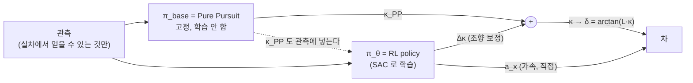

$$\kappa = \underbrace{\kappa_{\text{PP}}}_{\text{base}} + \underbrace{\Delta\kappa_\theta}_{\text{residual}}, \qquad
\delta = \arctan(L\,\kappa), \qquad
a_x = a_{x,\theta}\ (\text{base 없음})$$

| 기호 | 뜻 |
|---|---|
| $\kappa_{\text{PP}}$ | PP 가 낸 곡률 명령 [1/m] |
| $\Delta\kappa_\theta$ | RL 이 더하는 곡률 보정. 범위 ±0.40 (최대 곡률 1.349 의 30%) |
| $\delta$ | 앞바퀴 조향각 [rad]. 최대 ±0.4189 (24°) |
| $L$ | wheelbase(앞뒤 차축 거리) 0.33 m |
| $a_x$ | 가속도 명령 [m/s²]. RL 이 직접 낸다 |
| $\theta$ | policy 신경망의 가중치 |

**왜 조향만 residual 인가** — 원칙: *믿을 수 있는 base 가 있는 축만 residual 로 한다.*
조향의 PP 는 저속·고마찰에서 기하적으로 정확하다. 속도에는 그런 base 가 없다
(스택의 가속 한계 표는 자리표시자 값이고, 우리가 고른 숫자를 넣으면 결국 그 숫자가 성능 상한이 된다).

**residual 이 PP 보다 잘할 수 있는 근거** — PP 는 기하(목표점·곡률)만 본다.
RL 은 횡속도 $v_y$, yaw rate $\dot\psi$, 직전 조향의 **이력**을 본다.
"이만큼 꺾었는데 이만큼밖에 안 돌았다 → 미끄럽다" 를 이력에서 읽을 수 있다. **이 관측 차이가 보정 능력의 상한이다.**

**시작점이 PP 다** — 조향 보정 출력층을 0 근처로 초기화하면 학습 첫 순간의 컨트롤러가 PP 그대로다.
처음부터 아무것도 모르는 policy 로 시작하는 것(E2E)보다 학습이 안정적이고, 초기에 차가 벽에 박는 일이 줄어든다.

### 1-3. 컨트롤러의 역할 범위 — 라인 추종 전용

경로를 **어디로** 그릴지(raceline, 추월 경로)와 **언제** 추월할지는 기존 스택의 planner·state machine 이 정한다.
우리 컨트롤러는 그 경로 위에서 **얼마나 빠르게, 미끄러짐 속에서 어떻게 라인에 붙어 있을지**만 정한다. 라인을 바꿀 권한이 없다.
그래서 학습 때도 raceline 한 줄만이 아니라 planner 가 줄 수 있는 **여러 경로**(옆으로 옮긴 경로, 갑자기 바뀌는 경로)를 따라가게 한다.

---

## 2. 핵심 개념 여섯 가지

### 2-1. Pure Pursuit — 목표점을 지나는 원

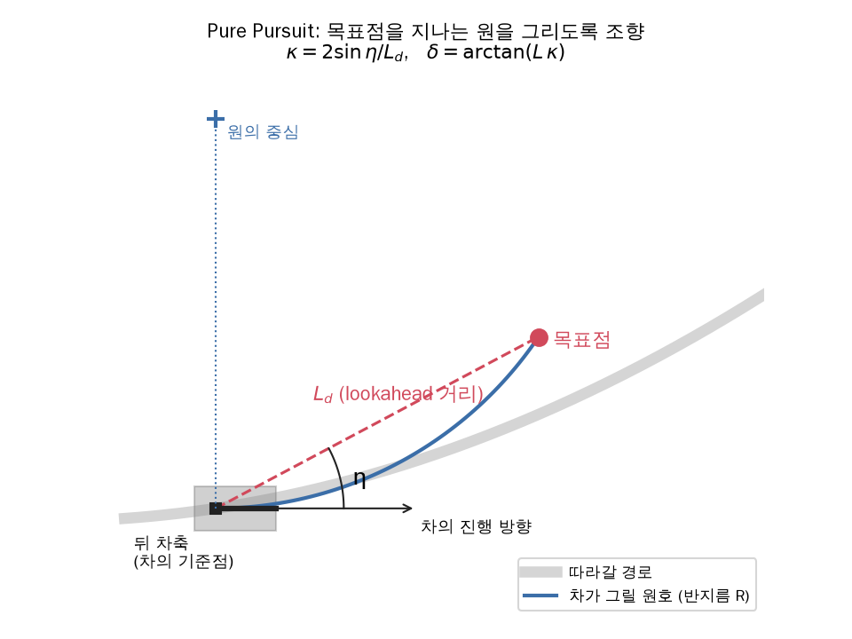

$$L_d = \mathrm{clip}(m\,v + q,\ t_{\min},\ t_{\max}), \qquad
\kappa_{\text{PP}} = \frac{2\sin\eta}{L_d}, \qquad
\delta = \arctan\!\left(\frac{2L\sin\eta}{L_d}\right)$$

| 기호 | 뜻 | 값 (스택 `controller.yaml`) |
|---|---|---|
| $L_d$ | lookahead 거리 — 경로 위 목표점까지 거리. 빠를수록 멀리 본다 | |
| $v$ | 현재 속도 | |
| $m, q$ | 속도 비례 계수, 절편 | 0.47, −0.2 |
| $t_{\min}, t_{\max}$ | lookahead 하한·상한 | 0.7 m, 8.0 m |
| $\eta$ | 차의 진행 방향과 "뒤 차축 → 목표점" 방향의 사잇각 | |

뒤 차축을 지나고 진행 방향에 접하면서 목표점을 지나는 원은 하나뿐이고, 그 원의 곡률이 $2\sin\eta/L_d$ 다.
**실패 모드:** 바퀴가 미끄러지면 같은 δ 에서 실제 곡률이 작아진다 — PP 는 다음 순간 η 가 커진 것을 보고서야 반응한다(늦다).

### 2-2. Residual policy

일반형은 $a = \pi_{\text{base}}(s) + \pi_\theta(s)$ — 고정된 기존 컨트롤러에 학습하는 보정을 더한다.
참고: Silver et al. 2018 *Residual Policy Learning* (arXiv 1812.06298), Johannink et al. 2019 *Residual Reinforcement Learning for Robot Control* (arXiv 1812.03201).
→ [[Residual Policy Learning]]

### 2-3. SAC — 쓸 RL 알고리즘

$$J(\pi) = \mathbb{E}_{\tau\sim\pi}\Big[\sum_t \gamma^t\big(r(s_t,a_t) + \alpha\,\mathcal{H}(\pi(\cdot\mid s_t))\big)\Big]$$

| 기호 | 뜻 |
|---|---|
| $\tau\sim\pi$ | policy $\pi$ 로 달렸을 때 생기는 궤적(상태·행동의 연속)에 대한 기댓값 |
| $\gamma$ | discount — 먼 미래 보상을 얼마나 깎을지 (0.99 면 50 Hz 에서 약 2 초 앞까지 본다) |
| $r$ | 보상 (2-6 절) |
| $\mathcal{H}$ | entropy — 행동을 얼마나 무작위로 고르는지. 크면 탐험을 많이 한다 |
| $\alpha$ | entropy 가중치. SAC v2 는 자동으로 조절한다 |

보상만 최대화하지 않고 **"가능한 한 무작위로 행동하면서"** 최대화한다 → 탐험이 저절로 되고, 한 가지 행동에 일찍 굳지 않는다.
off-policy(과거 경험을 replay buffer 에 모아 다시 씀)라 시뮬레이터 시간을 아낀다. 연속 행동(조향·가속)에 맞는다.
참고: Haarnoja et al. 2018 SAC (arXiv 1801.01290), SAC v2 (arXiv 1812.05905). → [[SAC (Haarnoja 2018)]]
구현은 CleanRL `sac_continuous_action.py` 계열을 직접 쓴다(내부를 이해하는 것이 목적이라서).

### 2-4. Asymmetric actor-critic — critic 에게만 정답 일부를 보여 준다

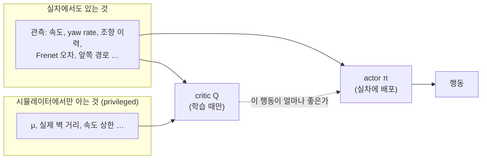

- **actor**(행동을 내는 신경망)는 실차에서도 얻을 수 있는 관측만 받는다 → 그대로 배포된다
- **critic**(행동의 가치를 평가하는 신경망)은 학습 때만 쓰이므로 시뮬레이터만 아는 값을 받아도 된다

**μ 를 critic 에 주는 이유** — 같은 상태·행동이라도 μ 에 따라 진짜 가치가 다르다:

```
같은 (s, a):  μ = 1.0 → 진짜 가치 100
              μ = 0.3 → 진짜 가치  40
μ 를 모르는 critic:  Q(s,a) ≈ 70     ← 어느 μ 에서도 맞지 않는 평균
```

μ 가 숨은 변수(hidden parameter)로 남으면 critic 이 평균을 배우고, actor 는 그 흐린 신호로 배운다.
critic 에 μ 를 주면 이 모호함이 사라진다. TM07 의 critic 관측(24 차원)에는 동역학 파라미터가 없다 → **우리 차별점**.
조건: actor 가 이력에서 **원리적으로 추론할 수 있는 것**만 critic 에 준다(μ 는 "꺾은 만큼 안 돈다" 에서 추론 가능).
참고: Pinto et al. 2017 *Asymmetric Actor Critic for Image-Based Robot Learning* (arXiv 1710.06542).

### 2-5. Frenet 좌표 — 경로 기준으로 위치를 잰다

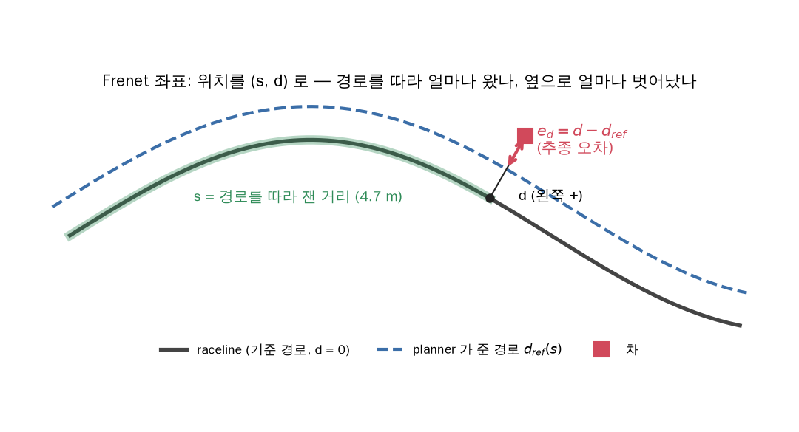

| 기호 | 뜻 |
|---|---|
| $s$ | raceline 을 따라 잰 거리 [m] — "얼마나 왔나". 한 바퀴 합은 트랙 길이로 고정 |
| $d$ | raceline 에서 옆으로 떨어진 거리 [m], 왼쪽이 + |
| $d_{\text{ref}}(s)$ | planner 가 준 경로를 raceline 기준 옆 거리로 나타낸 것 (raceline 이면 0) |
| $e_d = d - d_{\text{ref}}$ | **추종 오차** — 따라가야 할 경로에서 얼마나 벗어났나 |

병렬로 도는 여러 차의 위치를 GPU 에서 한 번에 변환하는 코드(`common/frenet.py`)를 만들어 두 맵에서 검증했다. → [[Frenet Frame]], [[트랙 생성 · Frenet 변환]]

### 2-6. 보상 — 빠르게, 그러나 라인 위에서

$$r = \underbrace{\Delta s}_{\text{진행}} \;-\; \underbrace{w_d\,\min(|e_d|,\ 0.3)}_{\text{추종}} \;+\; \underbrace{B_{\text{steer}} + B_{\text{accel}}}_{\text{떨림 억제}}$$

| 항 | 뜻 | 왜 |
|---|---|---|
| $\Delta s$ | 한 step 동안 경로를 따라 나아간 거리 | 빠르게 — 고정 시간 안에 많이 가면 = 랩타임 단축. 속도 항이 따로 필요 없다 |
| $w_d\min(\lvert e_d\rvert, 0.3)$ | 추종 오차 벌점 (0.3 m 에서 포화) | **$\Delta s$ 만 주면 코너 안쪽을 자르라고 배운다** — 안쪽으로 0.1~0.3 m 들어가면 같은 속도로도 진행이 8~24% 빠르다(실제 맵에서 계산) |
| $B_{\text{steer}}, B_{\text{accel}}$ | 직전 step 대비 조향·가속 변화량 벌점 | SAC 의 무작위성이 그대로 서보 떨림·휠스핀이 되는 것을 막는다 |

- $w_d$ 의 범위: **0.15 보다 커야** 코너를 자를 이득이 없고, **0.8 보다 크면** 경로가 갑자기 바뀐 순간 "벽에 박고 끝내는 것" 이 이득이 된다(자살 유인). 그 사이에서 3~4 값을 실제로 돌려 **랩타임–추종 오차 곡선**으로 고른다
- 종료: 벽 접촉, 역주행이 계속될 때. $e_d$ 가 크다고 종료하지 않는다(경로가 바뀐 직후 1 m 벗어나는 건 정상)

---

## 3. 무엇과 비교해서 무엇을 보이나

| 실험 | 조향 | 속도 | 묻는 것 |
|---|---|---|---|
| 기준선 | 스택 `Controller.py` (보정 전부) | 스택의 속도 프로파일 × 0.8 | 실전 스택 대비 |
| PP 단독 | 순수 PP | 비교용 속도 규칙 | PP 가 어디서 무너지나 |
| 속도만 RL | 순수 PP (고정) | RL | 속도를 RL 에 맡긴 효과 |
| **우리 방법** | PP + RL 보정 | RL | 조향 보정까지 더한 효과 |

"속도만 RL" 이 있어야 "우리 방법" 의 이득을 **속도 덕**과 **조향 보정 덕**으로 나눌 수 있다.
μ ∈ {1.0, 0.7, 0.5, 0.42, 0.35, 0.25} × 3 랩. 성공 기준은 **두 축** — 랩타임과 추종 오차(RMS $e_d$).
"같은 정밀도에서 더 빠르다" 또는 "같은 속도에서 더 정확하다" 로 말한다.

> [!tip] 리포트에 넣을 그림 세 가지 (계획)
> 1. 조향 보정 크기 vs 슬립각·μ·속도 — 보정이 "미끄러짐을 메우는 양" 임을 보인다
> 2. 학습된 속도 프로파일 vs 마찰 한계 $\sqrt{\mu g/|\kappa|}$ — RL 이 μ 에 맞는 속도를 스스로 찾았음을 보인다
> 3. 랩타임 vs RMS $e_d$ — 우리 방법의 곡선과 비교군의 점

---

## 4. 어디서 무엇이 도는가

### 4-1. 컴퓨터와 저장소

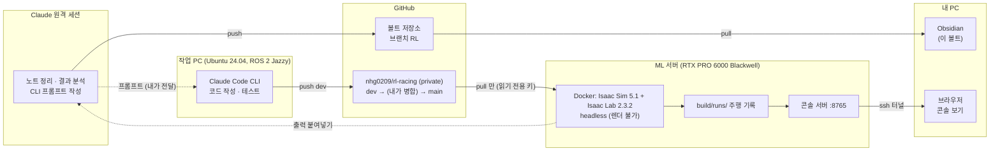

- 서버는 **pull 만** 한다 (커밋하지 않음). Isaac 이 필요한 실행은 서버에서, 코드 작성·단위 테스트는 작업 PC 에서
- 서버의 GPU 드라이버(595)와 Isaac Sim 5.1 이 맞지 않아 **카메라 렌더가 안 된다** → 영상은 기록한 자세로 다시 그린다(콘솔의 3D 다시보기)
- `main` 병합은 항상 내가 한다

### 4-2. 코드 구조 — 실차와 공유하는 코드를 한 곳에

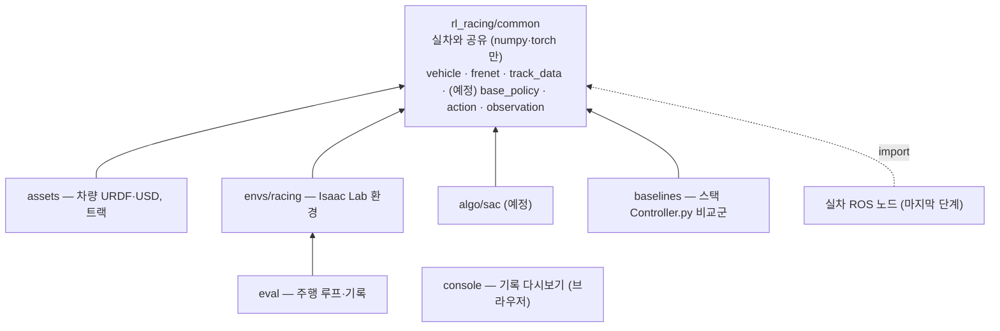

학습 코드와 실차 코드가 **한 글자라도 다르면 그 차이가 그대로 reality gap** 이다.
그래서 관측 조립·행동 변환·차량 상수는 `common` 한 곳에 두고 sim 과 실차가 같은 파일을 쓴다.
`common` 은 Isaac·ROS 를 import 하지 못하게 테스트로 막아 두었다.

---

## 5. 지금까지 한 일 — 큰 흐름

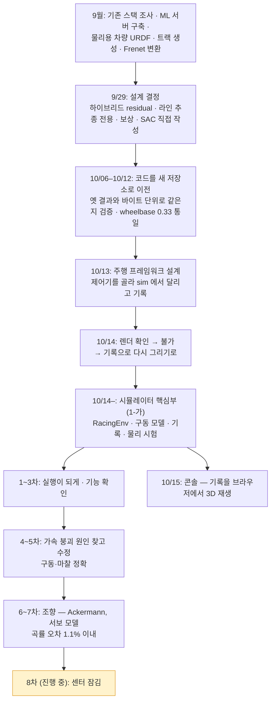

| 차수 | 한 일 | 찾은 것 |
|---|---|---|
| 1차 | 첫 실행 | 환경 생성에서 멈춤(Isaac Lab 의 한계값이 숫자가 아니라 텐서). 코드 리뷰로 슬립비 계산 축 오류, **트랙 접촉 센서 필터가 이 PhysX 에서 안 됨** → 벽 판정을 "차 외곽 12점의 경로 기준 여유" 로 바꿈 |
| 2차 | 다시 실행 | 벽 충돌 시험 통과(10 m/s 에서 9.2 mm 파고듦, 관통 없음). **한 프로세스에 환경은 하나만** 만들 수 있다는 제약 발견 |
| 3차 | 기능 확인 | 같은 설정 두 번 → 기록이 **완전히 같다**(비교의 잡음 0). 그런데 물리에 이상 셋: 1 m/s 넘으면 가속이 무너짐, 낮은 μ 에서 마찰이 설정보다 큼, 곡률이 명령보다 2~16% 작음 |
| 4차 | 진단 스크립트 | **가속 붕괴 원인 확정** — 7-1 절. 진단의 힘 열이 측정이 아니었다는 것도(센서가 수직항력만 줌) |
| 5차 | 원인 수정 | 구동이 예측과 0.04% 이내, 마찰 a/μg 0.993~0.997. 남은 건 조향 |
| 6차 | Ackermann | 기하는 맞음. 남은 오차는 조향 경첩이 덜 꺾이는 것 |
| 7차 | 서보 모델 + 강한 경첩 | 곡률 오차 0.19~1.07% (목표 ±3%) |
| 8차 | 센터 잠김 (진행 중) | 7-4 절 |

---

## 6. 시뮬레이터 속 차 — 명령이 바퀴까지 가는 길

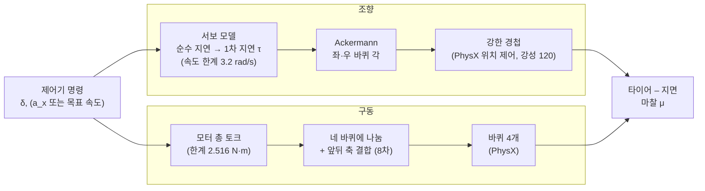

| 차량 수치 (sim) | 값 | 출처 |
|---|---|---|
| 질량 | 3.47 kg | 스택 `dynamics.yaml` |
| wheelbase / 좌우 바퀴 간격 | 0.33 m / 0.2255 m | 스택 / CAD |
| 바퀴 반지름 | 0.0508 m | 스택 시뮬레이터 |
| 최대 조향각 | 0.4189 rad (24°) | 스택 |
| 모터 총 토크 한계 | 2.516 N·m (바퀴당 몫 0.629) | 최대 가속 9.51 m/s² × 1.5 여유에서 계산 |
| 바퀴 armature | 1e-3 kg·m² (실제 바퀴 관성의 11배) | 수치 안정용 — 회전부가 등가질량 1.69 kg 을 더한다 |
| 물리 / 제어 주기 | 200 Hz / 50 Hz | |

> [!warning] 실차는 1/8, 위 수치는 1/10 스택 값이다
> 실차 차량 파라미터 측정이 1순위 리스크로 남아 있다 ([[프로젝트 스택]] §12-1). 9차의 `config/car.yaml` 이 "아직 안 잰 값" 목록을 자동으로 만들게 할 계획이다.

### 6-1. Ackermann — 두 앞바퀴는 다른 각으로 꺾여야 한다

코너에서 안쪽 바퀴는 더 작은 원을 돈다. 두 바퀴가 같은 회전 중심을 갖게 하려면 안쪽을 더 꺾어야 한다:

$$\delta_{L} = \arctan\frac{L\tan\delta}{L - \tfrac{t}{2}\tan\delta}, \qquad
\delta_{R} = \arctan\frac{L\tan\delta}{L + \tfrac{t}{2}\tan\delta}$$

$t$ = 좌우 바퀴 간격, $\delta$ = 자전거 모델의 조향각(명령). 최대 조향에서 안쪽 27.7°, 바깥 21.1°.
안 하면(두 바퀴 같은 각): 두 바퀴가 서로 다른 회전 중심을 원해서 타이어가 서로 싸우고, 실제 곡률이 하중이 큰 쪽 바퀴에 끌려간다.

### 6-2. 서보 모델 — 실차의 조향 지연을 명시적으로

실차 서보는 명령을 받고 **늦게, 정해진 속도 이하로** 움직인다. 경첩을 강하게만 만들면 이 지연이 사라진다
(이 지적이 서보 모델을 넣은 계기였다). 그래서 지연을 소프트웨어로 명시하고, 경첩 자체는 지연 없이 강하게 만들었다.

$$\delta_d'(t) = \delta_{\text{cmd}}(t - d), \qquad
\delta_f \leftarrow \delta_f + \mathrm{clip}\big((1-e^{-\Delta t/\tau})(\delta_d' - \delta_f),\ \pm r\,\Delta t\big)$$

| 기호 | 뜻 | 지금 값 |
|---|---|---|
| $d$ | 순수 지연 — 명령이 늦게 도착하는 시간 | 0 (아직 안 잼) |
| $\tau$ | 1차 지연 시정수 — 도착한 명령을 따라가는 빠르기 | 0.06 s (아직 안 잼) |
| $r$ | 조향 속도 한계 | 3.2 rad/s (스택 값) |
| $\Delta t$ | 물리 step | 0.005 s |

세 값 모두 실차 조향 계단 시험으로 정할 자리다 (차를 들어 올리고 슬로모션 촬영 + 바닥에서 IMU yaw rate).

### 6-3. 센터 잠김 — 실차 구동계 (8차, 진행 중)

실차는 모터 하나가 **센터 디퍼렌셜 없이** 앞뒤 축을 돌린다 → 앞축 평균 속도 = 뒤축 평균 속도.
축 안의 좌우는 디퍼렌셜(open diff)이라 서로 다른 속도로 돌 수 있다.
지금 시뮬레이터는 네 바퀴에 같은 토크를 넣는다(센터가 열린 차) — 앞바퀴가 미끄러지면 앞바퀴만 헛돈다.
PhysX 의 관절 묶음 기능(fixed tendon)은 우리 관절 구조(뒷바퀴가 차체 바로 밑의 형제)로는 쓸 수 없어서,
앞뒤 축 평균 속도 차이에 **가상의 축(스프링 + 감쇠)** 을 걸어 소프트웨어로 묶는다 — 7-4 절.

---

## 7. 물리 검증 — 무엇이 틀렸고 어떻게 찾았나

> [!important] 방법: 결과를 보기 전에 예측을 적는다
> 각 차수마다 "수정하면 이 숫자가 나와야 한다" 를 먼저 계산해 적고, 서버 결과와 대조했다.
> 맞으면 원인을 이해한 것이고, 안 맞으면 모르는 것이 남아 있다는 뜻이다. 코드 수정도 "고치기 전에 실패하는 테스트" 를 먼저 쓴다.

### 7-1. 가속 붕괴 — 단위 하나 (4~5차)

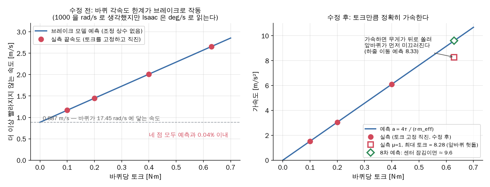

- **증상:** 약 1 m/s 를 넘으면 토크를 아무리 줘도 가속이 무너졌다. 바퀴는 미끄러지지 않았다
- **원인:** 바퀴 링크의 최대 각속도 설정 `max_angular_velocity = 1000`. 쓴 사람은 rad/s 로 생각했지만 **Isaac Lab 은 deg/s 로 읽는다** → 17.45 rad/s = 바퀴로 0.887 m/s. 그 위에서는 PhysX 가 매 step 초과분을 깎아서 **브레이크**처럼 작동했다
- **확인 방법:** 브레이크 모델(조정 상수 없음)로 토크별 끝속도를 예측 → 실측 네 점이 **0.04% 이내** 일치 (왼쪽 그림)
- **수정 후:** 가속도가 $a = 4\tau/(r\,m_{\text{eff}})$ 와 일치 (오른쪽 그림). $m_{\text{eff}}$ = 차 질량 + 회전부 등가질량 = 5.16 kg
- **9월 기준값도 오염돼 있었다:** 9월의 "μ=1 최대 가속 4.88" 은 이 브레이크 아래에서 잰 값이었다. 지금은 8.28 (가속하면 무게가 뒤로 쏠려 앞바퀴가 먼저 미끄러짐 — 예측 8.33)

### 7-2. 마찰 — 설정한 μ 가 그대로 걸리는가 (5~7차)

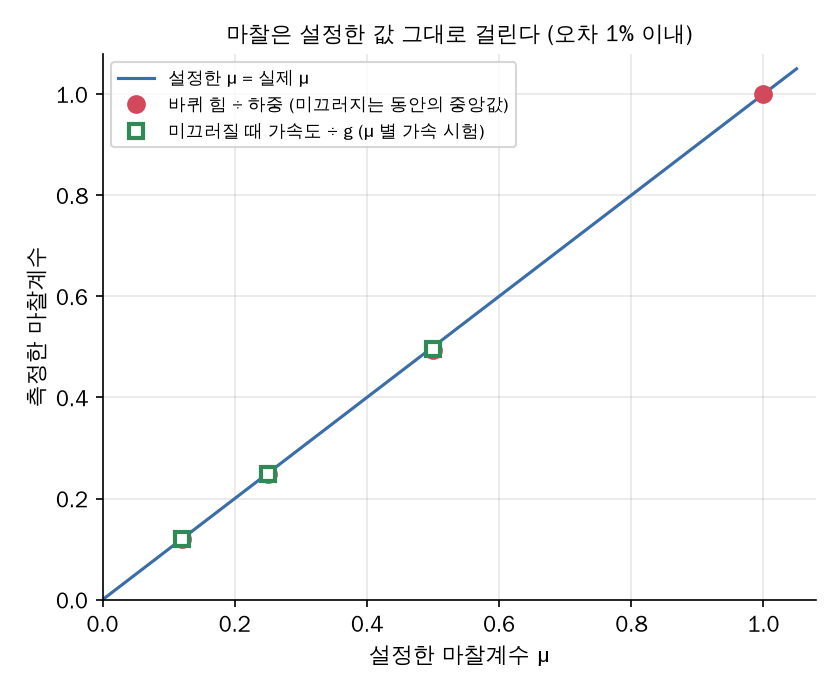

두 가지 독립된 방법으로 확인: ① 미끄러지는 동안 바퀴 힘 ÷ 하중, ② 네 바퀴가 다 미끄러질 때 가속도 ÷ g. 둘 다 설정값과 1% 안쪽.
중간에 배운 것: 접촉 센서의 `net_forces_w` 는 **수직항력만** 준다(마찰력이 아님). 바퀴 힘은 바퀴 운동방정식 $F_x = (\tau - J\,\dot\omega)/r$ 로 구했다.

### 7-3. 조향 — 원인을 하나씩 걷어냄 (5~7차)

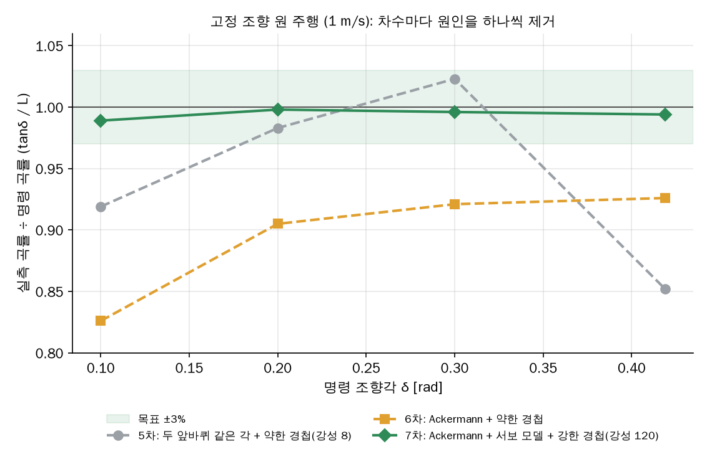

- **5차 (회색):** 두 앞바퀴를 같은 각으로 + 약한 경첩(강성 8). 오차가 들쭉날쭉 — 원인이 둘 섞여 있었다
- **6차 (주황):** Ackermann 을 넣자 오히려 작은 각에서 나빠 보였다. 평행 조향일 때 작은 각에서는 차가 하중이 실린 바깥 바퀴가 원하는 회전 중심(더 작은 원)을 따라 돌아서 곡률이 커지는 효과가 있었고, 이게 경첩이 덜 꺾이는 효과를 일부 가리고 있었다. 기하를 바로잡자 **경첩이 덜 꺾이는 것**만 남았다(타이어의 비틀림 마찰 약 0.16 N·m ÷ 강성 8 ≈ 0.02 rad)
- **7차 (초록):** 경첩을 강하게(강성 120) + 지연은 서보 모델로 → **±1.1% 이내**

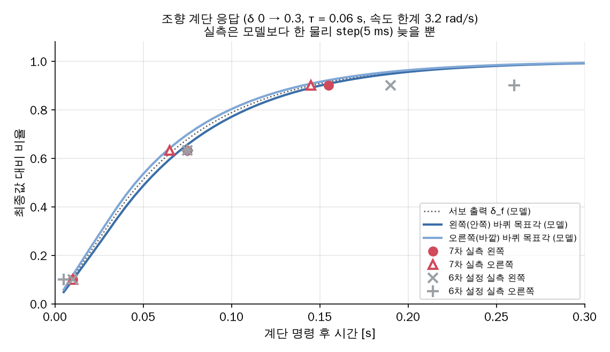

7차의 계단 응답(빨간 점)은 서보 모델 곡선과 거의 겹친다 — 강한 경첩은 서보 출력보다 **한 물리 step(5 ms)** 늦을 뿐이다.
6차 설정(회색)은 63% 까지는 비슷하지만 90% 에 늦게 닿고 끝까지 못 간다(정상상태 오차). τ 기본값은 0.06 으로 두었다 —
6차 응답은 측정값이 아니라 약한 경첩이 우연히 만든 응답이라 맞출 이유가 없다. 진짜 값은 실차에서 잰다.

### 7-4. 센터 잠김 결합 — 얼마나 세게 묶을 수 있나 (8차)

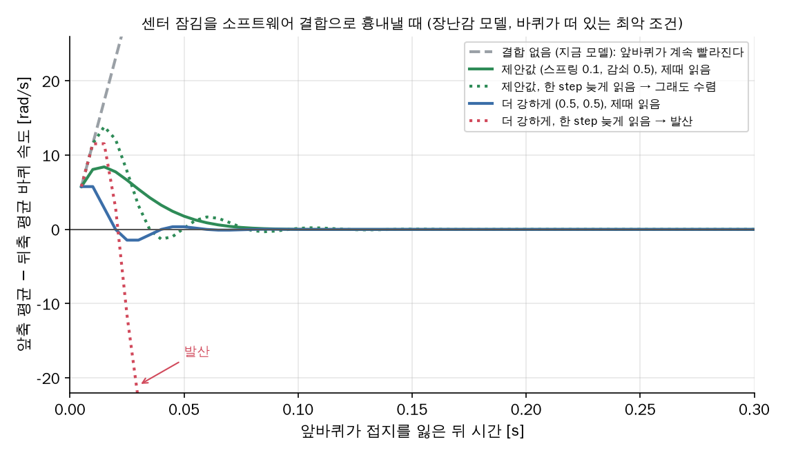

결합 토크 $\tau_c = k\cdot\Delta\theta + c\cdot\Delta\omega$ 를 앞 두 바퀴에서 빼고 뒤 두 바퀴에 더한다 (네 바퀴 합 = 모터 토크 그대로).

| 기호 | 뜻 |
|---|---|
| $\Delta\omega$ | 앞축 평균 − 뒤축 평균 바퀴 각속도 [rad/s] |
| $\Delta\theta$ | 그것을 시간으로 적분한 값 = 가상 축의 비틀림 [rad] |
| $k, c$ | 가상 축의 스프링·감쇠 강도 |

- 토크는 step 시작 시점의 값으로 계산해 그 step 동안 고정한다 → **너무 세게 묶으면 진동하며 발산한다**
- 가장 위험한 경우는 바퀴가 떠 있거나 미끄러질 때(관성이 바퀴 관절 관성뿐). 땅을 잡으면 더 안정하다
- 그림: 결합이 없으면 앞바퀴가 계속 빨라진다(회색). 제안값(초록)은 바퀴 속도를 한 step 늦게 읽는 경우에도 수렴하지만, 더 강한 값(빨강 점선)은 늦게 읽으면 발산한다. 우리 코드는 제때 읽는다는 것을 Isaac Lab 소스로 확인했고, 늦은 경우는 여유로만 검사한다
- 8차 예측: 직진 가속(토크 0.4 이하)·마찰 결과는 그대로, **μ=1 최대 토크 가속이 8.28 → 약 9.6** (앞바퀴가 헛돌 수 없어 남는 토크가 뒤로 감),
  원 선회에서 결합을 끄면 앞축이 4.7% 빨리 돌고 켜면 0

---

## 8. 지금 위치와 앞으로

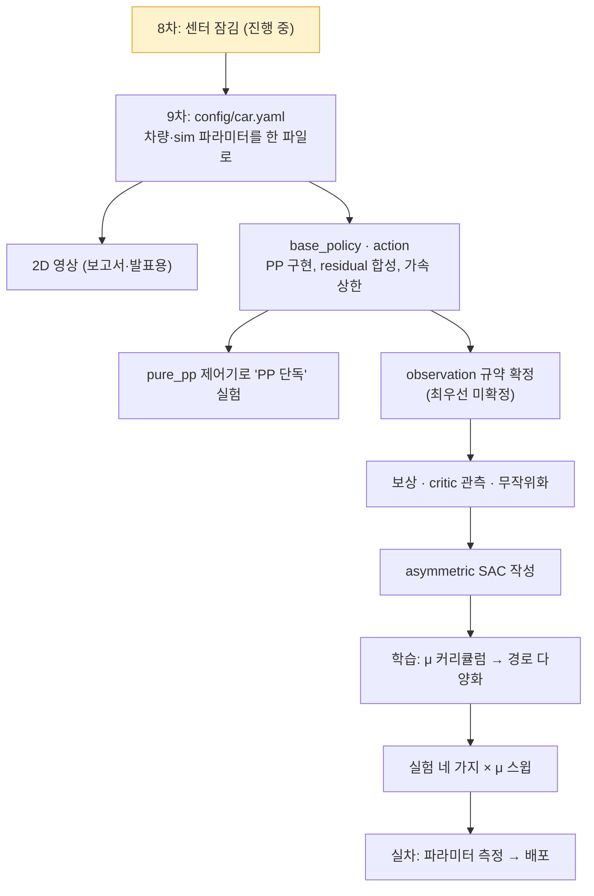

**열려 있는 결정** (각각 위 순서에 맞춰 1단계 설명부터 다시 시작한다):

| 결정 | 왜 아직인가 |
|---|---|
| observation 규약 (actor 관측의 이름·순서·스케일) | 학습 시작 전 반드시 고정. 바뀌면 재학습 |
| 가속 출력 범위 $A_{\max}$ | 9월 값이 브레이크에 오염돼 있었다 → 지금 물리로 다시 |
| action low-pass 를 어디에 거나 (policy 출력 vs 합) | sim 과 실차에 똑같이 걸어야 한다 |
| PP 와 보정을 합칠 때 자르는 순서, trailing 가속 상한 세부 | base_policy 구현 직전 |
| $\gamma$ (몇 초 앞을 볼지) | 실차 제어 주기를 재야 정한다 |
| 실차 서보 지연·τ, 차량 파라미터, 차량 컴퓨터 구성 | 실차 측정 |
| 맵 파이프라인 (실차 맵을 sim 트랙으로) | 결정 대기 |

> [!note] 2026-10-19 부터 진행 방식
> 모든 설계는 **설명(추천 없이) → 내 결정 → 검토 → 작은 단위 구현** 순서로 한다. CLI 프롬프트도 목적 하나·약 30줄 단위로 쪼갠다.
> → `CLAUDE.md` §0

---

## 9. 용어 한 줄 사전

| 용어 | 뜻 |
|---|---|
| Pure Pursuit (PP) | 경로 위 앞쪽 점을 지나는 원을 그리도록 조향하는 기하 공식 |
| residual | 기존 컨트롤러 출력에 더하는 학습된 보정 |
| policy / actor | 관측을 받아 행동을 내는 신경망 |
| critic | 상태·행동의 가치를 평가하는 신경망 (학습 때만) |
| privileged 관측 | 시뮬레이터만 아는 정보 (μ 등) — critic 에만 준다 |
| SAC | entropy 를 같이 최대화하는 off-policy RL 알고리즘 |
| Frenet 좌표 (s, d) | 경로를 따라 간 거리와 옆으로 벗어난 거리 |
| $e_d$ | 따라가야 할 경로에서 벗어난 거리 (추종 오차) |
| μ | 타이어-노면 마찰계수 |
| Ackermann | 안쪽 앞바퀴를 더 꺾어 두 바퀴가 같은 회전 중심을 갖게 하는 조향 기하 |
| armature | 시뮬레이터 안정을 위해 관절에 더하는 가상 관성 |
| PhysX / Isaac Sim / Isaac Lab | 물리 엔진 / NVIDIA 로봇 시뮬레이터 / 그 위의 RL 환경 프레임워크 |
| URDF / USD | 로봇 구조 기술 파일 / Isaac 이 쓰는 장면 파일 형식 → [[URDF 와 USD]] |
| env (병렬 환경) | GPU 한 장에서 동시에 도는 차 한 대 몫의 시뮬레이션 |
| decimation | 제어 1번에 물리 step 몇 번 (우리는 4: 200 Hz 물리, 50 Hz 제어) |
| sim-to-real, reality gap | 시뮬레이터에서 학습한 것을 실차로 옮기기 / 그때 생기는 차이 |
| domain randomization | μ·질량·지연 등을 무작위로 바꿔 가며 학습해 차이에 강하게 만드는 방법 |
| 센터 잠김 / open diff | 앞뒤 축이 같은 속도로 묶인 구동계 / 좌우 바퀴가 다른 속도로 돌 수 있게 하는 기어 |

---

## 참고 문헌

- R. C. Coulter, *Implementation of the Pure Pursuit Path Tracking Algorithm*, CMU-RI-TR-92-01, 1992
- T. Silver et al., *Residual Policy Learning*, arXiv 1812.06298, 2018
- T. Johannink et al., *Residual Reinforcement Learning for Robot Control*, arXiv 1812.03201, 2019
- T. Haarnoja et al., *Soft Actor-Critic*, arXiv 1801.01290 / *Soft Actor-Critic Algorithms and Applications*, arXiv 1812.05905, 2018
- L. Pinto et al., *Asymmetric Actor Critic for Image-Based Robot Learning*, arXiv 1710.06542, 2017
- TM07 리포트, *Reinforcement Learning End-to-End Autonomous Racing Architecture with Asymmetric SAC and Sim-to-Real Pipeline*
- R. Rajamani, *Vehicle Dynamics and Control* (Ackermann 조향·타이어 모델)

## 🔗 연결

- 상세 기록: [[rl-racing 구조]] · [[프로젝트 스택]] · [[공유 인터페이스 (sim ↔ real)]]
- 환경: [[ML 서버 · Isaac Sim 환경]] · [[차량 모델링 (URDF)]] · [[트랙 생성 · Frenet 변환]]
- 개념: [[Residual Policy Learning]] · [[Frenet Frame]] · [[SAC (Haarnoja 2018)]] · [[Asymmetric Actor-Critic (Pinto 2017)]] · [[TC-Driver (ETH 2022)]]
- 질문: [[질문 로그]]
