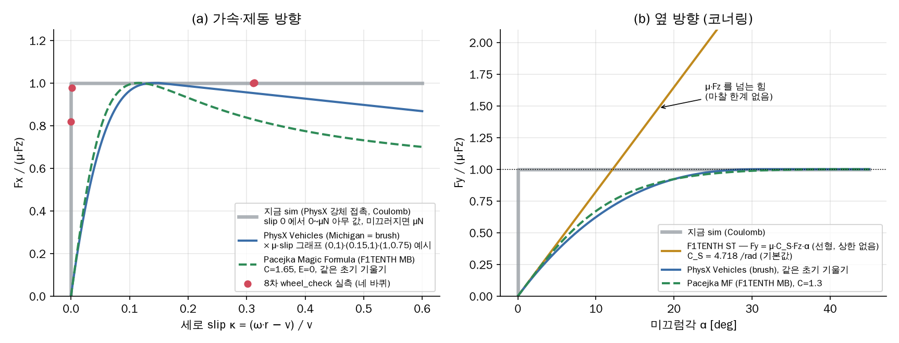
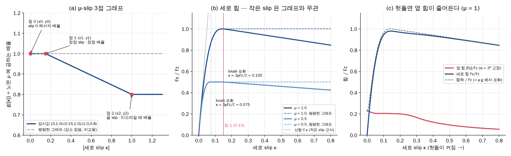
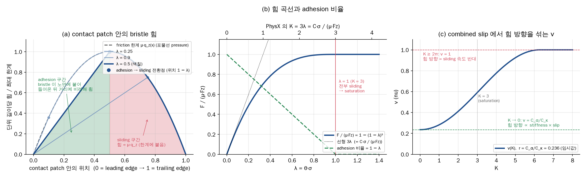

# 질문 로그

논문을 읽으며 던진 질문과 답을 시간순으로 쌓습니다.
각 논문 노트의 「❓ 질문 로그」 섹션과 중복되지만, **여기는 개념별로 다시 찾기 위한 색인**입니다.

> [!tip] 이 파일의 가치
> 같은 질문을 6개월 뒤에 또 던지게 됩니다. 그게 정상입니다.
> 그때 "이건 PPO 읽을 때 물어봤던 것"이라고 연결되면, 그 개념이 **어디서 반복해서 걸리는지**가 보입니다.
> 반복해서 걸리는 개념이 곧 아직 안 잡힌 개념입니다.

---

## 개념별 색인

<!-- 질문이 쌓이면 여기에 개념별로 묶습니다 -->

| 개념 | 관련 질문 | 논문 / 노트 |
|---|---|---|
| Value-based vs Policy-based | policy 없이 학습할 수 있나? | [[SAC (Haarnoja 2018)]] |
| Function approximation / 일반화 | 한 맵에서 학습하면 새 트랙에 적응 못 하나? | [[POMDP]] |
| Asymmetric Actor-Critic | privileged obs를 왜 critic만 받나? | [[Asymmetric Actor-Critic (Pinto 2017)]] |
| Action space 설계 | 곡률을 action으로 두면 PP와 같은 한계인가? | [[프로젝트 스택]] |
| Slip / tire saturation | PP의 언더·오버스티어 한계를 RL이 어떻게 넘나? | [[프로젝트 스택]] |
| Hierarchical RL / options | state machine을 RL로 만들 수 있나? | [[Options framework (Sutton 1999)]] |
| Sim-to-Real tier 구성 | Tier 2는 학습인가 검증인가? | [[프로젝트 스택]] |
| 방법론 선택 (RL vs MPC) | 이 문제에 RL이 적절한가? | [[프로젝트 스택]] |
| Residual Policy Learning | residual RL이 뭔가? | [[Residual Policy Learning]] |
| MSBE / TD error | MSBE minimization 이 뭔가? | [[SAC (Haarnoja 2018)]] |
| TD3 의 세 트릭 | SAC 는 TD3 와 무엇이 같고 다른가? | [[TD3 (Fujimoto 2018)]] |
| off-policy 의 메커니즘 | 왜 `s'` 는 버퍼에서, `ã'` 는 policy 에서? | [[SAC (Haarnoja 2018)]] |
| **Hidden parameter / contextual MDP** | **마찰별 행동을 어떻게 학습하나?** | [[프로젝트 스택]] §10-1 |
| tabular setting | 왜 §4.1 은 tabular 에서만 유도하나? | [[SAC (Haarnoja 2018)]] §4.1 |
| I-projection / partition function | 식 (4) 의 $\exp(Q)/Z$ 와 KL 이 뭔가? | [[SAC (Haarnoja 2018)]] §4.1 |
| Reparameterization trick | $\tilde a=\tanh(\mu+\sigma\odot\xi)$ 를 왜 쓰나? | [[Reparameterization Trick]] |
| done 플래그 $d$ | $r$ 은 어디서 오고 $d$ 는 뭔가? | [[SAC (Haarnoja 2018)]] §5 |
| tanh log-prob 보정 | Appendix C 의 식 (21) 은 왜 필요한가? | [[SAC (Haarnoja 2018)]] Appendix C |
| **reward scale = 1/α** | **reward 를 키우면 왜 탐험이 죽나?** | [[SAC (Haarnoja 2018)]] §3.2·§5.2 |
| alpha 는 무엇을 제어하나 | randomization 하에서 단일 $\alpha$ 로 충분한가? | [[SAC v2 (Haarnoja 2018)]] |
| **선형 타이어 모델의 함정** | **저마찰일수록 조향을 더 하는가?** | [[프로젝트 스택]] §8-5·§12 |
| state-dependent $\sigma_\phi(s)$ | 조건별 탐험량은 누가 배분하나? | [[SAC v2 (Haarnoja 2018)]] |
| Residual base 선정 | 스택 L1 컨트롤러를 residual 의 base 로 쓸 수 있나? | [[Residual Policy Learning]] |
| Residual base 선정 | 가속도 residual 이어야 하나, base 없이 직접 낼 수 있나? | [[Residual Policy Learning]] |
| 속도 프로파일 계산 | 곡률로 속도를 바로 구하면 왜 안 되나? | [[공유 인터페이스 (sim ↔ real)]] §7 |
| 코드 배치 | RL 코드를 스택에 구현해야 하나? | [[공유 인터페이스 (sim ↔ real)]] §0 |
| 보상 설계 / 라인 추종 | progress 보상만으로 라인 추종이 되나? | [[프로젝트 스택]] §10-4 |
| 보상 가중치 | 추종 벌점을 키우면 이탈이 줄어드나? 상한이 있나? | [[프로젝트 스택]] §10-4 |
| 역할 분리 / trailing | 추월을 state machine 에 맡기면 속도는 누가 줄이나? | [[공유 인터페이스 (sim ↔ real)]] §3-1 |
| 횡오차 부호 판정 | 꼭짓점에서 좌우를 어떻게 정하나 (이등분 법선)? | [[Frenet Frame]] §2-4 |

---

## 시간순 로그

<!-- 새 질문은 아래에 추가 -->

### 2026-09-02 · 아카이브 세팅

**Q. 논문 정리는 Notion과 Obsidian 중 어느 쪽이 나은가?**

**A.** Obsidian으로 결정. 근거:
- 수식(MathJax) 편집이 텍스트 기반이라 유도 과정을 쓰고 고치기 빠름
- `[[백링크]]`로 논문 계보를 네트워크로 조직 — 폴더 계층으로는 표현이 안 됨
- 로컬 마크다운이라 소유권·속도·오프라인 확보

**트레이드오프**: Claude가 이 원격 세션에서 로컬 볼트에 직접 접근할 수 없음.
→ git 저장소를 볼트로 삼아 우회. Claude가 push, 사용자가 pull(Obsidian Git 플러그인으로 자동화).

---

### 2026-09-02 · Stage 1 시작 & 프로젝트 방향 논의

**Q. 팡요랩 재생목록 1~5강까지 보라는 말이 맞나?**

**A.** 맞다. David Silver 커리큘럼 10강 중 1~5강이 정확히 Stage 1의 범위다.
1 Introduction · 2 **MDP** · 3 **Planning by DP** · 4 Model Free Prediction · 5 Model Free Control.
5강이 Q-learning으로 끝나고, 그게 Stage 1의 Exit Criteria 지점이다.

- ⚠️ **3강(Planning by DP)을 건너뛰지 말 것.** [[SAC (Haarnoja 2018)]] §4.1 "Soft Policy Iteration"이
  바로 이 3강의 entropy 버전이라, 3강 없이는 §4에서 막힌다.
- 5강까지는 **neural network가 한 번도 안 나온다.** 전부 tabular. 정상이다.
- 6강 Value Function Approximation·7강 Policy Gradient는 Stage 2로 이어진다. 8~10강은 우선순위 낮음.

---

**Q. 한 맵에서 학습시키면 그 트랙에만 맞춰진다면, policy 없이 학습시키면 안 되나?**

**A.** 전제가 틀렸다. **RL에서 policy는 없앨 수 있는 것이 아니다.**

David Silver 1강 *Categorizing RL agents* 슬라이드의 **"Value Based: No Policy (Implicit)"** 를 본 것 같은데,
괄호의 `(Implicit)`이 핵심이다. "policy가 없다"가 아니라 **"따로 저장하지 않는다"**는 뜻이고,
policy는 매번 $\pi(s) = \arg\max_a Q(s,a)$ 로 뽑아낸다. **policy는 항상 존재하고 $Q$ 안에 녹아 있다.**

더 중요한 것:
- **overfit의 원인은 policy가 아니라 function approximator다.** $Q$를 신경망으로 근사하면 $Q$가 똑같이 외운다.
  문제를 $\pi$ 에서 $Q$ 로 옮긴 것뿐이다.
- 그리고 우리 문제는 **연속 action**이라 $\arg\max_a$ 자체가 최적화 문제다. 40 Hz로 못 푼다.
  **바로 이것 때문에 actor가 필요하고**, 그게 DDPG → TD3 → SAC 계보의 존재 이유다.

**track overfit을 실제로 푸는 것** (중요도 순):
1. **관측을 track-agnostic하게** — 절대좌표를 넣으면 반드시 overfit. ego frame 상대량으로
2. 여러 트랙에서 학습 (track randomization)
3. dynamics randomization
4. regularization (SAC의 entropy 항도 일부 기여)

⚠️ 5강까지는 tabular라 **일반화라는 개념 자체가 없다.** 이 얘기는 6강부터 시작된다.

---

**Q. Action space에 조향각 대신 곡률을 넣는다는 게, 변환 노드를 같이 학습시킨다는 건가?**

**A.** 두 군데 다 아니다.

① **$\kappa$ 는 "경로"가 아니라 조향각의 다른 단위다.** 매 제어 스텝의 스칼라 하나이고,
$\delta = \arctan(L\kappa)$ 는 상태도 시간도 없는 정적 전단사 함수다.
"라디안 대신 도(degree)로 명령한다"와 같은 층위이고, 다만 비선형일 뿐이다.

② **변환 노드는 학습되지 않는다.** $\arctan(L\kappa)$ 에 가중치가 없다.
"학습 루프 **안에** 있어야 한다"는 것은 **학습할 때도 그 함수를 통과시켜야 한다**는 뜻이고,
이유는 학습이 아니라 **sim2real**이다 — sim과 real의 변환이 다르면 그 차이가 그대로 reality gap이 된다.
model-free RL이라 미분 가능할 필요도 없다. gradient는 $\nabla_a Q(s,a)$ 로만 흐르고 환경은 블랙박스다.

⚠️ **$\kappa_{\text{cmd}}$ 는 "달성될 곡률"이 아니다.** $\delta = \arctan(L\kappa)$ 는 slip이 0이라는
kinematic bicycle 가정이다. 한계 영역에서 실제 궤적 곡률은 다르고, **그 차이를 메우는 게 RL의 일**이다.
변환을 "정확하게" 만들려고 slip을 추정하기 시작하면 모델 지옥으로 돌아간다.

---

**Q. PP를 버리고 RL을 고민한 이유가 슬립인데, 지금 action space면 같은 리스크 아닌가?**

**A.** 아니다. 다만 **직관이 정확히 맞는 자리가 따로 있다.**

PP의 실패는 두 단계로 분해된다:
① 기하 법칙 $\kappa_{\text{req}} = 2y/L_d^2$ ② 변환 $\delta = \arctan(L\kappa)$.
**치명상은 ①이다.** 언더스티어가 나도 PP는 인지할 방법이 없다 — 피드백 경로가 없다.

> **PP의 한계는 "변환식이 kinematic이라서"가 아니라, "슬립을 관측하지도 피드백하지도 않아서"다.**

RL은 ①을 통째로 대체하고 ②만 남는다. 그리고 ②는 **단조 전단사**라 어떤 $\delta$ 든 대응하는 $\kappa$ 가
정확히 하나 있다. **표현력 손실이 0.**

**직관이 적중하는 진짜 자리**: `k_fric = μg/v²` clip. 여기가 $\mu$ 를 가정하는 **모델 재삽입** 지점이다.
→ $\mu$ 를 randomization 대상에 넣거나, 성능 한계가 아닌 **안전 봉투**로 넉넉하게.

**슬립 강건성의 실제 원천** (중요도 순): 관측($v_y$/$\beta$, $\dot\psi$) + history stacking → randomization
→ reward → **action space(가장 덜 중요)**.

⚠️ 그리고 더 큰 문제를 발견했다: **`f1tenth_gym`의 타이어 모델이 선형이라 포화가 없다.**
$\mu$ 를 낮춰도 "그립이 떨어져 놓이는" 한계 거동이 재현되지 않는다. → [[프로젝트 스택]] §8-5

---

**Q. state machine을 RL로 구현할 수 있나? point cloud로 정적·동적 장애물을 판별해서 state를 정하도록.**

**A.** 완전히 다른 두 문제가 묶여 있다.

**(a) 인지** — RL은 틀린 도구다. 정답 라벨이 있는 문제는 supervised의 영역이고,
RL은 에피소드당 스칼라 하나를 받는다. **게다가 스택에 이미 있다**:
`perception/detect.cpp` + `multi_tracking.py`, `Obstacle.msg`의 **`bool is_static`**,
`vs/vd` + `vs_var/vd_var`, `grid_filter`(맵 차분) + `polygon_filter`.

**(b) 결정** — 가능하다. 이름은 **Hierarchical RL / options**. 하지만 지금은 아니다:
1. **데이터 $1/k$** — 30초 에피소드에서 하위 1,200 스텝 vs 상위 5~10 결정
2. 두 층 동시 학습 시 상호 non-stationarity → 하위를 먼저 얼려야 한다
3. credit assignment 최악 (드문 결정 + 지연된 결과)
4. 지금 것이 잘 작동한다 (`state_transitions.py` 170줄, 읽고 테스트하고 디버깅 가능)

더 나은 중간 단계: ① FSM 구조 유지 + 임계값만 CMA-ES/BO로 최적화 ② 연속 스칼라 하나만 학습
③ 하위에 정보를 주고 암묵 처리(TM07의 `I_overtake`) ④ 제대로 된 semi-MDP HRL(M6 이후)

→ [[Options framework (Sutton 1999)]]

---

**Q. 상위·하위 policy를 더 자세히.**

**A.** option $\omega = \langle \mathcal{I}_\omega, \pi_\omega, \beta_\omega \rangle$ —
initiation set / intra-option policy / termination condition. 그 위에 상위 policy $\pi_\Omega(\omega|s)$.

**우리 state machine이 이미 이 구조다**: `StateType` 8개 = option 8개,
`state_transitions.py` = $\mathcal{I}_\omega$ 와 $\beta_\omega$, planner+controller = $\pi_\omega$,
`state_machine_node.py` = $\pi_\Omega$. **전부 손으로 쓰여 있을 뿐이다.**

**semi-MDP** — 상위의 한 transition은 $(s_t, \omega, R, s_{t+k})$, $R = \sum_{i=0}^{k-1}\gamma^i r_{t+i}$ 이고
Bellman이 $\gamma$ 가 아니라 $\boldsymbol{\gamma^k}$ 를 쓴다. 여기서 두 가지가 따라 나온다:
- 상위 샘플 수 = 하위 / $k$
- $\gamma = 0.99, k = 100$ 이면 $\gamma^k \approx 0.37$ → 상위는 훨씬 근시안적. **상위 전용 $\gamma_\Omega$ 를 크게(0.999)**

**학습 방식 3가지**: (a) 상위만 학습(하위 freeze) — 실무 표준 · **(b) 상위 고정 + 하위만 학습 — 우리의 현재 계획**
· (c) 동시 학습 — Option-Critic 계열, **option collapse**(한 option만 쓰이거나 매 스텝 종료) 때문에 불안정

**워크스루**: 2.4초짜리 추월 한 번 = 하위에게 96 샘플, **상위에게 1 샘플.**

---

**Q. 이 방안은 E2E와 거리가 있는 거지?**

**A.** 맞다. **더 이상 E2E가 아니다.** 학습 범위가 "주행 전체"에서 "제어 한 층"으로 줄었다.
다만 제어 층 안에서는 여전히 end-to-end다 — **E2E driving은 아니고 E2E control은 맞다.**

| policy 관측 | 성격 |
|---|---|
| LiDAR + ego | 순수 E2E. localization 불필요 |
| **path + LiDAR + ego** | **하이브리드 (권장)** — planner가 틀렸을 때 policy가 뒤집을 수 있다 |
| path + ego | 완전 모듈형 tracking controller |

**후퇴가 아니다.** 실차 배포에서 RL 컨트롤러가 고전 컨트롤러보다 느리다는 관찰이 반복되고,
[[TC-Driver (ETH 2022)]]는 하이브리드가 E2E 대비 충돌률 1/10임을 보였다.
E2E의 화려한 성과는 대부분 시뮬레이션이다.

⚠️ 다만 **E2E를 버리지 말고 baseline으로 구현**할 것. 3-way 비교(rule-based / E2E / TC)가
"못 해서 안 한 게 아니라 비교해서 골랐다"를 성립시킨다.

---

### 2026-09-13 · 방법론 선택 — 이 문제에 RL이 적절한가?

**Q. 주어진 경로를 어떤 노면에서든 robust하고 빠르게 추종하는 것이 목표다. RL이 적절한 접근인가, 더 좋은 방안이 있나?**

**A.** RL은 방어 가능하다. **단 정당화 이유를 바꿔야 하고, 논문 논거도 수정해야 한다.**

#### ① "RL은 모델이 필요 없다"는 틀렸다

**시뮬레이터가 모델이다.** RL은 모델 문제를 없애지 않고 **옮긴다**:

| | 모델이 필요한 지점 | 형태 |
|---|---|---|
| MPC | **런타임** | $\mu$, $C_S$ 의 **점추정** |
| RL | **학습 시점** | 시뮬레이터 + 파라미터 **분포** |

증거는 코드에 있다 — `f1tenth_gym`의 타이어 모델이 **선형이라 포화가 없다** ([[프로젝트 스택]] §8-5).
**없는 현상은 배울 수 없다.**

#### ② 진짜 경쟁자들

| 방법 | 슬립 | 노면 적응 | 빠른가 | 연산 | 필요한 것 |
|---|---|---|---|---|---|
| PP / Stanley | ❌ | ❌ | △ | 무시 | — |
| PP + $\mu$ 추정 gain scheduling | △ | ○ | △ | 낮음 | 온라인 $\mu$ 추정 (한계 전엔 관측 불가 — 닭과 달걀) |
| SMC / $\mathcal{L}_1$ adaptive | ○ | ✅ | ❌ **보수적** | 낮음 | 불확실성 상한 |
| MPC / MPCC | ✅ | △ | ✅ | 높음 | **정확한 동역학 + friction ellipse** |
| **AD-MPCC** | ✅ | ✅ | ✅ | 높음 | ⚠️ *"unknown multiple-surface robustness"* 를 명시 타겟 |
| GP-MPC (Kabzan) | ✅ | ✅ | ✅ | 매우 높음 | nominal 모델 + 주행 데이터 (±15% 오차 보정) |
| MPPI + learned dynamics (AutoRally) | ✅ | ✅ | ✅ *"beyond the friction limits"* | GPU | 학습된 동역학 |
| ILC | ✅ | ❌ | ✅ | 낮음 | **같은 경로 반복** |
| **Residual RL** | ✅ | ✅ | ✅ | 낮음 | baseline + 시뮬 |
| model-free RL (현재 계획) | ✅ | ✅ | ✅ | **0.25 ms** | 좋은 시뮬 + randomization |

⚠️ **ILC는 탈락.** state2/state3는 매번 다른 회피 스플라인이 나온다 → 같은 경로 반복이 성립하지 않는다.

#### ③ ⚠️ 논문 논거 수정 — 가장 중요

| 주장 | 판정 |
|---|---|
| "PP가 노면 마찰 변화에 대응 못 한다" | ✅ 맞다 |
| "그래서 고전 제어로는 안 된다" | ❌ **성립하지 않는다** |

F1TENTH에서 PP vs MPC vs MPCC를 실측 비교한 연구가 이미 있고, **PP는 계산만 빠르고 노이즈·지연 하에서 열등**했다.
심사에서 *"MPCC 쓰면 되지 않나요?"* 가 나온다.

**방어 가능한 gap으로 재정의:**
> 고전 최적제어는 슬립을 다룰 수 있지만 **정확한 모델과 노면별 파라미터 동정을 전제**한다.
> 그 비용이 이 플랫폼에서 감당 불가능하다.

**그 증거를 이미 갖고 있다** ([[프로젝트 스택]] §6·§12-1):
- `CAR/dynamics.yaml` == `SIM/dynamics.yaml` (바이트 단위) → 실차 동정 미수행
- `ggv.csv` 속도 무관 상수 → 가감속 한계 미측정
- `racecar_f110.ini` ↔ `dynamics.yaml` 이 mass·length·`v_max`·`delta_max` 불일치
- 값이 전부 1/10인데 차량은 **1/8**

→ **저장소 조사 결과가 곧 연구 동기다.**

#### ④ 그럼에도 RL이 이 상황에서 유리한 이유

1. **불확실성 처리 방식** ← 결정적. MPC는 $\mu$ 의 점추정을 요구하고 틀리면 그만큼 깎인다.
   RL은 randomization으로 **무지를 감싼다** — 파라미터를 모르는 게 설계 전제다
2. **연산** — TC-Driver 실측 RL 0.25 ms vs MPC 11.5 ms (약 40배). Orin Nano에서 NMPC 40~100 Hz는 빡빡
   > ⚠️ 2026-09-29 정정: 차량 컴퓨터는 Orin Nano 가 아니라 **NUC 또는 Mac** 이다. x86/Apple CPU 에서는 NMPC 실시간성이
   > 훨씬 덜 빡빡하므로 **이 근거는 약해진다.** 결론(RL 선택)은 1번(불확실성 처리)이 결정적이라 유지된다.
3. **한 학기 비용** — 역설적으로 MPC가 일이 더 많다 (타이어 동정 + Pacejka 피팅 + solver + QP 튜닝 + 실시간성).
   그리고 **MPCC on F1TENTH는 이미 여러 번 됐다** → novelty 약함

#### ⑤ 권고

1. RL 유지. 단 **residual RL을 1순위 후보로** (기존 L1/PP 위에 보정항만 → 리스크 급감)
2. **MPCC를 baseline에 추가.** [[TC-Driver (ETH 2022)]] repo에 이미 구현돼 있다.
   4-way 비교(PP / MPCC / E2E RL / TC RL)면 논문 강도가 달라진다. 최소한 related work에서 정직하게
3. **Tier 1 타이어 포화 추가는 선택이 아니다**
4. 대안 하이브리드: 학습은 **grip 추정(저차원 latent)만**, 제어는 고전이 소비 → 학습 문제 축소 + 검증성 유지

#### ⑥ "robust하고 빠르게"는 트레이드오프다

robust하게 만드는 **고전적** 방법(SMC, 보수적 friction ellipse)은 **느려진다.** 성능을 팔아 안전을 산다.
빠르면서 robust하려면 **적응**이 필요하고, 방법 선택은 **"적응을 어디에 두느냐"** 다:

| 적응의 위치 | 방법 |
|---|---|
| **모델**에 | GP-MPC |
| **샘플링**에 | MPPI + learned dynamics |
| **policy**에 | **RL** ← 우리 |

**셋 다 결국 학습한다.** 차이는 *무엇을* 학습하느냐이고, **가장 적게 알아야 하는 쪽이 policy다.**

---

**참고**: [MPCC (Liniger, ETH — 오픈소스)](https://github.com/alexliniger/MPCC) ·
[AD-MPCC](https://arxiv.org/html/2607.00141) ·
[Kabzan, *Learning-Based MPC for Autonomous Racing*](https://www.semanticscholar.org/paper/77b3f96aeb3a74e7bc864695904d5f35c8dea1b9) ·
[AutoRally](https://arxiv.org/pdf/1806.00678) · [BayesRace](https://arxiv.org/html/2005.04755) ·
[F1TENTH 통합 서베이](https://arxiv.org/pdf/2402.18558) ·
[PP vs MPC vs MPCC 실측 비교](https://www.su.ac.za/en/students/news/simulation-reality-assessing-efficacy-pure-pursuit-mpc-and-mpcc-f1tenth-platform)

미해결 링크: [[MPCC (Liniger 2015)]] · [[GP-MPC (Kabzan 2019)]] · [[MPPI (Williams 2016)]] · [[Residual Policy Learning]]

---

**Q. residual RL이 뭐야?**

**A.** policy가 action 전체를 내는 대신 $a_t = \pi_{\text{base}}(s_t) + \pi_\theta(s_t)$ 로,
**기존 컨트롤러 출력에 얹을 보정항만** 학습하는 것. 우리는 `controller/combined` 의 L1/Pure Pursuit을
고정 baseline으로 두고 RL이 *"PP가 틀리는 만큼"* 만 배운다.

핵심 이점은 **① 탐색이 step 0부터 랩을 완주하는 상태에서 시작** ② 학습 대상이 작다
③ clip으로 **검증 가능한 안전 하한** ④ sim2real 위험이 residual 크기로 제한
⑤ residual 로깅으로 baseline 실패 지점이 보인다
⑥ **residual 자체가 "kinematic 모델이 표현 못 하는 슬립 보정량"** → 논문의 핵심 그림이 된다.

⚠️ 긴장 하나: PP를 남기면 **PP 게인이 루프에 그대로 있어** *"no tuning"* 주장이 약해진다.
→ (a) *"tune once, adapt automatically"* 로 문구 수정, 또는 (b) attenuated residual로 baseline을 떼어낸다.

전체 정리(구현 디테일 4개, 실패 모드 4개, 변종 3가지, 코드 골격)는 **[[Residual Policy Learning]]** 으로 분리.

---

### 2026-09-14 · Spinning Up SAC 읽기 — off-policy 의 메커니즘과 hidden parameter

**Q. MSBE minimization 이 뭐야?**

**A.** **Mean Squared Bellman Error.** ch8 에서 DQN 을 학습시킨 그 방식이고, `y` 의 내용만 바뀐다.

```
L(φ) = E[ ( Q_φ(s,a) − y )² ]

DQN :  y = r + γ · max_a' Q_targ(s',a')
SAC :  y = r + γ(1−d) · [ min_j Q_targ,j(s',ã') − α·log π(ã'|s') ]
```

지도학습의 MSE 와 다른 점은 **정답 `y` 가 우리가 학습 중인 Q 로 만들어진다**는 것 (**bootstrapping**).
그래서 ① **target network** 가 필요하고 ② **`y` 에 gradient 를 흘리지 않아야** 한다 (`torch.no_grad()`).
②를 빠뜨리면 *"목표를 예측에 맞추는"* 짓을 하며 **에러 없이 조용히 망가진다.**

용어가 여러 개인데 같은 것: **Bellman error = TD error**, 그걸 제곱해 평균 낸 것이 **MSBE**.
⭐ `02_train_sac.py` 로그의 **`train/critic_loss` 가 바로 이 값**이다.

---

**Q. TD3 와 비교해서 SAC 의 critic 학습을 설명해줘.**

**A.** **TD3 = Twin Delayed DDPG.** DDPG 의 overestimation bias 를 고친 세 트릭:

| 트릭 | 내용 | SAC 가 물려받았나 |
|---|---|---|
| ① **Twin** (clipped double-Q) | critic 2개, target 에 `min` | ✅ **그대로** |
| ② **Delayed** | critic 2회당 actor 1회 업데이트 | ❌ 불필요 |
| ③ **Target policy smoothing** | target action 에 노이즈 + clip | ❌ **policy 확률성이 대체** |

```
TD3 :  y = r + γ(1−d)·min( Q_targ1(s',a'), Q_targ2(s',a') )
              a' = μ_θtarg(s') + clip(ε,−c,c)         ← target policy + 노이즈

SAC :  y = r + γ(1−d)·[ min( Q_targ1(s',ã'), Q_targ2(s',ã') ) − α·log π_θ(ã'|s') ]
              ã' ~ π_θ(·|s')                          ← 현재 policy 에서 샘플링
```

**SAC 에 target policy 가 없는 이유**: TD3 의 policy 는 결정론적이라 Q 의 뾰족한 지점으로 곧장
수렴하려 해서 target 이 요동친다 → 느린 복사본이 필요했다. SAC 의 policy 는 확률적이고 entropy 로
정칙화되어 **애초에 급변하지 않는다.**
→ ⭐ 앞서 낸 확인 질문 *"target network 가 왜 critic 에만 있나"* 의 답.

`− α log π` 가 붙는 근거는 entropy 버전 value function:
```
V^π(s) = E_{a~π}[Q^π(s,a)] + α·H(π)  =  E_{a~π}[ Q^π(s,a) − α·log π(a|s) ]
                                          └── target 안의 그 덩어리 ──┘
```

⚠️ **표기 함정**: soft update 계수가 Spinning Up 은 `ρ = 0.995`, 논문·SB3 는 `τ = 0.005`. **ρ = 1 − τ.**

---

**Q. "RHS 는 next state(버퍼)와 next action(현재 policy)에 대한 기댓값" 이 무슨 뜻이야?**

**A.** ⭐ **여기가 SAC 가 off-policy 인 이유의 정확한 자리다.**

| 무엇 | 어디서 | 왜 |
|---|---|---|
| `s'` | **replay buffer** | 분포 `P(s'\|s,a)` 는 **환경의 성질**. policy 와 무관 → 낡은 데이터도 유효 |
| `ã'` | **현재 policy** (매번 새로 샘플링) | 분포 `π(·\|s')` 는 **계속 바뀐다**. 버퍼의 것은 낡은 policy 산물 |

```
target 의 "다음 행동" 자리를 무엇으로 채우느냐가 알고리즘을 결정한다:

SARSA       :  a' = 버퍼에 저장된 실제 행동        → on-policy
Q-learning  :  a' = argmax_a' Q(s',a')            → off-policy (max)
DDPG / TD3  :  a' = μ_θ(s') / μ_θtarg(s')+노이즈   → off-policy (결정론적 actor)
SAC         :  ã' ~ π_θ(·|s')                     → off-policy (확률적 actor 샘플링)
```

**환경에 관한 부분은 재사용, policy 에 관한 부분은 매번 재계산.** 그게 off-policy 의 메커니즘 전체다.
그리고 기댓값은 `P` 를 모르고(model-free) 연속 적분도 불가능하므로 **몬테카를로 N=1** 로 근사한다
(미니배치 256 + 수십만 스텝이 분산을 흡수).

---

**Q. ★ 우리는 여러 마찰계수에 대한 policy 를 학습하는데, next state 만으로는 action↔next state 관계를 못 담는 것 아닌가? replay buffer 에 next action 을 넣어야 하지 않나?**

**A.** **`next_action` 은 도움이 안 된다.** 하지만 **짚은 문제 자체는 진짜다** — 위치가 한 칸 옆이다.

**① `ã'` 는 환경이 아니라 policy 가 만든 값이라 마찰 정보가 0 이다.** 저장해도 동역학 정보가 안 늘어난다.
그리고 마찰 정보는 **이미 `(s,a,s')` 에 온전히 있다**:
```
같은 (s,a) 를 다른 마찰에서 실행 :
  μ=1.0 → (s,a,r, s'_고그립)   ψ̇ 큼
  μ=0.3 → (s,a,r, s'_저그립)   ψ̇ 작음      ← 두 transition 이 각각 저장된다
```

**② 진짜 문제는 `μ` 가 관측에 없다는 것** — **hidden parameter / contextual MDP**:
```
같은 (s,a)  :  μ=1.0 → 진짜 가치 100
               μ=0.3 → 진짜 가치  40
critic 학습 :  Q(s,a) ≈ E_μ[Q^μ(s,a)] ≈ 70     ← 어느 μ 에서도 최적이 아니다
```
MSE 손실이라 신경망은 **평균**을 배운다. 이게 *"robust 하면 느려진다"* 의 정체.

**③ 해법 — `a'` 가 아니라 관측이다:**

1. **관측에 슬립 이력** — 단일 시점으로는 μ 를 알 수 없지만 **이력이면 알 수 있다**:
   *"δ=0.2 를 걸었는데 ψ̇ 가 0.8 밖에 안 나왔다 → 그립 낮음"*.
   `v_y`(또는 β), `ψ̇`, `δ_{t−1}` + `N=10~20` stacking 필요.
   ⚠️ `obs["linear_vels_y"]` 가 0 하드코딩인 게 **급소**인 이유가 이것.
2. ★ **critic 에게는 μ 를 직접 준다** — critic 은 배포 안 되므로 공짜. [[프로젝트 스택]] §10-1
3. latent context encoder (RMA 류) — 나중 옵션

⭐ **여기서 설계 결정이 나왔다: privileged obs 에 `μ, C_Sf, C_Sr, m, h` 추가.
TM07 의 24-dim 은 전부 기하 정보라 동역학 파라미터가 없다 → 우리 차별점.**

---

**Q. 시뮬에서 critic 에 넘긴 μ 와 실측 μ 의 갭은 어떻게 보완하지?**

**A.** **보완할 필요가 없다. critic 은 배포되지 않는다.**

actor 는 μ 를 **입력으로 받지 않고** 이력에서 추론한다. 실차에서 μ 를 알아야 하는 주체가 없다.

더 근본적으로 — **critic 의 μ 는 물리량이 아니라 "에피소드를 구별하는 라벨"** 이다.
`μ=0.73` 이든 `condition #3` 이든 **구별만 되면 기능이 같다.** 그래서 정규화해서 넘긴다:
```python
mu_norm = (mu - MU_LOW) / (MU_HIGH - MU_LOW)   # 절대값과 무관해진다
```

**⚠️ 진짜 갭은 네 곳이다:**

| | 갭 | 대응 |
|---|---|---|
| **A** | **randomization 범위가 실제를 안 덮음** ← 가장 흔한 실패 | 실측 μ 를 **점이 아니라 분포의 중심**으로. `[0.5×μ, 1.3×μ]` 처럼 넓게. **모르는 만큼 넓게** |
| **B** | 실제 마찰은 **단일 스칼라가 아님** (위치·온도·마모·하중·앞뒤 차이) | 에피소드 내 μ 변화, 앞/뒤 `C_S` 분리. ⚠️ `vehicle_dynamics_st` 는 `mu` 하나만 받음 → 수정 필요 |
| **C** | **선형 타이어 모델** | §8-5. 가장 큰 문제 |
| **D** | actor 의 **추론 구조**가 시뮬 전용일 수 있음 | 서보 지연·백래시·속도추정 지연도 함께 randomize |

**실측 μ 가 진짜로 중요한 곳**: `action_convert.py` 의 `k_fric = μg/v²` clip — **그것만 실차에서 돌아간다.**

⭐ **설계 원칙**: privileged 정보는 **"actor 가 원리적으로 추론 가능한 것"** 으로 제한한다.
그렇지 않으면 actor 가 **실행 불가능한 행동을 향한 gradient** 를 받는다. μ 는 이 조건을 통과한다.

**한 문장으로**: *"critic 에게 μ 를 주는 것은 물리를 알려주는 게 아니라, value 함수의 모호성을 제거하는 것이다."*

---

## 2026-09-14 — SAC 논문 본문 완독 (§3.2 → §4.1 → §4.2 → Appendix C → §5)

전체 정리는 [[SAC (Haarnoja 2018)]]. 여기에는 **개념 색인용 요점만** 남긴다.

---

**Q. "Our derivation is based on a tabular setting…" 이게 무슨 뜻인가?**

**A.** tabular = 상태·행동이 유한해서 $Q$ 를 **표 하나로 정확히** 표현할 수 있는 설정.
그래야 soft Bellman operator 가 contraction 임을 보이고 **고정점 수렴을 증명**할 수 있다.

⚠️ **§4.2 에서 신경망으로 가는 순간 §4.1 의 보장은 전부 무효다.**
논문 구성이 이어지는 것처럼 읽히지만, §4.1 은 "이 업데이트 규칙이 왜 말이 되는가"의 **정당화**일 뿐이다.
그 공백을 메우는 것이 §5.2 Figure 2 의 **seed 안정성 실험**이다 — 증명이 아니라 경험적 주장.

> 같은 구조가 [[TRPO (Schulman 2015)]] → [[PPO (Schulman 2017)]] 에도 있다. **"이론은 tabular/trust-region 에서, 실제는 근사"** 는 RL 논문의 표준 수사다. 읽을 때마다 "이 정리가 실제 알고리즘에 적용되는가"를 따로 물어야 한다.

---

**Q. 식 (4) 의 $\exp(\frac1\alpha Q)/Z$ 와 KL 이 이해가 안 된다.**

**A.** 세 조각으로 쪼갠다.

1. $\exp(\frac1\alpha Q(s,\cdot))$ — **Q 를 확률분포 모양으로 바꾼 것** (energy-based/Boltzmann).
   $\alpha$ 작음 → 뾰족(greedy) / $\alpha$ 큼 → 평평(탐험). ⭐ $\alpha$ 의 의미가 여기서 가장 선명하다.
2. $Z^{\pi_{\text{old}}}(s_t)$ — 정규화 상수. **$a$ 에 의존하지 않는다.**
3. $\arg\min_{\pi'\in\Pi}$ — 우리 policy 는 Gaussian 족 $\Pi$ 에 갇혀 있어 목표 분포에 도달 못 한다.
   **가장 가까운 것으로 투영** = **I-projection**.

⭐ **핵심**: KL 을 펼치면
$$D_{\mathrm{KL}}=\mathbb{E}_{a\sim\pi'}\Big[\log\pi'-\tfrac1\alpha Q+\log Z(s_t)\Big]$$
이고 $\log Z$ 는 $\phi$ 와 무관한 상수 → $\nabla_\phi\log Z=0$.
**계산 불가능한 적분이 gradient 단계에서 통째로 증발한다.** "KL 이 convenient 하다"의 정체가 이것이다.

---

**Q. reparameterization trick 을 더 자세히.**

**A.** $\tilde a_\phi(s,\xi)=\tanh\big(\mu_\phi(s)+\sigma_\phi(s)\odot\xi\big),\ \xi\sim\mathcal N(0,I)$

**무작위성을 파라미터 바깥($\xi$)으로 빼낸다.** 그래야 $\tilde a$ 가 $\phi$ 에 대해 미분 가능하다.

| | gradient 형태 | 분산 |
|---|---|---|
| 그냥 샘플링 | score function: $\nabla\log\pi\cdot Q$ (REINFORCE) | **큼** |
| reparameterization | **pathwise**: critic 을 통과해 흐름 | 훨씬 작음 |

즉 critic 이 *"action 을 어느 방향으로 옮기면 $Q$ 가 오르는지"* 를 **직접 알려준다.**
[[DDPG (Lillicrap 2015)]] 의 gradient 구조와 같되, **stochastic policy 에서도 작동**한다는 것이 SAC 의 핵심 기술.

⚠️ $\odot$ 는 elementwise → **대각 공분산**. action 차원 간 상관은 모델링하지 않는다.
(우리 action 이 $(\kappa, a_x)$ 2차원이면, **조향과 가속의 상관**을 policy 분포가 못 담는다는 뜻. 실제로는 문제되지 않지만 알고는 있어야 한다.)

---

**Q. pseudocode 의 $r$ 은 어떻게 계산되고 $d$ 는 뭔가?**

**A.** $r$ 은 **환경이 주는 것**이지 알고리즘이 계산하지 않는다.
⚠️ **f1tenth_gym 은 `reward = self.timestep` 이 전부다 → 우리가 직접 설계해야 한다.**

$d$ 는 종료 플래그:
$$\hat Q(s,a)=r+\gamma\,(1-d)\,V_{\bar\psi}(s')$$
$d=1$ 이면 부트스트랩을 끊는다.

> [!warning] ⚠️ time limit 함정 — 우리 환경에 직결
> | 종료 사유 | `d` |
> |---|---|
> | 충돌 / 트랙 이탈 (**진짜 종료**) | `1` |
> | 에피소드 최대 스텝 도달 (**임의 절단**) | **`0`** ← 부트스트랩해야 함 |
>
> 구분하지 않으면 policy 가 "에피소드 끝 = 가치 0" 으로 배워 **랩 끝에서 이상하게 감속**한다.
> Gymnasium 의 `terminated` / `truncated` 구분이 정확히 이것이다.

---

**Q. Appendix C 정리**

**A.** $a=\tanh(u)$ 는 **부피를 바꾸는 변환**이라 밀도를 그대로 쓰면 틀린다.

$$\log\pi(a\mid s)=\log\mu(u\mid s)-\sum_{i=1}^{D}\log\big(1-\tanh^2(u_i)\big)\tag{21}$$

- Jacobian 이 **대각**이라 $\log\det$ 가 **차원별 합**으로 분해된다.
- 부호 점검: $1-\tanh^2\in(0,1]$ → $\log\le0$ → 빼면 $\log\pi$ **증가**. tanh 가 공간을 압축하니 밀도가 커지는 게 맞다. ✅

> [!warning] 빠뜨렸을 때의 **조용한** 실패
> `log π` 과소평가 → entropy 과대평가 → $\alpha$ 축소 → **탐험 소멸** → 나쁜 local minimum.
> **에러가 안 난다. 성능만 나쁘다.**

**논문에 없지만 구현에 필수인 두 가지:**
```python
# ① 수치 안정성 — log(0) = -inf 방지. 수학적으로 동일
log_det = 2 * (math.log(2) - u - F.softplus(-2 * u))

# ② action scaling — (-1,1) → 실제 범위 매핑 시 Σ log(scale_i) 가 추가
#    gradient 에는 상수지만 log π 의 절대값을 바꾼다
#    → α auto-tuning 의 H̄ 비교에 직접 영향. v2 에서 반드시 포함
```

⭐ **부수 효과**: 경계 근처 action 은 $\log\pi$ 가 커서 entropy 가 작다 → 목적함수가 싫어한다.
**SAC 는 구조적으로 action saturation 을 회피한다.** 우리가 걱정하던 $\kappa$ clip 붙음 문제를 부분적으로 막아준다.

---

**Q. §5 Experiments 요점**

**A.** 세 가지만 남는다.

**① Figure 2 (stochastic vs deterministic)** — 이 논문에서 가장 값어치 있는 그림.
주장하는 것은 *평균 성능*이 아니라 **seed 간 분산**이다. deterministic 변형(≈DDPG+twin Q)은 seed 마다 천차만별, stochastic 은 5개가 거의 겹친다.
→ **§4.1 의 수렴 보장을 §4.2 에서 잃은 자리를 메우는 경험적 대체물.**
→ **우리 실험 프로토콜도 seed 3~5개 + min/max 밴드로 간다.** seed 1개 결과는 리뷰에서 가장 먼저 지적받는다.

**② reward scale 민감도** (Fig 3b, {1,3,10,30,100}) — §3.2 의 "$\alpha$ 는 reward 에 흡수된다"가 실험으로 나타난 것.
작으면 policy 가 uniform → 보상을 못 씀 / 크면 초반 빠르다가 deterministic → **poor local minima**.
저자: *"the only hyperparameter that requires tuning"*.

Appendix D 에서 패턴이 보인다 — **action 차원이 커지면 reward scale 도 커진다** (3~8dim: 5, 17dim: 20).
entropy 는 차원에 대한 **합**이라 $D$ 에 비례 → $\alpha$ 를 줄여야 한다.
⭐ **이 관찰이 [[SAC v2 (Haarnoja 2018)]] 의 $\bar{\mathcal H}=-\dim(\mathcal A)$ 를 그대로 예고한다.**

**③ $\tau$ (Fig 3c)** — 적정 범위가 **넓다**. 모든 task 에 `0.005` 하나. **튜닝 대상이 아니다.**

> [!warning] ⭐ 우리 프로젝트가 SAC **v2** 를 써야 하는 결정적 이유
> 우리 reward 는 가중합이다:
> ```
> r = w_prog·Δs − w_lat·e_lat² − w_psi·e_psi² − w_act·‖a_t − a_{t−1}‖² − w_col·1[collision]
> ```
> 여기서 **두 노브가 뒤섞인다**:
> - **전체 스케일** (모든 $w$ 에 $c$) → $\alpha$ 변경 = **탐험량** 변경
> - **상대 비중** ($w_{\text{lat}}$ vs $w_{\text{prog}}$) → **task 자체** 변경
>
> v1 은 이 둘이 구분 안 돼 reward 튜닝 한 번에 두 가지가 동시에 변한다.
> 게다가 **domain randomization** 으로 에피소드마다 난이도가 달라지므로, 고정 $\alpha$ 는 저마찰·고마찰에 동시에 맞을 수 없다.
> **→ $\alpha$ auto-tuning 은 선택이 아니라 필수.**

**Appendix D 기본값** (우리 시작점):
```
Adam / lr 3e-4 / γ 0.99 / buffer 1e6 / 2×256 ReLU / batch 256 / τ 0.005 / grad steps 1
```
바꿔야 할 것 두 개:
- **$\gamma$** — 0.99 는 MuJoCo 기준. 50 Hz 에서 $1/(1-\gamma)=100\text{step}=2\text{s}$ 로 **코너 하나도 안 된다.** ⚠️ **제어 주기 측정(`ros2 topic hz`)이 선행돼야 함.**
- **gradient steps** — f1tenth_gym 이 느리면 `>1` 로 sample efficiency 를 올린다. 단 불안정해질 수 있음(Appendix E).

---

## 2026-09-14 — 자가점검 Q5: domain randomization 하에서 단일 $\alpha$ 로 충분한가?

**사용자 답변**: *"바닥 마찰계수가 에피소드마다 다르더라도 난이도가 오를수록 차량의 동작이 일관된 방향으로 이루어짐 — 조향을 더 하고, 종방향 가속을 덜 하는 방향으로. 따라서 $\alpha$ 는 마찰 조건별로 바꿀 필요 없을 듯."*

**평가: 결론은 맞다. 근거는 절반이 틀렸고, 논증 구조는 범주 오류다.**

---

### ① 「저마찰 → 조향 더」 — 시뮬레이터에서는 정확히 맞다

`vehicle_dynamics_st` 의 steady-state 를 직접 풀었다. $v=5\,\mathrm{m/s}$, $R=8\,\mathrm{m}$ ($a_y=3.12\,\mathrm{m/s^2}$), $a_x=0$:

| $\mu$ | 필요 $\delta$ [deg] | $\beta$ [deg] | `s_max` 대비 |
|---|---|---|---|
| 1.049 | 2.86 | −1.96 | 11.9% |
| 0.800 | 3.02 | −2.95 | 12.6% |
| 0.600 | 3.24 | −4.35 | 13.5% |
| 0.400 | 3.67 | −7.13 | 15.3% |
| 0.250 | 4.46 | −12.15 | 18.6% |
| 0.150 | 5.85 | −21.07 | 24.4% |
| 0.080 | **8.91** | **−40.59** | 37.1% |

**단조 증가한다.** 코드에서 이유도 보인다 — $\dot\beta$ 식에서 $\mu$ 가 **약분되지 않는 항이 딱 하나**다:
```
β̇ = ( μ/(v²L)·(C_Sr·lr − C_Sf·lf) − 1 )·ψ̇ − ...
                                    ↑ 이 −1 만 μ 에 안 붙는다 (kinematic 결합항)
```
$\ddot\psi$ 식은 모든 항에 $\mu$ 가 붙어 $\ddot\psi=0$ 에서 통째로 약분된다.
→ 마찰 효과가 **오직 이 한 항**으로만 들어오고, 결과가 깔끔한 단조 understeer.

### ② ⚠️ 그런데 이건 차량의 성질이 아니라 **시뮬레이터의 성질**이다

맨 아랫줄: $\mu=0.08$ 에서 $\beta=-40.6°$. **실차라면 이미 완전히 스핀**인데 모델은 태연히 답한다.
$$\mu\to0\ \Rightarrow\ \delta\approx\frac{vL}{\mu}\cdot\frac{\dot\psi}{C_f}\ \to\ \infty$$
**포화가 없다.** ([[프로젝트 스택]] §8-5 의 그 선형 타이어 모델)

실제 타이어는 $|F_y|\le\mu F_z \Rightarrow a_{y,\max}\approx\mu g$ 로 막혀 있다:

| $\mu$ | $a_{y,\max}=\mu g$ | 이 코너(3.12) | 판정 |
|---|---|---|---|
| 0.60 | 5.9 | 3.12 | 여유 53% |
| **0.40** | **3.9** | 3.12 | 한계의 80% |
| **0.32** | **3.1** | 3.12 | ⚠️ 물리적 한계 |
| 0.25 | 2.5 | 3.12 | ❌ **불가능** |

$\mu<0.32$ 에서는 **어떤 조향각으로도 못 돈다.** 실차에서 조향을 더 넣으면 앞타이어가 먼저 포화되어
**더 넣을수록 횡력이 줄고 언더스티어가 심해진다 — 부호가 뒤집힌다.**

> [!warning] ⭐ 핵심 위험 — Tier 2 가 선택이 아닌 이유
> 명제는 $\mu$ 가 높은 구간에서만 참이고 **한계 근처에서 반전**한다.
> 그런데 **f1tenth_gym 은 그 반전을 절대 보여주지 않는다.**
> → Tier 1 policy 는 *"미끄러우면 더 꺾어라"* 를 **무한히 참인 법칙**으로 배운다.
> → 실차에서 처음 한계를 넘는 순간 **정확히 틀린 방향으로 행동한다.**
> → **Tier 2 로 가거나, `vehicle_dynamics_st` 를 포화 모델로 패치해야 한다.** ([[프로젝트 스택]] §12 1순위 리스크)

### ③ 나머지 절반 — 「종방향 가속 덜」 은 전 구간 참이고 **지배적**이다

$\mu=0.25$ 에서 그 코너를 도는 방법은 조향에 없다. $v\le\sqrt{0.25\cdot9.81\cdot8}=4.4\,\mathrm{m/s}$ 로 **미리** 떨어뜨리는 것뿐.
```
조향 조절 (횡방향, 즉각적, 한계 있음)   ← 사용자가 강조한 쪽
속도 조절 (종방향, 선제적, 한계 없음)   ← 실제로 지배적인 쪽
```
후자는 **2초 전에** 내려야 하는 결정이다 → **$\gamma$ 설정이 중요한 이유와 직결**.

---

### ④ $\alpha$ 결론: 맞다. 하지만 논증이 범주 오류다

```
π_φ(a|s) = 중심 μ_φ(s)   ← "어떤 행동을"    : 조건에 따라 달라져야 함
         + 폭   σ_φ(s)   ← "얼마나 무작위로" : α 가 관여하는 곳
```
**$\alpha$ 는 행동의 방향을 정하지 않는다. exploration 예산의 크기만 정한다.**
*"조건별 최적 행동이 비슷하다"* 는 $\mu_\phi(s)$ 에 대한 진술이지 $\alpha$ 에 대한 진술이 아니다.

올바른 질문: **"저마찰에서 policy 는 더/덜 무작위해야 하는가?"**
→ 사용자 전제와 무관하게 **"덜"** 쪽으로 답이 있다. 저마찰 한계에서 조향 $0.05\,\mathrm{rad}$ 섭동은 스핀이지만 고마찰에서는 무해하다. **탐험의 비용이 조건에 따라 다르다** — 사용자 논증이 놓친 실제 비대칭.

### ⭐ 그럼에도 단일 $\alpha$ 가 맞는 **진짜 이유**: $\sigma_\phi(s)$ 가 state-dependent 이다

```
α        : 상태 분포 전체의 entropy "평균" 을 맞춘다   ← 스칼라 하나
σ_φ(s)   : 그 평균을 상태별로 "어떻게 배분" 할지       ← policy 가 학습
```
배분을 결정하는 것은 **$Q$ 의 곡률**이다. $J_\pi=\mathbb E[\alpha\log\pi(\tilde a|s)-Q(s,\tilde a)]$ 에서
$Q(s,\cdot)$ 가 **뾰족하면** 넓은 $\sigma$ 가 비싸 $\sigma$ 가 줄고, **평평하면** entropy 항이 이겨 $\sigma$ 가 커진다.
저마찰 한계 상태에서 $Q$ 는 정확히 뾰족하다 → **policy 가 알아서 그 상태에서만 결정론적이 된다.**

> [!tip] ⭐ 이게 작동하려면 조건이 하나 있다 — 우리가 이미 내린 결정
> critic 이 저마찰 상태를 **구별**해야 $Q$ 를 뾰족하게 만들 수 있다.
> 구별 못 하면 critic 은 마찰 조건을 **평균내고**, *"행동이 나빴다"* 와 *"$\mu$ 가 낮았다"* 를 분리 못 한다.
> → **privileged obs 에 $\mu, C_{Sf}, C_{Sr}, m, h$ 를 넣은 결정이 이것을 가능하게 한다.** ([[프로젝트 스택]] §10-1)
> **사용자의 결론은 그 설계 결정에 의존해서 성립한다. 독립적으로 성립하지 않는다.**

### ⑤ 남는 실제 위험은 $\alpha$ 분리가 아니라 **샘플링**으로 푼다

$\alpha$ 는 batch 평균 entropy 를 맞춘다 → randomization 분포가 치우치면(예: 고마찰 90%) $\alpha$ 가 다수 조건에 맞춰지고,
**저마찰 entropy 는 "남는 것"** 이 된다 — 하필 데이터가 가장 적고 탐험 비용이 가장 비싼 구간.

**해법: $\alpha$ 를 쪼개는 게 아니라 $\mu$ 샘플링 분포를 균형 잡는다** (또는 저마찰 curriculum 비중을 명시적으로 올린다).
$\alpha$ 분리는 표준 구현이 없고, 단일 replay buffer 구조가 깨지며, 얻는 것이 $\sigma_\phi(s)$ 가 이미 주는 것과 거의 같다.

### ⑥ 보너스 — 사용자 전제가 참이면 그건 **좋은 논문 결과**다

*"난이도가 오를수록 일관된 방향"* = **최적 행동이 $\mu$ 에 대해 저차원·단조 구조를 갖는다.**
검증 가능한 예측:
```
μ ∈ {0.4, 1.0} 로만 학습  →  μ = 0.7 (미학습) 보간 성공 예상
                          →  μ = 0.2 (범위 밖) 붕괴 예상
```
interpolation ✅ / extrapolation ❌ 비대칭이 나오면 *"randomization 범위를 실제보다 넓게"* 의 **직접 증거**가 된다 (갭 (A)).
⚠️ 단, ②번 때문에 **Tier 1 에서 하면 의미가 반감**된다 — 선형 모델에서는 단조 구조가 공짜로 보장되므로.

---

### 판정 요약

| 주장 | 판정 |
|---|---|
| 저마찰 → 조향 더 | 🟡 **선형 영역에서만 참. 한계에서 부호 반전.** 시뮬이 반전을 안 보여주는 것이 핵심 위험 |
| 저마찰 → 종방향 가속 덜 | ✅ 전 구간 참. **지배적이고 선제적** |
| 따라서 단일 $\alpha$ 로 충분 | ✅ **결론 맞음, 근거는 범주 오류.** 진짜 이유는 $\sigma_\phi(s)$ 의 state-dependence + critic 의 privileged $\mu$ |

---

## 2026-09-23 ~ 09-29 — Residual 구조 설계 (비교군 · base · action)

> [!info] 논문이 아니라 설계 세션이다
> 결정은 [[프로젝트 스택]] §13 #16~#21, 규약은 [[공유 인터페이스 (sim ↔ real)]], 개념은 [[Residual Policy Learning]].
> 여기에는 **질문과 그 답의 요지**만 남긴다.

### Q1. 스택의 L1 컨트롤러(`Controller.py`)를 버리지 말고 쓰되, residual 의 base 는 순수 PP 로 하자 — 맞나?

**맞다. 그리고 코드에 근거가 있다.** `Controller.py` 는 호출 간에 상태를 들고 있다 — solo 주행에서만 7개.
결정적인 것은 `current_steer_command`: `calc_future_position` 이 **직전 조향각**으로 미래 위치를 예측하고
그 위치가 lookahead·횡오차·속도를 전부 정한다 = **조향이 다음 스텝 관측으로 되먹임되는 닫힌 루프.**
실측: 다른 구간 24스텝으로 오염시킨 뒤 같은 구간을 재주행하면 **속도가 2.91 m/s** 달라진다.
관측에 없는 상태가 base 출력을 바꾸면 residual 입장에서 non-Markovian 이다.

→ `Controller.py` 는 **비교군(실전 기준선)** 으로, 순수 PP 는 **우리 방법의 부품**으로. 이 분리가
"약한 베이스라인을 만들어 이겼다"는 비판(strawman)도 없앤다.

> [!warning] 내가 처음에 "내부 상태 4개" 라고 한 것은 틀렸다
> 이름·주석만 보고 셌다. 사용자가 *"주석이 틀릴 수 있으니 코드를 직접 읽어라"* 고 지시한 뒤
> AST 로 전수 조사해서 `current_steer_command` 를 찾았다. 이 교훈은 계속 유효하다 —
> `waypoint_at_distance_before_car` 의 docstring 은 "frenet distance" 라지만 코드는 **보간 없는 현 길이 누적합**이었고,
> `calc_future_position` 의 IMU 융합은 가중치 1.0 이라 **죽은 코드**였다.

### Q2. 스택에 RL 코드를 구현할 필요는 없나?

**지금은 없다.** 코드를 세 통으로 나누면 A(학습 전용)·B(sim·real 공유)·C(실차 전용)이고,
스택에 들어가는 건 **M6 의 C(배포 노드)뿐**이다. B 는 실차에 `pip install` 되는 패키지라 볼트에 둘 수 없어
신규 repo `nhg0209/rl-racing` 으로 분리했다. **의존은 실차 → 학습 한 방향.**
비교군 `Controller.py` 는 `visualization_msgs` 더미 + `converter` 어댑터로 **스택 수정 0** 으로 돌아간다.

### Q3. (#6) 곡률로 속도를 바로 구하는 규칙 $v = \sqrt{a/|\kappa|}$ 은 왜 안 되나? — 이건 `Controller.py` 를 위한 건가?

**`Controller.py` 와는 무관하다.** PP 는 조향만 내므로 우리 base 의 **속도 축**을 채우려던 것이었다.

안 되는 이유: $v = \sqrt{a/\kappa}$ 의 기울기는 $\kappa \to 0$ 에서 **무한대**다. 직선 끝의 아주 작은 곡률
(반경 25 m)이 "앞 창" 에 들어오는 순간 속도가 절벽처럼 떨어진다 — 0.5 m 에 10.08 → 6.79 m/s, **요구 감속 79 m/s²**
(우리 차 실측 최대 4.88). 창 크기를 바꾸면 절벽의 **위치만** 옮겨가고, 충분히 키우면 절벽 대신 랩 전체가 기어간다.

해법은 **"코너에서 거꾸로 걸어 나오는" forward/backward pass** —
*코너 입구에서 3.68 m/s 여야 하면 6.6 m 앞에서는* $\sqrt{3.68^2 + 2 \cdot 3.5 \cdot 6.6} = 7.73$ *m/s 까지.*
그런데 스택 코드를 읽어보니 **IQP 속도 계산이 정확히 이 알고리즘**이었다 (`vel_planner.py` `__solver_fb_closed`, 마찰 결합 606~609행).

### Q4. 그럼 가속은 residual 이 아니라 base 없이 RL 이 직접 뱉게 할 수 있나?

**할 수 있고, 그게 더 맞다 → 확정 (#21).**

원칙: **믿을 수 있는 base 가 있는 축만 residual 로 한다.** PP 는 조향에서는 기하 법칙이라 믿을 만하지만,
속도에는 믿을 만한 base 가 없다 — ggv 는 자리표시자고, Q3 의 $a = 3.5$ 도 결국 우리가 고른 숫자다.
이렇게 하면 연구 동기(*ggv 없이 policy 가 스스로 주행*)와 그대로 일치하고, 종방향에 손으로 고른 숫자가 0 이 된다.

| 대가 | 대응 |
|---|---|
| 종방향에서 "step 0 부터 완주" 이득 상실 | 가속 head **bias 만** 약한 양의 가속으로 초기화 + $\mu{=}1.0$ 부터 커리큘럼 |
| 종방향 안전 하한 없음 (저마찰 사고는 대부분 속도 과다) | 벽 충돌 종료 + VESC $v_{\text{cap}}$ + 실차 L1 fallback |
| 실험 ② 도 달리려면 속도가 필요 | Q3 의 forward/backward pass 를 **실험 ② 전용**으로 강등 |
| ②→③ 사이에 두 가지가 동시에 바뀜 | **③' (PP 조향 고정 + policy 속도)** 추가로 분리 |

> [!tip] 이 결정이 준 것 — 리포트 그림 하나
> 학습된 속도 프로파일을 $\mu$ 별로 마찰 한계 $\sqrt{\mu g/|\kappa|}$ 와 겹쳐 그리면
> **policy 가 마찰에 맞춰 속도를 스스로 찾았다**는 직접 증거가 된다.

## 2026-09-29 — 보상 함수 재설계 (라인 추종기로서의 컨트롤러)

> [!info] 결정은 [[프로젝트 스택]] §10-4·§10-5, 결정 #6(수정)·#22~#24

### Q1. 현재 보상함수 설계안을 자세히 설명해 달라

기존 안은 **TM07 보상을 옮긴 것**이었다: $R = r_{\text{progress}} + r_{\text{safety}} + r_{\text{TTC}} + r_{\text{overtake}} + B_{\text{steer}}$.
설명하면서 짚은 것: `Δs` 는 빠르게·방향 맞게를 전부 담아 속도 항이 필요 없다 / 충돌 종료 자체가 약 −16 의 암묵 벌점이다 /
스텝 보상이 음수가 되는 구간이 있으면 **자살 유인**이 생긴다 / 벽 거리는 중심이 아니라 **차체 모서리** 기준이어야 한다
(`e_ψ`=17° 에서 7 cm 차이) / **γ 는 초 단위로** 정해야 한다 (μ=0.25 감속 3.3 s 는 0.99^165=0.19 배로 흐려진다).

> [!warning] 로드맵 6-3 의 "`r_progress` 음수 clip" 은 착취 구멍을 만든다
> 부호 있는 `Δs` 는 합이 telescoping 이라 왕복으로 보상을 쌓을 수 없다. 음수를 자르면
> 1 m 후진(0) + 1 m 전진(+1) = +1. 후진은 보상 clip 이 아니라 **역주행 지속 시 종료**로 막는다.

### Q2. 설계 의도는 planner 라인을 정확히 빠르게 추종하는 것이고, 추월은 state_machine·planner 가 맡는다

**내 논증의 전제가 틀렸다.** 나는 TM07 처럼 policy 가 레이싱 라인을 스스로 찾는다고 전제하고
"`Δs` 는 짧은 라인을 자동으로 보상한다" 를 **장점**이라고 했다. 라인 추종이 목적이면 이건 **코너를 자르라는 유인**이다.

```
마찰 한계에서도 안쪽이 이득:  ifac_0824 최대 +16 %,  ifac_roboracer 최대 +22 %
```

진행량을 접선 속도로 바꾸면 마찰 한계에서 **바깥**이 유리해진다 — 속도를 보상하는 이상 중립 정의가 없다.
→ `Δs` 유지 + **추종 항** $-w_d|e_d|$. 결정 #6("tracking error 로 짜면 안 된다")은 *"tracking error **만**으로는 안 된다"* 로 수정.

추월을 맡기면: `r_TTC`·`r_overtake`·상대차 커리큘럼 **삭제**, 대신 **경로 다양화** 커리큘럼.
경로는 스택의 `d_m` 과 같은 **$d_{\text{ref}}(s)$ 오프셋**으로 표현. 그리고 한 가지 구멍 —
**trailing 은 스택에서 `Controller.py` 안의 간격 제어가 했다.** RL 이 속도를 입력 없이 전부 정하면 state machine 이 차를 늦출 방법이 없다.

### Q3. 추종 벌점 가중치를 더 주고, trailing 은 `v_lim` 입력 대신 최종 속도에 hard cap 을 주면?

**추종 가중치 — 맞지만 공짜가 아니고 상한이 있다.**

```
하한  w_d > Δs·κ ≈ 0.15      이 위에서 계통적 커팅 유인이 정확히 0 (L1 기준)
      그 이상은 정밀도 ↔ 속도의 교환 — 느린 추종기(#6 원판의 경고) 쪽으로 간다
상한  w_d ≈ 0.8              1 m 경로 교체 직후 "벽에 박고 끝내기" 가 이득이 되는 지점
                             → 포화 sat(|e_d|) + 충돌 페널티로 상한을 올린다
값     랩타임 vs RMS e_d 곡선으로 고른다. 비교군 ① 은 그 평면의 점 하나
```

**hard cap — 지금 범위에서는 사용자 안이 낫다.** 관측 불변, 절대 초과하지 않는 보장, RL 이 순수 추종기로 남고,
현재 실험은 전부 solo 다. 다만 우리 action 은 속도가 아니라 **가속**이라 governor 형태가 된다:
$a_x = \min(a_{x,\theta},\ k_g(v_{\text{lim}} - v))$. 약점은 제동 세기 $k_g$ 가 손으로 고른 값이라는 것 —
저마찰에서 $\mu g$ 를 넘는 제동을 요구하면 미끄러진다. trailing 은 state_machine 영역이라 수용하고,
문제가 되면 그때 `v_lim` 을 actor 관측으로 올린다.

## 2026-10-06 — 이등분 법선: 꼭짓점에서 좌우 부호를 정하는 법

### Q. 이등분 법선에 대해 더 자세히 설명해 달라

**배경** — Frenet 변환은 차의 횡오차 $d$ 를 낸다. 크기는 경로까지 거리, 부호는 왼쪽 +/오른쪽 −.
부호는 보통 선분 방향 $S$ 와 "최근접점 → 차" 벡터 $r$ 의 외적으로 정한다.

**문제** — 최근접점이 꼭짓점이고 차가 선분의 연장선 위에 있으면 외적이 0 → 코드가 거리 × 0 을 해서 $d = 0$.
차가 0.5 m 벗어나 있어도 "경로 위" 로 나온다. 0 을 무조건 왼쪽으로 처리하는 수정은 **좌회전 코너 바깥(오른쪽)에서 부호가 뒤집혀** 틀리다.

> 정정: 처음엔 "나가는 변의 역연장선" 쪽도 깨진다고 설명했지만, 실제로는 거리가 같을 때 탐색이 들어오는 변을 골라 원래도 맞게 나온다. 버그는 들어오는 변의 연장선 쪽뿐이다 (CLI 확인).

**해법** — 꼭짓점 양옆 선분의 왼쪽 방향을 더한 이등분 법선과 $r$ 의 내적 부호를 쓴다. 꼭짓점이 최근접점이 되는 곳은
항상 코너 바깥쪽이라 이 판정이 맞다. 정사각형 예시와 "실제 트랙에서는 꺾임각이 최대 4.34° 라 안 생긴다" 는 [[Frenet Frame]] §2-4.


## 2026-10-13 — 스택 controller 가 쓰는 속도 프로파일

### Q. 스택 controller 는 global optimization 으로 만든 속도 프로파일이 필요한데, 프레임워크에서는 어떻게 대응하나?

**최적화를 다시 돌릴 필요는 없다 — controller 는 결과 파일만 읽는다.**

```
실차   gb_optimizer (맵마다 1회, 오프라인) → global_waypoints.json (IQP raceline + vx_mps)
       → sector_tuner: speed_scaling.yaml (global_limit 0.8, 섹터 1개 ×0.8) → /global_waypoints_scaled
       → manager 가 local waypoint 9열 배열로 자름 (2열 = 속도) → Controller.main_loop
우리   같은 json 을 maps/ 에 복사 → RefPath.vx_planner → 어댑터 local_window 2열 → Controller.main_loop
```

**빠진 단계 하나** — sector_tuner 의 ×0.8. 지금 어댑터는 줄이기 전 값을 넘긴다 (mapping_3 최대 12.28 m/s, 차의 v_max 10.08 보다 크다).
→ 프레임워크 2단계에서 `speed_scaling.yaml` 도 복사하고, sector_tuner 코드를 읽어 같은 규칙을 어댑터에 재현한다.

**더 큰 한계 — 프로파일이 μ 를 모른다.** ×0.8 적용 후 코너에서 요구하는 횡가속도 $v^2|\kappa|$ 의 최대가
mapping_3 4.16 m/s² (μ ≈ 0.42), roboracer 3.52 m/s² (μ ≈ 0.36) 다. 그보다 낮은 μ 에서는 마찰 한계를 넘는 속도를 요구하고,
μ = 1.0 에서는 마찰의 약 42% 만 쓴다. `ggv.csv` 는 자리표시자(ax 5.0, ay 4.5)인데 저장된 프로파일과도 맞지 않는다
(프로파일이 암시하는 횡가속 6.28 > 4.5, 원인 미확인).

"배포된 그대로의 스택" 기준선으로는 정직하고, 연구 동기와도 맞는다. 공정성 보강이 필요하면
**마찰에 맞춘 스택 프로파일**(속도 × √(μ/μ_프로파일))을 추가 비교군으로 둘 수 있다 — forward/backward 속도 계산은
가속 한계를 c 배 하면 속도가 정확히 √c 배가 되므로 최적화를 다시 돌리지 않아도 된다 (v_max 상한·모터 한계가 걸리는 구간 제외).
실험 설계 때 결정. → [[공유 인터페이스 (sim ↔ real)]] §5 · §6, [[rl-racing 구조]] §8-6

## 2026-10-15 — 물리 시험(check_env) 장면을 영상으로 볼 수 있나

### Q. 아까 돌린 시험을 영상으로 볼 수 있나?

**그 실행은 다시 볼 수 없다 — `check_env.py` 는 값을 출력만 하고 기록 파일을 남기지 않는다.**
서버에서는 Isaac 렌더도 안 된다 (드라이버 595 와 Isaac Sim 5.1 비호환, [[ML 서버 · Isaac Sim 환경]] §7).

대신 **기록을 남기는 `drive.py` 로 같은 조건을 다시 돌리고, 기록을 브라우저 뷰어로 재생**한다.
- 뷰어: 처음엔 아티팩트로 만들었다가 rl-racing 저장소의 콘솔(`python3 -m rl_racing.console`)로 옮겼다 (아티팩트는 삭제) — 링크 7개의 world 자세(`link_pose_w`)를 step 마다 읽어 3D 로 그린다.
  속도·조향(명령/실제)·횡위치·슬립비 그래프와 계기판이 같이 움직인다
- 시험 ③(μ 네 값 가속)과 같은 조건: `drive.py --controller const --steer 0 --accel 4.0 --map flat --mu 1.0,0.5,0.25,0.12 --duration 5`
  → 지금의 물리 이상(약 1 m/s 이후 가속이 무너짐, 설정한 μ 와 다른 마찰)이 그대로 보일 것이다
- `--duration` 은 꼭 준다 — 없으면 차가 멈출 때까지 최대 200,000 step 을 돈다 (flat 직선 가속은 멈추지 않는다)

→ [[rl-racing 구조]] §8-6 「1-다 3D 다시보기」

## 2026-10-19 — 센터 잠김 결합의 안정 판정, "한 step 늦음" 이 무슨 뜻인가

### Q. CLI 가 "CenterCoupling 안정 판정의 '한 step 늦음' 4×4 모델을 어떻게 처리할까요?" 라고 묻는다. 무슨 소리인가?

**결합 토크를 계산할 때 쓰는 바퀴 속도가 "지금 값" 인지 "5 ms 전 값" 인지의 문제다.**
결합 토크는 매 물리 step(5 ms) 시작에 바퀴 속도를 읽어 계산하고, 그 step 동안 고정한다. 같은 강도라도
읽은 속도가 한 step 늦으면 이미 지나간 상황에 대고 밀게 되어, 앞뒤 축 속도 차이가 줄지 않고 왔다갔다 커질 수 있다
(샤워 온도가 늦게 반응할 때 손잡이를 세게 돌리면 뜨거웠다 차가웠다가 커지는 것과 같다). 계산해 보면 결합 강도 (0.5, 0.5) 는
제때 읽으면 안정하지만 한 step 늦으면 발산한다. 그래서 기본값 (0.1, 0.5) 를 "늦어도 안정" 한 값으로 골랐다.

- 2×2 / 4×4 는 그 계산에 쓰는 행렬의 크기다. 제때 읽는 경우는 (비틀림, 속도 차이) 둘만 알면 다음 step 이 정해지고,
  늦게 읽는 경우는 지난 step 의 둘도 기억해야 해서 넷이 된다. 행렬의 고윳값 크기가 1 보다 작으면 차이가 매 step 줄어든다(안정)
- **우리 코드는 실제로 "제때" 다** — Isaac Lab v2.3.2 `direct_rl_env.py:370-384` 가 매 물리 step 뒤에 `scene.update()` 를 부르고,
  `articulation_data.py:97-102·763-769` 가 그때마다 PhysX 에서 바퀴 속도를 새로 읽는다
- 그래도 늦은 경우까지 검사로 남긴다 — 안정 계산의 모델(semi-implicit Euler)이 PhysX 의 실제 솔버(TGS)와 똑같지 않아서 여유가 필요하고,
  setter 에서 한 번만 계산하므로 비용이 없다. 9차에 YAML 로 결합 강도를 고칠 때 불안정한 값을 막는 장치가 된다
- 8차 프롬프트에 "4×4 행렬" 이라고만 쓰고 행렬을 적지 않은 것이 질문의 원인 — CLI 에 행렬을 적어 답했다

→ [[rl-racing 구조]] §8-6 「8차 구조 제안」

## 2026-10-19 — compliant 를 지면이 아니라 타이어에 걸면 contact patch(면 접촉)에 더 가까워지나

### Q. 실제 타이어는 contact patch 로 면 접촉을 한다. 도로 대신 타이어에 compliant 를 걸면 그런 접촉을 더 현실적으로 구현할 수 있나?

**아니다 — PhysX 안에서는 바퀴–지면 접촉이 완전히 같다.** 이유 두 가지:
1. 재질 결합 규칙 — compliant 재질과 강체 재질이 만나면 결합 방식과 상관없이 compliant 쪽 값을 쓴다(감쇠도 같은 규칙)
   (PhysX `PxMaterial.h` 의 PxCombineMode 설명, 91~95행). 같은 k 를 어느 쪽에 걸든 같은 스프링이 된다
2. compliant 는 "접촉점을 어떻게 풀지"(단단한 제약 → 스프링)만 바꾼다. **접촉점을 어디에 몇 개 만들지는 충돌 모양**(원기둥 vs 평면)이 정한다.
   그래서 면이 아니라 점 몇 개에 스프링이 하나씩 붙는다 — A1 의 실효 강성 ≈ 입력의 2 배가 "바퀴당 점 2 개쯤" 이라는 가설과 맞는다(면적 비례 아님)

→ A2 의 바퀴별 굴림 반지름 차이는 타이어 쪽으로 옮겨도 그대로일 것으로 예측한다(미확인, 일회성 실행으로 확인 가능).

**실제 접지면이 만드는 것 중 PhysX 가 못 만드는 것은 대부분 "가로(마찰) 방향"이다** — compliant 는 세로(법선) 방향 스프링뿐:
- slip 곡선: 실제 타이어는 작은 slip 에서 힘이 slip 에 비례하다 정점을 지나 줄어든다(brush model — 접지면 고무 조각이 옆으로 휘다가 뒤쪽부터 미끄러짐).
  PhysX 는 Coulomb — 붙어 있거나(slip ≈ 0, 힘은 아무 값) 미끄러지거나(힘 = μN). 8차 wheel_check 에서 미끄러진 바퀴는 slip 0.31 에서 Fx/Fz = 0.998·1.001,
  안 미끄러진 바퀴는 slip 0.002·0.000 에서 0.978·0.819 — 정확히 이 모양
- relaxation length(힘이 쌓이는 데 굴러간 거리가 필요), self-aligning torque, 하중이 클수록 μ 가 줄어드는 하중 민감도 — 모두 없음

**타이어 재질로 옮기면 달라지는 것은 사실감이 아니라 기능:**
- env 별 강성 — 차량 shape 재질은 env 마다 따로라 지금 μ 를 env 별로 쓴다(`env._apply_mu`, 텐서 열 0·1). 강성은 음수 restitution = 열 2 라
  원리상 실행 중 env 별로 바꿀 수 있다(텐서 API 가 음수를 받는지는 미확인). 감쇠는 열이 없어 spawn 때 하나
- 바퀴가 벽에 닿을 때도 compliant (지면에 걸면 대신 차체가 땅에 닿을 때 compliant)
- 주의: 나중에 Isaac Lab `randomize_rigid_body_material` 로 restitution 을 무작위화하면 강성을 덮어쓴다

**면 접촉·slip 곡선에 실제로 가까워지는 방법 (참고):** 충돌 모양을 점 여러 개로(세로 지지만 분산, 마찰은 여전히 Coulomb) /
변형체 타이어(FEM — 수천 env 병렬 학습엔 무거움) / 해석적 타이어 모델(brush model·Pacejka Magic Formula 로 힘을 계산해 가함 — PhysX Vehicles SDK 방식, 구조 변경 큼).
참고: Pacejka, *Tire and Vehicle Dynamics* (brush model, Magic Formula, effective rolling radius)

→ [[rl-racing 구조]] §8-6 「A2 결과」

## 2026-10-19 — slip 곡선: PhysX Vehicles SDK 와 F1TENTH gym 은 타이어 힘을 어떻게 계산하나

### Q. slip 곡선을 고려해야 할 것 같다. PhysX Vehicles SDK 와 F1TENTH gym 의 타이어 모델 계산을 설명해 달라



(그림: `attachments/tire/make_tire_fig.py`. 곡선은 각 소스의 식, 계수는 예시. 빨간 점은 8차 wheel_check 실측 — 지금 sim 이 Coulomb 이라는 증거)

**PhysX Vehicles SDK (PhysX 5 `physxvehicle/src/tire/VhTireFunctions.cpp`)** — 바퀴는 충돌 모양이 아니다:
1. 서스펜션 위치에서 아래로 raycast/sweep → 서스펜션 압축 → 스프링·댐퍼 힘 = 타이어 하중 Fz (2점 그래프로 거른 값)
2. 바퀴 바닥점 속도를 바퀴 앞·옆 방향으로 나눠 `κ = (ω·r − v_long)/(|v_long| + ε)`, `α = atan(v_lat/(|v_long| + ε))` — ε 는 분모가 0 이 되지 않게 하는 최솟값
3. 마찰 `μ = μ_road × g(|κ|)` — g 는 세로 slip 에 대한 3점 직선 그래프(frictionVsSlip). 정점 뒤 감소는 여기서만 생긴다
4. 결합 slip — Michigan 모델(코드 주석: CarSimEd 매뉴얼 부록 F): `K = sqrt((C_α·tanα)² + (C_κ·κ)²) / (μ·Fz)` (slip 이 만들려는 힘 ÷ 마찰 한계),
   `F̄ = K − K²/3 + K³/27` (K ≥ 3 이면 1) — **brush model(포물선 압력 분포)과 같은 모양**. 합력 크기 = μ·Fz·F̄, 앞·옆 비율은 κ 와 ν·tanα 로 나눈다
5. 가로 강성 C_α 는 하중에 따라 커지다 평평해짐(latStiffX·latStiffY), camber 강성 포함. 바퀴 반작용 토크 −Fx·r 로 바퀴 회전을 SDK 가 직접 적분
6. 저속에서는 slip 식이 불안정해서 "sticky" 상태 — 일정 속도·시간 아래면 slip 대신 속도를 0 으로 묶는 제약을 쓴다

**F1TENTH gym**
- main (v0.x, f1tenth_gym_ros 가 쓰는 것) — single-track(자전거) 모델, CommonRoad 식. **바퀴 slip 이 없다**: 세로 가속도를 직접 입력(한계 a_max, v_switch 이상은 a_max·v_switch/v).
  가로 `Fy_f = μ·C_Sf·Fz_f·α_f` (Fz_f = m(g·lr − a·h)/(lf+lr), 하중 이동 포함) — **선형, 상한 없음** → μ 는 강성만 줄이고 마찰 한계 역할을 안 한다.
  0.5 m/s 아래는 kinematic 모델로 전환. 기본값 C_Sf 4.718 · C_Sr 5.4562 /rad, μ 1.0489, m 3.74, h 0.074
- dev-dynamics 브랜치 (개발 중) — multi-body 모델(29 상태, 바퀴마다 ω): 바퀴별 slip, Pacejka Magic Formula
  `F = D·sin(C·atan(B·κ − E·(B·κ − atan(B·κ))))` (D = μ·Fz 정점, C 모양, B = 강성/(C·D), E 곡률) + 결합 slip 감소 계수. 저속 문턱 아래는 slip 0·kinematic

**공통점: 셋 다 저속에서 slip 식을 따로 처리한다** — `κ` 의 분모가 속도라서. 명시 적분이면 바퀴 회전의 고유 속도 `λ = C_κ·r²/(J·v)` 가 저속에서 커져
dt 를 넘는다. 우리 바퀴(J = 1.09e-3, r = 0.0508)에 C_κ ≈ 20·μ·Fz ≈ 170 N(가정)이면 `λ·dt < 2` 조건이 v ≳ 1 m/s — 그 아래는 그대로 쓰면 발산한다

참고: PhysX `VhTireFunctions.cpp` (computeTireForceMichiganModel, computeLongitudionalSlip, PxVehicleTireStickyStateUpdate), `PxVehicleTireParams.h` /
F1TENTH `gym/f110_gym/envs/dynamic_models.py` (vehicle_dynamics_st), dev-dynamics `multi_body/tire_model.py` / Pacejka *Tire and Vehicle Dynamics* (brush model, Magic Formula) /
Rajamani *Vehicle Dynamics and Control* (bicycle model, cornering stiffness)

→ [[rl-racing 구조]] §8-6 「A2 결과」 — 결정 대기

## 2026-10-19 — 실차 원선회·직선 가속 bag 에서 타이어 계수를 뽑을 수 있나

### Q. 예전에 찍은 원돌기·직선 가속(워시아웃) bag 파일에서 계수를 추출할 수 있나?

**토픽에 달렸다 — 핵심은 "바퀴 속도와 독립인 차 속도" 가 있느냐.** slip = (바퀴 둘레 속도 − 차 속도)/차 속도 라서, 차 속도를 바퀴 속도에서 만든 값
(`/vesc/odom`, VESC 속도가 섞인 EKF 의 `/car_state/odom` 속도)으로 쓰면 slip 이 늘 0 근처로 나온다.

| 계수 | 필요한 것 | 계산 |
|---|---|---|
| 세로: 초기 기울기 C_κ, 정점 μ·slip, 정점 뒤 감소 | 바퀴 속도(VESC ERPM), 독립 차 속도(LiDAR 위치 추정), 가속도(IMU ax 또는 속도 미분), 질량 | κ̄ = (v_바퀴 − v)/v 대 ax/g 곡선. v_바퀴 환산은 같은 bag 의 일정 속도(slip≈0) 구간으로 보정 |
| 가로: 앞·뒤 코너링 강성 C_αf, C_αr, 한계 | 조향 명령(→ 각도 보정값), yaw rate(IMU), 속도, 횡가속도, **차체 미끄럼각 β**(LiDAR 위치·heading), lf·lr·m | 정상 구간에서 Fy_f = m·ay·lr/L, Fy_r = m·ay·lf/L, α_f = δ − β − lf·r/v, α_r = −β + lr·r/v → 기울기 |

- 모터가 하나라 바퀴 속도는 **네 바퀴 평균**만 보인다 (바퀴별 slip 불가) — 같은 타이어 네 개라면 차 전체 값으로 충분
- β 가 없으면 가로는 understeer 기울기(앞·뒤 강성의 조합)만 나오고 앞·뒤를 따로 못 나눈다
- 조향은 명령값만 있고 실제 바퀴 각은 없다 — 정상 상태(일정 반경)에서는 서보가 따라잡아 괜찮다. 서보 매핑 보정값이 1/8 차량 기준인지 확인 필요
- 노면 μ 는 그 bag 을 찍은 바닥 하나의 값이다

→ [[rl-racing 구조]] §8-6 — `ros2 bag info` 결과를 보고 판단

## 2026-10-19 — PhysX Vehicles SDK 는 보통 어디 쓰이나, Isaac 기반 차량 RL 연구는 차량 물리를 어떻게 만드나

### Q. PhysX vehicle SDK 는 보통 어떤 곳에 쓰이나? Isaac Sim 으로 차량 RL 을 학습시키는 다른 연구들은 주로 어떤 방식을 쓰나?

**PhysX Vehicles — 게임 엔진과 그 위의 주행 시뮬레이터 (차 한 대~몇 대, 실시간)**
- Unity WheelCollider — Unity 5 부터 PhysX 3 Vehicles SDK 위에서 돈다 (Unity 5 물리 업그레이드 가이드)
- Unreal Engine 4 의 PhysX vehicles — UE5 에서 Chaos Vehicles 로 교체 (Epic 변환 가이드)
- CARLA (UE4 계열) — 바퀴 파라미터 `lat_stiff_max_load`·`lat_stiff_value`·`long_stiff_value` (기본 2.0·17.0·1000.0) 가 PhysX 타이어 파라미터(latStiffX·latStiffY·longStiff)와 같은 구조
- Omniverse/Isaac Sim 의 vehicle 확장 — 디지털 트윈·데모
- 설계 의도가 소스 주석에 보인다: 하중 필터 "덜 jerky 한 handling 을 위해", slip 분모 최솟값 "부호 진동이 사라질 때까지 올려라" — **실차와의 일치(식별)보다 안정적이고 그럴듯한 주행감**이 목표. 차 하나씩 CPU 로 갱신

**Isaac 기반 차량 RL — 주류는 articulation(바퀴 = 관절 링크) + PhysX 강체 접촉 + domain randomization (= 지금 우리 구조)**
- [[Wheeled Lab (2025)]] (CoRL 2025, 코드 확인 `UWRobotLearning/wheeledlab` a5017ce): Isaac Lab ArticulationCfg(MuSHR·HOUND·F1TENTH USD), 바퀴 속도 목표
  (Ackermann 기하로 바퀴별 속도 → `set_joint_velocity_target`, Isaac Lab DCMotor 모델), 서스펜션 관절 강성 1e8(사실상 고정), 지면 카펫 μ 1.1/1.0.
  drifting: 뒷바퀴 구동, **바퀴 재질 마찰 0.3~0.5 무작위**, 구동 감쇠 10~50, 차체 질량 +0.3~0.5 kg, 주기적 밀기. **타이어 모델 없음(Coulomb)** — 그래도 drifting 을 실차에 zero-shot 으로 옮겼다고 주장
- Isaac Lab 논문의 Ultra Mobility Vehicle — 바퀴-지면 동역학의 정확한 모델링과 DR 이 필요했다고 (검색 요약)
- Isaac Gym 포럼 — vehicle SDK 는 불가, URDF 바퀴 + 토크 제어로. Isaac Lab issue #3735 — PhysX vehicle 을 Isaac Lab 에서 띄우면 GPU 관련 오류
- PhysX Vehicles 를 Isaac Lab GPU 병렬 RL 에 쓴 사례는 찾지 못했다

**Isaac 밖의 레이싱 RL**: 해석적 모델(single-track + Pacejka·선형) — F1TENTH gym, "Learning from Simulation, Racing in Reality"(소형 차, 단순 모델 + 전이) /
데이터로 배운 동역학 — AnyCar(여러 simulator 데이터로 transformer 동역학 + MPC). "Learning to Drift with Individual Wheel Drive"(2025, GPU 병렬 sim + DR) 는 simulator 미확인

한계: 이 세션에서 arXiv·Omniverse 문서 접속이 막혀 논문 본문은 못 읽었다 — Wheeled Lab 은 코드로 확인, 나머지는 검색 요약

→ [[rl-racing 구조]] §8-6 — PhysX Vehicles 결정 재확인 대기

## 2026-10-20 — μ-slip 3점 그래프는 정확히 무엇이고 무엇을 바꾸나

### Q. (T2a 작업 중) μ-slip 3점 그래프에 대해 자세히 설명해 달라



(그림: `attachments/tire/make_mu_slip_fig.py` — PhysX 식을 numpy 로 1:1 옮긴 계산, 계수는 합의한 임시값)

**무엇인가** — 노면 μ 에 곱하는 배율 g 를 세로 slip 의 크기 |κ| 의 함수로 준다. 점 셋을 직선으로 잇는다 (PhysX `computeTireFriction`).
`μ_eff = μ_노면 × g(|κ|)`. 점 0 (0, y0) = slip 0 에서의 배율, 점 1 (x1, y1) = 정점 slip·정점 배율, 점 2 (x2, y2) = 끝 slip·미끄러질 때 배율(그 뒤 일정).
임시값 (0, 1.0)·(0.15, 1.0)·(1.0, 0.8). x2 = 1 은 제동에서 바퀴가 완전히 잠긴 상태(κ = −1)에 해당한다.

**왜 있나** — 실제 타이어는 slip 이 정점을 넘으면 접지면 전체가 미끄러지고, 미끄러지는 고무의 마찰이 붙어 있을 때보다 작아서 힘이 줄어든다.
Michigan 식(brush) 은 μ·Fz 에서 **포화만** 하고 줄지 않는다 — 정점 뒤 감소는 이 그래프에서만 나온다 (그림 b 의 실선 vs 점선).

**핵심 성질 세 가지**
1. **작은 slip 에서는 그래프와 무관** — brush 식을 펴면 `F = C·κ − (C·κ)²/(3·μ_eff·Fz) + …` 라 첫 항(C·κ)에 μ 가 없다. 그래프는 포화 근처부터만 영향을 준다
2. **힘의 정점 위치는 brush 포화와 그래프가 함께 정한다** — brush 포화 slip `κ_sat = 3·μ·Fz/C`. 임시값은 μ = 1 에서 0.15 = x1 이 되게 맞췄다.
   μ = 0.5 면 κ_sat = 0.075 라 힘은 0.075 에서 이미 포화하고, 0.15 까지 평평하다가 줄어든다 — 그래프 모양은 노면과 무관하게 같다 (단순화)
3. **세로 slip 으로만 정해지지만 옆 힘에도 걸린다** — 결합 slip 에서 합력이 μ_eff·Fz 로 묶이므로, 바퀴가 헛돌면(κ 증가) 옆 힘이 빠르게 준다 (그림 c:
   α = 3° 에서 |Fy|/Fz 0.23 → κ = 0.8 에서 0.06). 뒷바퀴가 헛돌면 꼬리가 밀리고(power oversteer), 앞바퀴면 바깥으로 밀린다 — RL 가속 출력이 배워야 할 견인 제어

**측정** — 직선 가속 bag 에서 ax/g 대 κ̄ 곡선의 정점 높이 = μ·y1, 정점 위치 ≈ x1, 큰 slip 의 값 = μ·y2. **μ 와 y 는 곱으로만 보인다** →
y1 = 1 로 두는 약속이면 μ = 노면의 정점 마찰계수가 된다 (임시값이 이 약속). y0 는 작은 slip 곡률만 조금 바꿔 보통 y1 과 같게 둔다.
실제 자동차 타이어에서 흔히 쓰는 대략값: 정점 slip 0.1~0.2, 미끄러질 때 / 정점 0.7~0.9 — RC 타이어는 모름.

**주의 두 가지 (T5 에서 다룸)**
- check_env ③ "μ≤0.5 마찰 포화" 는 바퀴가 크게 헛도는 상태(slip 3~22)에서 잰다 → 그래프가 들어가면 가속이 μ·g 가 아니라 **0.8·μ·g** 가 된다.
  버그가 아니라 의도한 물리 변화 — 기대값(μ·y2·g)을 T5 에서 고쳐야 한다
- 임시 ε = 2.0 m/s 는 저속에서 κ 를 작게 계산한다 (v = 1 m/s, 바퀴 1.5 m/s 면 실제 0.5 → 계산 0.17) → 그래프의 x 위치가 저속에서 늘어난 것처럼 작동.
  저속 처리 결정에서 같이 본다
- 한계: 꺾인 직선이라 x1·x2 에서 기울기가 끊긴다 / 속도·하중·온도 의존 없음

→ [[rl-racing 구조]] §8-6 「타이어 T2a」

## 2026-10-20 — brush model 은 무엇이고 우리 타이어 식의 어디에 들어가나

### Q. (T2b 결과 기다리는 동안) brush model 에 대해 자세히 설명해 달라



(그림: `attachments/tire/make_brush_fig.py` — 정규화한 brush model, (c) 의 ν 는 PhysX 식·임시값)

**한 줄**: tread 를 contact patch 에 촘촘히 늘어선 짧은 bristle(솔)로 보고, bristle 이 노면에 붙은 채 휘다가(adhesion) friction 한계를 넘으면
미끄러진다(sliding)는 모델. Michigan 식의 F̄ = K − K²/3 + K³/27 이 바로 이 모델의 답이다.

**가정**: rigid carcass(bristle 뿌리 = rim, 안 휜다) · contact patch 길이 2a · bristle stiffness c_p [N/m²] · 포물선 normal pressure
`q_z(x) = (3Fz/4a)(1 − (x/a)²)` · static friction = sliding friction = μ.

**메커니즘 (slip angle 예)**: bristle 은 leading edge 로 들어올 때 휨 0. 바퀴가 slip angle α 로 굴러가면 뿌리는 노면에 대해 옆으로 움직이고
끝은 노면에 붙어 있으니, 들어온 뒤 굴러간 거리에 비례해 휜다 → 힘 `c_p·(a − x)·tanα` 가 leading edge 부터 직선으로 커진다.
이 직선이 friction 한계 `μ·q_z(x)` 포물선을 넘는 지점부터 trailing edge 까지는 sliding (힘 = 한계). slip ratio κ 도 같은 그림(뿌리 속도 ω·r, 노면 속도 v 의 차이).

**식** (σ = tanα 또는 κ):
`θ = 2·c_p·a² / (3·μ·Fz)`, `λ = θ·σ` → adhesion 비율 = 1 − λ, `F = μ·Fz·(1 − (1 − λ)³)` (λ ≥ 1 이면 μ·Fz).
작은 slip: `F ≈ 2·c_p·a²·σ` → **stiffness C = 2·c_p·a² — μ 와 무관**, contact patch 길이(→ normal load)에 따라 커진다
(F1TENTH 의 C_S·Fz, PhysX 의 latStiffX 가 이 load 의존을 표현). PhysX 의 `K = C·σ/(μ·Fz) = 3λ`, `f1(K) = 1 − (1 − K/3)³`.
**K = 3 = contact patch 전체가 sliding = saturation.** 정점 뒤 감소는 없다 (static = sliding friction 가정) → 그래서 μ-slip 그래프가 따로 있다.

**combined slip**: bristle 휨이 2차원 벡터. adhesion 이 지배하면 힘 방향 ∝ stiffness × slip `(C_κ·κ, C_α·tanα)`, 전부 sliding 이면
sliding 속도 반대 방향 `(κ, tanα)`. PhysX 의 ν 가 두 극한을 잇는다 — K → 0 에서 ν = C_α/C_κ, K ≥ 2π 에서 ν = 1. cos 로 잇는 부분은
brush 를 정확히 푼 식이 아니라 경험식(CarSimEd 부록 F). 합력은 μ·Fz 로 묶이므로 wheelspin(κ 큼) 이면 방향이 longitudinal 로 기울어 lateral force 가 준다.

**brush model 이 빼놓은 것**: carcass deflection(실제는 carcass 도 휘어 stiffness 가 더 낮고 힘 위치가 바뀜) · 정점 뒤 감소 · 속도·온도 의존 ·
pressure 모양 · transient(relaxation length) · camber · aligning moment(lateral force 분포의 중심이 patch 중심보다 뒤 → pneumatic trail,
작은 slip 에서 a/3, saturation 에서 0 — PhysX·우리 모두 안 씀).

**저속 처리와의 연결 (미리보기)**: bristle 이 휘려면 굴러가야 하므로 힘은 대략 contact patch 길이만큼 굴러간 뒤에야 쌓인다 = relaxation length.
이걸 식으로 쓴 transient slip 모델은 slip 을 속도로 나누지 않아 저속에서도 터지지 않는다 — 저속 처리 1단계의 선택지 중 하나가 여기서 나온다.

**우리 컨트롤러에서**: 곡선이 두 숫자(C, μ)로 정해진다 — 초기 기울기 C(cornering stiffness → understeer → 조향 residual Δκ 가 보상할 대상),
plateau μ·Fz(한계). 견인에 가장 좋은 지점은 K ≈ 3(saturation 직전) — RL 가속 출력이 이 근처를 넘지 않게 배워야 한다(넘으면 μ-slip 그래프로 감소).

참고: Pacejka, *Tire and Vehicle Dynamics* (brush model, transient slip·relaxation length) / PhysX `VhTireFunctions.cpp` 주석의 CarSimEd 매뉴얼 부록 F /
Bernard & Clover 1995, SAE 950311 (저속 tire 모델)

→ [[rl-racing 구조]] §8-6 「타이어 T2b」

## 2026-10-20 — relaxation length + 휨 속도 감쇠는 물리적으로 어떤 근거가 있나

### Q. (R1 진행 중) 이 결정이 물리적으로 어떻게 근거가 있는지 자세히 설명해 달라

**결론: 구조는 근거가 있고, 결합 방식은 근사이며, 계수 크기는 수치 안정성으로 고른 값이다.**

**물리 모델 (Pacejka 의 single contact point transient 모델과 같은 구조)**
```
rim ──[ carcass: spring c_c ‖ damper k ]── contact point ──[ friction law F(κ') ]── road
u  = carcass deflection (rim 에 대한 contact point 의 변위) [m]
s  = rim 의 slip velocity (ω·r − v, lateral 은 v_lat) [m/s]
```
- 힘 평형(직렬): carcass 가 내는 힘 = contact 가 내는 힘 → `c_c·u + k·du/dt = F(κ')`
- 운동학: contact point 의 노면 대비 속도 = s − du/dt → `κ' = (s − du/dt)/|v|`
- **k = 0, 선형 구간(F = C·κ')** 이면 `κ' = u/σ`, `σ = C/c_c` (relaxation length = slip stiffness ÷ carcass stiffness), `du/dt = s − |v|·u/σ`
  → R1 의 식 그대로. 임시값이면 c_c = 170/0.02 = 8500 N/m (longitudinal), 41.5/0.02 = 2075 N/m (lateral)
- **damper k 를 넣으면 (Kelvin–Voigt, 고무의 viscoelasticity)**: `du/dt = (s − |v|·u/σ)/(1 + |v|·k/C)`, `F = c_c·u + k·du/dt`
  → 정지(|v| = 0)에서는 우리 식과 같고, 주행 중에는 damper 가 deflection 을 늦춘다 (time constant 에 σ·k/C 가 더해짐: k 40 이면 4.7 ms)

**우리 식(합의한 것)과의 차이** — 우리 식은 du/dt 를 나누지 않고 k·du/dt 를 바깥에서 더하는 "병렬" 근사:
| | 정지 | 주행 |
|---|---|---|
| 직렬 (물리적으로 일관) | F = c_c·u + k·s | deflection 이 (1 + |v|·k/C) 배 느림 |
| 병렬 (우리 식) | 같음 | k·du/dt 가 그대로 더해져 force 가 더 빨리 반응 |
차이 배율 `1 + |v|·k/C` — k 40 이면 1.5 m/s 1.35, 3 m/s 1.71 / k 10 이면 1.09, 1.18. 장난감(`attachments/tire/toy/series.py`, 3 m/s transient):
k 40 최대 |F| 병렬 2.82 vs 직렬 1.92 N / k 10 1.76 vs 1.58 N. 출발(0.3 s 속도)은 어느 경우나 같다.

**계수 크기** — 감쇠비 ζ = c·k/(2ω_n), 고무 손실계수 η(tanδ) = 2ζ:
c 10 → ζ 0.10, η 0.20 · c 20 → 0.20, 0.41 · c 40 → 0.41, **0.81**. 타이어 고무의 η 는 대략 0.1~0.4 (tread 쪽이 큼) → c 40 은 그보다 손실이 큰 고무에 해당.
정지 유지에서 |F| < 0.05 N 로 가라앉는 시간: c 10 → 195 ms, 20 → 90 ms, 40 → 35 ms, 0 → 안 가라앉음.

**측정 길** — σ = C/c_c 이므로 정적 시험으로 c_c 를 재면 σ 가 나온다 (바퀴를 고정하고 접지면을 접선 방향으로 밀며 힘·변위).
차를 앞뒤·옆으로 살짝 밀었다 놓고 IMU 로 진동 주파수·감쇠를 보면 c_c 와 ζ(→ k) 를 추정할 수 있다 (서스펜션·구동계 유격이 섞이는 점은 주의).

→ [[rl-racing 구조]] §8-6 「감쇠항 결정」
